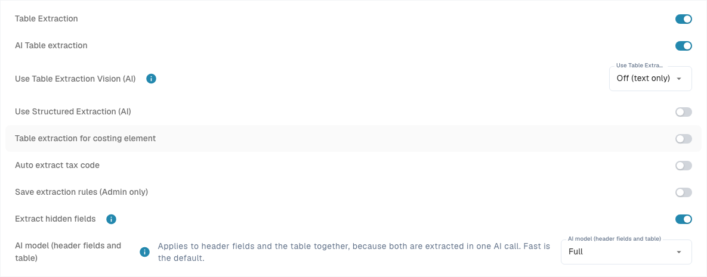
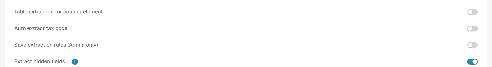

# Settings and overrides

[AI Table](README.md) · [Structured Output for Tables](structured-output.md)

## Settings for admins

Open **Settings → Document Processing → Document Types → Classification and Extraction**, tab **General**, section **Extraction**.

<figure><figcaption>
Current Extraction controls. Structured Output is off in this existing configuration, so no schema preview is shown. No extraction setting was changed.
</figcaption></figure>

* **Table Extraction** switches the classic table on.
* **AI Table extraction** switches the AI table on or off for the organization.
* **Use Structured Extraction (AI)**: The switch sets the organization's structured-output default. The requested columns depend on the three-state Use AI selection; template overrides and supplier training also matter. Read the complete configuration, preview and example guide. [Structured Output for Tables](structured-output.md).
* **Save extraction rules (Admin only)**: when on, only organization admins can save and export extraction rules.

<figure><figcaption>
<strong>Save extraction rules (Admin only)</strong> controls who can use <strong>Save as training</strong>.
</figcaption></figure>

### Use AI per column

Three-state AI selection: Default inherits the document-type AI default, Yes explicitly requests the column, and No excludes it from the base schema. This is separate from Required, Read Only and Hidden. [Structured Output for Tables](structured-output.md).

Structured Output has a separate organization/template setting from the model tier. Change it in More options on the document; confirmation saves the override and restarts that document. The indicators in the settings list are read-only. Deleting a preference entry can remove several overrides at once. [Structured Output for Tables](structured-output.md).
