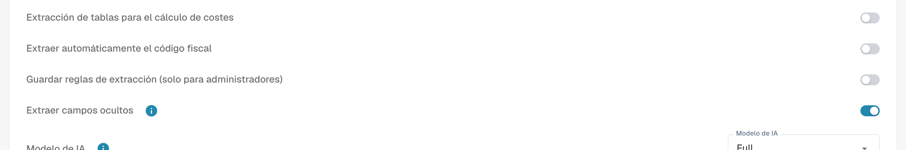

# Ajustes y configuraciones específicas

[AI Table](README.md) · [Structured Output para tablas](structured-output.md)

## Ajustes para administradores

Abre **Ajustes → Procesamiento de documentos → Tipos de documento → Clasificación y extracción**, pestaña **General**, sección **Extracción**.

<figure><figcaption>
Controles actuales de extracción. Structured Output está desactivado en esta configuración existente y por eso no aparece la vista previa. No se cambió ningún ajuste de extracción.
</figcaption></figure>

* **Extracción de tabla** activa la tabla clásica.
* **Extracción de tabla de IA** activa o desactiva la tabla AI para la organización.
* **Utilizar extracción estructurada (IA)**: El interruptor establece el valor de organización para la salida estructurada. Las columnas solicitadas dependen de Predeterminado/Sí/No en Use AI, de la plantilla y del entrenamiento del proveedor. La guía completa explica configuración, vista previa y ejemplo. [Structured Output para tablas](structured-output.md).
* **Guardar reglas de extracción (solo para administradores)**: cuando está activado, solo los administradores de la organización pueden guardar y exportar reglas de extracción.

<figure><figcaption>
<strong>Guardar reglas de extracción (solo para administradores)</strong> controla quién puede usar <strong>Guardar como entrenamiento</strong>.
</figcaption></figure>

### Utilizar IA por columna

Selección de tres estados: Predeterminado hereda la selección de IA del tipo de documento, Sí solicita expresamente la columna y No la excluye del esquema base. Es independiente de Obligatoria, Solo lectura y Oculta. [Structured Output para tablas](structured-output.md).

Structured Output tiene su propio ajuste de organización y plantilla, independiente del nivel de modelo. Cámbielo en Más opciones del documento; confirmar guarda el valor y reinicia ese documento. Los indicadores de la lista son de solo lectura. Eliminar una entrada puede borrar varios valores específicos a la vez. [Structured Output para tablas](structured-output.md).
