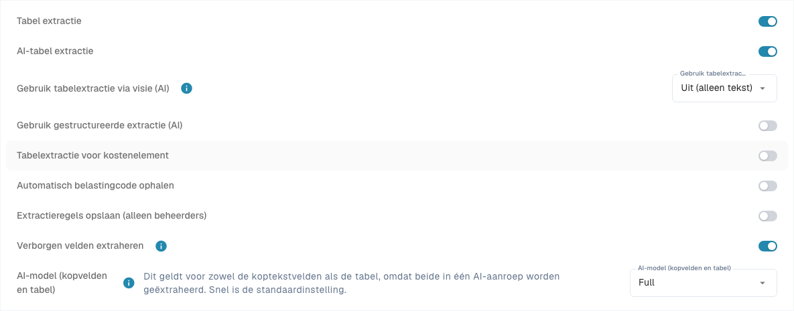
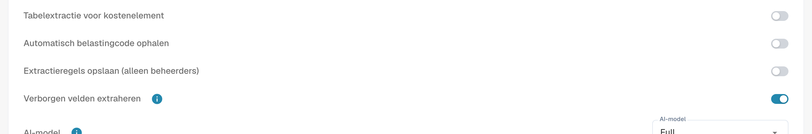

# Instellingen en sjabloonafwijkingen

[AI Table](README.md) · [Structured Output voor tabellen](structured-output.md)

## Instellingen voor beheerders

Open **Instellingen → Documentverwerking → Documenttypen → Classificatie en extractie**, tabblad **Algemeen**, sectie **Extractie**.

<figure><figcaption>
Huidige extractie-instellingen. Structured Output staat uit in deze bestaande configuratie; daarom wordt geen schemavoorbeeld getoond. Er is geen extractie-instelling gewijzigd.
</figcaption></figure>

* **Tabel extractie** schakelt de klassieke tabel in.
* **AI-tabel extractie** schakelt de AI-tabel voor de organisatie in of uit.
* **Gebruik gestructureerde extractie (AI)**: De schakelaar bepaalt de organisatiestandaard voor gestructureerde uitvoer. Gevraagde kolommen hangen af van Standaard/Ja/Nee onder Use AI, sjabloonafwijkingen en leverancierstraining. De volledige handleiding behandelt instellingen, voorbeeldweergave en praktijkvoorbeeld. [Structured Output voor tabellen](structured-output.md).
* **Extractieregels opslaan (alleen beheerders)**: indien ingeschakeld kunnen alleen organisatiebeheerders extractieregels opslaan en exporteren.

<figure><figcaption>
<strong>Extractieregels opslaan (alleen beheerders)</strong> bepaalt wie <strong>Opslaan als training</strong> kan gebruiken.
</figcaption></figure>

### AI gebruiken per kolom

Keuze met drie toestanden: Standaard neemt de AI-selectie van het documenttype over, Ja vraagt de kolom uitdrukkelijk en Nee sluit haar uit het basisschema uit. Dit staat los van Verplicht, Alleen-lezen en Verborgen. [Structured Output voor tabellen](structured-output.md).

Structured Output heeft een eigen organisatie-/sjablooninstelling, los van het AI-modelniveau. Wijzig die via Meer opties bij het document; bevestigen slaat de afwijking op en herstart dat document. De indicatoren in de lijst zijn alleen-lezen. Een vermelding verwijderen kan meerdere afwijkingen tegelijk wissen. [Structured Output voor tabellen](structured-output.md).
