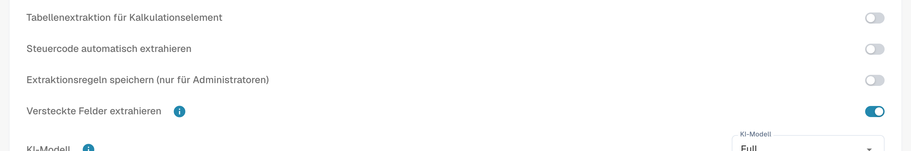

# Einstellungen und Überschreibungen

[AI Table](README.md) · [Structured Output für Tabellen](structured-output.md)

## Einstellungen für Administratoren

Öffnen Sie **Einstellungen → Dokumentenverarbeitung → Dokumenttypen → Klassifizierung und Extraktion**, Tab **Allgemein**, Abschnitt **Extraktion**.

<figure><figcaption>
Aktuelle Extraktionsschalter. Structured Output ist in dieser vorhandenen Konfiguration ausgeschaltet, deshalb wird keine Schema-Vorschau angezeigt. Keine Extraktionseinstellung wurde geändert.
</figcaption></figure>

* **Tabelle Extraktion** schaltet die klassische Tabelle ein.
* **AI-Tabellen-Extraktion** schaltet die KI-Tabelle für die Organisation ein oder aus.
* **Strukturierte Extraktion nutzen (KI)**: Der Schalter setzt den Organisationsstandard für strukturierte Ausgabe. Welche Spalten angefordert werden, hängt von Standard/Ja/Nein unter Use AI ab; auch Vorlagenüberschreibungen und Lieferantentraining wirken mit. Die vollständige Anleitung erklärt Konfiguration, Vorschau und Beispiel. [Structured Output für Tabellen](structured-output.md).
* **Extraktionsregeln speichern (nur für Administratoren)**: Ist sie eingeschaltet, können nur Organisationsadministratoren Extraktionsregeln speichern und exportieren.

<figure><figcaption>
<strong>Extraktionsregeln speichern (nur für Administratoren)</strong> steuert, wer <strong>Als Training speichern</strong> verwenden darf.
</figcaption></figure>

### KI pro Spalte nutzen

Dreistufige KI-Auswahl: Standard übernimmt die KI-Vorgabe des Dokumenttyps, Ja fordert die Spalte ausdrücklich an, Nein schließt sie aus dem Basisschema aus. Dies ist von Pflichtfeld, Schreibgeschützt und Ausgeblendet getrennt. [Structured Output für Tabellen](structured-output.md).

Structured Output hat eine eigene Organisations-/Vorlageneinstellung, getrennt von der Modellstufe. Ändern Sie sie unter Mehr Optionen am Dokument; die Bestätigung speichert die Überschreibung und startet dieses Dokument neu. Die Anzeigen in der Einstellungsliste sind schreibgeschützt. Eintrag löschen kann mehrere Überschreibungen zugleich entfernen. [Structured Output für Tabellen](structured-output.md).
