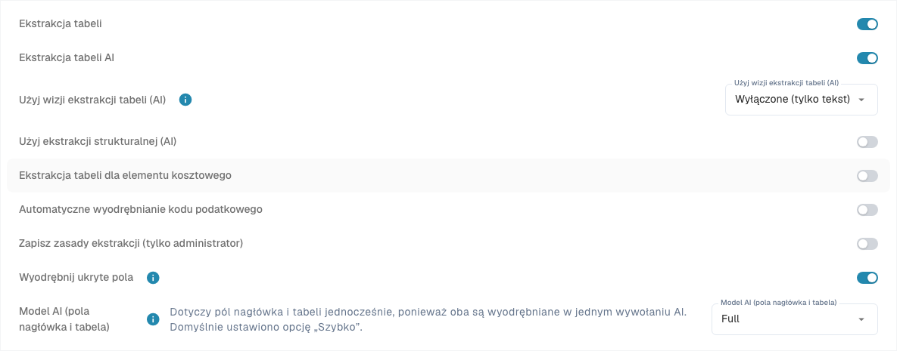
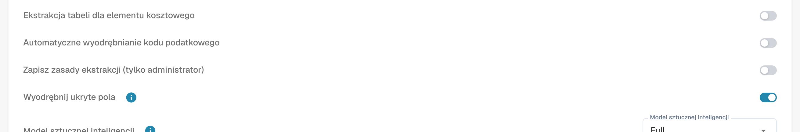

# Ustawienia i nadpisania

[AI Table](README.md) · [Structured Output dla tabel](structured-output.md)

## Ustawienia dla administratorów

Otwórz **Ustawienia → Przetwarzanie dokumentów → Typy dokumentów → Klasyfikacja i ekstrakcja**, zakładka **Ogólny**, sekcja **Ekstrakcja**.

<figure><figcaption>
Aktualne ustawienia ekstrakcji. Structured Output jest wyłączony w tej istniejącej konfiguracji, dlatego podgląd schematu nie jest widoczny. Nie zmieniono ustawień ekstrakcji.
</figcaption></figure>

* **Ekstrakcja tabeli** włącza klasyczną tabelę.
* **Ekstrakcja tabeli AI** włącza lub wyłącza tabelę AI dla organizacji.
* **Użyj ekstrakcji strukturalnej (AI)**: Przełącznik określa ustawienie organizacji dla wyniku strukturalnego. Żądane kolumny zależą od Domyślne/Tak/Nie w Use AI, nadpisań szablonu i treningu dostawcy. Pełna instrukcja opisuje konfigurację, podgląd i przykład. [Structured Output dla tabel](structured-output.md).
* **Zapisz zasady ekstrakcji (tylko administrator)**: po włączeniu tylko administratorzy organizacji mogą zapisywać i eksportować reguły ekstrakcji.

<figure><figcaption>
<strong>Zapisz zasady ekstrakcji (tylko administrator)</strong> decyduje, kto może używać <strong>Zapisz jako szkolenie</strong>.
</figcaption></figure>

### Użyj AI dla pojedynczych kolumn

Wybór trzech stanów: Domyślne przejmuje wybór AI typu dokumentu, Tak jawnie żąda kolumny, a Nie wyklucza ją ze schematu bazowego. To niezależne od Wymagana, Tylko do odczytu i Ukryta. [Structured Output dla tabel](structured-output.md).

Structured Output ma oddzielne ustawienie organizacji/szablonu, niezależne od poziomu modelu AI. Zmień je w Więcej opcji dokumentu; potwierdzenie zapisuje nadpisanie i uruchamia ten dokument ponownie. Wskaźniki na liście są tylko do odczytu. Usunięcie wpisu może usunąć kilka nadpisań jednocześnie. [Structured Output dla tabel](structured-output.md).
