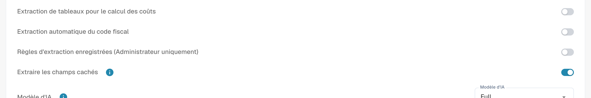

# Paramètres et dérogations

[AI Table](README.md) · [Structured Output pour les tableaux](structured-output.md)

## Paramètres pour les administrateurs

Ouvrez **Paramètres → Traitement des documents → Types de documents → Classification et extraction**, onglet **Général**, section **Extraction**.

<figure><figcaption>
Commandes actuelles d&#x27;extraction. Structured Output est désactivé dans cette configuration existante ; aucun aperçu de schéma n&#x27;est donc affiché. Aucun paramètre d&#x27;extraction n&#x27;a été modifié.
</figcaption></figure>

* **Extraction de table** active le tableau classique.
* **Extraction de table AI** active ou désactive le tableau AI pour l'organisation.
* **Utiliser l'extraction structurée (IA)**: Le commutateur définit la valeur d'organisation de la sortie structurée. Les colonnes demandées dépendent de Par défaut/Oui/Non dans Use AI, des dérogations et de l'apprentissage fournisseur. Le guide complet explique configuration, aperçu et exemple. [Structured Output pour les tableaux](structured-output.md).
* **Règles d'extraction enregistrées (Administrateur uniquement)** : lorsque l'option est activée, seuls les administrateurs de l'organisation peuvent enregistrer et exporter les règles d'extraction.

<figure><figcaption>
<strong>Règles d'extraction enregistrées (Administrateur uniquement)</strong> détermine qui peut utiliser <strong>Enregistrer comme formation</strong>.
</figcaption></figure>

### Utiliser l'IA par colonne

Sélection à trois états : Par défaut reprend la sélection IA du type de document, Oui demande explicitement la colonne et Non l'exclut du schéma de base. Ce choix est distinct de Obligatoire, Lecture seule et Masqué. [Structured Output pour les tableaux](structured-output.md).

Structured Output possède un réglage organisation/modèle d'extraction distinct du niveau d'IA. Modifiez-le dans Plus d'options du document ; confirmer enregistre la dérogation et redémarre ce document. Les indicateurs de la liste sont en lecture seule. Supprimer une entrée peut retirer plusieurs dérogations ensemble. [Structured Output pour les tableaux](structured-output.md).
