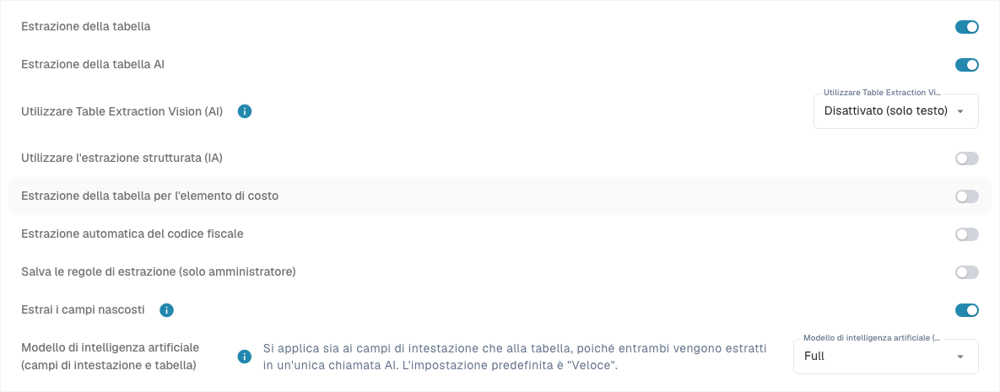
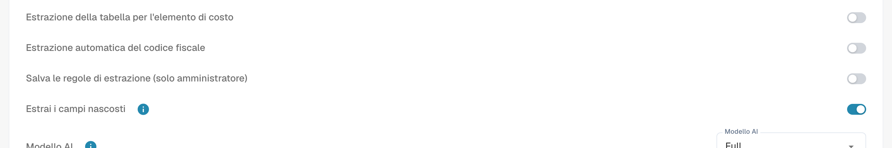

# Impostazioni e override

[AI Table](README.md) · [Structured Output per le tabelle](structured-output.md)

## Impostazioni per gli amministratori

Apri **Settings → Document Processing → Document Types → Classification and Extraction**, scheda **General**, sezione **Extraction**.

<figure><figcaption>
Controlli di estrazione attuali. Structured Output è disattivato in questa configurazione esistente, quindi non viene mostrata alcuna anteprima dello schema. Nessuna impostazione di estrazione è stata modificata.
</figcaption></figure>

* **Table Extraction** attiva la tabella classica.
* **AI Table extraction** attiva o disattiva la tabella AI per l'organizzazione.
* **Use Structured Extraction (AI)**: l'interruttore imposta il valore predefinito di output strutturato dell'organizzazione. Le colonne richieste dipendono dalla selezione Use AI a tre stati; contano anche gli override del modello e l'addestramento del fornitore. Leggi la configurazione completa, l'anteprima e la guida con esempi. [Structured Output per le tabelle](structured-output.md).
* **Save extraction rules (Admin only)**: se attivo, solo gli amministratori dell'organizzazione possono salvare ed esportare le regole di estrazione.

<figure><figcaption>
<strong>Save extraction rules (Admin only)</strong> determina chi può usare <strong>Save as training</strong>.
</figcaption></figure>

### Use AI per colonna

Selezione AI a tre stati: Default eredita il valore predefinito AI del tipo di documento, Yes richiede esplicitamente la colonna e No la esclude dallo schema di base. È distinto da Required, Read Only e Hidden. [Structured Output per le tabelle](structured-output.md).

Structured Output ha un'impostazione di organizzazione/modello separata dal livello di modello. Modificala in More options sul documento; la conferma salva l'override e riavvia quel documento. Gli indicatori nell'elenco delle impostazioni sono di sola lettura. Eliminare una voce di preferenza può rimuovere più override insieme. [Structured Output per le tabelle](structured-output.md).
