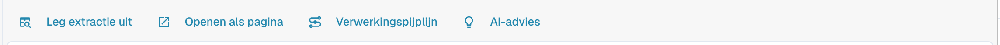
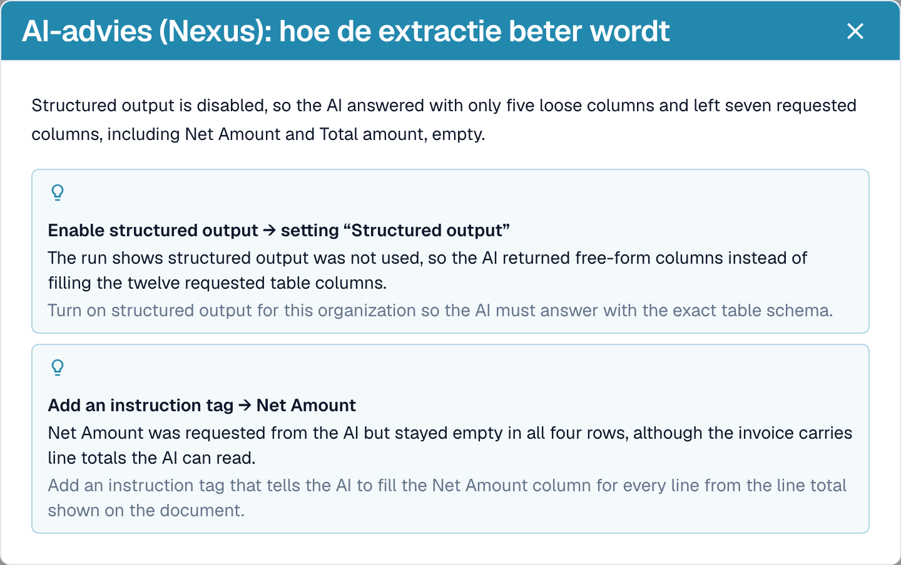

# Extractie uitleggen en problemen onderzoeken

[AI Table](README.md) · [Structured Output voor tabellen](structured-output.md)

## Zien wat de AI heeft gedaan

Vier knoppen onder de tabel verklaren de extractie.

<figure><figcaption>
De uitlegknoppen.
</figcaption></figure>

* **Leg extractie uit** opent *Hoe de AI-tabel tot zijn waarden is gekomen*: het document, de AI-extractie (tier, aantal onbewerkte kolommen en rijen), de afbeelding op uw structuur en het resultaat per kolom met de oorsprong van elke kolom.
* **Openen als pagina** toont dezelfde uitleg in een eigen venster.
* **Verwerkingspijplijn** toont de verwerkingsstappen van het document en waar het is gestopt.
* **AI-advies** vraagt Nexus hoe de extractie beter kan en toont concrete aanbevelingen, bijvoorbeeld *Enable structured output* of *Add an instruction tag → Net Amount*. Het is alleen advies; u beslist.

<figure><figcaption>
Leg extractie uit: vier stappen van document tot resultaat.
</figcaption></figure>

<figure><figcaption>
AI-advies stelt de volgende stappen voor.
</figcaption></figure>

<figure><figcaption>
De verwerkingspijplijn toont waar een document is gestopt, hier bij de veldvalidatie.
</figcaption></figure>

Deze uitleg hoort bij de module **Analytics Dashboard**. Zonder modulelicentie, of wanneer uw rol geen toegang heeft tot het tabblad Analytics, vertelt DocBits wat u aan uw beheerder moet vragen (activeer de module onder Instellingen → Modules, of geef uw rol toegang tot het tabblad onder Instellingen → Rollen).

## Praktische voorbeelden

| Situatie | Wat te doen |
| --- | --- |
| Een waarde staat in de verkeerde kolom, bijvoorbeeld *Eenheidsprijs* staat in *Nettobedrag* | Klik op de kolomnaam en koppel de kolom aan de juiste kolom. Kies daarna **Opslaan als training** als de leverancier het altijd zo afdrukt. |
| Een kolom blijft in elke rij leeg, bijvoorbeeld *Kortingsbedrag* | Voeg de kolom toe onder **Extra kolommen voor de AI**, of schrijf een instructie met de bewoordingen van de factuur, zoals *Vul de kolom Kortingsbedrag met de waarden uit de kolom "Rabatt" op de factuur.* Controleer met **Test wijziging** en kies daarna **Toepassen**. |
| De AI weet niet wat te doen (niets in de prompt) | Klik op **Voorstellen met Nexus** en voeg in wat past. |
| Een prijs moet worden gedeeld of afgerond | Schrijf de regel in de prompt, bijvoorbeeld *De eenheidsprijs is het nettobedrag gedeeld door de hoeveelheid*. |
| Bedragen worden met de verkeerde scheidingstekens gelezen (1.234,50 versus 1,234.50) | Open het menu met drie puntjes van de kolom, kies **Bedrag opmaak** en selecteer de juiste notatie. |
| Het label staat onder de waarde | Menu met drie puntjes → **Extract From** → **Below**. |
| Een kolom is niet nodig voor deze leverancier | Menu met drie puntjes → **Kolom verwijderen**. **Opslaan als training** houdt de kolom voor de leverancier verborgen. |
| Een rij is fout of ontbreekt | Verwijder de rij met het **x**, of voeg er een toe met **Nieuwe tabelrij toevoegen** en typ de waarden. |
| Dezelfde correcties zijn steeds opnieuw nodig | Gebruik **Opslaan als training**, zodat de volgende documenten van deze leverancier goed uitkomen. Voor complexe indelingen [traint u in plaats daarvan de tabel](../../../administration-and-setup/setup/document-training/training-line-fields-table-training/README.md). |


Niet elke omgebroken omschrijvingsregel kan met een instructie worden hersteld. Als regels van één artikel over meerdere rijen zijn verdeeld, bewerk dan de rijen of gebruik de klassieke tabeltraining.

