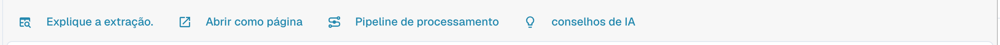
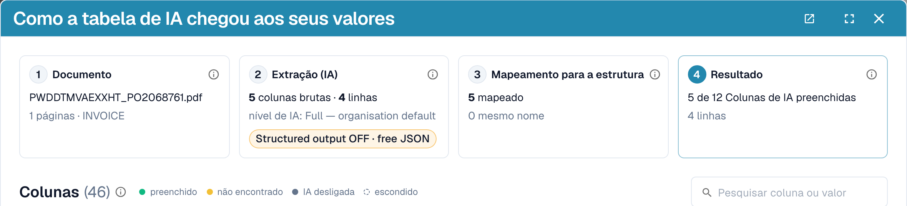
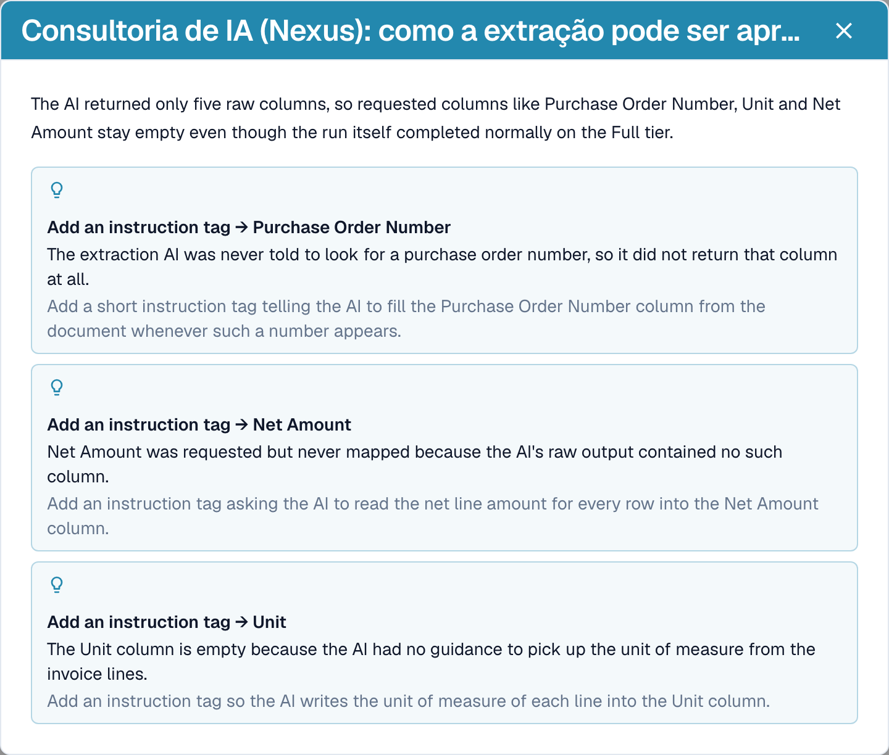
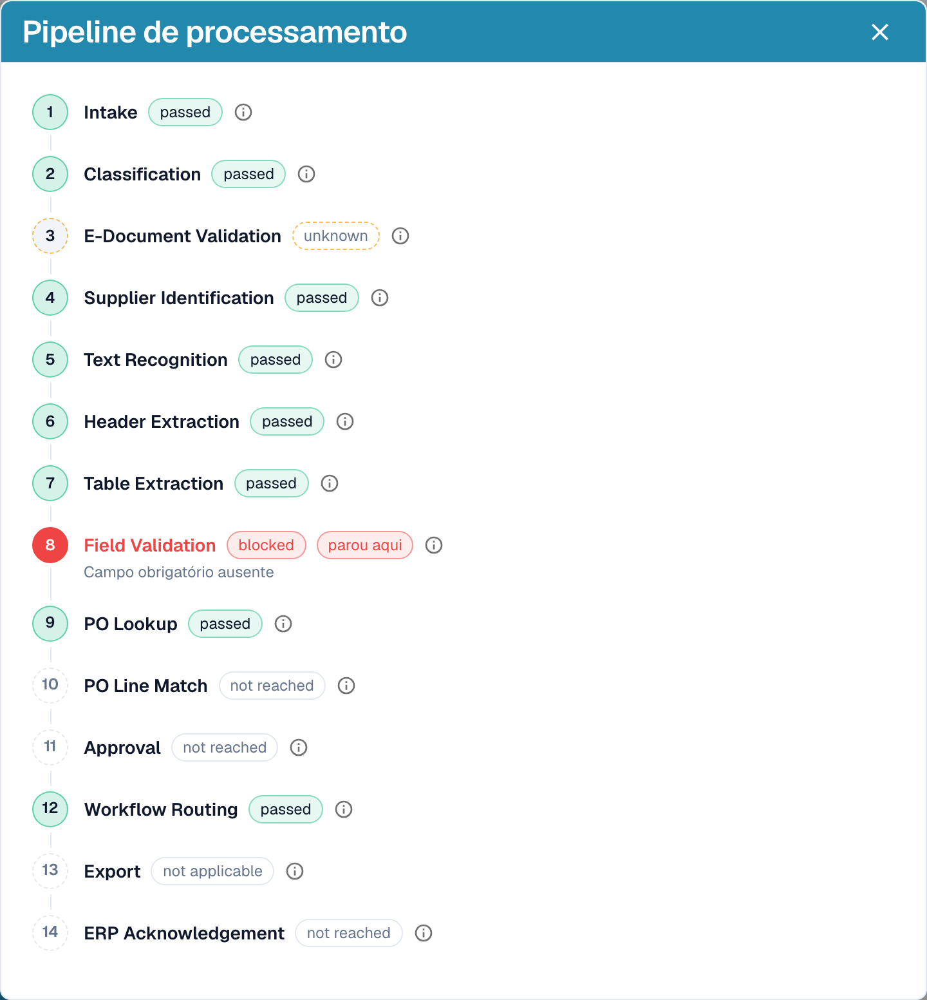

# Explicar a extração e diagnosticar

[AI Table](README.md) · [Structured Output para tabelas](structured-output.md)

## Ver o que a IA fez

Quatro botões abaixo da tabela explicam a extração.

<figure><figcaption>
Os botões de explicação.
</figcaption></figure>

* **Explique a extração.** abre *Como a tabela de IA chegou aos seus valores*: o documento, a extração por IA (nível, número de colunas e linhas brutas), o mapeamento para a sua estrutura e o resultado por coluna, com a origem de cada coluna.
* **Abrir como página** mostra a mesma explicação em uma janela própria.
* **Pipeline de processamento** lista as etapas de processamento do documento e onde ele parou.
* **conselhos de IA** pergunta ao Nexus como a extração pode melhorar e lista recomendações concretas, por exemplo *Enable structured output* ou *Add an instruction tag → Net Amount*. É apenas um conselho; a decisão é sua.

<figure><figcaption>
Explique a extração.: quatro etapas, do documento ao resultado.
</figcaption></figure>

<figure><figcaption>
Os conselhos de IA propõem os próximos passos.
</figcaption></figure>

<figure><figcaption>
O pipeline de processamento mostra onde um documento parou, aqui na etapa Field Validation.
</figcaption></figure>

Essas explicações pertencem ao módulo **Painel de Análise**. Sem a licença do módulo, ou quando a sua função não tem acesso à aba Análise, o DocBits informa o que pedir ao seu administrador (ativar o módulo em Configurações → Módulos ou conceder a aba à sua função em Configurações → Funções).

## Exemplos práticos

| Situação | O que fazer |
| --- | --- |
| Um valor está na coluna errada, por exemplo, *Preço unitário* está em *Valor líquido* | Clique no nome da coluna e mapeie-a para a coluna certa. Depois use **Salvar como treinamento** se o fornecedor sempre imprime assim. |
| Uma coluna fica vazia em todas as linhas, por exemplo, *Valor do desconto* | Adicione a coluna em **Colunas adicionais para a IA** ou escreva uma instrução com o termo usado na fatura, como *Preencha a coluna Valor do desconto com a coluna chamada "Rabatt" da fatura.* Verifique com **Alteração de teste** e depois use **Aplicar**. |
| A IA não sabe o que fazer (nada no prompt) | Clique em **Sugerir com o Nexus** e insira o que fizer sentido. |
| Um preço deve ser dividido ou arredondado | Escreva a regra no prompt, por exemplo, *O preço unitário é o valor líquido dividido pela quantidade.* |
| Os valores são lidos com separadores errados (1.234,50 versus 1,234.50) | Abra o menu de três pontos da coluna, escolha **Formatação de Quantidade** e selecione o formato certo. |
| O rótulo fica abaixo do valor | Menu de três pontos → **Extract From** → **Abaixo**. |
| Uma coluna não é necessária para este fornecedor | Menu de três pontos → **Excluir coluna**. **Salvar como treinamento** a mantém oculta para o fornecedor. |
| Uma linha está errada ou faltando | Remova-a com o **x** ou adicione uma com **Adicionar nova linha de tabela** e digite os valores. |
| As mesmas correções são necessárias o tempo todo | Use **Salvar como treinamento** para que os próximos documentos deste fornecedor saiam corretos. Para layouts complexos, [treine a tabela](../../../administration-and-setup/setup/document-training/training-line-fields-table-training/README.md). |


Nem toda linha de descrição quebrada pode ser corrigida com uma instrução. Se as linhas de um item forem divididas em várias linhas da tabela, edite as linhas ou use o treinamento clássico de tabela.

