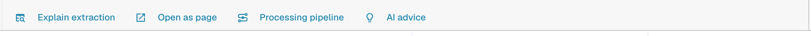
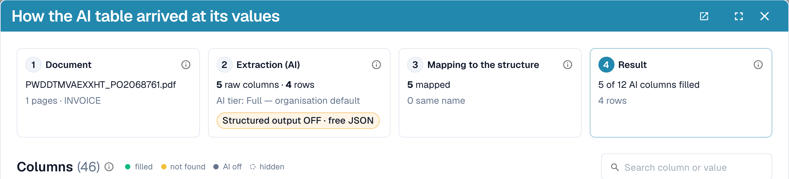
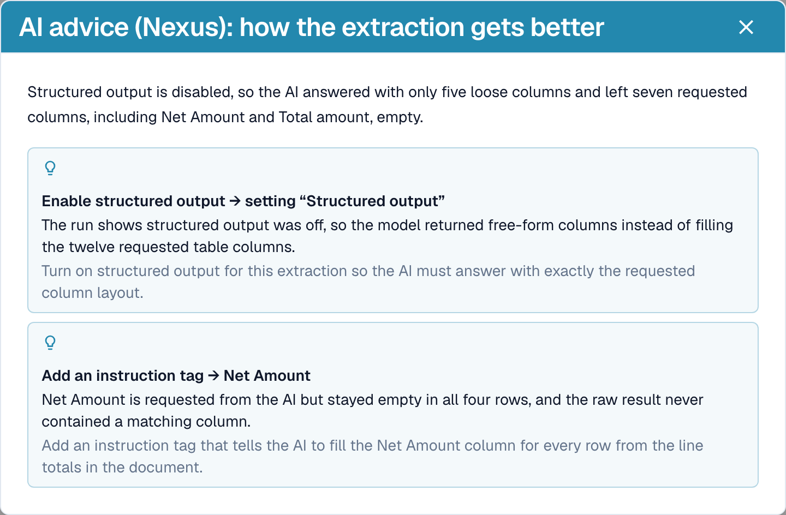
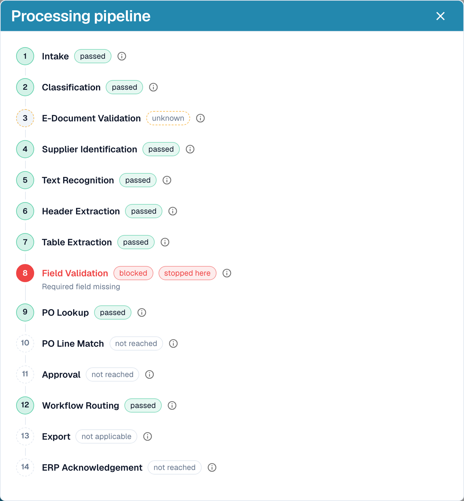

# 提取说明与问题诊断

[AI Table](README.md) · [表格的 Structured Output](structured-output.md)

## 查看 AI 的处理结果

表格下方的四个按钮用于说明提取结果。

<figure><figcaption>
说明按钮。
</figcaption></figure>

* **Explain extraction** 会打开 _How the AI table arrived at its values_，其中包含文档、AI 提取信息（层级、原始列数和行数）、与当前结构的映射，以及各列的结果和来源。
* **Open as page** 会在单独的窗口中显示相同的说明。
* **Processing pipeline** 会列出文档的处理步骤，以及处理在哪一步停止。
* **AI advice** 会询问 Nexus 如何改进提取结果，并列出具体建议，例如 _Enable structured output_ 或 _Add an instruction tag for Net Amount_。这些只是建议，由你决定是否采纳。

<figure><figcaption>
Explain extraction：从文档到结果的四个步骤。
</figcaption></figure>

<figure><figcaption>
AI advice 会提出后续步骤建议。
</figcaption></figure>

<figure><figcaption>
Processing pipeline 会显示文档在哪一步停止；此处显示文档停在字段验证阶段。
</figcaption></figure>

这些说明属于 **Analytics Dashboard** 模块。如果没有该模块的许可证，或者你的角色无权访问 Analytics 选项卡，DocBits 会告知你需要向管理员提出什么请求（在设置 → 模块中启用该模块，或在设置 → 角色中为你的角色授予该选项卡的访问权限）。

## 实际示例

| 情况 | 处理方法 |
| ----------------------------------------------------------------------------- | ----------------------------------------------------------------------------------------------------------------------------------------------------------------------------------- |
| 值位于错误的列中，例如 _Unit price_ 出现在 _Net amount_ 中 | 点击列名称并将其映射到正确的列。如果该供应商的发票总是采用这种格式，请点击 **Save as training**。 |
| 每一行的某列都为空，例如 _Discount_ | 在 **Extra columns for the AI** 中添加该列，或者根据发票上的用词编写指令，例如 _Fill the Discount Amount column from the column called "Rabatt" on the invoice._ 使用 **Test change** 检查，然后点击 **Apply**。 |
| AI 不知道该怎么做（提示中没有任何内容） | 点击 **Suggest with Nexus**，然后插入合适的建议。 |
| 价格需要进行除法计算或舍入 | 在提示中写入规则，例如 _The unit price is the net amount divided by the quantity_。 |
| 金额使用了错误的分隔符（1.234,50 与 1,234.50） | 打开该列的三点菜单，选择 **Amount Formatting**，然后选择正确的格式。 |
| 标签位于值的下方 | 三点菜单 → **Extract From** → **Below**。 |
| 该供应商不需要某列 | 三点菜单 → **Delete column**。点击 **Save as training** 可将该列保持隐藏状态，供该供应商后续使用。 |
| 某一行错误或缺失 | 使用 **x** 删除该行，或使用 **Add new table row** 添加一行并输入值。 |
| 需要反复进行相同的修正 | 使用 **Save as training**，让该供应商的后续文档正确读取。对于复杂版式，请改为[训练表格](../../../administration-and-setup/setup/document-training/training-line-fields-table-training/)。 |


并非每种换行的描述都能通过指令修复。如果同一项目的多行内容被拆分到多个行中，请编辑这些行，或使用传统表格训练。

