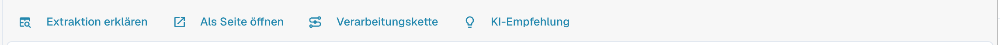
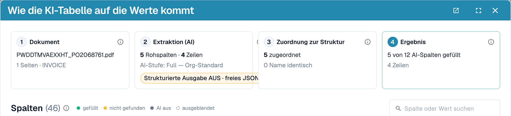
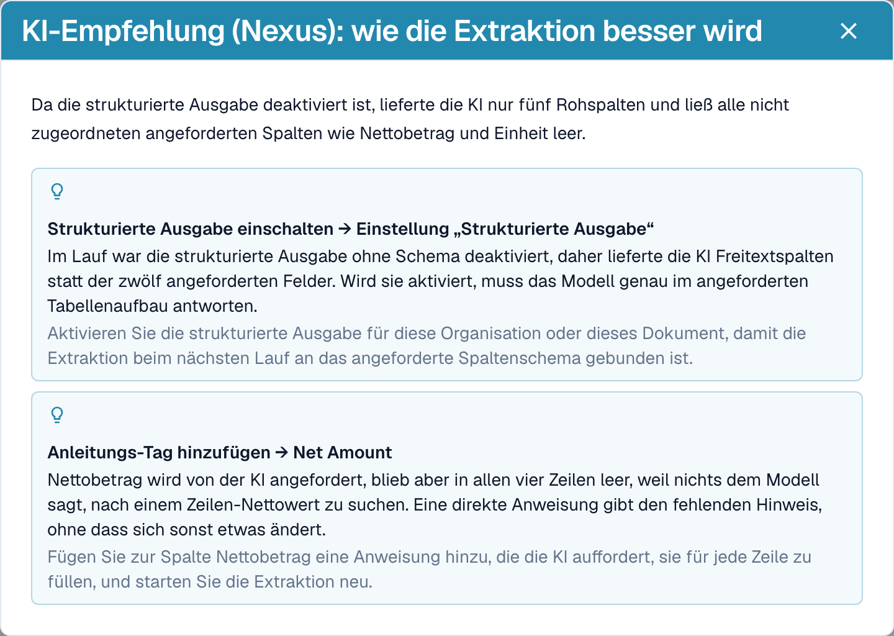
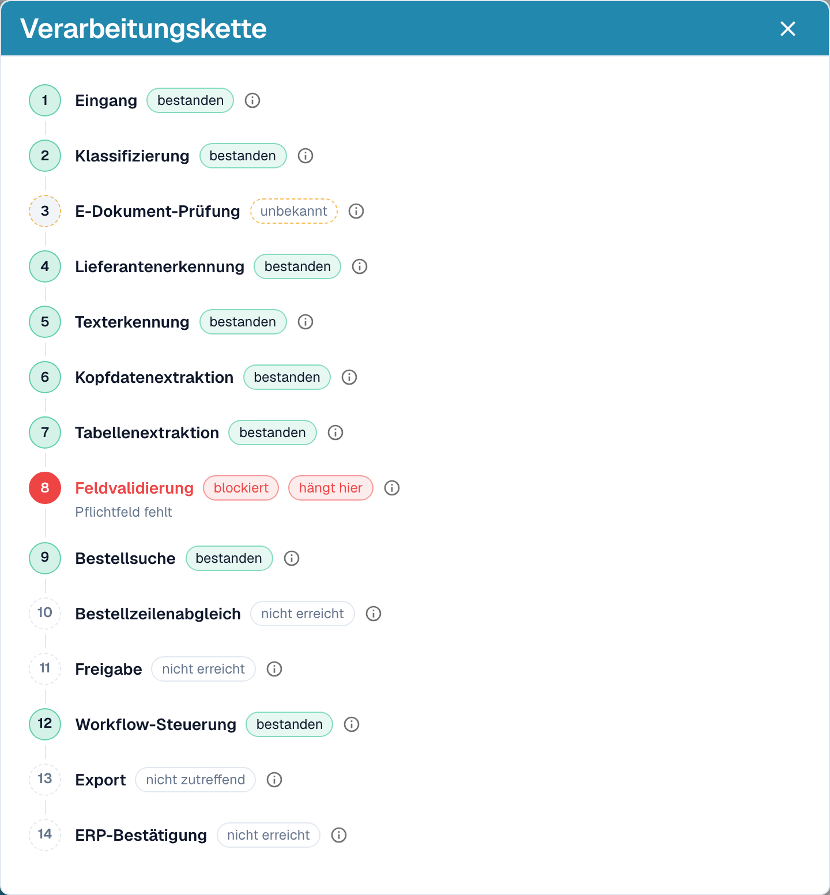

# Extraktion erklären und Fehler eingrenzen

[AI Table](README.md) · [Structured Output für Tabellen](structured-output.md)

## Sehen, was die KI getan hat

Vier Schaltflächen unter der Tabelle erklären die Extraktion.

<figure><figcaption>
Die Erklär-Schaltflächen.
</figcaption></figure>

* **Extraktion erklären** öffnet *Wie die KI-Tabelle auf die Werte kommt*: das Dokument, die KI-Extraktion (Stufe, Anzahl der Rohspalten und Zeilen), die Zuordnung zu Ihrer Struktur und das Ergebnis pro Spalte mit der Herkunft jeder Spalte.
* **Als Seite öffnen** zeigt dieselbe Erklärung in einem eigenen Fenster.
* **Verarbeitungskette** listet die Verarbeitungsschritte des Dokuments auf und zeigt, wo es stehen geblieben ist.
* **KI-Empfehlung** fragt Nexus, wie die Extraktion besser werden kann, und listet konkrete Empfehlungen auf, zum Beispiel *Strukturierte Ausgabe einschalten* oder *Anleitungs-Tag hinzufügen* für Net Amount. Es ist nur ein Rat; Sie entscheiden.

<figure><figcaption>
Extraktion erklären: vier Schritte vom Dokument zum Ergebnis.
</figcaption></figure>

<figure><figcaption>
Die KI-Empfehlung schlägt die nächsten Schritte vor.
</figcaption></figure>

<figure><figcaption>
Die Verarbeitungskette zeigt, wo ein Dokument stehen geblieben ist, hier bei der Feldvalidierung.
</figcaption></figure>

Diese Erklärungen gehören zum Modul „Analytics Dashboard“. Ohne die Modullizenz oder wenn Ihre Rolle keinen Zugriff auf den Tab Analytics hat, sagt DocBits Ihnen, was Sie bei Ihrem Administrator anfragen müssen (das Modul unter Einstellungen → Module aktivieren oder den Tab für Ihre Rolle unter Einstellungen → Rollen freigeben).

## Praktische Beispiele

| Situation | Was zu tun ist |
| --- | --- |
| Ein Wert steht in der falschen Spalte, zum Beispiel steht *Einzelpreis* in *Nettobetrag* | Klicken Sie auf den Spaltennamen und ordnen Sie ihn der richtigen Spalte zu. Wählen Sie dann **Als Training speichern**, wenn der Lieferant es immer so druckt. |
| Eine Spalte bleibt in jeder Zeile leer, zum Beispiel *Rabatt Betrag* | Fügen Sie die Spalte unter **Zusätzliche Spalten für die KI** hinzu oder schreiben Sie eine Anweisung mit der Bezeichnung, die die Rechnung verwendet, etwa *Fülle die Spalte Rabatt Betrag aus der Spalte „Preisnachlass“ der Rechnung.* Prüfen Sie mit **Änderung testen** und wählen Sie dann **Anwenden**. |
| Die KI weiß nicht, was sie tun soll (nichts im Prompt) | Klicken Sie auf **Mit Nexus vorschlagen** und fügen Sie ein, was passt. |
| Ein Preis muss dividiert oder gerundet werden | Schreiben Sie die Regel in den Prompt, zum Beispiel *Der Einzelpreis ist der Nettobetrag geteilt durch die Menge.* |
| Beträge werden mit den falschen Trennzeichen gelesen (1.234,50 gegenüber 1,234.50) | Öffnen Sie das Drei-Punkte-Menü der Spalte, wählen Sie **Betragsformatierung** und wählen Sie das richtige Format. |
| Die Bezeichnung steht unter dem Wert | Drei-Punkte-Menü → **Extract From** → **Below**. |
| Eine Spalte wird für diesen Lieferanten nicht gebraucht | Drei-Punkte-Menü → **Spalte löschen**. **Als Training speichern** hält sie für den Lieferanten ausgeblendet. |
| Eine Zeile ist falsch oder fehlt | Entfernen Sie sie mit dem **x** oder fügen Sie mit **Neue Tabellenzeile hinzufügen** eine hinzu und tragen Sie die Werte ein. |
| Dieselben Korrekturen sind immer wieder nötig | Verwenden Sie **Als Training speichern**, damit die nächsten Dokumente dieses Lieferanten richtig herauskommen. Bei komplexen Layouts [trainieren Sie stattdessen die Tabelle](../../../administration-and-setup/setup/document-training/training-line-fields-table-training/README.md). |


Nicht jede umbrochene Beschreibungszeile lässt sich mit einer Anweisung reparieren. Sind die Zeilen einer Position auf mehrere Zeilen verteilt, bearbeiten Sie die Zeilen oder verwenden Sie das klassische Tabellentraining.

