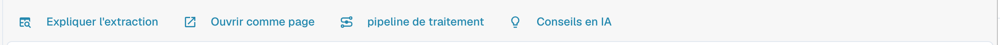
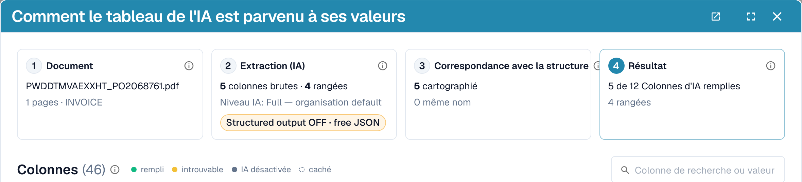
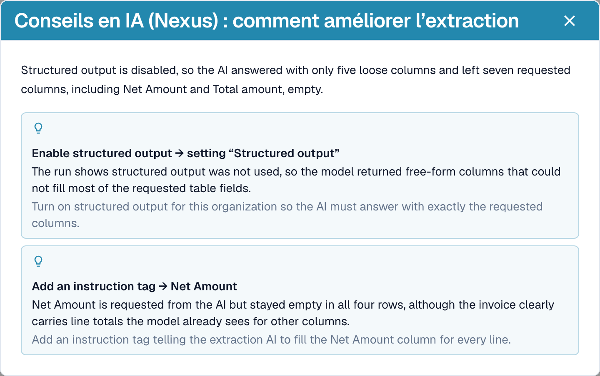
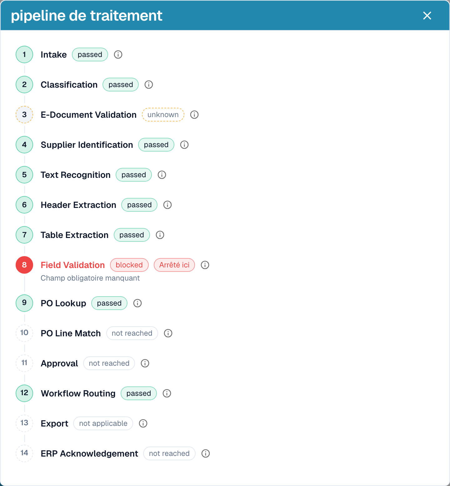

# Expliquer l'extraction et diagnostiquer

[AI Table](README.md) · [Structured Output pour les tableaux](structured-output.md)

## Voir ce que l'IA a fait

Quatre boutons sous le tableau expliquent l'extraction.

<figure><figcaption>
Les boutons d'explication.
</figcaption></figure>

* **Expliquer l'extraction** ouvre *Comment le tableau de l'IA est parvenu à ses valeurs* : le document, l'extraction par l'IA (niveau, nombre de colonnes et de lignes brutes), la correspondance avec votre structure et le résultat par colonne avec l'origine de chaque colonne.
* **Ouvrir comme page** affiche la même explication dans sa propre fenêtre.
* **pipeline de traitement** liste les étapes de traitement du document et l'endroit où il s'est arrêté.
* **Conseils en IA** demande à Nexus comment l'extraction peut s'améliorer et liste des recommandations concrètes, par exemple *Enable structured output* ou *Add an instruction tag*. Ce ne sont que des conseils ; c'est vous qui décidez.

<figure><figcaption>
Expliquer l'extraction : quatre étapes, du document au résultat.
</figcaption></figure>

<figure><figcaption>
Conseils en IA propose les prochaines étapes.
</figcaption></figure>

<figure><figcaption>
Le pipeline de traitement montre où un document s'est arrêté, ici à la validation des champs.
</figcaption></figure>

Ces explications relèvent du module **Tableau de bord analytique**. Sans licence pour le module, ou lorsque votre rôle n'a pas accès à l'onglet Analytics, DocBits vous indique ce que vous devez demander à votre administrateur (activer le module sous Paramètres → Modules, ou accorder l'onglet à votre rôle sous Paramètres → Rôles).

## Exemples pratiques

| Situation | Que faire |
| --- | --- |
| Une valeur se trouve dans la mauvaise colonne, par exemple *Prix Unitaire* se trouve dans *Montant net* | Cliquez sur le nom de la colonne et mappez-la sur la bonne colonne. Puis **Enregistrer comme formation** si le fournisseur l'imprime toujours ainsi. |
| Une colonne reste vide sur chaque ligne, par exemple *Remise* | Ajoutez la colonne sous **Colonnes supplémentaires pour l'IA**, ou écrivez une instruction avec le libellé utilisé par la facture, par exemple *Remplis la colonne Remise avec la colonne nommée « Rabatt » sur la facture.* Vérifiez avec **Test de changement**, puis **Appliquer**. |
| L'IA ne sait pas quoi faire (rien dans le prompt) | Cliquez sur **Suggérer avec Nexus** et insérez ce qui convient. |
| Un prix doit être divisé ou arrondi | Écrivez la règle dans le prompt, par exemple *Le prix unitaire est le montant net divisé par la quantité.* |
| Les montants sont lus avec de mauvais séparateurs (1.234,50 au lieu de 1,234.50) | Ouvrez le menu trois points de la colonne, choisissez **Formatage du montant** et sélectionnez le bon format. |
| Le libellé se trouve sous la valeur | Menu trois points → **Extrait de** → **Below**. |
| Une colonne n'est pas nécessaire pour ce fournisseur | Menu trois points → **Supprimer la colonne**. **Enregistrer comme formation** la garde masquée pour le fournisseur. |
| Une ligne est erronée ou manquante | Supprimez-la avec le **x**, ou ajoutez-en une avec **Ajouter une nouvelle ligne de tableau** et saisissez les valeurs. |
| Les mêmes corrections sont nécessaires encore et encore | Utilisez **Enregistrer comme formation** pour que les documents suivants de ce fournisseur soient corrects. Pour les mises en page complexes, [entraînez plutôt le tableau](../../../administration-and-setup/setup/document-training/training-line-fields-table-training/README.md). |


Toutes les lignes de description réparties sur plusieurs lignes ne peuvent pas être corrigées par une instruction. Si les lignes d'un même article sont réparties sur plusieurs lignes du tableau, modifiez les lignes ou utilisez l'entraînement de tableau classique.

