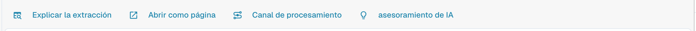
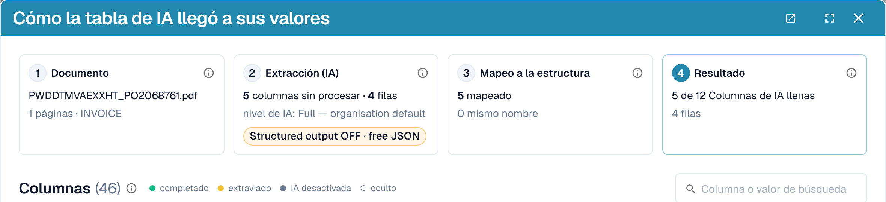
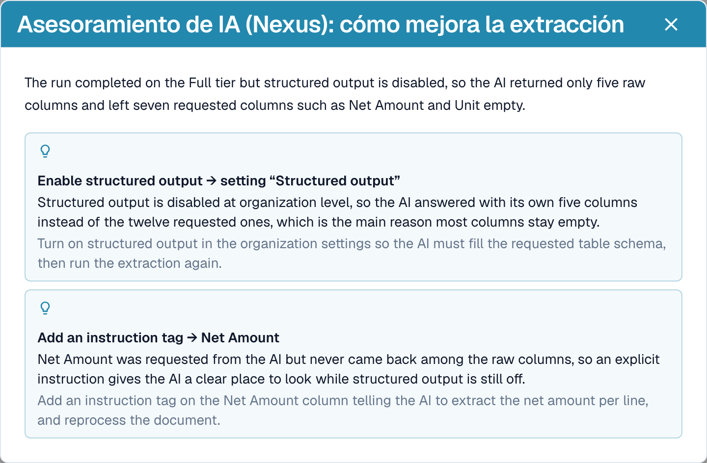
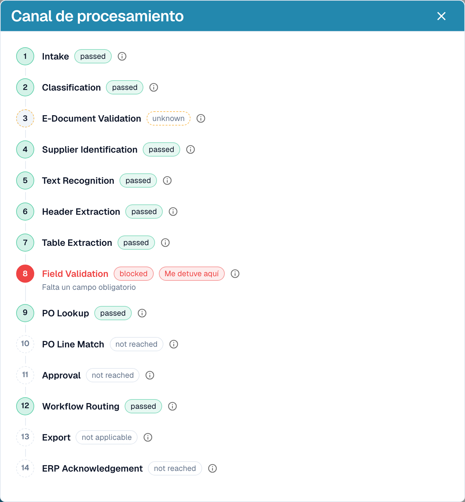

# Explicar la extracción y diagnosticar

[AI Table](README.md) · [Structured Output para tablas](structured-output.md)

## Ver lo que hizo la IA

Cuatro botones debajo de la tabla explican la extracción.

<figure><figcaption>
Los botones de explicación.
</figcaption></figure>

* **Explicar la extracción** abre *Cómo la tabla de IA llegó a sus valores*: el documento, la extracción de la IA (nivel, número de columnas sin procesar y de filas), el mapeo a tu estructura y el resultado por columna con el origen de cada columna.
* **Abrir como página** muestra la misma explicación en su propia ventana.
* **Canal de procesamiento** enumera los pasos de procesamiento del documento y dónde se detuvo.
* **asesoramiento de IA** pregunta a Nexus cómo se puede mejorar la extracción y enumera recomendaciones concretas, por ejemplo *Enable structured output* o *Add an instruction tag → Net Amount*. Es solo un consejo; la decisión es tuya.

<figure><figcaption>
Explicar la extracción: cuatro pasos, del documento al resultado.
</figcaption></figure>

<figure><figcaption>
El asesoramiento de IA propone los siguientes pasos.
</figcaption></figure>

<figure><figcaption>
El canal de procesamiento muestra dónde se detuvo un documento, aquí en Field Validation.
</figcaption></figure>

Estas explicaciones pertenecen al módulo **Panel de análisis**. Sin la licencia del módulo, o cuando tu rol no tiene acceso a la pestaña Analítica, DocBits te indica qué pedir a tu administrador (activar el módulo en Ajustes → Módulos o conceder la pestaña a tu rol en Ajustes → Roles).

## Ejemplos prácticos

| Situación | Qué hacer |
| --- | --- |
| Un valor está en la columna equivocada, por ejemplo *Precio Unitario* está en *Importe neto* | Haz clic en el nombre de la columna y asígnala a la columna correcta. Después, **Guardar como entrenamiento** si el proveedor siempre la imprime así. |
| Una columna queda vacía en todas las filas, por ejemplo *Descuento* | Añade la columna en **Columnas adicionales para la IA** o escribe una instrucción con el término que usa la factura, como *Rellena la columna Descuento con la columna llamada "Rabatt" de la factura*. Comprueba con **Cambio de prueba** y luego **Aplicar**. |
| La IA no sabe qué hacer (no hay nada en el prompt) | Haz clic en **Sugerir con Nexus** e inserta lo que encaje. |
| Un precio debe dividirse o redondearse | Escribe la regla en el prompt, por ejemplo *El precio unitario es el importe neto dividido por la cantidad*. |
| Los importes se leen con separadores incorrectos (1.234,50 frente a 1,234.50) | Abre el menú de tres puntos de la columna, elige **Formato de cantidad** y selecciona el formato correcto. |
| La etiqueta está debajo del valor | Menú de tres puntos → **Extract From** → **Below**. |
| Una columna no se necesita para este proveedor | Menú de tres puntos → **Eliminar columna**. **Guardar como entrenamiento** la mantiene oculta para el proveedor. |
| Una fila es incorrecta o falta | Elimínala con la **x** o añade una con **Añadir nueva fila de tabla** y escribe los valores. |
| Se necesitan las mismas correcciones una y otra vez | Usa **Guardar como entrenamiento** para que los siguientes documentos de este proveedor salgan bien. Para diseños complejos, [entrena la tabla](../../../administration-and-setup/setup/document-training/training-line-fields-table-training/README.md). |


No todas las líneas de descripción que continúan en la línea siguiente se pueden reparar con una instrucción. Si las líneas de un mismo artículo se dividen en varias filas, edita las filas o usa el entrenamiento de tabla clásico.

