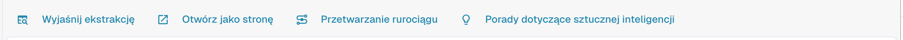
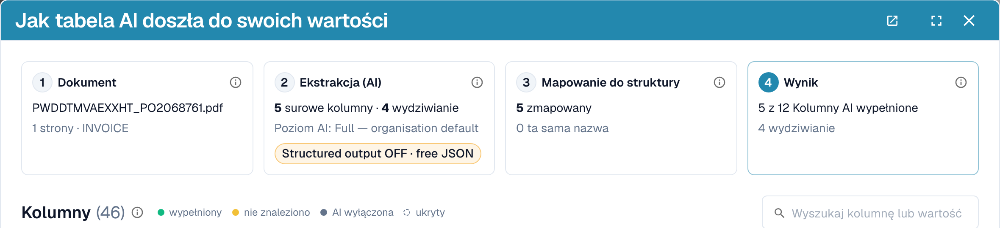
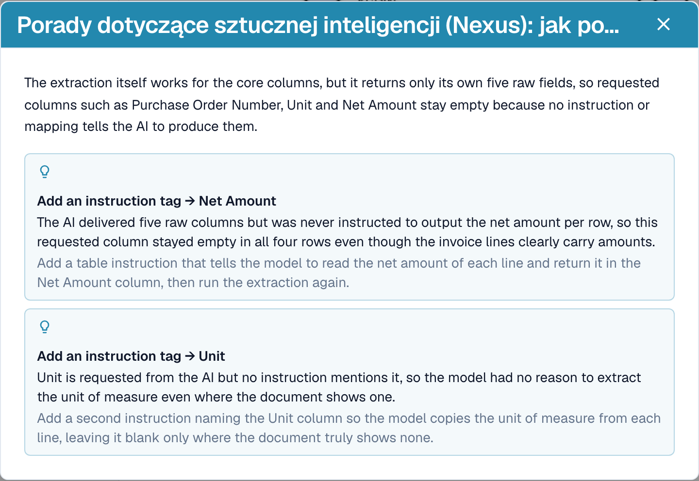
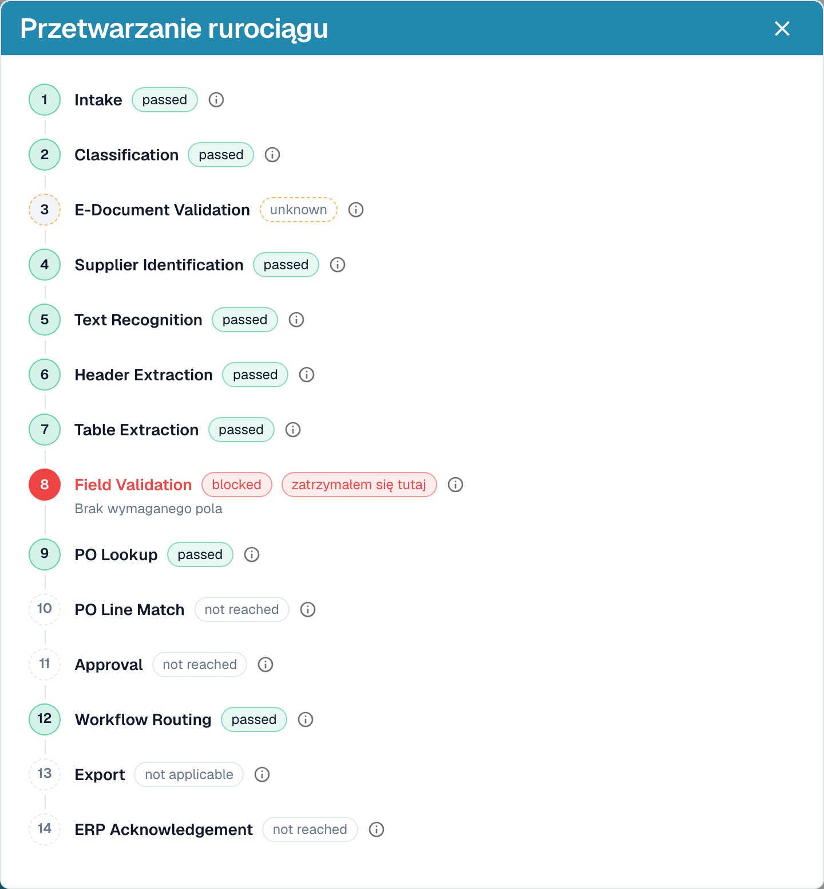

# Wyjaśnianie ekstrakcji i diagnostyka

[AI Table](README.md) · [Structured Output dla tabel](structured-output.md)

## Sprawdź, co zrobiła AI

Cztery przyciski pod tabelą wyjaśniają ekstrakcję.

<figure><figcaption>
Przyciski wyjaśnień.
</figcaption></figure>

* **Wyjaśnij ekstrakcję** otwiera okno *Jak tabela AI doszła do swoich wartości*: dokument, ekstrakcja AI (poziom, liczba surowych kolumn i wierszy), mapowanie do Twojej struktury oraz wynik dla każdej kolumny wraz z pochodzeniem każdej kolumny.
* **Otwórz jako stronę** pokazuje to samo wyjaśnienie we własnym oknie.
* **Przetwarzanie rurociągu** wylicza etapy przetwarzania dokumentu i miejsce, w którym się zatrzymał.
* **Porady dotyczące sztucznej inteligencji** pytają Nexus, jak poprawić ekstrakcję, i wymieniają konkretne zalecenia, na przykład *Enable structured output* lub *Add an instruction tag → Net Amount*. To tylko porada; decydujesz Ty.

<figure><figcaption>
Wyjaśnij ekstrakcję: cztery kroki od dokumentu do wyniku.
</figcaption></figure>

<figure><figcaption>
Porady dotyczące sztucznej inteligencji proponują kolejne kroki.
</figcaption></figure>

<figure><figcaption>
Przetwarzanie rurociągu pokazuje, gdzie dokument się zatrzymał, tutaj na walidacji pól.
</figcaption></figure>

Te wyjaśnienia należą do modułu **Panel analityczny**. Bez licencji na moduł lub gdy Twoja rola nie ma dostępu do zakładki Analityka, DocBits informuje, o co poprosić administratora (aktywować moduł w Ustawienia → Moduły albo przyznać zakładkę Twojej roli w Ustawienia → Role).

## Praktyczne przykłady

| Sytuacja | Co zrobić |
| --- | --- |
| Wartość jest w złej kolumnie, na przykład *Cena Jednostkowa* znajduje się w *Kwota netto* | Kliknij nazwę kolumny i zmapuj ją na właściwą kolumnę. Następnie **Zapisz jako szkolenie**, jeśli dostawca zawsze drukuje to w ten sposób. |
| Kolumna pozostaje pusta w każdym wierszu, na przykład *Kwota rabatu* | Dodaj kolumnę w polu **Dodatkowe kolumny dla sztucznej inteligencji** albo napisz instrukcję z sformułowaniem użytym na fakturze, na przykład *Wypełnij kolumnę Kwota rabatu na podstawie kolumny o nazwie „Rabatt” na fakturze.* Sprawdź za pomocą **Zmiana testu**, a następnie **Stosować**. |
| AI nie wie, co zrobić (nic w prompcie) | Kliknij **Zasugeruj za pomocą Nexus** i wstaw to, co pasuje. |
| Cenę trzeba podzielić lub zaokrąglić | Zapisz regułę w prompcie, na przykład *Cena jednostkowa to kwota netto podzielona przez ilość*. |
| Kwoty są odczytywane z błędnymi separatorami (1.234,50 zamiast 1,234.50) | Otwórz menu trzech kropek kolumny, wybierz **Formatowanie kwoty** i wskaż właściwy format. |
| Etykieta znajduje się pod wartością | Menu trzech kropek → **Extract From** → **Below**. |
| Kolumna nie jest potrzebna dla tego dostawcy | Menu trzech kropek → **Usuń kolumnę**. **Zapisz jako szkolenie** zachowuje ją jako ukrytą dla dostawcy. |
| Wiersz jest błędny lub go brakuje | Usuń go przyciskiem **x** albo dodaj wiersz za pomocą **Dodaj nowy wiersz tabeli** i wpisz wartości. |
| Te same poprawki są potrzebne raz za razem | Użyj **Zapisz jako szkolenie**, aby kolejne dokumenty tego dostawcy były poprawne. Przy złożonych układach zamiast tego [wytrenuj tabelę](../../../administration-and-setup/setup/document-training/training-line-fields-table-training/README.md). |


Nie każdy zawinięty wiersz opisu da się naprawić instrukcją. Jeśli wiersze jednej pozycji są rozbite na kilka wierszy, edytuj wiersze lub użyj klasycznego szkolenia tabeli.

