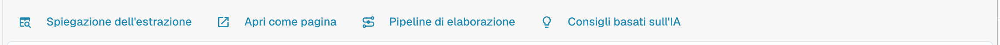
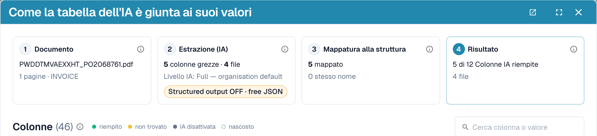
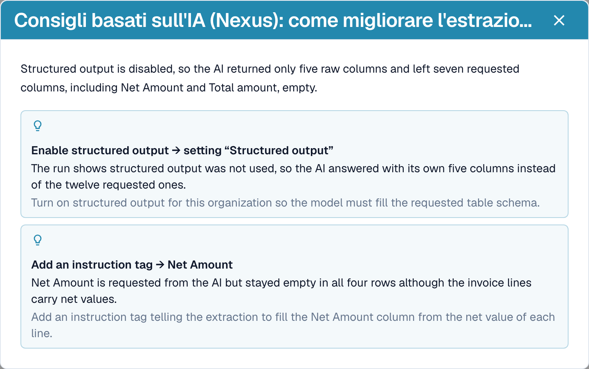
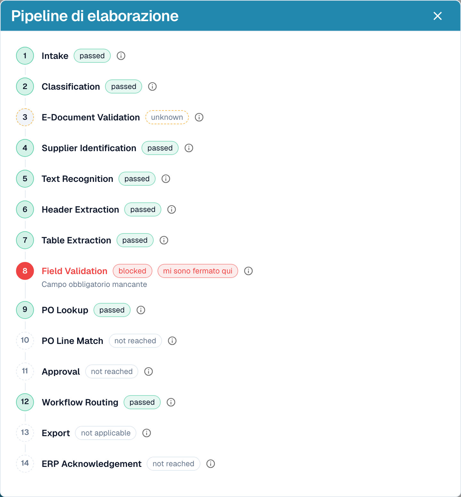

# Spiegare l'estrazione e diagnosticare

[AI Table](README.md) · [Structured Output per le tabelle](structured-output.md)

## Vedere cosa ha fatto l'AI

Quattro pulsanti sotto la tabella spiegano l'estrazione.

<figure><figcaption>
I pulsanti di spiegazione.
</figcaption></figure>

* **Spiegazione dell'estrazione** apre *Come la tabella dell'IA è giunta ai suoi valori*: il documento, l'estrazione AI (livello, numero di colonne grezze e di righe), la mappatura alla tua struttura e il risultato per colonna con l'origine di ciascuna colonna.
* **Apri come pagina** mostra la stessa spiegazione in una finestra a sé.
* **Pipeline di elaborazione** elenca i passaggi di elaborazione del documento e dove si è fermato.
* **Consigli basati sull'IA** chiede a Nexus come migliorare l'estrazione ed elenca raccomandazioni concrete, ad esempio *Enable structured output* o *Add an instruction tag → Net Amount*. Sono solo consigli; decidi tu.

<figure><figcaption>
Spiegazione dell'estrazione: quattro passaggi dal documento al risultato.
</figcaption></figure>

<figure><figcaption>
I consigli basati sull'IA propongono i passi successivi.
</figcaption></figure>

<figure><figcaption>
La pipeline di elaborazione mostra dove si è fermato un documento, qui alla validazione dei campi.
</figcaption></figure>

Queste spiegazioni appartengono al modulo **Dashboard di analisi**. Senza la licenza del modulo, oppure quando il tuo ruolo non ha accesso alla scheda Analisi, DocBits ti indica cosa chiedere al tuo amministratore (attivare il modulo in Impostazioni → Moduli, oppure assegnare la scheda al tuo ruolo in Impostazioni → Ruoli).

## Esempi pratici

| Situazione | Cosa fare |
| --- | --- |
| Un valore è nella colonna sbagliata, ad esempio *Prezzo Unitario* si trova in *Importo netto* | Fai clic sul nome della colonna e mappalo sulla colonna giusta. Poi **Salva come addestramento** se il fornitore lo stampa sempre così. |
| Una colonna resta vuota in ogni riga, ad esempio *Importo dello sconto* | Aggiungi la colonna in **Colonne aggiuntive per l'IA**, oppure scrivi un'istruzione con la dicitura usata in fattura, ad esempio *Compila la colonna Importo dello sconto con la colonna chiamata "Rabatt" in fattura.* Verifica con **Modifica del test**, poi **Applicare**. |
| L'AI non sa cosa fare (nulla nel prompt) | Fai clic su **Suggerisci con Nexus** e inserisci ciò che è adatto. |
| Un prezzo deve essere diviso o arrotondato | Scrivi la regola nel prompt, ad esempio *Il prezzo unitario è l'importo netto diviso per la quantità*. |
| Gli importi vengono letti con separatori errati (1.234,50 anziché 1,234.50) | Apri il menu con i tre puntini della colonna, scegli **Formattazione degli importi** e seleziona il formato giusto. |
| L'etichetta si trova sotto il valore | Menu con i tre puntini → **Estrai da** → **Sotto**. |
| Una colonna non serve per questo fornitore | Menu con i tre puntini → **Cancellare la colonna**. **Salva come addestramento** la mantiene nascosta per il fornitore. |
| Una riga è errata o mancante | Rimuovila con la **x**, oppure aggiungine una con **Aggiungere una nuova riga di tabella** e digita i valori. |
| Le stesse correzioni servono ripetutamente | Usa **Salva come addestramento** così i documenti successivi di questo fornitore vengono estratti correttamente. Per i layout complessi [addestra invece la tabella](../../../administration-and-setup/setup/document-training/training-line-fields-table-training/README.md). |


Non ogni riga di descrizione andata a capo può essere riparata con un'istruzione. Se le righe di un articolo sono suddivise in più righe di tabella, modifica le righe oppure usa l'addestramento classico della tabella.

