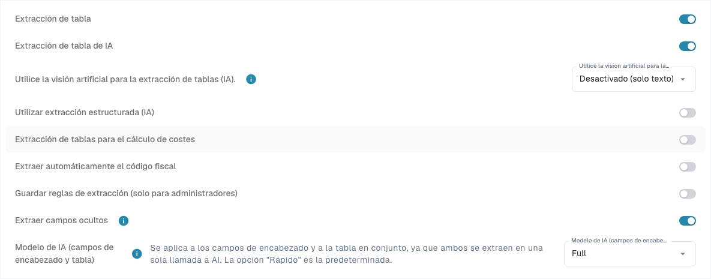

# Structured Output para tablas

Structured Output indica a la IA qué columnas debe devolver mediante un esquema generado a partir de la configuración. Así se reducen los encabezados libres que después requieren asignación. El ajuste **Utilizar extracción estructurada (IA)** controla la forma de salida; el modelo y Vision controlan el modelo y los datos de entrada.

## Por qué suele ser mejor

| Ejemplo | Sin esquema fijo | Ventaja de Structured Output |
| --- | --- | --- |
| Encabezados variables | «Art.-Nr.», «SKU» e «Item Code» pueden generar claves distintas. | La clave solicitada `ITEM_NUMBER` permanece estable entre diseños y simplifica la asignación. |
| Dos números de artículo | El número interno `00127` puede confundirse con el del proveedor `V-884`. | `ITEM_NUMBER` y `SUPPLIER_ITEM_NUMBER` son destinos separados. Compruebe los valores: el esquema impone nombres, no comprensión del negocio. |
| Columna propia de proyecto | El código impreso puede omitirse o aparecer con otro nombre. | `PROJECT_CODE` con **Sí** se solicita expresamente. Un dato ausente sigue debiendo tratarse como ausente. |

El tipo también ayuda: las columnas `AMOUNT` se describen en el esquema como número o `null`, con una explicación de su significado. Esto ayuda, por ejemplo, a distinguir un divisor de precio de una unidad de medida. Los demás tipos no se convierten automáticamente en valores JSON estrictamente tipados. Conserve los ceros iniciales de los identificadores.

No se garantiza mayor precisión, menor duración ni menor coste. Pueden seguir faltando filas o aparecer valores incorrectos. Compare los mismos documentos con idéntico modelo, Vision y entrenamiento.

## 1. Requisitos y valor de la organización

Abra [Clasificación y extracción](../../../administration-and-setup/settings/document-processing/classification-and-extraction/README.md), **General → Extracción**. Los ajustes de organización requieren permisos de administrador y se guardan inmediatamente.

1. El tipo de documento correcto debe tener una tabla y las [columnas](../../../administration-and-setup/settings/global-settings/document-types/table-columns/README.md) necesarias.
2. Active las rutas requeridas. En la ruta PDF de reglas con alternativa de IA hacen falta **Table Extraction** y **AI Table Extraction**. Structured Output no inicia por sí solo la extracción de tablas por IA.
3. Configure **Utilizar extracción estructurada (IA)** como valor de organización. La preferencia técnica es `USE_STRUCTURED_EXTRACTION`.
4. Compruebe el texto legible o la entrada Vision. Las reglas clásicas guardadas pueden seguir determinando la ruta; verifique [qué ruta se utilizó realmente](../../../overview-and-basics/faq/document-processing/which-extraction-path-was-used.md).

<figure><figcaption>
Controles actuales de extracción. Structured Output está desactivado en esta configuración existente y por eso no aparece la vista previa. No se cambió ningún ajuste de extracción.
</figcaption></figure>

## 2. Configuraciones específicas de plantilla

El alcance es la organización y la plantilla de extracción actual; no todas las plantillas de un proveedor.

| Situación | Comportamiento efectivo |
| --- | --- |
| Plantilla activada expresamente | Usa Structured Output aunque la organización lo tenga desactivado. |
| Plantilla desactivada expresamente | No lo usa aunque la organización lo tenga activado. |
| Sin configuración específica | Se aplica el ajuste de organización y sus valores predeterminados. |

En un documento adecuado, abra **Más opciones** (tres puntos) en la pantalla de validación. Si existe un contexto de plantilla, un administrador puede cambiar **Utilizar extracción estructurada (IA)**. Confirmar guarda el valor y reinicia el documento; Cancelar descarta el cambio. No cambia otras plantillas del proveedor ni reprocesa automáticamente documentos históricos.

**Plantillas de proveedores nuevos:** Si no tienen reglas de formato de tabla guardadas ni un valor propio para Structured Output, el procesamiento puede activarlo automáticamente y guardar ese valor en la plantilla, incluso con la organización desactivada. Lo controla `STRUCTURED_EXTRACTION_FOR_NEW_SUPPLIERS` (activo de forma predeterminada); la pantalla descrita no tiene un interruptor adicional para ello. Se respeta cualquier elección explícita ya existente.

La lista de [Modelo de IA](../../../administration-and-setup/settings/document-processing/classification-and-extraction/ai-model.md) muestra los valores de plantilla; sus interruptores de Structured Output son indicadores. Cambie el valor desde el menú del documento. **Eliminar entrada** puede borrar conjuntamente las configuraciones de modelo, E-Text y otras opciones; no es una desactivación selectiva. Si la plantilla vuelve a considerarse nueva, la activación automática puede aplicarse de nuevo.

## 3. Use AI: Predeterminado, Sí o No

Abra las [columnas de tabla](../../../administration-and-setup/settings/global-settings/document-types/table-columns/README.md) del tipo de documento y tabla correctos. **Utilizar IA (Use AI)** es un desplegable de tres estados, no una casilla. Se guarda inmediatamente.

| Opción actual | Efecto en el esquema base |
| --- | --- |
| **Predeterminado · solicitado** o **Predeterminado · no solicitado** | Usa la selección predeterminada de DocBits para ese tipo y nombre de columna. No significa siempre activado ni siempre desactivado. |
| **Sí · solicitado** | Solicita expresamente la columna configurada. |
| **No · no solicitado** | La excluye del esquema base, incluso si normalmente se solicita. |

Volver a **Predeterminado** elimina la elección explícita. Una columna propia nueva normalmente no pertenece a la selección predeterminada de IA: seleccione **Sí** para solicitarla. Las columnas predeterminadas de IA no son todas las columnas incluidas en DocBits; compruebe el efecto indicado y la vista previa.

**Obligatoria**, **Solo lectura** y **Oculta** controlan integridad, edición y visibilidad; no sustituyen la elección de IA. **No** no elimina la columna ni borra valores, y no impide que reglas, scripts u otras fuentes la rellenen. El entrenamiento y las etiquetas adicionales pueden ampliar la solicitud del proveedor: resuelva también allí las contradicciones. Este ajuste no sustituye automáticamente un resultado obtenido solo mediante reglas.

<figure><figcaption>
Desplegable actual Use AI con Predeterminado, Sí y No. No se cambió ninguna opción. Las celdas de título están ocultas por privacidad.
</figcaption></figure>

## 4. Interpretar la vista previa

Con el interruptor de organización activado aparece **Lo que solicita la IA**. Seleccione factura, confirmación de pedido, albarán, pedido de cliente u oferta. Los enlaces de edición abren los campos o columnas correspondientes. La vista previa no ejecuta una extracción.

* **Solicitado:** campos de encabezado y columnas incluidos en el esquema base; un indicador identifica los valores de IA heredados.
* **No solicitado:** columnas configuradas fuera de la selección actual.
* **Valores predeterminados desactivados:** campos o columnas excluidos expresamente que normalmente se solicitarían.
* **Strict y recuento:** el esquema base es estricto hasta el límite actual de DocBits de **100 propiedades**. Se cuentan campos de encabezado, contenedor de tabla y columnas de posición distintas solicitadas, no filas. Al superar el límite, el esquema se usa como orientación no estricta.

La vista previa no incluye entrenamiento ni etiquetas del proveedor. Instrucciones adicionales pueden permitir una salida abierta mientras no se hayan aprendido las asignaciones; las columnas de origen aprendidas pueden permitir una salida cerrada de nuevo. Por eso «strict» no prueba el modo de cada ejecución. Si solo está activada la plantilla, la vista previa de organización puede no aparecer: no cambie el valor global únicamente para verla.

Sin configuración utilizable de campos de encabezado no puede construirse el esquema completo. El interruptor activado no demuestra por sí solo que se haya usado. Revise la ejecución con **Explicar extracción** y los registros disponibles; [Tabla de IA](README.md) explica las vistas y permisos.

## 5. Ejemplo: factura con dos números y proyecto

Ejemplo sintético de un resultado que debe comprobarse; no representa una extracción ejecutada.

| Artículo | Artículo del proveedor | Cantidad | Precio unitario | Importe de línea | Proyecto |
| --- | --- | --- | --- | --- | --- |
| `00127` | `V-884` | 2 | 12,50 | 25,00 | `PRJ-42` |
| `00208` | `V-990` | 1 | 7,00 | 7,00 | `PRJ-42` |

1. Seleccione **Factura** y compruebe la elección de IA de `ITEM_NUMBER`, `SUPPLIER_ITEM_NUMBER`, `QUANTITY`, `UNIT_PRICE` y `TOTAL_AMOUNT`.
2. En la misma tabla, cree una columna de texto con el título literal `Project Code`; su nombre técnico será `PROJECT_CODE`. Seleccione **Sí · solicitado**. Use **No · no solicitado** solo conscientemente; una columna obligatoria debe conservar una fuente.
3. Compruebe organización y plantilla. En la vista previa de factura, si está disponible, `PROJECT_CODE` debe figurar como solicitado. Con Predeterminado normalmente no se solicitaría esta columna propia.
4. Vuelva a cargar un documento de prueba autorizado o reinícielo. El cambio no transforma tablas ya extraídas. Revise también asignaciones e instrucciones guardadas.
5. Espere dos filas: `ITEM_NUMBER` = `00127`/`00208`, `SUPPLIER_ITEM_NUMBER` = `V-884`/`V-990`, y `PROJECT_CODE` = `PRJ-42` en ambas. Compruebe ceros iniciales, cantidades, precios e importes; 25,00 + 7,00 = 32,00 netos. La suma correcta no demuestra cada valor.
6. Repita con el encabezado «SKU» y con un documento sin proyecto. Las columnas deben seguir siendo estables y no deben inventarse valores. Si se intercambian los números, añada y pruebe una asignación o instrucción inequívoca y revise ambas columnas.

El beneficio es una estructura solicitada estable entre diseños. Valide por separado los datos, campos obligatorios, cotejo de pedidos y exportación.

## 6. Problemas frecuentes

| Observación | Qué comprobar |
| --- | --- |
| Falta una columna propia | Tipo y tabla correctos, elección Sí, vista previa, valor de plantilla y etiquetas; volver a extraer. |
| Columna predeterminada vacía | ¿Elección No? Si se solicita pero falta en el documento, tratar el dato como ausente. |
| Resultado distinto del ajuste global | Configuración de plantilla, activación automática y ruta utilizada. |
| Columnas diferentes o adicionales | Asignaciones entrenadas, etiquetas, salida abierta y límite de la ejecución real. |
| Documentos antiguos sin cambios | Reprocesar; antes, comprobar el efecto sobre correcciones manuales. |

Más información: [Editar columnas](../../../administration-and-setup/settings/global-settings/document-types/table-columns/editing-and-deleting-columns.md), [Etiquetas e instrucciones](ai-table-tags.md), [Modelo y valores de plantilla](../../../administration-and-setup/settings/document-processing/classification-and-extraction/ai-model.md).
