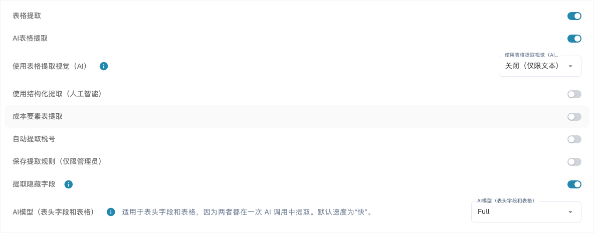
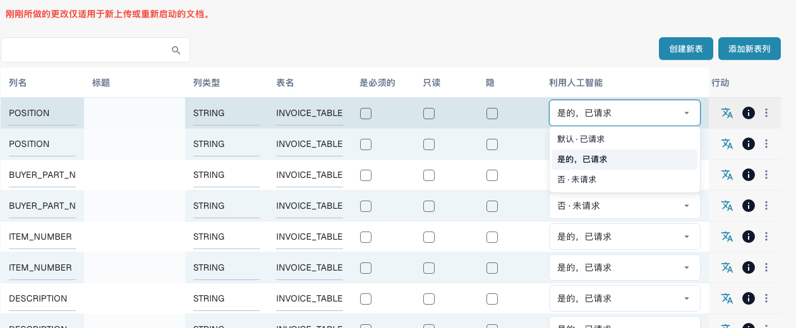
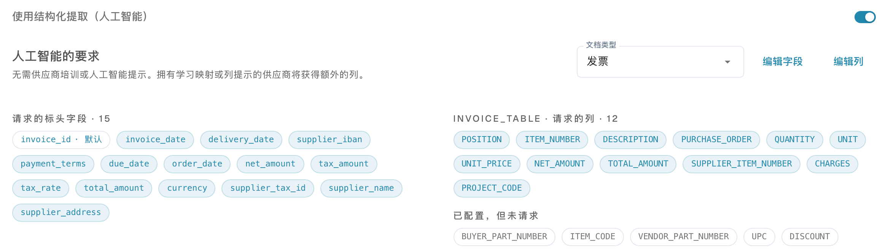

# 表格的 Structured Output

Structured Output 根据配置生成输出架构，明确要求 AI 返回哪些列，减少先生成任意列名、再进行映射的步骤。开关 **使用结构化提取（人工智能）** 控制输出结构；模型和 Vision 设置则控制所用模型及输入。

## 为什么结构化输出通常更合适

| 示例 | 没有固定输出架构时 | Structured Output 的优势 |
| --- | --- | --- |
| 列标题变化 | “Art.-Nr.”、“SKU”和“Item Code”可能产生不同的输出键。 | 请求的键 `ITEM_NUMBER` 保持不变，便于跨版式映射和后续处理。 |
| 两种物料编号 | 内部物料编号 `00127` 可能与供应商编号 `V-884` 混淆。 | `ITEM_NUMBER` 和 `SUPPLIER_ITEM_NUMBER` 是两个独立目标列。仍需核对值：架构约束的是名称，不代表正确理解业务含义。 |
| 自定义项目列 | 文档上的项目代码可能被遗漏或以其他名称返回。 | 将 `PROJECT_CODE` 设为“是”即可明确请求该列；缺失信息仍必须按缺失处理。 |

列类型也有作用：`AMOUNT` 列在架构中被描述为数值或 `null`，并附带含义说明。例如，这有助于区分价格除数和计量单位。其他类型不会自动变成严格限定类型的 JSON 值。编号中的前导零必须保留。

结构化输出不保证更高准确率、更短处理时间或更低费用。错误值、缺失行和无法辨认的版式仍可能出现。比较时应使用相同文档、模型、Vision 和训练配置。

## 1. 前提条件与组织默认值

打开[分类与提取](../../../administration-and-setup/settings/document-processing/classification-and-extraction/README.md)的“一般的”（常规）选项卡，再展开“萃取”（提取）区域。这里使用当前中文界面的实际标签。更改组织设置需要相应管理员权限，选择后立即保存。

1. 正确的文档类型必须配置表格及所需[表格列](../../../administration-and-setup/settings/global-settings/document-types/table-columns/README.md)。
2. 启用所需提取路径。PDF 的规则提取及 AI 回退路径需要同时启用 **表格提取 (Table Extraction)** 和 **AI表格提取 (AI Table Extraction)**。仅启用 Structured Output 不会启动 AI 表格提取。
3. 设置组织级 **使用结构化提取（人工智能）**，其技术偏好键为 `USE_STRUCTURED_EXTRACTION`。
4. 检查可读文本或所选 Vision 输入。已保存的传统表格规则仍可能决定实际路径；请核对[实际使用的提取路径](../../../overview-and-basics/faq/document-processing/which-extraction-path-was-used.md)。

<figure><figcaption>
当前提取设置。此现有配置关闭了 Structured Output，因此不显示架构预览。未更改任何提取设置。
</figcaption></figure>

## 2. 模板覆盖：实际采用哪个设置

设置范围为组织和当前提取模板，并不自动覆盖同一供应商的所有模板。

| 情况 | 实际行为 |
| --- | --- |
| 模板明确启用 | 即使组织默认关闭，该模板仍使用 Structured Output。 |
| 模板明确关闭 | 即使组织默认开启，该模板也不使用它。 |
| 没有模板覆盖 | 使用适用的组织设置及其默认值。 |

在合适文档的验证界面中打开“更多选项”（三点）。存在模板上下文时，管理员可在此更改 **使用结构化提取（人工智能）**。确认后保存覆盖值并重新启动文档；取消则放弃更改。该操作不会自动修改供应商的其他模板，也不会自动重新处理历史文档。

**新供应商模板：** 如果既没有已保存的表格格式规则，也没有自己的 Structured Output 覆盖值，处理时可以自动启用 Structured Output，并保存为模板设置，即使组织默认关闭。此行为由 `STRUCTURED_EXTRACTION_FOR_NEW_SUPPLIERS` 控制（默认启用）；本文所述界面没有额外开关。已有明确模板选择不会被覆盖。

[AI 模型](../../../administration-and-setup/settings/document-processing/classification-and-extraction/ai-model.md)列表显示已有模板设置，其中 Structured Output 开关仅用于显示状态；请通过文档菜单更改。**删除条目**可能同时删除模型、E-Text 等多个模板覆盖值，并非只关闭 Structured Output。如果模板随后再次被识别为新模板，自动启用也可能再次生效。

## 3. Use AI：默认、是或否

打开正确文档类型及表格的[表格列](../../../administration-and-setup/settings/global-settings/document-types/table-columns/README.md)。**利用人工智能 (Use AI)** 是三态下拉选择，不是复选框；更改后立即保存。

| 当前菜单选项 | 对基础架构的影响 |
| --- | --- |
| **默认 · 已请求** 或 **默认值 · 未请求** | 采用 DocBits 对该文档类型和列名的默认 AI 选择。“默认”不等于始终开启，也不等于始终关闭。 |
| **是的，已请求** | 明确要求 AI 返回该配置列。 |
| **否 · 未请求** | 从基础架构中排除此列，即使它通常属于默认 AI 请求。 |

恢复“默认”会移除明确的是/否选择。新建自定义列通常不属于默认 AI 列集合；若需要 AI 返回，应选择“是”。默认 AI 列不等于所有系统自带列，请以显示的实际效果和预览为准。

**必填**、**只读**和**隐藏**分别控制完整性检查、可编辑性和可见性，不替代 AI 选择。“否”不会删除列或清除已有值，也不阻止规则、脚本或其他来源填充值。供应商训练和额外 AI 标签可能扩展实际请求，相关矛盾也需要处理。Structured Output 开关不会自动替换纯规则提取结果。

<figure><figcaption>
当前 Use AI 下拉菜单，包含默认、是和否。未更改任何选项。标题单元格已隐藏以保护数据。
</figcaption></figure>

## 4. 如何阅读预览

组织开关开启后，下方会显示 **人工智能的要求**。请选择发票、订单确认、送货单、客户订单或报价。字段和列的编辑链接会打开相应配置；预览本身不执行提取。

* **已请求：** 基础架构包含的表头字段和表格列；默认标记表示继承的 AI 默认选择。
* **未请求：** 已配置但不在当前 AI 选择中的表格列。
* **已关闭的默认字段/列：** 原本默认请求、但已明确排除的项目。
* **Strict 与数量：** 当前 DocBits 的严格基础架构限制为 **100 个属性**。计数包括请求的表头字段、表格容器和不同的请求明细列，不是表格行数。超过限制后，架构仅作为非严格指导。

预览不包含供应商训练和 AI 标签。尚未学会列映射时，额外指令可能允许开放输出；已学习的源列可使输出重新封闭。因此预览显示“strict”不能证明每次文档运行都使用该模式。如果仅模板启用，组织预览可能不显示；不要仅为了显示预览而更改组织默认值。

没有可用的表头字段配置时，无法生成完整结构化架构，因此开关开启本身不能证明使用了架构。请通过 **Explain extraction** 和可用文档日志检查实际运行；[AI 表格](README.md)说明了这些视图及访问权限。

在此配置示例中，INVOICE_TABLE 请求的列包括 `ITEM_NUMBER`、`SUPPLIER_ITEM_NUMBER`、`QUANTITY`、`UNIT_PRICE`、`TOTAL_AMOUNT` 和 `PROJECT_CODE`。自定义项目列已明确设为“是”，与下方示例第 2 步一致。预览还包含其他已配置的发票列，因此您的选择和数量可能不同。**12** 是此表格请求的列数，不是行数，也不是整个架构的属性总数。这是配置预览，不是提取结果。

<figure><figcaption>
已启用 Structured Output 的发票架构预览局部。INVOICE_TABLE 请求 12 列，其中 PROJECT_CODE 的 Use AI 明确设为“是”。其他已配置表格及属性计数器不在此局部画面中。
</figcaption></figure>

## 5. 示例：包含两种物料编号及项目的发票

以下为合成示例，用来定义核对目标，并非已执行的提取结果。

| 物料编号 | 供应商物料编号 | 数量 | 单价 | 行金额 | 项目 |
| --- | --- | --- | --- | --- | --- |
| `00127` | `V-884` | 2 | 12.50 | 25.00 | `PRJ-42` |
| `00208` | `V-990` | 1 | 7.00 | 7.00 | `PRJ-42` |

1. 选择“发票”，检查 `ITEM_NUMBER`、`SUPPLIER_ITEM_NUMBER`、`QUANTITY`、`UNIT_PRICE` 和 `TOTAL_AMOUNT` 的 AI 选择。
2. 在同一表格中新建文本列，标题按字面输入 `Project Code`，技术名称因此为 `PROJECT_CODE`。选择 **是的，已请求**。仅在确认不需要时选择 **否 · 未请求**；必填列仍需保留数据来源。
3. 检查组织默认值和当前模板覆盖。如果发票预览可用，`PROJECT_CODE` 必须列为已请求；采用默认值时，这个自定义列通常不会被请求。
4. 重新上传获准使用的测试文档，或重新启动该文档。设置不会追溯改变已提取表格。还需检查已保存映射及指令。
5. 预期有两行：`ITEM_NUMBER` 为 `00127`/`00208`，`SUPPLIER_ITEM_NUMBER` 为 `V-884`/`V-990`，两行 `PROJECT_CODE` 均为 `PRJ-42`。核对前导零、数量、单价和行金额；25.00 + 7.00 = 32.00 未税金额。总额正确不代表各个值都正确。
6. 使用“SKU”等不同标题及没有项目值的文档重复测试。目标列应保持一致，不能编造缺失值。如果编号互换，添加并测试明确的映射或指令，然后重新核对两个编号列。

优势在于跨版式保持稳定的请求结构。业务正确性、必填验证、采购订单匹配及导出仍须单独检查。

## 6. 常见问题

| 现象 | 下一步检查 |
| --- | --- |
| 缺少自定义列 | 文档类型和表格是否正确、是否明确选“是”；检查预览、模板值和标签后重新提取。 |
| 默认列为空 | 是否明确选“否”？若已请求但原文缺少该值，应按缺失处理。 |
| 行为与组织开关不同 | 检查模板覆盖、新模板自动启用及实际提取路径。 |
| 出现其他或额外列 | 检查训练映射、AI 标签、开放输出及实际运行的属性限制。 |
| 历史文档没有变化 | 需要重新处理；先检查对手工修正的影响。 |

相关说明：[编辑表格列](../../../administration-and-setup/settings/global-settings/document-types/table-columns/editing-and-deleting-columns.md)、[AI 标签与指令](ai-table-tags.md)、[AI 模型及模板设置](../../../administration-and-setup/settings/document-processing/classification-and-extraction/ai-model.md)。
