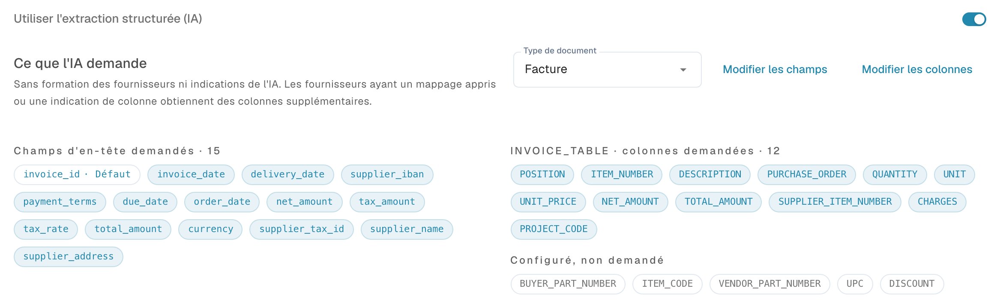

# Structured Output pour les tableaux

Structured Output indique à l'IA les colonnes attendues à l'aide d'un schéma issu de votre configuration. Il réduit les en-têtes libres qui nécessitent ensuite un mappage. **Utiliser l'extraction structurée (IA)** contrôle la forme du résultat ; le modèle et Vision contrôlent le modèle et ses données d'entrée.

## Pourquoi la sortie structurée est souvent préférable

| Exemple | Sans schéma fixe | Avantage de Structured Output |
| --- | --- | --- |
| En-têtes variables | « Art.-Nr. », « SKU » et « Item Code » peuvent produire des clés différentes. | La clé demandée `ITEM_NUMBER` reste stable entre mises en page et simplifie le mappage. |
| Deux références article | La référence interne `00127` peut être confondue avec celle du fournisseur `V-884`. | `ITEM_NUMBER` et `SUPPLIER_ITEM_NUMBER` constituent deux cibles distinctes. Vérifiez néanmoins les valeurs : le schéma impose des noms, pas la compréhension métier. |
| Colonne projet personnalisée | Le code imprimé peut être omis ou renvoyé sous un autre nom. | `PROJECT_CODE` réglé sur **Oui** est explicitement demandé. Une information absente doit toujours être reconnue comme telle. |

Le type de colonne aide aussi : les colonnes `AMOUNT` sont décrites dans le schéma comme des nombres ou `null`, avec leur signification. Cela aide notamment à distinguer un diviseur de prix d'une unité de mesure. Les autres types ne deviennent pas automatiquement des valeurs JSON strictement typées. Conservez les zéros initiaux des identifiants.

Aucune amélioration de précision, de durée ou de coût n'est garantie. Des valeurs erronées et des lignes manquantes restent possibles. Comparez les mêmes documents avec les mêmes modèle, Vision et apprentissages.

## 1. Prérequis et valeur de l'organisation

Ouvrez [Classification et extraction](../../../administration-and-setup/settings/document-processing/classification-and-extraction/README.md), **Général → Extraction**. Les paramètres d'organisation exigent les droits administrateur appropriés et sont enregistrés immédiatement.

1. Le bon type de document doit posséder un tableau et les [colonnes](../../../administration-and-setup/settings/global-settings/document-types/table-columns/README.md) nécessaires.
2. Activez les chemins requis. Le chemin PDF utilisant les règles puis l'IA en secours nécessite **Table Extraction** et **AI Table Extraction**. Structured Output ne lance pas à lui seul l'extraction de tableau par IA.
3. Définissez **Utiliser l'extraction structurée (IA)** comme valeur d'organisation. La préférence technique est `USE_STRUCTURED_EXTRACTION`.
4. Vérifiez le texte lisible ou l'entrée Vision. Des règles classiques enregistrées peuvent encore déterminer le chemin effectif ; contrôlez [le chemin réellement utilisé](../../../overview-and-basics/faq/document-processing/which-extraction-path-was-used.md).

<figure><figcaption>
Commandes actuelles d'extraction. Structured Output est désactivé dans cette configuration existante ; aucun aperçu de schéma n'est donc affiché. Aucun paramètre d'extraction n'a été modifié.
</figcaption></figure>

## 2. Priorité des paramètres de modèle d'extraction

Le périmètre est l'organisation et le modèle d'extraction actuel, pas tous les modèles d'un fournisseur.

| Situation | Comportement effectif |
| --- | --- |
| Activation explicite du modèle d'extraction | Structured Output s'applique même si la valeur d'organisation est désactivée. |
| Désactivation explicite du modèle d'extraction | Il ne s'applique pas même si la valeur d'organisation est activée. |
| Aucune dérogation | Le paramètre d'organisation applicable et ses valeurs par défaut s'appliquent. |

Dans l'écran de validation d'un document approprié, ouvrez **Plus d'options** (trois points). Lorsqu'un contexte de modèle d'extraction existe, un administrateur peut modifier **Utiliser l'extraction structurée (IA)**. Confirmer enregistre la dérogation et redémarre le document ; Annuler abandonne le changement. Les autres modèles du fournisseur et les anciens documents ne sont pas automatiquement modifiés.

**Nouveaux modèles fournisseurs :** sans règle de formatage de tableau enregistrée ni valeur Structured Output propre, le traitement peut activer automatiquement Structured Output et enregistrer ce choix sur le modèle, même si l'organisation le désactive. Ce comportement dépend de `STRUCTURED_EXTRACTION_FOR_NEW_SUPPLIERS` (activé par défaut) ; l'écran décrit ne propose pas de commutateur supplémentaire pour ce réglage. Un choix explicite existant est conservé.

La liste [Modèle d'IA](../../../administration-and-setup/settings/document-processing/classification-and-extraction/ai-model.md) affiche les valeurs des modèles d'extraction ; ses commutateurs Structured Output sont des indicateurs. Pour modifier la valeur, utilisez le menu du document. **Supprimer l'entrée** peut retirer ensemble les dérogations du modèle d'IA, d'E-Text et d'autres options. Ce n'est pas une désactivation ciblée. L'activation automatique peut se reproduire si le modèle est ensuite considéré comme nouveau.

## 3. Use AI : Par défaut, Oui ou Non

Ouvrez les [colonnes de tableau](../../../administration-and-setup/settings/global-settings/document-types/table-columns/README.md) du bon type de document et du bon tableau. **Utiliser l'IA (Use AI)** est une liste à trois états, pas une case à cocher. Le choix est enregistré immédiatement.

| Choix actuel | Effet sur le schéma de base |
| --- | --- |
| **Par défaut · demandé** ou **Par défaut · non demandé** | Applique la sélection DocBits pour ce type et ce nom de colonne. Par défaut ne signifie ni toujours activé ni toujours désactivé. |
| **Oui · demandé** | Demande explicitement cette colonne configurée à l'IA. |
| **Non · non demandé** | L'exclut du schéma de base, même si elle est normalement demandée. |

Revenir à **Par défaut** supprime le choix explicite. Une nouvelle colonne personnalisée n'appartient normalement pas à la sélection IA par défaut : choisissez **Oui** pour la demander. Les colonnes IA par défaut ne correspondent pas à toutes les colonnes fournies. Vérifiez l'effet affiché et l'aperçu.

**Obligatoire**, **Lecture seule** et **Masqué** concernent les contrôles de complétude, la modification et la visibilité ; ils ne remplacent pas le choix IA. **Non** ne supprime ni la colonne ni ses valeurs et n'empêche pas des règles, scripts ou autres sources de la renseigner. L'apprentissage fournisseur et les tags IA peuvent étendre la demande effective : résolvez aussi leurs contradictions. Le commutateur ne remplace pas automatiquement un résultat purement issu de règles.

<figure><figcaption>
Liste Use AI actuelle avec Par défaut, Oui et Non. Aucune option n'a été modifiée. Les cellules de titre sont masquées pour protéger les données.
</figcaption></figure>

## 4. Lire l'aperçu

Lorsque le commutateur d'organisation est activé, **Ce que l'IA demande** apparaît dessous. Sélectionnez facture, confirmation de commande, bon de livraison, commande client ou devis. Les liens d'édition ouvrent les champs ou colonnes correspondants. L'aperçu ne lance aucune extraction.

* **Demandé :** champs d'en-tête et colonnes inclus dans le schéma de base ; un indicateur signale les valeurs IA héritées.
* **Non demandé :** colonnes configurées hors de la sélection actuelle.
* **Valeurs par défaut désactivées :** champs ou colonnes explicitement exclus alors qu'ils seraient normalement demandés.
* **Strict et nombre :** le schéma de base est strict jusqu'à la limite DocBits actuelle de **100 propriétés**. Sont comptés les champs d'en-tête demandés, le conteneur du tableau et les colonnes de ligne distinctes demandées, pas le nombre de lignes. Au-delà, le schéma guide le modèle sans contrainte stricte.

L'aperçu exclut l'apprentissage et les tags fournisseurs. Des instructions supplémentaires peuvent permettre une sortie ouverte tant que les mappages ne sont pas appris ; des colonnes sources apprises peuvent permettre une sortie fermée. « Strict » dans l'aperçu ne prouve donc pas le mode de chaque exécution. L'aperçu peut manquer si seule une dérogation est activée : ne modifiez pas la valeur globale uniquement pour l'afficher.

Sans configuration exploitable des champs d'en-tête, aucun schéma complet ne peut être construit. Un commutateur activé ne prouve donc pas son utilisation. Contrôlez l'exécution avec **Expliquer l'extraction** et les journaux disponibles ; [Tableau IA](README.md) décrit ces vues et leurs droits d'accès.

Dans cet exemple de configuration, les colonnes demandées d’INVOICE_TABLE comprennent `ITEM_NUMBER`, `SUPPLIER_ITEM_NUMBER`, `QUANTITY`, `UNIT_PRICE`, `TOTAL_AMOUNT` et `PROJECT_CODE`. La colonne de projet personnalisée est explicitement réglée sur **Oui**, comme à l’étape 2 de l’exemple ci-dessous. L’aperçu comprend aussi d’autres colonnes de facture configurées ; votre sélection et votre nombre peuvent donc différer. **12** correspond au nombre de colonnes demandées dans cette table, pas au nombre de lignes ni au total des propriétés du schéma. Il s’agit d’un aperçu de configuration, pas d’un résultat d’extraction.

<figure><figcaption>
Extrait de l’aperçu du schéma Facture avec Structured Output activé. INVOICE_TABLE demande 12 colonnes, dont PROJECT_CODE avec Use AI sur Oui. Les autres tables configurées et le compteur de propriétés ne figurent pas dans cet extrait.
</figcaption></figure>

## 5. Exemple : facture avec deux références et un projet

Cet exemple synthétique définit un résultat à vérifier, pas une extraction exécutée.

| Article | Article fournisseur | Quantité | Prix unitaire | Montant de ligne | Projet |
| --- | --- | --- | --- | --- | --- |
| `00127` | `V-884` | 2 | 12,50 | 25,00 | `PRJ-42` |
| `00208` | `V-990` | 1 | 7,00 | 7,00 | `PRJ-42` |

1. Sélectionnez **Facture** et vérifiez la sélection IA de `ITEM_NUMBER`, `SUPPLIER_ITEM_NUMBER`, `QUANTITY`, `UNIT_PRICE` et `TOTAL_AMOUNT`.
2. Dans le même tableau, créez une colonne texte portant le titre exact `Project Code`, qui produit le nom technique `PROJECT_CODE`. Choisissez **Oui · demandé**. Utilisez **Non · non demandé** consciemment ; une colonne obligatoire doit garder une source de données.
3. Vérifiez l'organisation et le modèle d'extraction actuel. Dans l'aperçu Facture, s'il est disponible, `PROJECT_CODE` doit être demandé. Avec Par défaut, cette colonne personnalisée ne le serait normalement pas.
4. Importez de nouveau un document de test autorisé ou redémarrez-le. Le changement ne transforme pas rétroactivement les tableaux extraits. Vérifiez aussi les mappages et instructions enregistrés.
5. Attendez deux lignes : `ITEM_NUMBER` = `00127`/`00208`, `SUPPLIER_ITEM_NUMBER` = `V-884`/`V-990` et `PROJECT_CODE` = `PRJ-42` sur chacune. Vérifiez zéros initiaux, quantités, prix et montants ; 25,00 + 7,00 = 32,00 net. Une somme correcte ne prouve pas chaque valeur.
6. Recommencez avec l'en-tête « SKU » et un document sans projet. Les colonnes cibles doivent rester stables sans valeur inventée. Si les références sont inversées, ajoutez et testez un mappage ou une instruction sans ambiguïté, puis vérifiez les deux colonnes.

Le gain est une structure demandée stable entre mises en page. Exactitude métier, champs obligatoires, rapprochement des commandes et export restent à vérifier séparément.

## 6. Problèmes courants

| Observation | Vérification suivante |
| --- | --- |
| Colonne personnalisée absente | Bon type et bon tableau, choix Oui, aperçu, valeur du modèle et tags ; réextraire. |
| Colonne par défaut vide | Choix Non explicite ? Si elle est demandée mais absente du document, traiter la donnée comme manquante. |
| Résultat différent du réglage global | Dérogation, activation automatique et chemin effectif. |
| Colonnes différentes ou supplémentaires | Mappages appris, tags, sortie ouverte et limite de l'exécution réelle. |
| Anciens documents inchangés | Retraiter ; vérifier d'abord l'effet sur les corrections manuelles. |

Voir aussi : [Modifier les colonnes](../../../administration-and-setup/settings/global-settings/document-types/table-columns/editing-and-deleting-columns.md), [Tags et instructions](ai-table-tags.md), [Modèle d'IA et valeurs spécifiques](../../../administration-and-setup/settings/document-processing/classification-and-extraction/ai-model.md).
