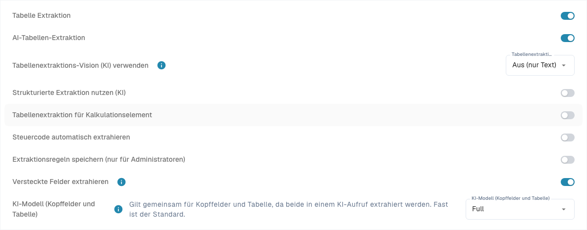

# Structured Output für Tabellen

Structured Output gibt der KI die erwarteten Spalten vor. Statt beliebige Überschriften zurückzugeben und sie anschließend zuzuordnen, arbeitet sie mit einem aus Ihrer Konfiguration erzeugten Schema. Der Schalter heißt **Strukturierte Extraktion nutzen (KI)**. Er bestimmt die Ausgabeform; Modellwahl und Vision bestimmen dagegen das Modell und dessen Eingabe.

## Warum ist die strukturierte Ausgabe oft besser?

| Beispiel | Ohne festes Ausgabeschema | Vorteil mit Structured Output |
| --- | --- | --- |
| Wechselnde Überschriften | „Art.-Nr.“, „SKU“ und „Item Code“ können unterschiedliche Ausgabeschlüssel ergeben; danach ist eine Zuordnung nötig. | Ein angeforderter Schlüssel wie `ITEM_NUMBER` bleibt gleich. Das vereinfacht Zuordnung und Weiterverarbeitung über mehrere Layouts. |
| Zwei Artikelnummern | Interne Artikelnummer `00127` und Lieferantenartikelnummer `V-884` können beim Zuordnen verwechselt werden. | `ITEM_NUMBER` und `SUPPLIER_ITEM_NUMBER` sind getrennte Zielspalten. Prüfen Sie trotzdem, ob die richtigen Werte darin stehen: ein Schema erzwingt Namen, nicht fachliches Verständnis. |
| Eigene Projektspalte | Eine gedruckte Projektkennung kann unter einem freien Namen oder gar nicht zurückkommen. | `PROJECT_CODE` wird mit **Ja** ausdrücklich angefordert. Fehlende Angaben müssen weiterhin als fehlend erkannt werden. |

Bei Tabellenbeträgen hat auch der Spaltentyp einen Nutzen: `AMOUNT` wird im strukturierten Schema als Zahl oder `null` beschrieben, mit einem Hinweis zur Bedeutung. Das hilft etwa, einen Preisdivisor von einer Mengeneinheit zu unterscheiden. Andere Typen sind damit nicht automatisch streng typisierte JSON-Werte. Führende Nullen in Kennungen müssen erhalten bleiben.

Structured Output garantiert keine höhere Erkennungsquote, kürzere Laufzeit oder geringere Kosten. Unlesbare Vorlagen, falsche Werte und fehlende Zeilen bleiben möglich. Vergleichen Sie dieselben Belege bei gleicher Modell-, Vision- und Trainingskonfiguration.

## 1. Voraussetzungen und Organisationsstandard

Öffnen Sie [Klassifizierung und Extraktion](../../../administration-and-setup/settings/document-processing/classification-and-extraction/README.md), Tab **Allgemein**, Bereich **Extraktion**. Änderungen an Organisationseinstellungen benötigen die entsprechenden Administratorrechte und werden unmittelbar gespeichert.

1. Der richtige Dokumenttyp muss eine Tabelle und die benötigten [Tabellenspalten](../../../administration-and-setup/settings/global-settings/document-types/table-columns/README.md) besitzen.
2. Aktivieren Sie die erforderlichen Extraktionspfade. Im PDF-Regel-/KI-Fallback-Pfad sind **Table Extraction** und zusätzlich **AI Table Extraction** erforderlich. Structured Output allein startet keine KI-Tabellenextraktion.
3. Setzen Sie **Strukturierte Extraktion nutzen (KI)** als Organisationsstandard. Die technische Preference heißt `USE_STRUCTURED_EXTRACTION`.
4. Prüfen Sie lesbaren Text beziehungsweise die gewählte Vision-Eingabe. Gespeicherte klassische Tabellenregeln können weiterhin den wirksamen Tabellenpfad bestimmen; kontrollieren Sie [den tatsächlich verwendeten Extraktionspfad](../../../overview-and-basics/faq/document-processing/which-extraction-path-was-used.md).

<figure><figcaption>
Aktuelle Extraktionsschalter. Structured Output ist in dieser vorhandenen Konfiguration ausgeschaltet, deshalb wird keine Schema-Vorschau angezeigt. Keine Extraktionseinstellung wurde geändert.
</figcaption></figure>

## 2. Überschreibungen: Welche Einstellung gilt?

Die Einstellung gilt je Organisation und aktueller Extraktionsvorlage, nicht pauschal für alle Vorlagen eines Lieferanten:

| Situation | Wirksames Verhalten |
| --- | --- |
| Vorlage hat ausdrücklich eingeschaltet | Structured Output ist für diese Vorlage aktiv, auch bei ausgeschaltetem Organisationsstandard. |
| Vorlage hat ausdrücklich ausgeschaltet | Die Vorlage verwendet es nicht, auch bei eingeschaltetem Organisationsstandard. |
| Keine Vorlagenüberschreibung | Die anwendbare Organisationseinstellung einschließlich ihrer Standardwerte gilt. |

Öffnen Sie im Validierungsbildschirm eines passenden Dokuments **Mehr Optionen** (drei Punkte). Bei vorhandenem Vorlagenkontext können Administratoren dort **Strukturierte Extraktion nutzen (KI)** ändern. Die Bestätigung speichert die Überschreibung und startet das Dokument neu; Abbrechen verwirft die Änderung. Andere Vorlagen desselben Lieferanten und historische Dokumente werden dadurch nicht automatisch umgestellt.

**Neue Lieferantenvorlagen:** Ohne gespeicherte Tabellenformatierungsregel und ohne eigene Structured-Output-Überschreibung kann die Verarbeitung Structured Output automatisch aktivieren und als Vorlagenwert speichern, auch wenn der Organisationsstandard aus ist. Gesteuert wird dies durch `STRUCTURED_EXTRACTION_FOR_NEW_SUPPLIERS` (standardmäßig aktiv); hierfür gibt es in der hier beschriebenen Maske keinen zusätzlichen Schalter. Eine vorhandene ausdrückliche Vorlagenauswahl wird dadurch nicht überschrieben.

Die Übersicht unter [KI-Modell](../../../administration-and-setup/settings/document-processing/classification-and-extraction/ai-model.md) zeigt bestehende Vorlagenwerte; ihre Structured-Output-Schalter sind Anzeigen. Zum Ändern verwenden Sie das Dokumentmenü. **Eintrag löschen** kann zugleich Modell-, E-Text- und weitere Vorlagenüberschreibungen entfernen. Es ist kein gezielter Ausschalter für Structured Output. Bei einer danach wieder als neu erkannten Vorlage kann die automatische Aktivierung erneut greifen.

## 3. „Use AI“ pro Spalte: Standard, Ja oder Nein

Öffnen Sie die [Tabellenspalten](../../../administration-and-setup/settings/global-settings/document-types/table-columns/README.md) des richtigen Dokumenttyps und der richtigen Tabelle. **KI nutzen (Use AI)** ist eine dreistufige Auswahl, keine Checkbox. Die Auswahl wird unmittelbar gespeichert.

| Auswahl im aktuellen Menü | Bedeutung für das Basisschema |
| --- | --- |
| **Standard · angefordert** oder **Standard · nicht angefordert** | Übernimmt die DocBits-Vorgabe für diesen Dokumenttyp und Spaltennamen. Standard bedeutet weder immer an noch immer aus. |
| **Ja · angefordert** | Fordert diese konfigurierte Spalte ausdrücklich von der KI an. |
| **Nein · nicht angefordert** | Fordert sie im Basisschema nicht an, auch wenn sie zur KI-Standardauswahl gehört. |

Zurück auf **Standard** entfernt die ausdrückliche Ja-/Nein-Auswahl. Eine neu angelegte eigene Spalte gehört normalerweise nicht zur KI-Standardauswahl; setzen Sie sie auf **Ja**, wenn die KI sie liefern soll. Die Liste der KI-Standardspalten ist nicht identisch mit allen mitgelieferten Spalten. Die angezeigte Wirkung und die Vorschau sind maßgeblich.

**Pflichtfeld**, **Schreibgeschützt** und **Ausgeblendet** haben andere Aufgaben: Vollständigkeitsprüfung, Bearbeitbarkeit und Sichtbarkeit. Keines dieser Merkmale ersetzt die KI-Auswahl. **Nein** löscht weder die Spalte noch vorhandene Werte und verhindert nicht, dass Regeln, Skripte oder andere Quellen Werte liefern. Lieferantentraining und zusätzliche KI-Tags können den Laufauftrag erweitern; lösen Sie Widersprüche dort ebenfalls auf. Ein rein regelbasiertes Ergebnis wird durch den Structured-Output-Schalter nicht automatisch ersetzt.

<figure><figcaption>
Aktuelle Use-AI-Auswahl mit Standard, Ja und Nein. Es wurde keine Option geändert. Titelzellen sind aus Datenschutzgründen ausgeblendet.
</figcaption></figure>

## 4. Die Vorschau richtig lesen

Wenn der Organisationsschalter eingeschaltet ist, erscheint darunter **Das fordert die KI an**. Wählen Sie den Dokumenttyp: Rechnung, Auftragsbestätigung, Lieferschein, Kundenauftrag oder Angebot. Die Links zur Feld- und Spaltenbearbeitung öffnen die zugehörige Konfiguration; die Vorschau selbst führt keine Extraktion aus.

* **Angefordert:** Kopffelder und Tabellenspalten, die das Basisschema enthält; ein Standardhinweis kennzeichnet übernommene KI-Vorgaben.
* **Nicht angefordert:** konfigurierte Tabellenspalten außerhalb der aktuellen KI-Auswahl.
* **Deaktivierte Standardfelder/-spalten:** ausdrücklich ausgeschaltete Einträge, die sonst zur KI-Standardauswahl gehören würden.
* **Strict und Anzahl:** Das Basisschema ist bis zur derzeitigen DocBits-Grenze von **100 Eigenschaften** streng. Gezählt werden angeforderte Kopffelder, der Tabellencontainer und die unterschiedlichen angeforderten Positionsspalten, nicht Tabellenzeilen. Oberhalb der Grenze wird das Schema nur als nicht strenge Vorgabe verwendet.

**Grenzen der Vorschau:** Sie zeigt die Dokumenttyp-Basis ohne Lieferantentraining oder KI-Tags. Zusätzliche Anweisungen können bei noch nicht gelernter Spaltenzuordnung eine offene Ausgabe erlauben; gelernte Quellspalten können wieder eine geschlossene Ausgabe ermöglichen. Deshalb beweist „strict“ in der Vorschau nicht den Modus jedes Dokumentlaufs. Ist nur die Vorlage eingeschaltet, kann die Organisationsvorschau fehlen. Schalten Sie nicht allein zum Anzeigen der Vorschau den Organisationsstandard um.

Ohne verwertbare Kopffeldkonfiguration kann kein strukturiertes Gesamtschema entstehen; ein eingeschalteter Schalter allein belegt daher keinen Schemaeinsatz. Prüfen Sie den konkreten Lauf über **Extraktion erklären** und die verfügbaren Dokumentprotokolle. [KI-Tabelle](README.md) erläutert diese Ansichten und ihre Zugriffsrechte.

## 5. Beispiel: Rechnung mit zwei Artikelnummern und Projekt

Das folgende Beispiel ist synthetisch und beschreibt ein Prüfziel, keinen ausgeführten Extraktionslauf. Auf dem Beleg stehen zwei Positionen:

| Art.-Nr. | Lieferanten-Nr. | Menge | Einzelpreis | Positionsbetrag | Projekt |
| --- | --- | --- | --- | --- | --- |
| `00127` | `V-884` | 2 | 12,50 | 25,00 | `PRJ-42` |
| `00208` | `V-990` | 1 | 7,00 | 7,00 | `PRJ-42` |

1. Wählen Sie den Dokumenttyp **Rechnung**. Verwenden Sie die vorhandenen Spalten `ITEM_NUMBER`, `SUPPLIER_ITEM_NUMBER`, `QUANTITY`, `UNIT_PRICE` und `TOTAL_AMOUNT`; kontrollieren Sie deren KI-Auswahl.
2. Legen Sie in derselben Tabelle eine Textspalte mit dem wörtlichen Titel `Project Code` an. Der technische Name ist `PROJECT_CODE`. Wählen Sie **Ja · angefordert**. Setzen Sie nicht benötigte Spalten nur bewusst auf **Nein · nicht angefordert**; eine benötigte Pflichtspalte darf dadurch nicht unversorgt bleiben.
3. Prüfen Sie den Organisationsstandard und die Überschreibung der konkreten Vorlage. Öffnen Sie, soweit vorhanden, die Vorschau für Rechnung: `PROJECT_CODE` muss angefordert werden. Bei Standard wäre diese eigene Spalte normalerweise nicht angefordert.
4. Laden Sie einen freigegebenen Testbeleg neu hoch oder starten Sie ihn neu. Die Änderung formt bereits extrahierte Tabellen nicht rückwirkend um. Bei gespeicherten Zuordnungen oder Anweisungen diese ebenfalls prüfen.
5. Erwartet werden zwei Zeilen: `ITEM_NUMBER` enthält `00127`/`00208`, `SUPPLIER_ITEM_NUMBER` enthält `V-884`/`V-990`, `PROJECT_CODE` enthält je `PRJ-42`. Prüfen Sie die führenden Nullen, Mengen, Einzelpreise und Positionsbeträge; 25,00 + 7,00 = 32,00 netto. Die Summe allein beweist keine korrekten Einzelwerte.
6. Wiederholen Sie den Vergleich mit einer anderen Überschrift wie „SKU“ und mit einem Beleg ohne Projektwert. Die Zielspalten sollen gleich bleiben; ein fehlender Wert darf nicht erfunden werden. Falls ein Lieferantenlayout die Nummern vertauscht, ergänzen und testen Sie eine klare Zuordnung oder Anweisung und kontrollieren Sie beide Nummernspalten erneut.

Der Gewinn ist die stabile angeforderte Struktur über mehrere Layouts. Fachliche Richtigkeit, Pflichtfeldprüfung, Bestellabgleich und Export prüfen Sie weiterhin gesondert.

## 6. Häufige Probleme

| Beobachtung | Nächster Prüfschritt |
| --- | --- |
| Eigene Spalte fehlt | Richtiger Dokumenttyp und richtige Tabelle? Use AI ausdrücklich Ja? Vorschau, Vorlagenwert und gespeicherte Tags prüfen; neu extrahieren. |
| Standardspalte ist leer | Steht sie ausdrücklich auf Nein? Ist sie angefordert, fehlt aber auf dem Beleg, muss der Wert als fehlend behandelt werden. |
| Trotz Organisationsschalter anderes Verhalten | Vorlagenüberschreibung, automatische Aktivierung neuer Vorlagen und tatsächlichen Extraktionspfad prüfen. |
| Ausgabe enthält andere/zusätzliche Spalten | Trainingszuordnung, KI-Tags, offene Ausgabe und Eigenschaftsgrenze des tatsächlichen Laufs prüfen. |
| Alte Dokumente zeigen keine Änderung | Einstellungen wirken bei erneuter Verarbeitung. Vor einem Neustart Auswirkungen auf manuelle Korrekturen prüfen. |

Weiterführend: [Tabellenspalten bearbeiten](../../../administration-and-setup/settings/global-settings/document-types/table-columns/editing-and-deleting-columns.md), [KI-Tags und Anweisungen](ai-table-tags.md), [KI-Modell und Vorlagenwerte](../../../administration-and-setup/settings/document-processing/classification-and-extraction/ai-model.md).
