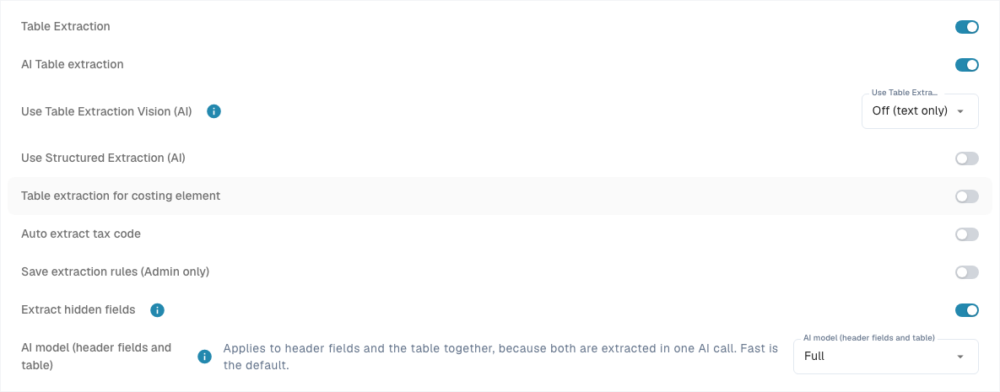
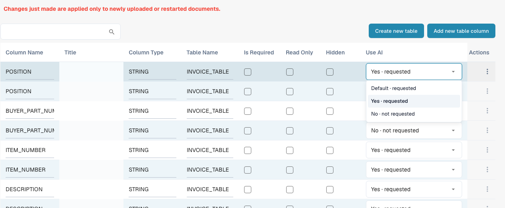

# Structured Output for Tables

Structured Output tells the AI which columns to return. Instead of producing arbitrary headers that need subsequent mapping, it uses a schema built from your configuration. The switch is **Use Structured Extraction (AI)**. It controls the output shape; the model and Vision settings control the model and its input.

## Why is structured output often better?

| Example | Without a fixed output schema | Benefit of Structured Output |
| --- | --- | --- |
| Varying headers | “Art.-Nr.”, “SKU” and “Item Code” can produce different output keys that need mapping. | A requested key such as `ITEM_NUMBER` stays the same, simplifying mapping and downstream processing across layouts. |
| Two item numbers | Internal item number `00127` and supplier item number `V-884` can be confused during mapping. | `ITEM_NUMBER` and `SUPPLIER_ITEM_NUMBER` are separate targets. Still check their values: a schema enforces names, not business understanding. |
| Custom project column | A printed project code can come back under an arbitrary name or be omitted. | Setting `PROJECT_CODE` to **Yes** explicitly requests it. Missing information must still be recognised as missing. |

Column type also helps with amounts: `AMOUNT` becomes a number-or-`null` slot in the structured schema, with a description of its meaning. This can help distinguish a price divisor from a unit of measure. Other types do not automatically become strictly typed JSON values. Preserve leading zeros in identifiers.

Structured Output does not guarantee higher accuracy, shorter processing time or lower cost. Unreadable layouts, wrong values and missing rows remain possible. Compare the same documents with the same model, Vision and training configuration.

## 1. Prerequisites and organization default

Open [Classification and Extraction](../../../administration-and-setup/settings/document-processing/classification-and-extraction/README.md), **General → Extraction**. Organization settings require the appropriate administrator permissions and save immediately.

1. The correct document type must have a table and the required [Table Columns](../../../administration-and-setup/settings/global-settings/document-types/table-columns/README.md).
2. Enable the required extraction paths. The PDF rules/AI fallback path requires **Table Extraction** and additionally **AI Table Extraction**. Structured Output alone does not start AI table extraction.
3. Set **Use Structured Extraction (AI)** as the organization default. Its technical preference is `USE_STRUCTURED_EXTRACTION`.
4. Check readable text or the selected Vision input. Saved classic table rules can still determine the effective table path; check [which extraction path was actually used](../../../overview-and-basics/faq/document-processing/which-extraction-path-was-used.md).

<figure><figcaption>
Current Extraction controls. Structured Output is off in this existing configuration, so no schema preview is shown. No extraction setting was changed.
</figcaption></figure>

## 2. Overrides: which setting applies?

The setting applies to the organization and current extraction template, not automatically to every template of a supplier:

| Situation | Effective behavior |
| --- | --- |
| Template explicitly enabled | Structured Output is active for that template even when the organization default is off. |
| Template explicitly disabled | The template does not use it even when the organization default is on. |
| No template override | The applicable organization setting and its defaults apply. |

On a suitable document's validation screen, open **More options** (three dots). When a template context exists, administrators can change **Use Structured Extraction (AI)** there. Confirmation saves the override and restarts the document; Cancel discards the change. Other templates of the same supplier and historical documents are not automatically changed.

**New supplier templates:** With no saved table-formatting rule and no own Structured Output override, processing can automatically enable Structured Output and save it as a template value, even when the organization default is off. `STRUCTURED_EXTRACTION_FOR_NEW_SUPPLIERS` controls this behavior (enabled by default); the screen described here has no additional switch for it. An existing explicit template choice is preserved.

The [AI Model](../../../administration-and-setup/settings/document-processing/classification-and-extraction/ai-model.md) overview displays existing template preferences; its Structured Output toggles are indicators. Use the document menu to change them. **Delete entry** can remove model, E-Text and other template overrides together. It is not a targeted Structured Output off switch. Automatic enablement can apply again if the template subsequently qualifies as new.

## 3. Use AI per column: Default, Yes or No

Open [Table Columns](../../../administration-and-setup/settings/global-settings/document-types/table-columns/README.md) for the correct document type and table. **Use AI** is a three-state dropdown, not a checkbox. Changes save immediately.

| Choice in the current menu | Meaning for the base schema |
| --- | --- |
| **Default · requested** or **Default · not requested** | Uses the DocBits default for this document type and column name. Default does not always mean on or always mean off. |
| **Yes · requested** | Explicitly requests this configured column from the AI. |
| **No · not requested** | Excludes it from the base schema even if it belongs to the default AI selection. |

Returning to **Default** removes the explicit Yes/No choice. A newly created custom column normally does not belong to the default AI selection; set it to **Yes** if the AI should return it. Default AI columns are not the same as all built-in columns. Check the displayed effect and preview.

**Required**, **Read Only** and **Hidden** control completeness checks, editability and visibility. None replaces the AI choice. **No** neither deletes the column nor clears existing values and does not stop rules, scripts or other sources from filling it. Supplier training and additional AI tags can extend a run's request; resolve conflicting instructions there too. The Structured Output switch does not automatically replace a purely rule-based result.

<figure><figcaption>
Current Use AI dropdown with Default, Yes and No. No option was changed. Title cells are hidden for privacy.
</figcaption></figure>

## 4. Read the preview

When the organization switch is on, **What the AI requests** appears below it. Select Invoice, Order Confirmation, Delivery Note, Customer Orders or Quote. The field/column editing links open the relevant configuration; the preview itself does not run extraction.

* **Requested:** header fields and table columns included in the base schema; a default indicator marks inherited AI defaults.
* **Not requested:** configured table columns outside the current AI selection.
* **Disabled default fields/columns:** explicitly disabled entries that would otherwise be requested by default.
* **Strict and count:** the base schema is strict up to the current DocBits limit of **100 properties**. Requested header fields, the table container and distinct requested line-item columns count; table rows do not. Above that limit, the schema is used as non-strict guidance.

**Preview limits:** It shows the document-type baseline without supplier training or AI tags. Additional instructions can allow an open output before column mappings have been learned; learned source columns can enable a closed output again. Therefore “strict” in the preview does not prove the mode of every document run. The organization preview may be absent when only a template is enabled. Do not change the organization default merely to display the preview.

Without usable header-field configuration, a structured overall schema cannot be built; an enabled switch alone therefore does not prove schema use. Check the actual run through **Explain extraction** and the available document logs. [AI Table](README.md) explains these views and their access requirements.

## 5. Example: invoice with two item numbers and a project

This synthetic example defines a verification target, not an executed extraction run. The document contains two items:

| Item no. | Supplier item no. | Quantity | Unit price | Line amount | Project |
| --- | --- | --- | --- | --- | --- |
| `00127` | `V-884` | 2 | 12.50 | 25.00 | `PRJ-42` |
| `00208` | `V-990` | 1 | 7.00 | 7.00 | `PRJ-42` |

1. Select **Invoice**. Use the existing `ITEM_NUMBER`, `SUPPLIER_ITEM_NUMBER`, `QUANTITY`, `UNIT_PRICE` and `TOTAL_AMOUNT` columns; check their AI selection.
2. In the same table, create a text column with the literal title `Project Code`, producing technical name `PROJECT_CODE`. Choose **Yes · requested**. Set unneeded columns to **No · not requested** deliberately; do not leave a required column without a source.
3. Check the organization default and the current template override. Where available, open the Invoice preview: `PROJECT_CODE` must be requested. Under Default, this custom column would normally not be requested.
4. Upload an approved test document again or restart it. This setting does not reshape already extracted tables retroactively. Check saved mappings and instructions too.
5. Expect two rows: `ITEM_NUMBER` contains `00127`/`00208`, `SUPPLIER_ITEM_NUMBER` contains `V-884`/`V-990`, and `PROJECT_CODE` contains `PRJ-42` in each row. Check leading zeros, quantities, unit prices and line amounts; 25.00 + 7.00 = 32.00 net. A correct total alone does not prove correct individual values.
6. Repeat with another header such as “SKU” and with a document missing its project value. Target columns should stay stable; missing values must not be invented. If a supplier layout swaps the item numbers, add and test an unambiguous mapping or instruction, then recheck both item-number columns.

The gain is a stable requested structure across layouts. Business correctness, required-field validation, PO matching and export still need separate checks.

## 6. Common problems

| Observation | Next check |
| --- | --- |
| Custom column missing | Correct document type and table? Use AI explicitly Yes? Check preview, template value and saved tags; re-extract. |
| Default column empty | Explicitly set to No? If requested but absent from the document, treat its value as missing. |
| Behavior differs despite organization switch | Check template override, automatic enablement of new templates and actual extraction path. |
| Output contains different/additional columns | Check training mappings, AI tags, open output and the actual run's property limit. |
| Old documents show no change | Settings take effect on reprocessing. Check the impact on manual corrections before restarting. |

Further reading: [Edit table columns](../../../administration-and-setup/settings/global-settings/document-types/table-columns/editing-and-deleting-columns.md), [AI tags and instructions](ai-table-tags.md), [AI Model and template preferences](../../../administration-and-setup/settings/document-processing/classification-and-extraction/ai-model.md).
