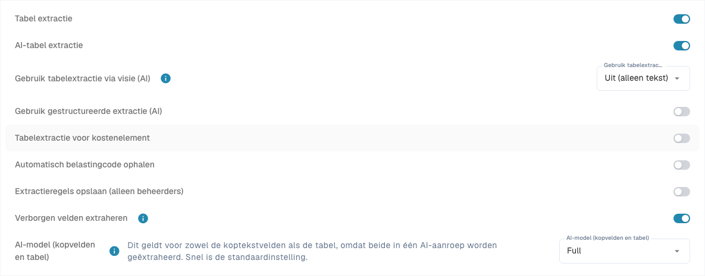

# Structured Output voor tabellen

Structured Output vertelt de AI welke kolommen zij moet teruggeven, met een schema uit uw configuratie. Daardoor zijn er minder vrije kolomnamen die achteraf moeten worden gekoppeld. **Gebruik gestructureerde extractie (AI)** bepaalt de uitvoerstructuur; model en Vision bepalen het model en de invoer.

## Waarom gestructureerde uitvoer vaak beter werkt

| Voorbeeld | Zonder vast schema | Voordeel van Structured Output |
| --- | --- | --- |
| Wisselende koppen | ‘Art.-Nr.’, ‘SKU’ en ‘Item Code’ kunnen verschillende sleutels opleveren. | De gevraagde sleutel `ITEM_NUMBER` blijft gelijk tussen lay-outs en vereenvoudigt de koppeling. |
| Twee artikelnummers | Intern nummer `00127` kan met leveranciersnummer `V-884` worden verwisseld. | `ITEM_NUMBER` en `SUPPLIER_ITEM_NUMBER` zijn afzonderlijke doelen. Controleer de waarden: een schema dwingt namen af, geen inhoudelijk begrip. |
| Eigen projectkolom | De afgedrukte projectcode kan ontbreken of een andere naam krijgen. | `PROJECT_CODE` op **Ja** wordt uitdrukkelijk gevraagd. Ontbrekende informatie moet nog steeds als ontbrekend worden behandeld. |

Ook het type helpt: `AMOUNT`-kolommen krijgen in het schema het type getal of `null`, met een omschrijving van hun betekenis. Dat helpt bijvoorbeeld een prijsdeler van een maateenheid te onderscheiden. Andere typen worden niet automatisch strikt getypeerde JSON-waarden. Behoud voorloopnullen in identificaties.

Hogere nauwkeurigheid, kortere verwerking en lagere kosten zijn niet gegarandeerd. Foute waarden en ontbrekende regels blijven mogelijk. Vergelijk dezelfde documenten met hetzelfde model, Vision en dezelfde training.

## 1. Voorwaarden en organisatiestandaard

Open [Classificatie en Extractie](../../../administration-and-setup/settings/document-processing/classification-and-extraction/README.md), **Algemeen → Extractie**. Organisatie-instellingen vereisen de juiste beheerdersrechten en worden direct opgeslagen.

1. Het juiste documenttype moet een tabel met de benodigde [tabelkolommen](../../../administration-and-setup/settings/global-settings/document-types/table-columns/README.md) hebben.
2. Activeer de vereiste paden. Het PDF-pad met regels en AI als terugval vereist **Table Extraction** én **AI Table Extraction**. Structured Output start op zichzelf geen AI-tabelextractie.
3. Stel **Gebruik gestructureerde extractie (AI)** in als organisatiestandaard. De technische voorkeur heet `USE_STRUCTURED_EXTRACTION`.
4. Controleer leesbare tekst of de gekozen Vision-invoer. Opgeslagen klassieke regels kunnen nog steeds het gebruikte pad bepalen; controleer [welk extractiepad werkelijk is gebruikt](../../../overview-and-basics/faq/document-processing/which-extraction-path-was-used.md).

<figure><figcaption>
Huidige extractie-instellingen. Structured Output staat uit in deze bestaande configuratie; daarom wordt geen schemavoorbeeld getoond. Er is geen extractie-instelling gewijzigd.
</figcaption></figure>

## 2. Welke sjablooninstelling gaat voor?

De instelling geldt voor de organisatie en het huidige extractiesjabloon, niet automatisch voor alle sjablonen van een leverancier.

| Situatie | Werkelijk gedrag |
| --- | --- |
| Sjabloon uitdrukkelijk aan | Structured Output wordt gebruikt, ook als de organisatiestandaard uit staat. |
| Sjabloon uitdrukkelijk uit | Het wordt niet gebruikt, ook als de organisatiestandaard aan staat. |
| Geen sjabloonafwijking | De toepasselijke organisatie-instelling met haar standaardwaarden geldt. |

Open in het validatiescherm van een passend document **Meer opties** (drie punten). Als een sjablooncontext beschikbaar is, kan een beheerder daar **Gebruik gestructureerde extractie (AI)** wijzigen. Bevestigen slaat de afwijking op en start het document opnieuw; Annuleren verwerpt de wijziging. Andere sjablonen en historische documenten worden niet automatisch gewijzigd.

**Nieuwe leverancierssjablonen:** zonder opgeslagen tabelopmaakregel en zonder eigen Structured Output-waarde kan de verwerking Structured Output automatisch activeren en als sjabloonwaarde opslaan, zelfs bij uitgeschakelde organisatiestandaard. `STRUCTURED_EXTRACTION_FOR_NEW_SUPPLIERS` regelt dit (standaard aan); het beschreven scherm heeft hiervoor geen extra schakelaar. Een bestaande uitdrukkelijke keuze blijft behouden.

De lijst [AI-model](../../../administration-and-setup/settings/document-processing/classification-and-extraction/ai-model.md) toont sjabloonwaarden; haar Structured Output-schakelaars zijn alleen indicatoren. Wijzig de waarde via het documentmenu. **Vermelding verwijderen** kan tegelijk model-, E-Text- en andere sjabloonafwijkingen verwijderen. Dit is geen gerichte uitschakeling. Automatische activering kan opnieuw gelden als het sjabloon daarna weer als nieuw wordt beschouwd.

## 3. Use AI: Standaard, Ja of Nee

Open [Tabelkolommen](../../../administration-and-setup/settings/global-settings/document-types/table-columns/README.md) voor het juiste documenttype en de juiste tabel. **Gebruik AI (Use AI)** is een keuzelijst met drie toestanden, geen selectievakje. Wijzigingen worden direct opgeslagen.

| Huidige keuze | Betekenis voor het basisschema |
| --- | --- |
| **Standaard · aangevraagd** of **Standaard · niet aangevraagd** | Neemt de DocBits-standaard voor dit documenttype en deze kolomnaam over. Standaard betekent niet altijd aan of altijd uit. |
| **Ja · aangevraagd** | Vraagt deze geconfigureerde kolom uitdrukkelijk aan de AI. |
| **Nee · niet aangevraagd** | Sluit de kolom uit het basisschema uit, ook als deze normaal wordt gevraagd. |

Terug naar **Standaard** verwijdert de uitdrukkelijke keuze. Een nieuwe eigen kolom valt normaal niet onder de AI-standaardselectie: kies **Ja** als de AI haar moet teruggeven. De AI-standaardkolommen zijn niet alle meegeleverde kolommen. Controleer de aangegeven werking en het voorbeeld.

**Verplicht**, **Alleen-lezen** en **Verborgen** regelen volledigheid, bewerkbaarheid en zichtbaarheid; ze vervangen de AI-keuze niet. **Nee** verwijdert de kolom of bestaande waarden niet en verhindert niet dat regels, scripts of andere bronnen haar vullen. Leverancierstraining en extra AI-tags kunnen de werkelijke aanvraag uitbreiden: los tegenstrijdigheden daar ook op. De schakelaar vervangt niet automatisch een resultaat dat uitsluitend uit regels komt.

<figure><figcaption>
Huidige Use AI-keuzelijst met Standaard, Ja en Nee. Er is geen optie gewijzigd. Titelcellen zijn verborgen ter bescherming van gegevens.
</figcaption></figure>

## 4. Het voorbeeld lezen

Als de organisatieschakelaar aan staat, verschijnt **Wat de AI vraagt** eronder. Kies factuur, orderbevestiging, pakbon, klantorder of offerte. De bewerklinks openen de bijbehorende veld- of kolominstellingen. Het voorbeeld voert geen extractie uit.

* **Aangevraagd:** kopvelden en tabelkolommen in het basisschema; een standaardindicator markeert overgenomen AI-voorkeuren.
* **Niet aangevraagd:** geconfigureerde kolommen buiten de huidige selectie.
* **Uitgeschakelde standaardvelden/-kolommen:** uitdrukkelijk uitgesloten waarden die anders standaard worden gevraagd.
* **Strict en aantal:** het basisschema is strikt tot de huidige DocBits-grens van **100 eigenschappen**. Gevraagde kopvelden, de tabelcontainer en verschillende gevraagde regelkolommen tellen mee; tabelregels niet. Boven de grens is het schema een niet-strikte aanwijzing.

Het voorbeeld bevat geen leverancierstraining of AI-tags. Extra instructies kunnen open uitvoer toestaan zolang kolomkoppelingen niet zijn geleerd; geleerde bronkolommen kunnen gesloten uitvoer mogelijk maken. ‘Strict’ bewijst dus niet de modus van iedere documentverwerking. Als alleen het sjabloon aan staat, kan het organisatievoorbeeld ontbreken: wijzig de globale instelling niet alleen om het zichtbaar te maken.

Zonder bruikbare kopveldconfiguratie kan geen volledig schema worden opgebouwd. Een ingeschakelde schakelaar bewijst het gebruik dus niet. Controleer de echte verwerking via **Extractie uitleggen** en de beschikbare documentlogboeken; [AI-tabel](README.md) beschrijft deze weergaven en toegangsrechten.

## 5. Voorbeeld: factuur met twee nummers en een project

Dit synthetische voorbeeld beschrijft een te controleren resultaat, geen uitgevoerde extractie.

| Artikel | Leveranciersartikel | Aantal | Eenheidsprijs | Regelbedrag | Project |
| --- | --- | --- | --- | --- | --- |
| `00127` | `V-884` | 2 | 12,50 | 25,00 | `PRJ-42` |
| `00208` | `V-990` | 1 | 7,00 | 7,00 | `PRJ-42` |

1. Kies **Factuur** en controleer de AI-selectie voor `ITEM_NUMBER`, `SUPPLIER_ITEM_NUMBER`, `QUANTITY`, `UNIT_PRICE` en `TOTAL_AMOUNT`.
2. Maak in dezelfde tabel een tekstkolom met de letterlijke titel `Project Code`; dit geeft technische naam `PROJECT_CODE`. Kies **Ja · aangevraagd**. Gebruik **Nee · niet aangevraagd** bewust; een verplichte kolom moet een gegevensbron houden.
3. Controleer organisatie en huidig sjabloon. In het factuurvoorbeeld, indien beschikbaar, moet `PROJECT_CODE` aangevraagd zijn. Onder Standaard zou deze eigen kolom normaal niet worden gevraagd.
4. Upload een toegestaan testdocument opnieuw of herstart het. De instelling verandert bestaande extracties niet met terugwerkende kracht. Controleer ook opgeslagen koppelingen en instructies.
5. Verwacht twee regels: `ITEM_NUMBER` = `00127`/`00208`, `SUPPLIER_ITEM_NUMBER` = `V-884`/`V-990` en `PROJECT_CODE` = `PRJ-42` in beide. Controleer voorloopnullen, aantallen, prijzen en bedragen; 25,00 + 7,00 = 32,00 netto. Een juiste som bewijst niet iedere waarde.
6. Herhaal met kop ‘SKU’ en met een document zonder project. Doelkolommen moeten stabiel blijven zonder verzonnen waarden. Worden nummers verwisseld, voeg dan een duidelijke koppeling of instructie toe, test die en controleer beide kolommen opnieuw.

Het voordeel is een stabiele gevraagde structuur tussen lay-outs. Controleer gegevens, verplichte velden, inkoopordermatching en export afzonderlijk.

## 6. Veelvoorkomende problemen

| Waarneming | Volgende controle |
| --- | --- |
| Eigen kolom ontbreekt | Juiste type en tabel, keuze Ja, voorbeeld, sjabloonwaarde en tags; opnieuw extraheren. |
| Standaardkolom leeg | Uitdrukkelijk Nee? Indien wel gevraagd maar niet op het document: behandelen als ontbrekend. |
| Gedrag wijkt af van globale instelling | Sjabloonafwijking, automatische activering en werkelijk extractiepad. |
| Andere of extra kolommen | Geleerde koppelingen, tags, open uitvoer en grens van de echte verwerking. |
| Oude documenten onveranderd | Opnieuw verwerken; controleer eerst gevolgen voor handmatige correcties. |

Verder lezen: [Kolommen bewerken](../../../administration-and-setup/settings/global-settings/document-types/table-columns/editing-and-deleting-columns.md), [AI-tags en instructies](ai-table-tags.md), [AI-model en sjabloonwaarden](../../../administration-and-setup/settings/document-processing/classification-and-extraction/ai-model.md).
