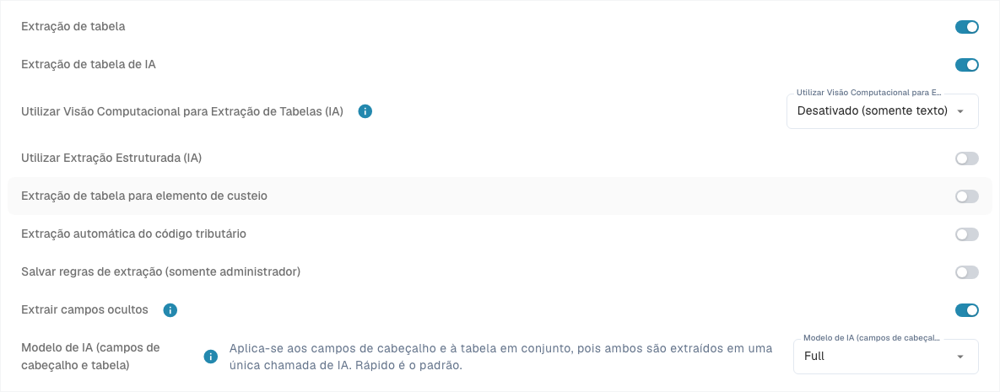
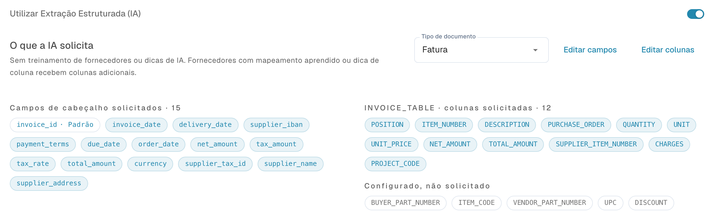

# Structured Output para tabelas

Structured Output indica à IA quais colunas devolver, usando um esquema criado a partir da configuração. Isso reduz os cabeçalhos livres que depois precisam ser mapeados. **Utilizar Extração Estruturada (IA)** controla o formato da saída; modelo e Vision controlam o modelo e seus dados de entrada.

## Por que a saída estruturada costuma ser melhor

| Exemplo | Sem esquema fixo | Vantagem do Structured Output |
| --- | --- | --- |
| Cabeçalhos variáveis | “Art.-Nr.”, “SKU” e “Item Code” podem gerar chaves diferentes. | A chave solicitada `ITEM_NUMBER` permanece estável entre layouts e simplifica o mapeamento. |
| Dois códigos de artigo | O código interno `00127` pode ser confundido com o do fornecedor `V-884`. | `ITEM_NUMBER` e `SUPPLIER_ITEM_NUMBER` são destinos separados. Verifique os valores: o esquema impõe nomes, não entendimento do conteúdo. |
| Coluna própria de projeto | O código impresso pode ser omitido ou devolvido com outro nome. | `PROJECT_CODE` com **Sim** é solicitado explicitamente. Dados ausentes continuam devendo ser reconhecidos como ausentes. |

O tipo também ajuda: colunas `AMOUNT` são descritas no esquema como número ou `null`, com uma explicação de seu significado. Isso ajuda, por exemplo, a distinguir um divisor de preço de uma unidade de medida. Os outros tipos não se tornam automaticamente valores JSON com tipagem estrita. Preserve zeros iniciais em identificadores.

Não há garantia de maior precisão, menor tempo ou menor custo. Valores incorretos e linhas ausentes continuam possíveis. Compare os mesmos documentos com o mesmo modelo, Vision e treinamento.

## 1. Requisitos e configuração da organização

Abra [Classificação e extração](../../../administration-and-setup/settings/document-processing/classification-and-extraction/README.md), **Geral → Extração**. As configurações da organização exigem permissões de administrador adequadas e são salvas imediatamente.

1. O tipo de documento correto deve ter uma tabela e as [colunas](../../../administration-and-setup/settings/global-settings/document-types/table-columns/README.md) necessárias.
2. Ative os caminhos exigidos. O caminho PDF baseado em regras com IA como alternativa exige **Table Extraction** e **AI Table Extraction**. Structured Output sozinho não inicia a extração de tabelas por IA.
3. Defina **Utilizar Extração Estruturada (IA)** como padrão da organização. A preferência técnica é `USE_STRUCTURED_EXTRACTION`.
4. Verifique o texto legível ou a entrada Vision escolhida. Regras clássicas salvas ainda podem determinar o caminho efetivo; confirme [qual caminho foi realmente usado](../../../overview-and-basics/faq/document-processing/which-extraction-path-was-used.md).

<figure><figcaption>
Controles atuais de extração. Structured Output está desativado nesta configuração existente, portanto não aparece a prévia do esquema. Nenhuma configuração de extração foi alterada.
</figcaption></figure>

## 2. Prioridade das configurações do modelo de extração

O escopo é a organização e o modelo de extração atual, não todos os modelos de um fornecedor.

| Situação | Comportamento efetivo |
| --- | --- |
| Modelo de extração ativado explicitamente | Usa Structured Output mesmo com o padrão da organização desativado. |
| Modelo de extração desativado explicitamente | Não o usa mesmo com o padrão da organização ativado. |
| Sem configuração específica | Aplica a configuração da organização e seus valores padrão pertinentes. |

Na tela de validação de um documento adequado, abra **Mais opções** (três pontos). Se houver contexto de modelo de extração, um administrador pode alterar **Utilizar Extração Estruturada (IA)**. Confirmar salva a configuração específica e reinicia o documento; Cancelar descarta a alteração. Outros modelos do fornecedor e documentos históricos não são alterados automaticamente.

**Novos modelos de fornecedores:** sem regra de formatação de tabela salva e sem valor Structured Output próprio, o processamento pode ativá-lo automaticamente e salvar essa escolha no modelo, mesmo com a organização desativada. `STRUCTURED_EXTRACTION_FOR_NEW_SUPPLIERS` controla esse comportamento (ativado por padrão); a tela descrita não tem um interruptor adicional para ele. Uma escolha explícita existente é preservada.

A lista [Modelo de IA](../../../administration-and-setup/settings/document-processing/classification-and-extraction/ai-model.md) mostra os valores dos modelos de extração; seus interruptores Structured Output são indicadores. Altere a configuração pelo menu do documento. **Excluir entrada** pode remover juntas as configurações específicas de modelo de IA, E-Text e outras opções. Não é uma desativação seletiva. A ativação automática pode acontecer novamente se o modelo voltar a ser considerado novo.

## 3. Use AI: Padrão, Sim ou Não

Abra [Colunas de tabela](../../../administration-and-setup/settings/global-settings/document-types/table-columns/README.md) para o tipo de documento e a tabela corretos. **Usar IA (Use AI)** é uma lista de três estados, não uma caixa de seleção. A alteração é salva imediatamente.

| Opção atual | Efeito no esquema base |
| --- | --- |
| **Padrão · solicitado** ou **Padrão · não solicitado** | Usa a seleção DocBits para esse tipo e nome de coluna. Padrão não significa sempre ativado nem sempre desativado. |
| **Sim · solicitado** | Solicita explicitamente essa coluna configurada à IA. |
| **Não · não solicitado** | Exclui a coluna do esquema base, mesmo que normalmente seja solicitada. |

Voltar a **Padrão** remove a escolha explícita. Uma coluna própria recém-criada normalmente não pertence à seleção padrão de IA: escolha **Sim** para solicitá-la. As colunas padrão de IA não são todas as colunas fornecidas. Verifique o efeito indicado e a prévia.

**Obrigatória**, **Somente leitura** e **Oculta** controlam completude, edição e visibilidade; não substituem a escolha de IA. **Não** não exclui a coluna nem apaga valores, e não impede que regras, scripts ou outras fontes a preencham. Treinamento do fornecedor e tags de IA podem ampliar a solicitação efetiva: resolva também ali as contradições. O interruptor não substitui automaticamente um resultado obtido apenas por regras.

<figure><figcaption>
Lista Use AI atual com Padrão, Sim e Não. Nenhuma opção foi alterada. As células de título estão ocultas para proteger dados.
</figcaption></figure>

## 4. Interpretar a prévia

Com o interruptor da organização ativado, aparece **O que a IA solicita** abaixo dele. Escolha fatura, confirmação de pedido, nota de entrega, pedido de cliente ou cotação. Os links de edição abrem os campos ou colunas correspondentes. A prévia não executa uma extração.

* **Solicitado:** campos de cabeçalho e colunas do esquema base; um indicador identifica as seleções padrão de IA herdadas.
* **Não solicitado:** colunas configuradas fora da seleção atual.
* **Valores padrão desativados:** campos ou colunas excluídos explicitamente que normalmente seriam solicitados.
* **Strict e contagem:** o esquema base é estrito até o limite DocBits atual de **100 propriedades**. Contam os campos de cabeçalho solicitados, o contêiner da tabela e as colunas de posição distintas solicitadas, não as linhas. Acima do limite, o esquema é usado como orientação não estrita.

A prévia não inclui treinamento nem tags do fornecedor. Instruções adicionais podem permitir saída aberta antes de as associações serem aprendidas; colunas de origem aprendidas podem permitir saída fechada novamente. Portanto, “strict” não comprova o modo de cada execução. Se apenas o modelo de extração estiver ativado, a prévia da organização pode não aparecer: não altere o padrão global só para exibi-la.

Sem configuração utilizável dos campos de cabeçalho, não é possível construir um esquema completo. Um interruptor ativado, sozinho, não comprova seu uso. Confira a execução em **Explicar extração** e nos logs disponíveis; [Tabela de IA](README.md) explica essas telas e permissões.

Neste exemplo de configuração, as colunas solicitadas de INVOICE_TABLE incluem `ITEM_NUMBER`, `SUPPLIER_ITEM_NUMBER`, `QUANTITY`, `UNIT_PRICE`, `TOTAL_AMOUNT` e `PROJECT_CODE`. A coluna própria de projeto está explicitamente em **Sim**, como na etapa 2 do exemplo abaixo. A prévia também inclui outras colunas de fatura configuradas; a seleção e a quantidade da sua organização podem, portanto, variar. **12** é a quantidade de colunas solicitadas desta tabela, não a quantidade de linhas nem o total de propriedades do esquema. É uma prévia de configuração, não um resultado de extração.

<figure><figcaption>
Detalhe da prévia do esquema de Fatura com Structured Output ativado. INVOICE_TABLE solicita 12 colunas, incluindo PROJECT_CODE com Usar IA em Sim. As outras tabelas configuradas e o contador de propriedades ficam fora deste detalhe.
</figcaption></figure>

## 5. Exemplo: fatura com dois códigos e projeto

Este exemplo sintético define um resultado a verificar, não uma extração executada.

| Artigo | Artigo do fornecedor | Quantidade | Preço unitário | Valor da linha | Projeto |
| --- | --- | --- | --- | --- | --- |
| `00127` | `V-884` | 2 | 12,50 | 25,00 | `PRJ-42` |
| `00208` | `V-990` | 1 | 7,00 | 7,00 | `PRJ-42` |

1. Escolha **Fatura** e verifique a seleção de IA de `ITEM_NUMBER`, `SUPPLIER_ITEM_NUMBER`, `QUANTITY`, `UNIT_PRICE` e `TOTAL_AMOUNT`.
2. Na mesma tabela, crie uma coluna de texto com o título literal `Project Code`, gerando o nome técnico `PROJECT_CODE`. Escolha **Sim · solicitado**. Use **Não · não solicitado** conscientemente; uma coluna obrigatória precisa manter uma fonte.
3. Verifique organização e modelo de extração atual. Na prévia de fatura, se disponível, `PROJECT_CODE` deve ser solicitado. Com Padrão, essa coluna própria normalmente não seria solicitada.
4. Envie novamente um documento de teste autorizado ou reinicie-o. A alteração não transforma tabelas já extraídas retroativamente. Confira também associações e instruções salvas.
5. Espere duas linhas: `ITEM_NUMBER` = `00127`/`00208`, `SUPPLIER_ITEM_NUMBER` = `V-884`/`V-990` e `PROJECT_CODE` = `PRJ-42` nas duas. Verifique zeros iniciais, quantidades, preços e valores; 25,00 + 7,00 = 32,00 líquidos. A soma correta não comprova cada valor.
6. Repita com o cabeçalho “SKU” e com um documento sem projeto. As colunas devem permanecer estáveis, sem inventar valores. Se os códigos forem trocados, adicione e teste uma associação ou instrução inequívoca e confira as duas colunas novamente.

O ganho é uma estrutura solicitada estável entre layouts. Verifique separadamente os dados, campos obrigatórios, correspondência de pedidos e exportação.

## 6. Problemas comuns

| Observação | Próxima verificação |
| --- | --- |
| Coluna própria ausente | Tipo e tabela corretos, opção Sim, prévia, valor do modelo e tags; extrair novamente. |
| Coluna padrão vazia | Opção Não explícita? Se solicitada, mas ausente do documento, tratar o dado como faltante. |
| Resultado diferente do ajuste global | Configuração específica, ativação automática e caminho efetivo. |
| Colunas diferentes ou adicionais | Associações aprendidas, tags, saída aberta e limite da execução real. |
| Documentos antigos sem alterações | Reprocessar; antes, verificar o impacto nas correções manuais. |

Leia também: [Editar colunas](../../../administration-and-setup/settings/global-settings/document-types/table-columns/editing-and-deleting-columns.md), [Tags e instruções](ai-table-tags.md), [Modelo de IA e valores específicos](../../../administration-and-setup/settings/document-processing/classification-and-extraction/ai-model.md).
