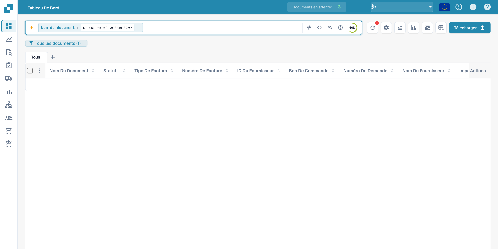
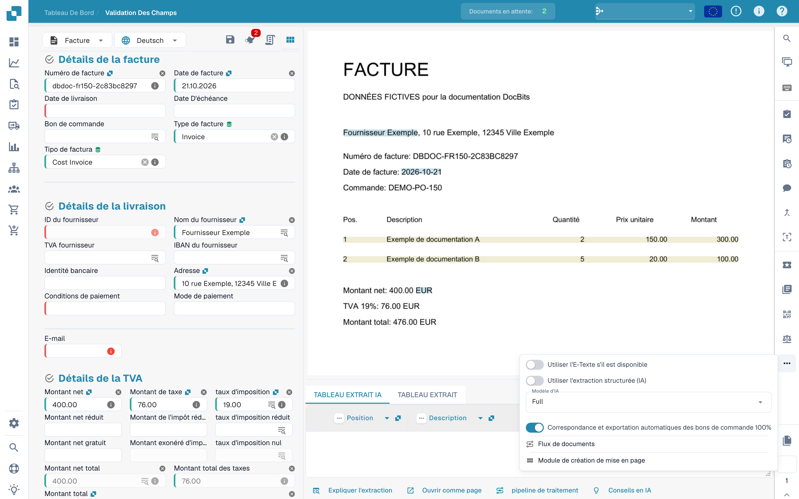
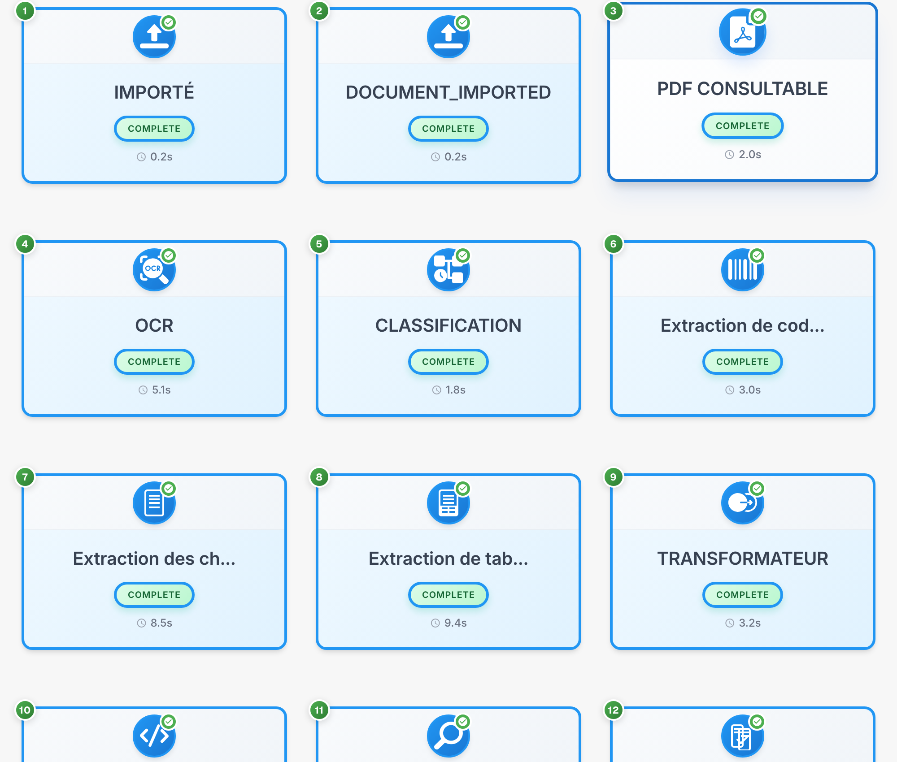

# Flux du document

Le flux du document montre l’ordre, le statut et la durée des étapes de traitement. Les cartes numérotées indiquent cet ordre. L’exemple utilise une facture fictive.

## Ouvrir le flux

Recherchez d’abord le document dans le tableau de bord. L’image montre la recherche de l’exemple fictif ; les valeurs des documents du tableau sont masquées.

<figure><figcaption>
Recherche du document fictif dans le tableau de bord ; les valeurs sont masquées.
</figcaption></figure>

Ouvrez le document dans **Validation des champs**. Dans la barre d’actions de droite, ouvrez le menu d’options (…) et choisissez **Flux de documents**.

<figure><figcaption>
Menu d’options de validation permettant d’ouvrir le flux du document.
</figcaption></figure>

## Lire les étapes

Chaque carte représente une étape, comme l’import, l’OCR, la classification ou l’extraction des champs. Suivez leur numérotation et faites défiler vers le bas pour voir les étapes suivantes.

<figure><figcaption>
Étapes de traitement d’une facture fictive ; les codes techniques restent inchangés.
</figcaption></figure>

Les identifiants techniques comme `DOCUMENT_IMPORTED` et `COMPLETE` restent inchangés. `COMPLETE` indique une étape terminée.

## Consulter les détails

Sélectionnez une carte pour consulter ses détails et journaux disponibles.

| Détail | Signification |
| --- | --- |
| Module | Composant de traitement de l’étape |
| Statut | État actuel de cette étape |
| Durée | Temps de traitement enregistré |
| Journaux | Messages techniques disponibles |

Examinez les messages d’une étape en attente ou en échec avant de relancer le traitement. Certains titres de diagnostic peuvent rester en anglais dans le produit.
