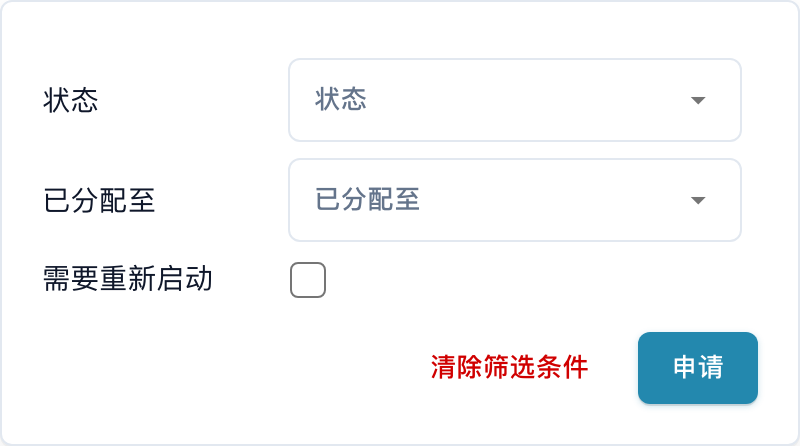
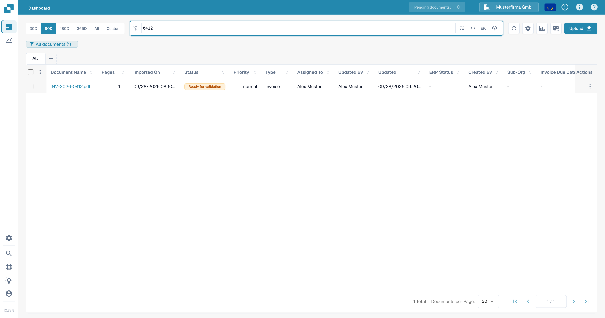
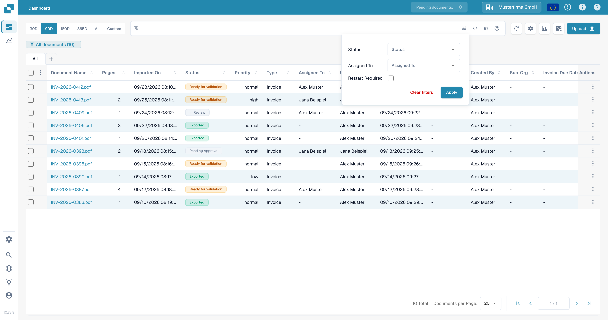
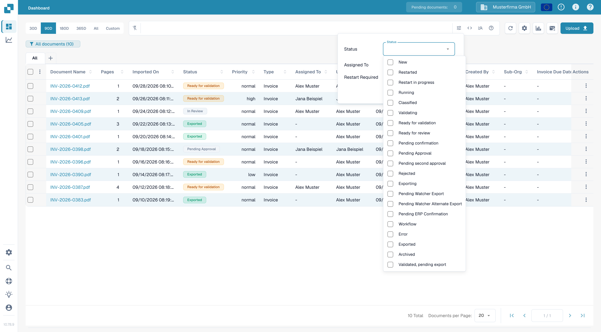
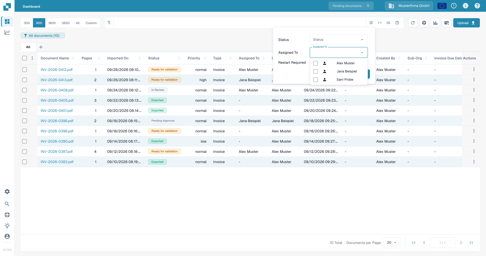
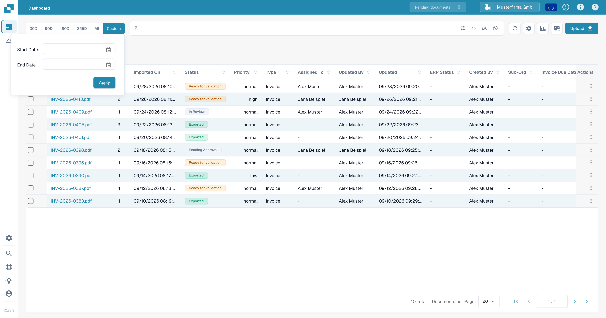
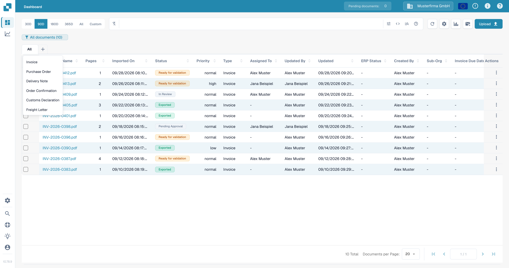
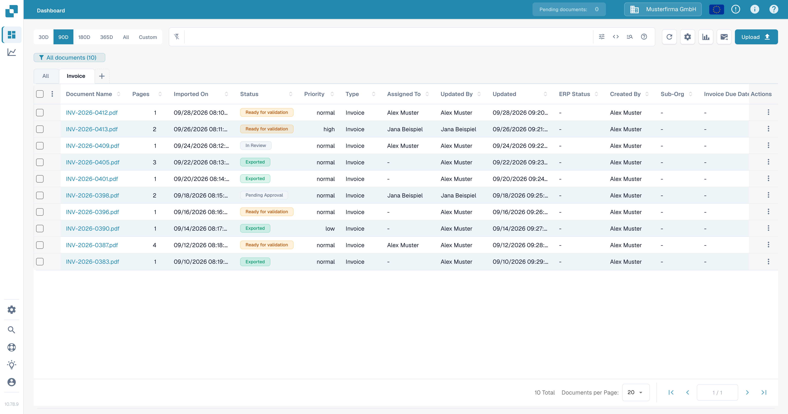

# 筛选文档

<figure><figcaption>
Dashboard 中用于分配和需要重新处理条件的筛选器。
</figcaption></figure>

使用 Dashboard 的搜索栏、筛选面板、日期范围和文档类型标签页来缩小文档列表。这些控件相互配合：文档必须同时符合当前搜索条件和筛选条件，才会保留在表格中。

## 按名称查找文档

1. 打开 **Dashboard**。
2. 在表格上方的搜索栏中输入文档名称的一部分，然后按 **Enter**。Dashboard 徽标中的计数和表格会更新，显示匹配的文档。
3. 要查找其他文档时，请替换搜索词。关于字段搜索和搜索语法，请参阅 [Quick Search](quick-search.md)。

<figure><figcaption>按文档名称搜索可缩小测试文档列表。</figcaption></figure>

## 按状态、分配对象或重新处理要求筛选

1. 选择搜索栏右端的 **Filters** 图标（滑块）。
2. 选择一个或多个 **Status** 值。可以同时选择多个状态。
3. 在 **Assigned To** 中选择您要查看其文档的用户。如果您的组织启用了组权限，组也可能出现在同一列表中。此面板中没有单独的 **Assigned to Group** 字段。
4. 选择 **Restart Required**，以显示需要重新处理的文档。
5. 选择 **Apply**。要移除此面板中的这些选择，请选择 **Clear filters**；搜索文本和日期范围是独立的控件。

<figure><figcaption>当前筛选面板包含三个条件和两个操作。</figcaption></figure>

<figure><figcaption>选择您需要的处理状态。</figcaption></figure>

<figure><figcaption>在 Assigned To 中选择一位用户。</figcaption></figure>

关于每种处理状态的含义，请参阅 [Document Status](document-status.md)。

## 选择导入日期范围

在搜索栏上方，选择 **30D**、**90D**、**180D**、**365D** 或 **All** 可更改导入日期范围。选择 **Custom**，选择 **Start Date** 和 **End Date**，然后选择 **Apply** 以使用特定范围。当前选择会高亮显示。

<figure><figcaption>预设日期范围不合适时使用 Custom。</figcaption></figure>

## 使用文档类型标签页

1. 选择 **All** 旁边的 **+**。菜单会列出您的组织可用的文档类型。
2. 选择一种类型（例如 **Invoice**）以添加其标签页。然后选择新标签页，将表格筛选为该类型。**All** 会移除类型限制，但不会删除标签页。
3. 要移除类型标签页，请选择其 **×**。**All** 标签页无法移除。

DocBits 会将您的标签页与用户设置一起保存，因此下次打开 Dashboard 时它们仍会存在。添加的标签页会一直保留，直到您将其移除。

<figure><figcaption>从加号菜单添加文档类型标签页。</figcaption></figure>

<figure><figcaption>选择该标签页以应用类型筛选；使用 × 移除标签页。</figcaption></figure>

如果 **+** 菜单中没有类型，请让管理员检查您的组织当前启用了哪些文档类型。请参阅 [Document Types](../../../administration-and-setup/settings/global-settings/document-types/README.md)。要保存筛选器组合以备后用，请参阅 [Personal Dashboards](personal-dashboards.md)。
