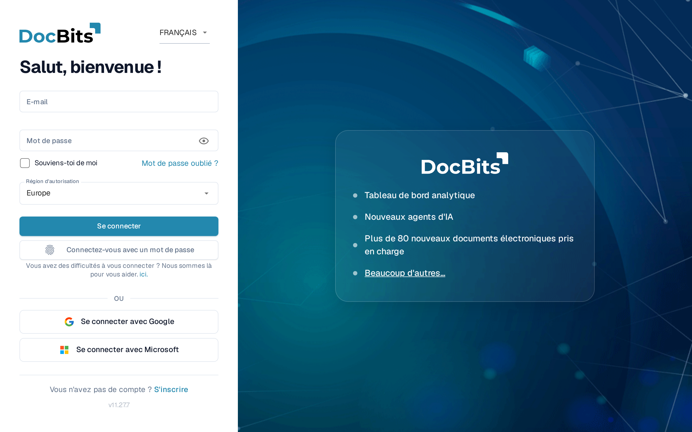
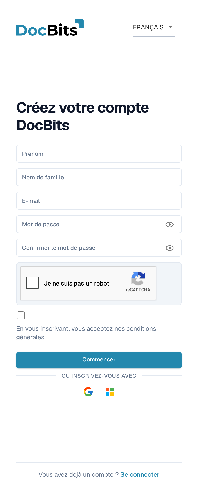
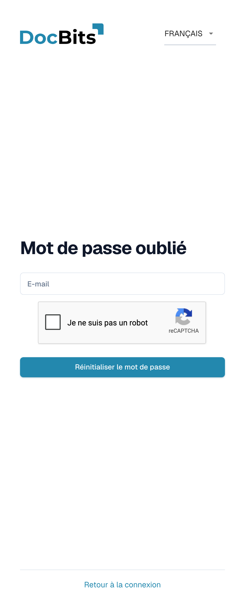
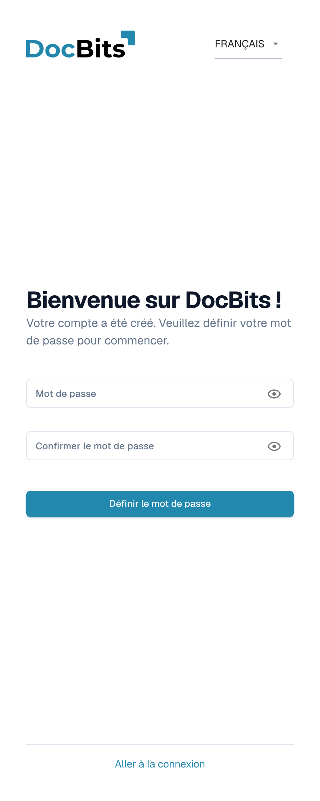

# Accéder à DocBits et se connecter

Cette page explique comment obtenir un compte DocBits et comment vous connecter :

* [Se connecter avec un compte existant](#se-connecter-avec-un-compte-existant) — les champs de l'écran de connexion et le sélecteur de région.
* [Inscription](#inscription) — créez votre propre compte DocBits.
* [Mot de passe oublié](#mot-de-passe-oublie) — réinitialisez votre mot de passe avec un lien de réinitialisation.
* [Premier mot de passe pour les comptes créés par un administrateur](#premier-mot-de-passe-pour-les-comptes-crees-par-un-administrateur) — définissez le premier mot de passe d'un compte créé pour vous par votre administrateur.

L'authentification à deux facteurs, les passkeys et la deuxième étape de connexion sont décrites dans [Authentification à deux facteurs (2FA)](../../security/two-factor-authentication.md). Utilisez le menu des langues en haut à droite de ces formulaires si vous avez besoin d'une autre langue d'affichage.

## Se connecter avec un compte existant

Ouvrez l'adresse web DocBits fournie à votre organisation — par exemple `https://app.docbits.com` — et connectez-vous sur l'écran de connexion.

<figure><figcaption>
L'écran de connexion : E-mail et Mot de passe, Souviens-toi de moi, le sélecteur Région d'autorisation, Se connecter, la connexion par passkey et les boutons de connexion Google et Microsoft.
</figcaption></figure>

1. **E-mail** — l'adresse avec laquelle votre compte DocBits a été créé.
2. **Mot de passe** — votre mot de passe DocBits. L'icône en forme d'œil dans le champ affiche ou masque ce que vous avez saisi.
3. **Souviens-toi de moi** — préremplit votre adresse e-mail la prochaine fois que vous ouvrez l'écran de connexion.
4. **Région d'autorisation** — DocBits fonctionne dans deux régions, l'Europe et les États-Unis, et chacune dispose de son propre service de connexion. Le sélecteur apparaît sur les déploiements qui utilisent les deux (production, dev et sandbox) ; il affiche par exemple **Europe**. DocBits présélectionne votre dernier choix, sinon la région correspondant au fuseau horaire de votre ordinateur, sinon l'Europe. Si votre compte a été créé dans l'autre région, sélectionnez-la ici avant de cliquer sur **Se connecter**.
5. Cliquez sur **Se connecter**.

Sous les champs de mot de passe :

* **Connectez-vous avec un mot de passe** — le bouton marqué d'une empreinte digitale apparaît lorsque votre navigateur prend en charge les passkeys. Il vous connecte sans votre mot de passe ; la version française de l'application a repris ici le libellé du mot de passe, il s'agit bien de la connexion sans mot de passe. Voir [Connexion sans mot de passe](../../security/two-factor-authentication.md).
* **Se connecter avec Google** et **Se connecter avec Microsoft** — pour les organisations qui utilisent l'authentification unique avec ces fournisseurs. Le fournisseur d'identité gère la connexion, le mot de passe DocBits et l'exigence de double facteur DocBits ne s'appliquent donc pas.
* **Mot de passe oublié ?** — voir [Mot de passe oublié](#mot-de-passe-oublie) ci-dessous.
* **Vous avez des difficultés à vous connecter ? Nous sommes là pour vous aider. ici.** — le lien « ici. » ouvre le site de documentation DocBits.
* **S'inscrire** — voir [Inscription](#inscription) ci-dessous.


Choisissez la **Région d'autorisation** utilisée par votre organisation avant de cliquer sur **Se connecter** : ce choix détermine quel service de connexion de la région reçoit vos identifiants. En cas de doute, demandez à votre administrateur.


## Inscription

Vous pouvez créer vous-même un compte DocBits sur la page d'inscription. Ouvrez-la depuis le lien **S'inscrire** sur l'écran de connexion, ou accédez à `https://app.docbits.com/register` (utilisez l'adresse web communiquée à votre organisation).

<figure><figcaption>
Inscription : renseignez Prénom, Nom de famille, E-mail, Mot de passe et Confirmer le mot de passe. Résolvez reCAPTCHA s’il apparaît, acceptez les conditions générales et choisissez Commencer. Se connecter revient à la connexion.
</figcaption></figure>

Remplissez le formulaire :

1. **Prénom** et **Nom de famille** — votre nom tel qu'il doit apparaître dans DocBits.
2. **E-mail** — votre adresse e-mail professionnelle. C'est votre identifiant de connexion.
3. **Mot de passe** et **Confirmer le mot de passe** — voir les règles de mot de passe ci-dessous. Une liste de contrôle sous le champ du mot de passe indique quelles règles votre mot de passe remplit déjà.
4. Si la page affiche un widget **reCAPTCHA**, complétez-le. Le widget n'apparaît que lorsque le déploiement DocBits de votre organisation dispose d'une protection contre les robots.
5. Cochez la case pour confirmer que vous acceptez les **conditions générales**.
6. Cliquez sur **Commencer**. Si vous avez déjà un compte, cliquez sur **Se connecter** en bas pour revenir à la page de connexion. **Visitez le site web** ouvre le site web de DocBits pour obtenir des informations sur le produit.

Utilisez l'icône en forme d'œil à côté d'un champ de mot de passe pour afficher ou masquer les caractères saisis.

### Règles de mot de passe

Votre mot de passe doit :

* contenir entre **8 et 20 caractères**,
* contenir au moins une lettre **majuscule** et une lettre **minuscule**,
* contenir au moins un **chiffre**,
* contenir au moins un **caractère spécial** (`!@#$%^&*()_+=\\[{]\\};:,.<>?/\\|~-`).

Seules les lettres, les chiffres et ces caractères spéciaux sont autorisés.

### S'inscrire avec Google ou Microsoft

Au lieu d'un mot de passe, vous pouvez cliquer sur le bouton **Google** ou **Microsoft** sous **OU INSCRIVEZ-VOUS AVEC**. DocBits crée votre compte via votre fournisseur d'identité, et vous vous connecterez plus tard de la même manière.

### Confirmer votre adresse e-mail

Après avoir soumis le formulaire, DocBits affiche une page de confirmation et envoie un **e-mail de vérification** à l'adresse que vous avez saisie. Ouvrez l'e-mail et cliquez sur le lien qu'il contient — il vous amène à une page de confirmation qui vérifie votre adresse. Si l'e-mail n'arrive pas, la page de confirmation propose une option de **renvoi**. Une fois l'adresse vérifiée, connectez-vous avec votre e-mail et votre mot de passe.

## Mot de passe oublié

DocBits stocke les mots de passe sous forme de hachages salés à sens unique. Un mot de passe existant ne peut pas être récupéré à partir de son hachage ; cette procédure en définit donc un nouveau. Voir [Stockage sécurisé des identifiants](../../security/secure-storage-of-credentials.md).

Si vous avez oublié votre mot de passe :

1. Sur l'écran de connexion, cliquez sur **Mot de passe oublié ?**.
2. Sur la page **Mot de passe oublié**, saisissez votre adresse **E-mail** et cliquez sur **Réinitialiser le mot de passe**. Si un widget reCAPTCHA est affiché, complétez-le d'abord.

   <figure><figcaption>
Saisissez votre E-mail et choisissez Réinitialiser le mot de passe pour demander un lien, ou utilisez Retour à la connexion. Résolvez reCAPTCHA lorsqu’il apparaît.
</figcaption></figure>

   Si vous ne souhaitez pas réinitialiser votre mot de passe, cliquez sur **Retour à la connexion** pour revenir à la page de connexion.

3. DocBits vous envoie par e-mail un **lien de réinitialisation de mot de passe**. Ouvrez l'e-mail et cliquez sur le lien — il ouvre la page de réinitialisation.
4. Saisissez votre **nouveau mot de passe deux fois**. Les mêmes règles de mot de passe que lors de l'[inscription](#regles-de-mot-de-passe) s'appliquent, et une liste de contrôle indique les règles déjà remplies.
5. Cliquez sur **Réinitialiser le mot de passe**. DocBits confirme la modification et vous ramène à l'écran de connexion, où vous pouvez vous connecter avec le nouveau mot de passe.


Les liens de réinitialisation expirent après un court délai. Si le lien ne fonctionne plus, recommencez les étapes ci-dessus pour en demander un nouveau.


## Premier mot de passe pour les comptes créés par un administrateur

Lorsque votre administrateur vous ajoute comme utilisateur (voir [Utilisateurs](../../administration-and-setup/settings/global-settings/groups-users-and-permissions/users/README.md)), vous recevez un e-mail avec vos identifiants de connexion et un lien pour définir votre **premier mot de passe**. Le lien ouvre la page **Définir le mot de passe** :

<figure><figcaption>
Définition du premier mot de passe d’un compte créé par un administrateur : renseignez Mot de passe et Confirmer le mot de passe, puis choisissez Définir le mot de passe. Aller à la connexion revient à l’identification.
</figcaption></figure>

1. Cliquez sur le lien dans l'e-mail d'invitation. La page vous accueille avec « Bienvenue sur DocBits ! Votre compte a été créé. Veuillez définir votre mot de passe pour commencer. »
2. Saisissez votre mot de passe deux fois — les mêmes [règles de mot de passe](#regles-de-mot-de-passe) s'appliquent.
3. Cliquez sur **Définir le mot de passe**. Vous pouvez ensuite vous connecter avec votre e-mail et ce mot de passe.

Les icônes en forme d'œil affichent ou masquent ce que vous avez saisi. Si vous partez avant de définir un mot de passe, **Aller à la connexion** ramène à la page de connexion.

Le lien est lié à votre compte et ne fonctionne qu'une seule fois. S'il expire avant que vous ne l'utilisiez, demandez à votre administrateur de renvoyer l'invitation ou utilisez **Mot de passe oublié ?** avec votre adresse e-mail.
