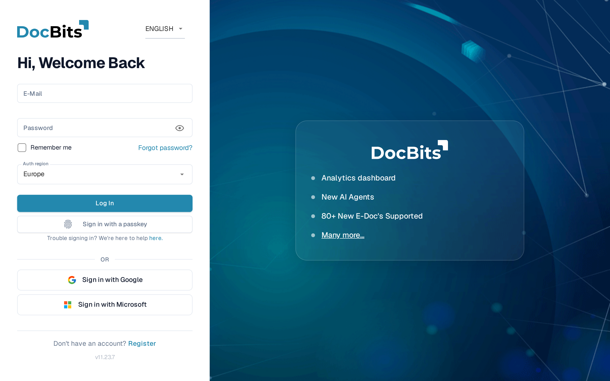
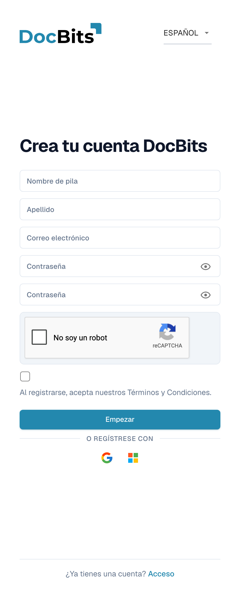
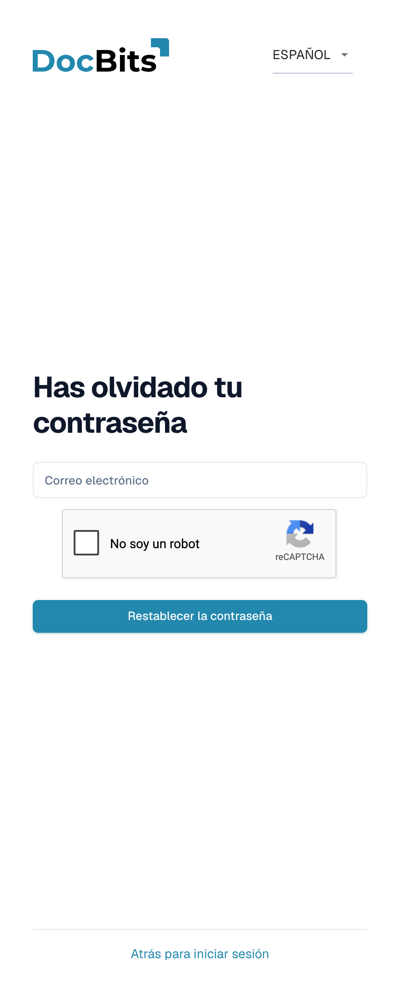
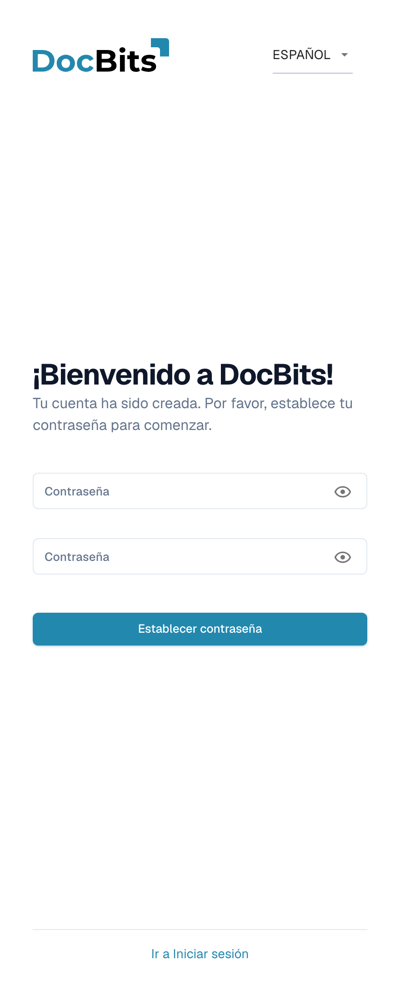

# Obtener acceso e iniciar sesión

Esta página explica cómo obtener una cuenta de DocBits y cómo iniciar sesión:

* [Iniciar sesión con una cuenta existente](#iniciar-sesion-con-una-cuenta-existente) — los campos de la pantalla de inicio de sesión y el selector de región.
* [Registro](#registro) — crea tu propia cuenta de DocBits.
* [Contraseña olvidada](#contrasena-olvidada) — restablece tu contraseña con un enlace de restablecimiento.
* [Primera contraseña para cuentas creadas por el administrador](#primera-contrasena-para-cuentas-creadas-por-el-administrador) — establece la primera contraseña de una cuenta que tu administrador creó para ti.

La Autenticación de Dos Factores, los passkeys y el segundo paso de inicio de sesión se tratan en [Autenticación de Dos Factores (2FA)](../../security/two-factor-authentication.md). Usa el menú de idioma en la esquina superior derecha de estos formularios si necesitas otro idioma de visualización.

## Iniciar sesión con una cuenta existente

Abre la dirección web de DocBits que recibió tu organización — por ejemplo `https://app.docbits.com` — e inicia sesión en la pantalla de inicio de sesión.

<figure><figcaption>
La pantalla de inicio de sesión: correo electrónico y contraseña, Remember me, el selector Auth region, Log In, passkey y los botones de inicio de sesión de Google y Microsoft.
</figcaption></figure>

<!-- Shared English screenshot, do not re-shoot: public_docs/.gitbook/assets/getting-access-login-en-20261107.png -->

1. **E-Mail** — la dirección con la que se creó tu cuenta de DocBits.
2. **Password** — tu contraseña de DocBits. El icono del ojo en el campo muestra u oculta lo que has escrito.
3. **Remember me** — rellena tu dirección de correo electrónico la próxima vez que abras la pantalla de inicio de sesión.
4. **Auth region** — DocBits funciona en dos regiones, **Europe** y **United States**, y cada una tiene su propio servicio de inicio de sesión. El selector se muestra en las implementaciones que usan ambas (production, dev y sandbox). DocBits preselecciona tu última elección; si no, la región que coincide con la zona horaria de tu ordenador; si no, Europe. Si tu cuenta se creó en la otra región, selecciónala aquí antes de hacer clic en **Log In**.
5. Haz clic en **Log In**.

Debajo de los campos de contraseña:

* **Sign in with a passkey** — aparece cuando tu navegador admite passkeys. Te inicia sesión sin contraseña. Consulta [Inicio de sesión sin contraseña](../../security/two-factor-authentication.md).
* **Sign in with Google** y **Sign in with Microsoft** — para organizaciones que usan inicio de sesión único con estos proveedores. El proveedor de identidad gestiona el inicio de sesión, por lo que no se aplican la contraseña de DocBits ni el requisito de dos factores de DocBits.
* **Forgot password?** — consulta [Contraseña olvidada](#contrasena-olvidada) más abajo.
* **Register** — consulta [Registro](#registro) más abajo.


Elige el **Auth region** que usa tu organización antes de hacer clic en **Log In**: la elección decide qué servicio de inicio de sesión de la región recibe tus credenciales. Si no estás seguro, pregunta a tu administrador.


## Registro

Puedes crear tú mismo una cuenta de DocBits en la página de registro. Ábrela desde el enlace **Register** en la pantalla de inicio de sesión, o navega a `https://app.docbits.com/register` (usa la dirección web que se indicó a tu organización).

<figure><figcaption>
Registro: completa tu nombre, apellido, correo de trabajo y los dos campos Contraseña. Resuelve reCAPTCHA si aparece, acepta los términos y selecciona Empezar. Acceso vuelve al inicio de sesión.
</figcaption></figure>

Rellena el formulario:

1. **First name** y **Last name** — tu nombre tal como debe aparecer en DocBits.
2. **E-Mail** — tu dirección de correo electrónico de trabajo. Es tu identificador de inicio de sesión.
3. **Password** y **Confirm password** — escribe la contraseña en el primero y repítela en el segundo; consulta las reglas de contraseña más abajo. Una lista de verificación bajo el campo de contraseña muestra qué reglas ya cumple tu contraseña.
4. Si la página muestra un widget de **reCAPTCHA**, complétalo. El widget solo aparece cuando tu despliegue de DocBits tiene la protección contra bots activada.
5. Marca la casilla para confirmar que aceptas los **Terms and Conditions**.
6. Haz clic en **Get Started**. Si ya tienes una cuenta, haz clic en **Login** en la parte inferior para volver a la página de inicio de sesión. **Visit website** abre el sitio web de DocBits para obtener información del producto.

Usa el icono del ojo junto a un campo de contraseña para mostrar u ocultar los caracteres que escribiste.

### Reglas de contraseña

Tu contraseña debe:

* tener entre **8 y 20 caracteres** de longitud,
* contener al menos una letra **mayúscula** y una **minúscula**,
* contener al menos un **dígito**,
* contener al menos un **carácter especial** (`!@#$%^&*()_+=\[{]\};:,.<>?/\|~-`).

Solo se permiten letras, dígitos y estos caracteres especiales.

### Registrarse con Google o Microsoft

En lugar de una contraseña, puedes hacer clic en el botón **Google** o **Microsoft** bajo **Or sign up with**. DocBits crea tu cuenta a través de tu proveedor de identidad, y más adelante inicias sesión de la misma manera.

### Confirma tu dirección de correo electrónico

Después de enviar el formulario, DocBits muestra una página de confirmación y envía un **correo de verificación** a la dirección que introdujiste. Abre el correo y haz clic en el enlace interior — te lleva a una página de confirmación que verifica tu dirección. Si el correo no llega, la página de confirmación ofrece una opción de **reenvío**. Una vez verificada la dirección, haz clic en **Sign in** e inicia sesión con tu correo y contraseña.

## Contraseña olvidada

DocBits almacena las contraseñas como hashes unidireccionales con sal. Una contraseña existente no se puede recuperar a partir de su hash, por lo que este procedimiento establece una nueva. Consulte [Almacenamiento seguro de credenciales](../../security/secure-storage-of-credentials.md).

Si olvidaste tu contraseña:

1. En la pantalla de inicio de sesión, haz clic en **Forgot password?**.
2. En la página **Forgot Password**, introduce tu dirección de **E-Mail** y haz clic en **Reset Password**. Si se muestra un widget de reCAPTCHA, complétalo primero.

   <figure><figcaption>
Introduce tu correo electrónico y selecciona Restablecer la contraseña para solicitar un enlace, o vuelve con Atrás para iniciar sesión. Resuelve reCAPTCHA cuando aparezca.
</figcaption></figure>

   Si no quieres restablecer tu contraseña, haz clic en **Back to Login** para volver al inicio de sesión.

3. DocBits te envía por correo un **enlace de restablecimiento de contraseña**. Abre el correo y haz clic en el enlace — se abre la página de restablecimiento.
4. Introduce tu **nueva contraseña dos veces**. Se aplican las mismas reglas de contraseña que durante el [registro](#reglas-de-contrasena), y una lista de verificación muestra qué reglas se cumplen.
5. Haz clic en **Reset Password**. DocBits confirma el cambio y te devuelve a la pantalla de inicio de sesión, donde puedes iniciar sesión con la nueva contraseña.


Los enlaces de restablecimiento caducan tras un breve periodo. Si el enlace ya no funciona, repite los pasos anteriores para solicitar uno nuevo.


## Primera contraseña para cuentas creadas por el administrador

Cuando tu administrador te añade como usuario (consulta [Usuarios](../../administration-and-setup/settings/global-settings/groups-users-and-permissions/users/README.md)), recibes un correo con tus datos de inicio de sesión y un enlace para establecer tu **primera contraseña**. El enlace abre la página **Set Password**:

<figure><figcaption>
Formulario para establecer la primera contraseña de una cuenta creada por el administrador. Repite la contraseña en los dos campos y selecciona Establecer contraseña; Ir a Iniciar sesión vuelve al acceso.
</figcaption></figure>

1. Haz clic en el enlace del correo de invitación. La página te saluda con "¡Bienvenido a DocBits! Tu cuenta ha sido creada. Por favor, establece tu contraseña para comenzar."
2. Introduce tu contraseña dos veces — se aplican las mismas [reglas de contraseña](#reglas-de-contrasena).
3. Haz clic en **Set Password**. Después puedes iniciar sesión con tu correo y esta contraseña.

Los iconos del ojo muestran u ocultan lo que escribiste. Si sales antes de establecer una contraseña, **Go to Login** te devuelve al inicio de sesión.

El enlace está vinculado a tu cuenta y funciona una sola vez. Si caduca antes de que lo uses, pide a tu administrador que reenvíe la invitación o usa **Forgot password?** con tu dirección de correo.
