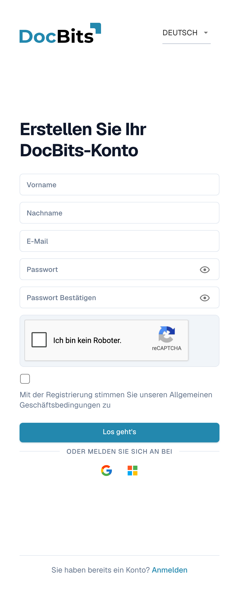
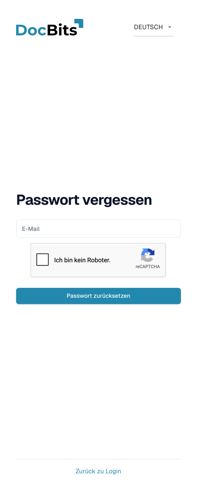
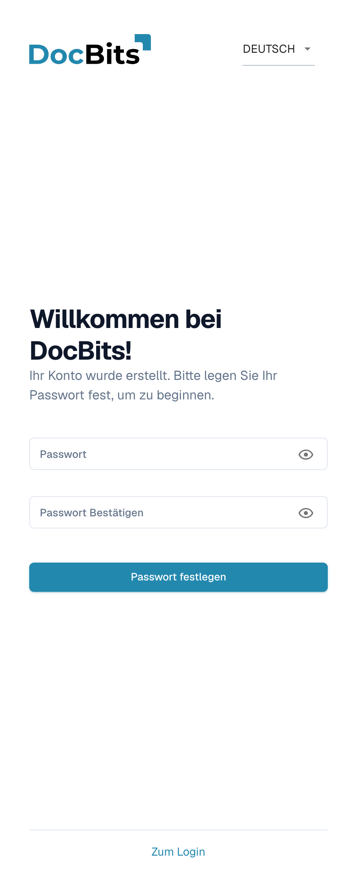

# Erste Schritte und Anmeldung

Diese Seite erklärt, wie Sie ein DocBits-Konto erhalten und wie Sie sich anmelden:

* [Anmeldung mit einem bestehenden Konto](#anmeldung-mit-einem-bestehenden-konto) — die Felder auf dem Anmeldebildschirm und die Regionsauswahl.
* [Registrierung](#registrierung) — erstellen Sie Ihr eigenes DocBits-Konto.
* [Passwort vergessen](#passwort-vergessen) — setzen Sie Ihr Passwort mit einem Reset-Link zurück.
* [Erstes Passwort für vom Administrator angelegte Konten](#erstes-passwort-fur-vom-administrator-angelegte-konten) — legen Sie das erste Passwort für ein Konto fest, das Ihr Administrator für Sie erstellt hat.

Zwei-Faktor-Authentifizierung, Passkeys und der zweite Anmeldeschritt werden unter [Zwei-Faktor-Authentifizierung (2FA)](../../security/two-factor-authentication.md) behandelt. Verwenden Sie das Sprachmenü oben rechts auf diesen Formularen, wenn Sie eine andere Anzeigesprache benötigen.

## Anmeldung mit einem bestehenden Konto

Öffnen Sie die DocBits-Webadresse, die Ihre Organisation erhalten hat — zum Beispiel `https://app.docbits.com` — und melden Sie sich auf dem Anmeldebildschirm an.

<figure><figcaption>
Der Anmeldebildschirm: E-Mail und Passwort, Remember me, der Auth region, Log In, Passkey sowie die Anmeldeschaltflächen von Google und Microsoft.
</figcaption></figure>

<!-- Shared English screenshot, do not re-shoot: public_docs/.gitbook/assets/getting-access-login-en-20261107.png -->

1. **E-Mail** — die Adresse, mit der Ihr DocBits-Konto erstellt wurde.
2. **Password** — Ihr DocBits-Passwort. Das Augensymbol im Feld zeigt die eingegebenen Zeichen an oder verbirgt sie.
3. **Remember me** — füllt Ihre E-Mail-Adresse beim nächsten Öffnen des Anmeldebildschirms aus.
4. **Auth region** — DocBits läuft in zwei Regionen, **Europe** und **United States**, und jede hat ihren eigenen Anmeldedienst. Die Auswahl wird in Instanzen angezeigt, die beide nutzen (production, dev und sandbox). DocBits wählt Ihre letzte Auswahl vor, sonst die Region, die zur Zeitzone Ihres Computers passt, sonst Europe. Wenn Ihr Konto in der anderen Region erstellt wurde, wählen Sie diese hier aus, bevor Sie auf **Log In** klicken.
5. Klicken Sie auf **Log In**.

Unter den Passwortfeldern:

* **Sign in with a passkey** — erscheint, wenn Ihr Browser Passkeys unterstützt. Damit melden Sie sich ohne Passwort an. Siehe [Passwortlose Anmeldung](../../security/two-factor-authentication.md).
* **Sign in with Google** und **Sign in with Microsoft** — für Organisationen, die Single Sign-on mit diesen Anbietern verwenden. Der Identitätsanbieter übernimmt die Anmeldung, daher gelten das DocBits-Passwort und die DocBits-Zwei-Faktor-Anforderung nicht.
* **Forgot password?** — siehe [Passwort vergessen](#passwort-vergessen) unten.
* **Register** — siehe [Registrierung](#registrierung) unten.


Wählen Sie den **Auth region**, den Ihre Organisation verwendet, bevor Sie auf **Log In** klicken: Die Auswahl entscheidet, welcher Anmeldedienst der Region Ihre Zugangsdaten erhält. Wenn Sie unsicher sind, fragen Sie Ihren Administrator.


## Registrierung

Sie können selbst ein DocBits-Konto auf der Registrierungsseite erstellen. Öffnen Sie sie über den Registrierungslink auf dem Anmeldebildschirm oder rufen Sie `https://app.docbits.com/register` auf (verwenden Sie die Webadresse, die Ihre Organisation erhalten hat).

<figure><figcaption>
Geben Sie Namen, geschäftliche E-Mail-Adresse und Passwort ein. Lösen Sie reCAPTCHA, falls es angezeigt wird, stimmen Sie den Geschäftsbedingungen zu und wählen Sie Los geht’s. Anmelden führt zurück zur Anmeldung.
</figcaption></figure>

Füllen Sie das Formular aus:

1. **First name** und **Last name** — Ihr Name, wie er in DocBits erscheinen soll.
2. **E-Mail** — Ihre geschäftliche E-Mail-Adresse. Sie ist Ihr Anmelde-Identifikator.
3. **Password** und **Confirm password** — siehe die Passwortregeln unten. Eine Checkliste unter dem Passwortfeld zeigt, welche Regeln Ihr Passwort bereits erfüllt.
4. Wenn die Seite ein **reCAPTCHA**-Widget anzeigt, lösen Sie es. Das Widget erscheint nur, wenn in Ihrer DocBits-Instanz Bot-Schutz aktiviert ist.
5. Setzen Sie das Häkchen, um zu bestätigen, dass Sie den **Terms and Conditions** zustimmen.
6. Klicken Sie auf **Get Started**. Wenn Sie bereits ein Konto haben, klicken Sie unten auf **Login**, um zur Anmeldeseite zurückzukehren. **Visit website** öffnet die DocBits-Website mit Produktinformationen.

Mit dem Augensymbol neben einem Passwortfeld können Sie die eingegebenen Zeichen anzeigen oder verbergen.

### Passwortregeln

Ihr Passwort muss:

* zwischen **8 und 20 Zeichen** lang sein,
* mindestens einen **Großbuchstaben** und einen **Kleinbuchstaben** enthalten,
* mindestens eine **Ziffer** enthalten,
* mindestens ein **Sonderzeichen** enthalten (`!@#$%^&*()_+=\[{]\};:,.<>?/\|~-`).

Nur Buchstaben, Ziffern und diese Sonderzeichen sind zulässig.

### Registrierung mit Google oder Microsoft

Statt eines Passworts können Sie auf die Schaltfläche **Google** oder **Microsoft** unter **Or sign up with** klicken. DocBits erstellt Ihr Konto über Ihren Identitätsanbieter, und Sie melden sich später auf dieselbe Weise an.

### Bestätigen Sie Ihre E-Mail-Adresse

Nach dem Absenden des Formulars zeigt DocBits eine Bestätigungsseite an und sendet eine **Verifizierungs-E-Mail** an die von Ihnen eingegebene Adresse. Öffnen Sie die E-Mail und klicken Sie auf den Link darin — er führt Sie zu einer Bestätigungsseite, die Ihre Adresse verifiziert. Wenn die E-Mail nicht ankommt, bietet die Bestätigungsseite eine Option an, die E-Mail erneut zu senden. Sobald die Adresse verifiziert ist, klicken Sie auf **Sign in** und melden Sie sich mit Ihrer E-Mail-Adresse und Ihrem Passwort an.

## Passwort vergessen

DocBits speichert Anmeldepasswörter als gesalzene Einweg-Hashes. Ein bestehendes Passwort kann nicht aus seinem Hash abgerufen werden; mit diesem Verfahren legen Sie deshalb ein neues Passwort fest. Siehe [Sichere Speicherung von Zugangsdaten](../../security/secure-storage-of-credentials.md).

Wenn Sie Ihr Passwort vergessen haben:

1. Klicken Sie auf dem Anmeldebildschirm auf **Forgot password?**.
2. Geben Sie auf der Seite **Forgot Password** Ihre **E-Mail**-Adresse ein und klicken Sie auf **Reset Password**. Falls ein reCAPTCHA-Widget angezeigt wird, lösen Sie es zuerst.

   <figure><figcaption>
Fordern Sie mit Ihrer E-Mail-Adresse und Passwort zurücksetzen einen Reset-Link an oder kehren Sie mit Zurück zu Login zur Anmeldung zurück. Lösen Sie reCAPTCHA, wenn es angezeigt wird.
</figcaption></figure>

   Wenn Sie Ihr Passwort nicht zurücksetzen wollen, klicken Sie auf **Back to Login**, um zur Anmeldung zurückzukehren.

3. DocBits sendet Ihnen einen **Passwort-Reset-Link** per E-Mail. Öffnen Sie die E-Mail und klicken Sie auf den Link — er öffnet die Reset-Seite.
4. Geben Sie Ihr **neues Passwort zweimal** ein. Es gelten dieselben Passwortregeln wie bei der [Registrierung](#passwortregeln), und eine Checkliste zeigt, welche Regeln erfüllt sind.
5. Klicken Sie auf **Reset Password**. DocBits bestätigt die Änderung und bringt Sie zurück zum Anmeldebildschirm, wo Sie sich mit dem neuen Passwort anmelden können.


Reset-Links laufen nach kurzer Zeit ab. Wenn der Link nicht mehr funktioniert, wiederholen Sie die obigen Schritte, um einen neuen anzufordern.


## Erstes Passwort für vom Administrator angelegte Konten

Wenn Ihr Administrator Sie als Benutzer anlegt (siehe [Benutzer](../../administration-and-setup/settings/global-settings/groups-users-and-permissions/users/README.md)), erhalten Sie eine E-Mail mit Ihren Anmeldedaten und einem Link zum Festlegen Ihres **ersten Passworts**. Der Link öffnet die Seite **Set Password**:

<figure><figcaption>
Das Formular zum Festlegen des ersten Passworts für ein vom Administrator angelegtes Konto. Geben Sie das Passwort zweimal ein und wählen Sie Passwort festlegen. Zum Login führt zur Anmeldung zurück.
</figcaption></figure>

1. Klicken Sie auf den Link in der Einladungs-E-Mail. Die Seite begrüßt Sie mit „Willkommen bei DocBits! Ihr Konto wurde erstellt. Bitte legen Sie Ihr Passwort fest, um zu beginnen."
2. Geben Sie Ihr Passwort zweimal ein — es gelten dieselben [Passwortregeln](#passwortregeln).
3. Klicken Sie auf **Set Password**. Anschließend können Sie sich mit Ihrer E-Mail-Adresse und diesem Passwort anmelden.

Die Augensymbole zeigen an oder verbergen, was Sie eingegeben haben. Wenn Sie das Festlegen abbrechen, bringt Sie **Go to Login** zurück zur Anmeldung.

Der Link ist an Ihr Konto gebunden und funktioniert nur einmal. Wenn er abläuft, bevor Sie ihn verwenden, bitten Sie Ihren Administrator, die Einladung erneut zu senden, oder verwenden Sie **Forgot password?** mit Ihrer E-Mail-Adresse.
