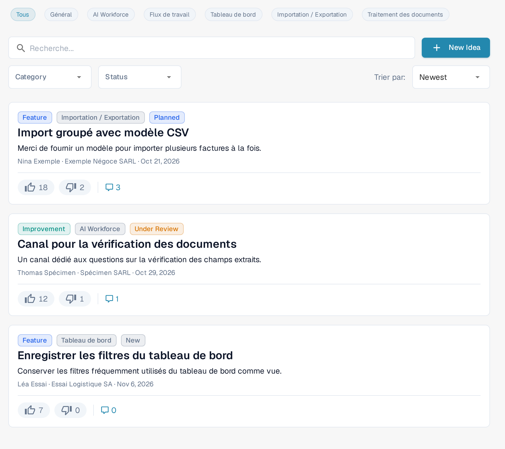
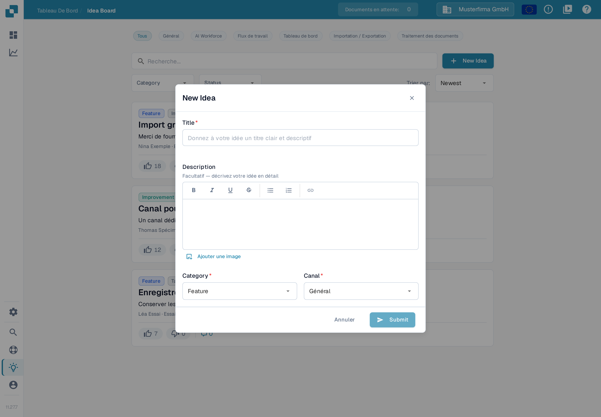
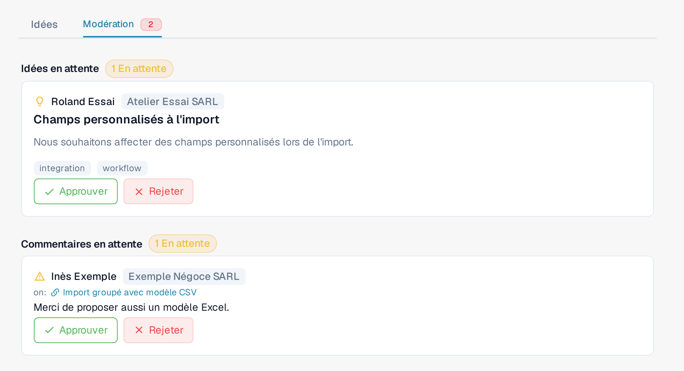

# Tableau d'Idées

Le Tableau d'Idées est l'endroit où soumettre des demandes de fonctionnalités, signaler une fonctionnalité manquante et voter pour ce que l'équipe produit doit construire ensuite. Les idées sont organisées par canal, avec commentaires et votes. Le tableau est partagé entre les organisations DocBits : les idées et les commentaires approuvés peuvent être visibles par les utilisateurs d'autres organisations. Les éléments en attente ou refusés restent visibles pour les utilisateurs de l'organisation qui les a soumis et pour les modérateurs. Traitez-le comme un canal de retour produit partagé et n'y mettez aucune information confidentielle sur votre entreprise, vos clients ou vos documents.

## Comment y accéder

Ouvrez la barre latérale et cliquez sur l'entrée **Idea Board**, ou naviguez directement vers `/ideas`.

<figure><figcaption>
Les commandes du Tableau d'Idées, y compris le canal AI Workforce. Les idées existantes et les informations du compte sont hors de cette capture.
</figcaption></figure>

## Canaux

Une rangée de chips de canal se trouve en haut du tableau : **Tous**, **Général**, **AI Workforce**, **Flux de travail**, **Tableau de bord**, **Importation / Exportation** et **Traitement des documents**. Cliquez sur un chip pour n'afficher que les idées de ce domaine produit ; **Tous** retire le filtre de canal. Chaque idée appartient à un seul canal, indiqué par une étiquette sur sa carte. Le canal **AI Workforce** regroupe les idées concernant les fonctions [AI Workforce](../../advanced-functions-and-tools/ai_workforce/).

## Parcourir les idées

Chaque idée est affichée sous forme de carte avec :

* Le titre et une description en texte riche, qui peut contenir des images.
* Des boutons distincts de vote positif et de vote négatif, chacun avec son propre compteur.
* Une étiquette de catégorie — par exemple Feature, Improvement, Integration ou Other. Les idées plus anciennes peuvent encore afficher la catégorie Bug.
* Une étiquette de canal — Général, AI Workforce, Flux de travail, Tableau de bord, Importation / Exportation ou Traitement des documents.
* Une étiquette de statut — New, Under Review, Planned, In Progress, Done ou Declined.
* Le nom et l'organisation de la personne qui a soumis l'idée, ainsi qu'un horodatage relatif.
* Un bouton de commentaires qui déploie la discussion sous la carte.

La pagination en bas de la liste permet de passer d'une page à l'autre.

## Soumettre une nouvelle idée

Cliquez sur **New Idea** dans l'en-tête. La boîte de dialogue demande :

* **Title** — un nom court et descriptif pour l'idée.
* **Description** — un éditeur de texte riche facultatif avec gras, italique, souligné, barré, listes et liens. Vous pouvez aussi ajouter des images : collez-les directement, ou utilisez le bouton **Ajouter une image** pour en insérer une dans la description.
* **Category** — choisissez la catégorie la plus proche : Feature, Improvement, Integration ou Other. Pour un incident qui bloque votre travail, utilisez un ticket de support.
* **Canal** — le domaine produit auquel l'idée appartient.

Appuyez sur **Submit** pour envoyer l'idée. Sa visibilité dépend de son statut de modération : elle peut apparaître dans votre organisation en attendant la vérification ; une fois approuvée, elle est visible sur l'ensemble du tableau — voir [Modération](idea-board.md#moderation) ci-dessous.

<figure><figcaption>
La boîte de dialogue New Idea avant la saisie d'un titre : le bouton Submit est désactivé tant que le titre est vide.
</figcaption></figure>

## Voter

Chaque idée dispose de boutons distincts de vote positif et de vote négatif, chacun avec son propre compteur. Cliquez sur un bouton pour exprimer votre vote, cliquez à nouveau sur le même bouton pour le retirer, ou cliquez sur le bouton opposé pour changer de vote. Les votes signalent la demande à l'équipe produit et alimentent les tris **Chaud** et **Les mieux notés**.

## Commenter

Ouvrez le fil de commentaires d'une idée pour poser des questions, ajouter du contexte ou partager une solution de contournement. Vous pouvez voter positivement ou négativement pour les commentaires (mais pas pour les vôtres) et supprimer les commentaires que vous avez publiés. Les modérateurs du tableau peuvent également supprimer des commentaires. Le fait d'avoir soumis une idée ou d'être administrateur d'une organisation ne donne pas à lui seul cette permission de modération.

## Modération

Si votre compte dispose de l'accès à la modération du tableau, un onglet **Modération** supplémentaire apparaît à côté de **Idées** en haut du tableau. Cet accès est réservé aux administrateurs d'organisations de confiance ; être administrateur d'une autre organisation ne l'accorde pas automatiquement. Un badge rouge apparaît lorsqu'il y a des éléments à vérifier.

<figure><figcaption>
La vue Modération avec une idée en attente et un commentaire en attente. Les boutons de vérification restent visibles.
</figcaption></figure>

L'onglet comporte deux sections :

* **Idées en attente** — les idées nouvellement soumises qui attendent une approbation. Chaque carte affiche la personne qui a soumis, le titre, la description et les étiquettes de catégorie et de canal. Utilisez **Approuver** pour rendre l'idée visible sur l'ensemble du tableau, ou **Rejeter** pour la retirer de cette vue.
* **Commentaires en attente** — les commentaires qui attendent une vérification, affichés avec l'idée sur laquelle ils ont été écrits. Utilisez **Approuver** pour rendre le commentaire visible sur l'ensemble du tableau, ou **Rejeter** pour le retirer de cette vue.

Un refus ne supprime pas l'élément : les utilisateurs de l'organisation qui l'a soumis et les modérateurs du tableau peuvent toujours le voir.

Les modérateurs peuvent aussi agir directement dans une discussion : le menu du commentaire (bouton à trois points) sur un commentaire approuvé propose **Se cacher pour les autres**. Cela retire le commentaire de la vue inter-organisations sans le supprimer ; les utilisateurs de l'organisation qui l'a soumis et les modérateurs peuvent toujours le voir.

## Filtres et tri

Au-dessus de la liste, vous pouvez combiner :

* Les chips de **canal**.
* Un champ de recherche qui porte sur le titre et la description.
* Une liste déroulante de catégorie.
* Une liste déroulante de statut.
* Un sélecteur de tri — **Newest**, **Chaud** ou **Les mieux notés**.

Les filtres se combinent : vous pouvez par exemple réduire en quelques clics à « les idées Improvement les mieux notées qui sont Under Review ».

## Modifier ou supprimer votre propre idée

Le menu de la carte (bouton à trois points) permet de modifier ou de supprimer une idée que vous avez soumise ; il propose **Éditer** et **Supprimer**. Les modérateurs du tableau peuvent aussi agir sur d'autres idées ; les utilisateurs ordinaires n'obtiennent pas ces permissions simplement parce qu'ils appartiennent à la même organisation.

Le Tableau d'Idées sert au retour produit, pas aux rapports d'incident. Utilisez un ticket de support pour les problèmes qui bloquent votre travail aujourd'hui.
