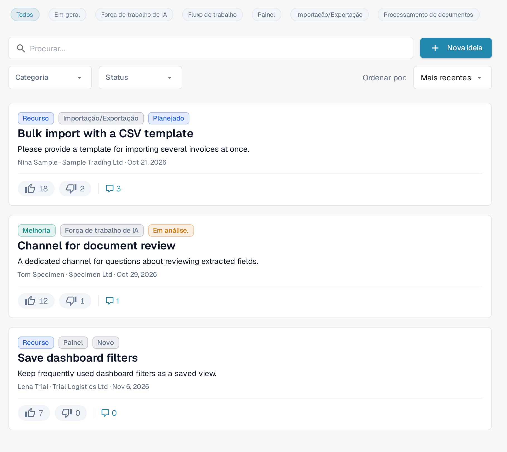
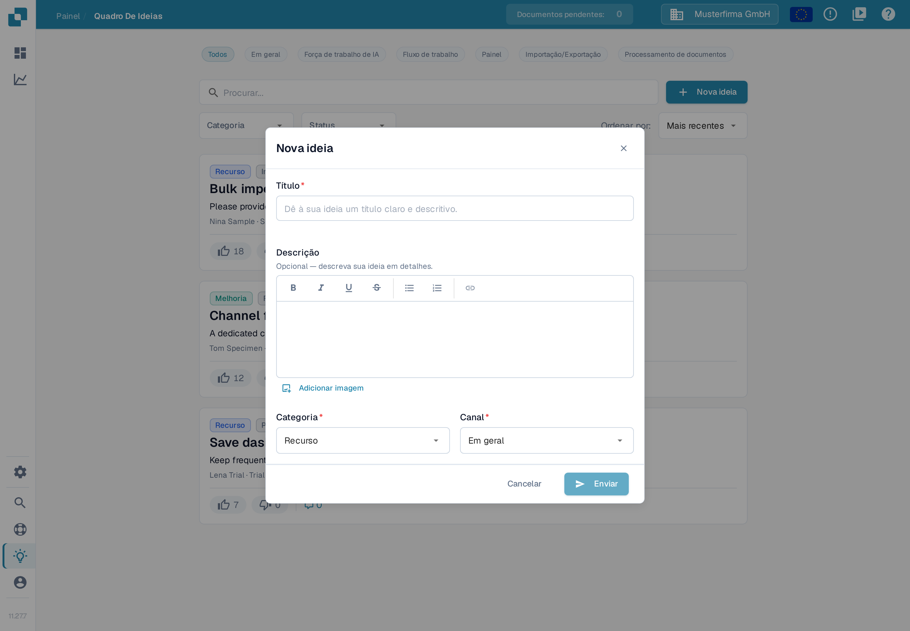
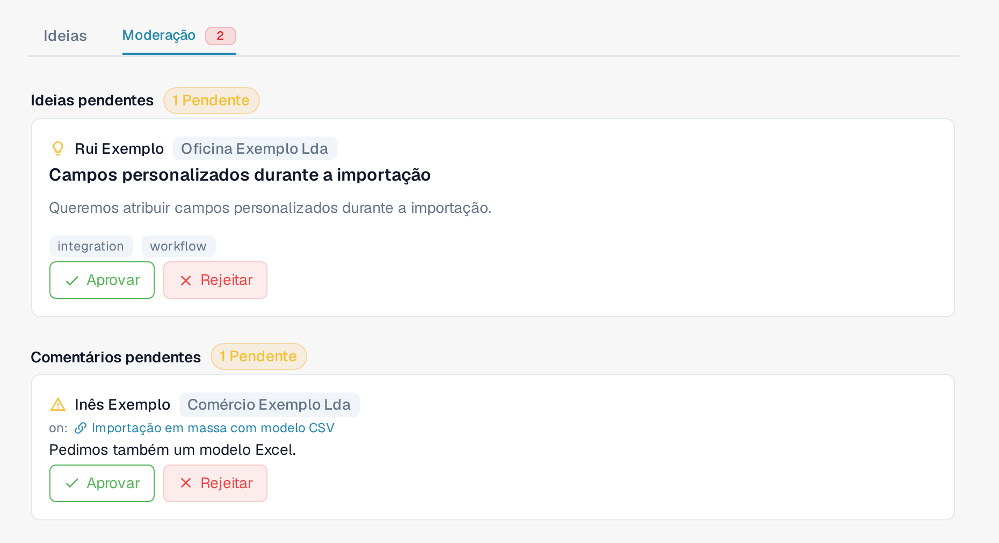

# Quadro de Ideias

O Quadro de Ideias é o lugar para enviar pedidos de funcionalidades, relatar funcionalidades ausentes e votar no que a equipe de produto deve construir em seguida. As ideias são organizadas por canal, com comentários e votação. O quadro é compartilhado entre as organizações DocBits: ideias e comentários aprovados podem ficar visíveis para usuários de outras organizações. Itens pendentes ou rejeitados continuam visíveis para os usuários da organização que os enviou e para os moderadores. Trate este espaço como um canal compartilhado de feedback de produto e não inclua informações confidenciais de empresa, clientes ou documentos.

## Como acessar

Abra a barra lateral e clique em **Ideias**, ou navegue diretamente para `/ideas`.

<figure><figcaption>
Os controles do Quadro de Ideias em português, incluindo o canal Força de trabalho de IA, com três ideias de exemplo abaixo.
</figcaption></figure>

## Canais

No topo do quadro há uma fileira de chips de canal: **Todos**, **Em geral**, **Força de trabalho de IA**, **Fluxo de trabalho**, **Painel**, **Importação/Exportação** e **Processamento de documentos**. Clique em um chip para mostrar apenas as ideias daquela área de produto; **Todos** remove o filtro de canal. Cada ideia pertence a um único canal, exibido como uma etiqueta no seu cartão. O canal **Força de trabalho de IA** reúne ideias para os recursos do [AI Workforce](../../advanced-functions-and-tools/ai_workforce/).

## Explorando as ideias

Cada ideia é exibida como um cartão com:

* O título e uma descrição em texto formatado, que pode incluir imagens.
* Botões separados de **voto positivo** e **voto negativo**, cada um com sua própria contagem.
* Uma etiqueta de categoria — por exemplo **Recurso**, **Melhoria**, **Integração** ou **Outro**. Ideias antigas ainda podem exibir a categoria **Erro**.
* Uma etiqueta de canal — **Em geral**, **Força de trabalho de IA**, **Fluxo de trabalho**, **Painel**, **Importação/Exportação** ou **Processamento de documentos**.
* Um chip de status — **Novo**, **Em análise.**, **Planejado**, **Em andamento**, **Feito** ou **Recusado**.
* O nome e a organização de quem enviou, além de um registro de data e hora relativo.
* Um botão de comentários que expande a discussão abaixo do cartão.

A paginação na parte inferior da lista permite navegar entre as páginas.

## Enviando uma nova ideia

Clique em **Nova ideia** no cabeçalho. A janela solicita:

* **Título** — um nome curto e descritivo para a ideia.
* **Descrição** — um editor de texto formatado opcional com negrito, itálico, sublinhado, riscado, listas e links. Você também pode adicionar imagens: cole-as diretamente ou use o botão **Adicionar imagem** para inserir uma na descrição.
* **Categoria** — escolha a mais próxima: **Recurso**, **Melhoria**, **Integração** ou **Outro**. Use um chamado de suporte para incidentes que estão bloqueando seu trabalho.
* **Canal** — a área de produto à qual a ideia pertence.

Clique em **Enviar** para enviar a ideia. A visibilidade dela depende do status de moderação: a ideia pode aparecer dentro da sua organização enquanto aguarda análise; a aprovação a torna visível em todo o quadro — consulte [Moderação](idea-board.md#moderacao) abaixo.

<figure><figcaption>
A janela Nova ideia antes de inserir um título.
</figcaption></figure>

## Votando

Cada ideia tem botões separados de **voto positivo** e **voto negativo**, cada um com sua própria contagem. Clique em um botão para registrar seu voto, clique no mesmo botão novamente para retirá-lo, ou clique no botão oposto para trocar. Os votos sinalizam a demanda para a equipe de produto e alimentam as ordenações **Quente** e **Mais bem avaliado**.

## Comentando

Abra o tópico de comentários de uma ideia para fazer perguntas, adicionar contexto ou compartilhar soluções alternativas. Você pode votar positiva ou negativamente nos comentários (mas não nos seus) e excluir os comentários que você publicou. Os moderadores do quadro também podem excluir comentários. Ser o autor de uma ideia ou apenas administrador comum da organização não concede essa permissão de moderação.

## Moderação

Se a sua conta tem acesso à moderação do quadro, um painel extra **Moderação** aparece ao lado de **Ideias** no topo do quadro. Esse acesso é reservado aos administradores de organizações confiáveis; ser administrador de outra organização não o concede automaticamente. Um selo vermelho aparece quando há itens aguardando análise.

<figure><figcaption>
A visão de Moderação com uma ideia e um comentário aguardando análise. Os dados são exemplos inventados.
</figcaption></figure>

O painel tem duas seções:

* **Ideias pendentes** — ideias recém-enviadas aguardando aprovação. Cada cartão mostra o autor, o título, a descrição e as etiquetas de categoria e canal. Use **Aprovar** para tornar a ideia visível em todo o quadro ou **Rejeitar** para retirá-la dessa visão.
* **Comentários pendentes** — comentários aguardando análise, exibidos junto com a ideia em que foram escritos. Use **Aprovar** para tornar o comentário visível em todo o quadro ou **Rejeitar** para retirá-lo dessa visão.

Rejeitar não exclui o item: os usuários da organização que o enviou e os moderadores do quadro continuam podendo vê-lo.

Os moderadores também podem agir diretamente em uma discussão: o menu do comentário (botão de três pontos) em um comentário aprovado oferece a opção de ocultá-lo dos outros. Isso retira o comentário da visão entre organizações sem excluí-lo; os usuários da organização que o enviou e os moderadores continuam podendo vê-lo.

## Filtrando e ordenando

Acima da lista você pode combinar:

* Os chips de **canal**.
* Uma caixa de busca que verifica o título e a descrição.
* Um menu suspenso de categoria.
* Um menu suspenso de status.
* Um seletor de ordenação — **Mais recentes**, **Quente** ou **Mais bem avaliado**.

Os filtros se combinam, então você pode restringir, por exemplo, a "Recursos **Mais bem avaliado** que estão **Em andamento**" em poucos cliques.

## Editando ou excluindo sua própria ideia

O menu do cartão (botão de três pontos) permite editar ou excluir uma ideia que você enviou. Os moderadores do quadro também podem agir sobre outras ideias; usuários comuns não recebem essas permissões apenas por pertencer à mesma organização.

O Quadro de Ideias é para feedback de produto, não para relatos de incidentes. Use um chamado de suporte para problemas que estão bloqueando seu trabalho hoje.
