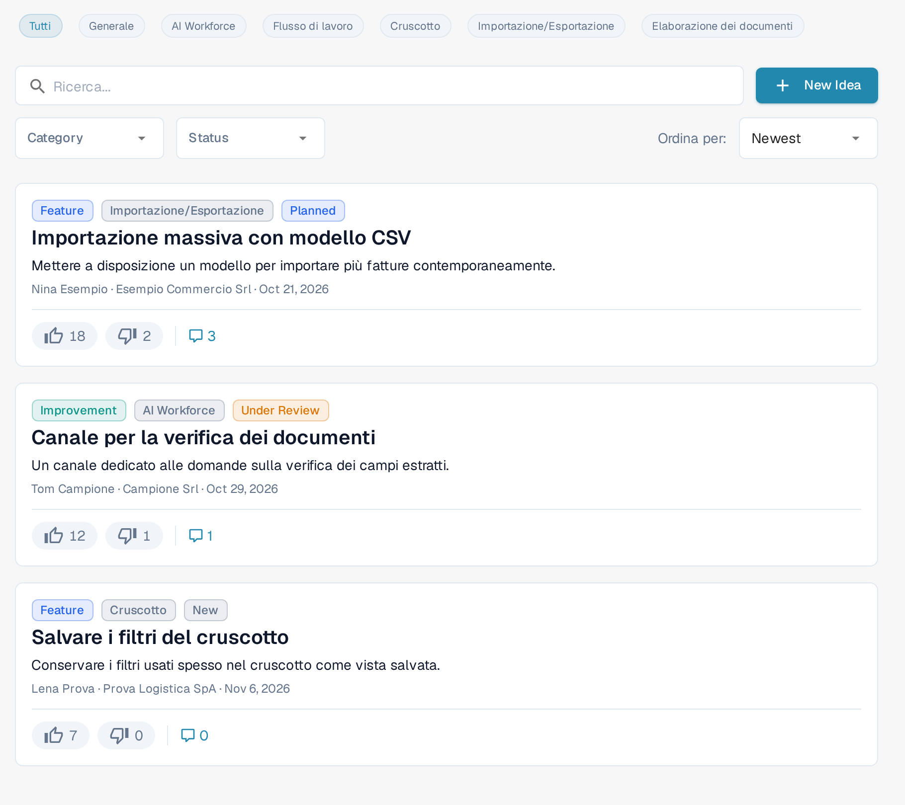
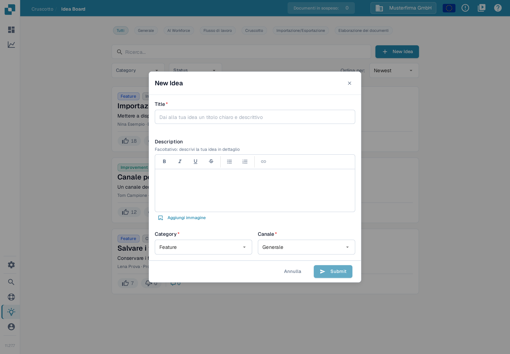
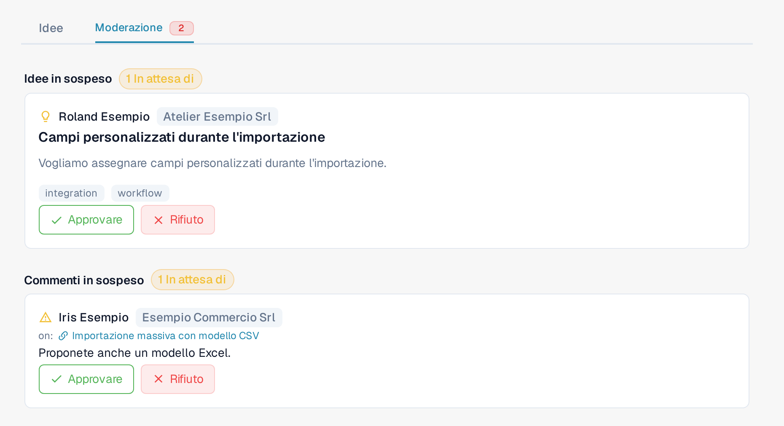

# Bacheca delle Idee

La Bacheca delle Idee è il luogo dove inviare richieste di funzionalità, segnalare funzioni mancanti e votare ciò che il team di prodotto dovrebbe realizzare. Le idee sono organizzate per canale, con commenti e votazioni. La bacheca è condivisa tra le organizzazioni DocBits: le idee e i commenti approvati possono essere visibili agli utenti di altre organizzazioni. Gli elementi in attesa di revisione o rifiutati restano visibili agli utenti dell'organizzazione che li ha inviati e ai moderatori. Considerala un canale condiviso di feedback sul prodotto e non inserire informazioni riservate su azienda, clienti e documenti.

Alcune etichette dell'app sono ancora visualizzate in inglese, per esempio **New Idea**, **Category** e **Status**; in questa pagina riportiamo le etichette così come appaiono sullo schermo.

## Come accedere

Apri la barra laterale e clicca su **Idee**, oppure vai direttamente a `/ideas`.

<figure><figcaption>
I controlli della Bacheca delle Idee: chip dei canali, ricerca, filtri e ordinamento. Le schede sotto mostrano dati di esempio.
</figcaption></figure>

## Canali

In cima alla bacheca c'è una fila di chip dei canali: **Tutti**, **Generale**, **AI Workforce**, **Flusso di lavoro**, **Cruscotto**, **Importazione/Esportazione** ed **Elaborazione dei documenti**. Clicca su un chip per mostrare solo le idee di quell'area di prodotto; **Tutti** annulla il filtro per canale. Ogni idea appartiene a un canale, indicato da un badge sulla scheda. Il canale **AI Workforce** raccoglie le idee per le funzioni [AI Workforce](../../advanced-functions-and-tools/ai_workforce/).

## Sfogliare le idee

Ogni idea è mostrata come una scheda con:

* Il titolo e una descrizione in formato avanzato, che può contenere immagini.
* Due pulsanti di voto separati, con il pollice in su e il pollice in giù, ciascuno con il proprio conteggio.
* Un badge di categoria: **Feature**, **Improvement**, **Bug**, **Integration** o **Other**.
* Un badge di canale: **Generale**, **AI Workforce**, **Flusso di lavoro**, **Cruscotto**, **Importazione/Esportazione** o **Elaborazione dei documenti**.
* Un'etichetta di stato: **New**, **Under Review**, **Planned**, **In Progress**, **Done** o **Declined**.
* Nome e organizzazione di chi ha inviato l'idea e una data.
* Un pulsante con il numero dei commenti che apre la discussione sotto la scheda.

Le etichette delle categorie e degli stati restano in inglese. In fondo alla lista la paginazione permette di passare da una pagina all'altra.

## Inviare una nuova idea

Clicca su **New Idea** in alto a destra. La finestra chiede:

* **Title** — un nome breve e descrittivo dell'idea; il campo suggerisce «Dai alla tua idea un titolo chiaro e descrittivo».
* **Description** — un editor facoltativo con grassetto, corsivo, sottolineato, barrato, elenchi e link; il testo di aiuto dice «Facoltativo: descrivi la tua idea in dettaglio». Puoi anche aggiungere immagini: incollale direttamente oppure usa **Aggiungi immagine** per inserirne una nella descrizione.
* **Category** — scegli la categoria più adatta: **Feature**, **Improvement**, **Bug**, **Integration** o **Other**. Per i problemi che bloccano il tuo lavoro oggi usa un ticket di supporto.
* **Canale** — l'area di prodotto a cui appartiene l'idea.

Premi **Submit** per inviare l'idea. **Submit** resta disattivato finché il titolo è vuoto. La visibilità dipende dallo stato di moderazione: l'idea può comparire all'interno della tua organizzazione mentre attende la revisione; dopo l'approvazione diventa visibile a tutta la bacheca — vedi [Moderazione](idea-board.md#moderation).

<figure><figcaption>
La finestra New Idea prima di inserire un titolo: Submit resta disattivato finché il titolo è vuoto.
</figcaption></figure>

## Votare

Ogni idea ha due pulsanti di voto separati, ciascuno con il proprio conteggio. Clicca un pulsante per votare, clicca di nuovo lo stesso pulsante per togliere il voto, oppure clicca il pulsante opposto per cambiare voto. I voti mostrano al team di prodotto quali idee sono più richieste e alimentano gli ordinamenti **Caldo** e **I migliori gusti**.

## Commentare

Apri il filo dei commenti di un'idea per fare domande, aggiungere contesto o condividere soluzioni alternative. Puoi votare i commenti (tranne i tuoi) ed eliminare i commenti che hai scritto. Anche i moderatori della bacheca possono eliminare i commenti. Il fatto di aver creato l'idea, o di essere amministratore della tua organizzazione, non basta per ottenere questo permesso di moderazione.

## Moderazione

Se il tuo account ha accesso alla moderazione della bacheca, in cima alla bacheca compare una scheda **Moderazione** accanto a **Idee**. L'accesso è riservato agli amministratori delle organizzazioni considerate affidabili; essere amministratore di un'altra organizzazione non lo concede automaticamente. Accanto alla scheda un badge rosso indica quanti elementi attendono una revisione.

<figure><figcaption>
La vista Moderazione con un'idea e un commento in attesa: i dati sono di esempio.
</figcaption></figure>

La scheda ha due sezioni:

* **Idee in sospeso** — le idee appena inviate che attendono l'approvazione, contrassegnate da **In attesa di**. Ogni scheda mostra chi l'ha inviata, il titolo, la descrizione e i badge di categoria e canale. Usa **Approvare** per rendere l'idea visibile a tutta la bacheca oppure **Rifiuto** per non mostrarla in quella vista.
* **Commenti in sospeso** — i commenti che attendono una revisione, mostrati insieme all'idea a cui si riferiscono (il prefisso **on:** resta in inglese). Usa **Approvare** per rendere il commento visibile a tutta la bacheca oppure **Rifiuto** per non mostrarlo in quella vista.

Il rifiuto non elimina l'elemento: gli utenti dell'organizzazione che l'ha inviato e i moderatori della bacheca possono ancora vederlo.

I moderatori possono intervenire anche direttamente in una discussione: il menu del commento (pulsante con i tre punti) di un commento approvato contiene una voce che lo nasconde agli altri. Il commento viene ritirato dalla vista condivisa tra le organizzazioni senza essere eliminato; gli utenti dell'organizzazione che l'ha scritto e i moderatori possono ancora vederlo.

## Filtrare e ordinare

Sopra la lista puoi combinare:

* I chip dei canali.
* Un campo di ricerca (**Ricerca...**) che confronta titolo e descrizione.
* Un menu a discesa **Category**.
* Un menu a discesa **Status**.
* Un selettore di ordinamento (**Ordina per:**) con **Newest**, **Caldo** o **I migliori gusti**.

I filtri si combinano, quindi puoi restringere in pochi clic, per esempio alle **Improvement** con stato **Under Review** ordinate per **I migliori gusti**.

## Modificare o eliminare una tua idea

Il menu della scheda (pulsante con i tre punti) permette di modificare o eliminare un'idea che hai inviato. I moderatori della bacheca possono intervenire anche sulle altre idee; gli utenti normali non ottengono questi permessi solo perché appartengono alla stessa organizzazione.

La Bacheca delle Idee serve per il feedback sul prodotto, non per segnalare incidenti. Per i problemi che bloccano il tuo lavoro oggi usa un ticket di supporto.
