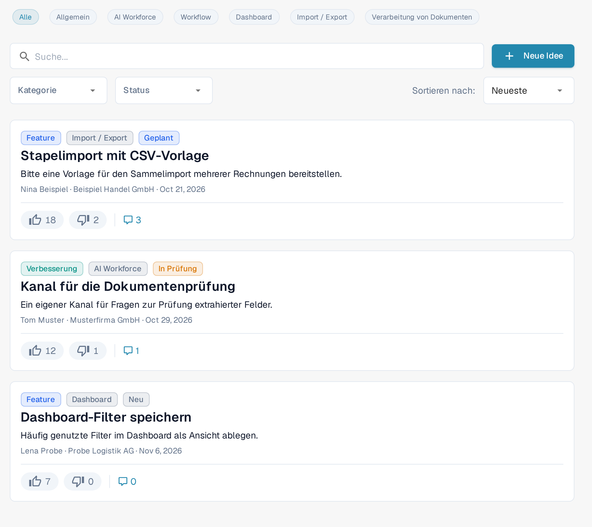
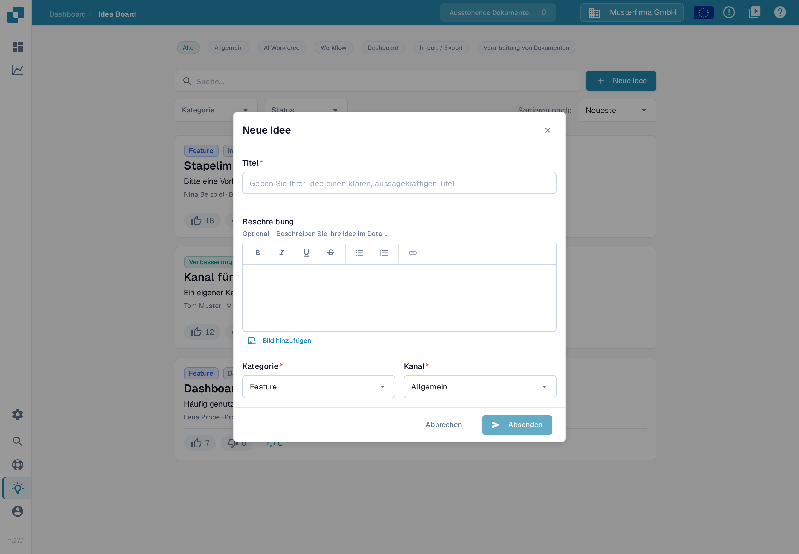
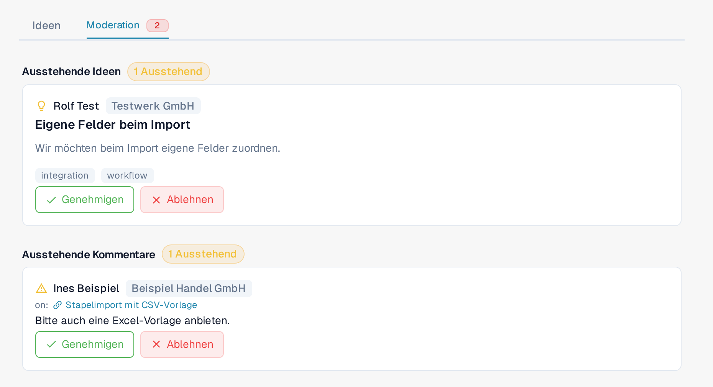

# Ideenboard

Das Ideenboard ist der Ort, um Funktionswünsche einzureichen, fehlende Funktionen zu melden und darüber abzustimmen, was das Produktteam als Nächstes umsetzen soll. Ideen sind nach Kanal organisiert und bieten Kommentare und Abstimmungen. Das Board wird von allen DocBits-Organisationen gemeinsam genutzt: Freigegebene Ideen und Kommentare können für Benutzer anderer Organisationen sichtbar sein. Ausstehende oder abgelehnte Einträge bleiben für Benutzer der einreichenden Organisation und für Moderierende sichtbar. Behandeln Sie das Board deshalb als gemeinsamen Produktfeedback-Kanal und lassen Sie vertrauliche Firmen-, Kunden- und Dokumentinformationen weg.

## Aufrufen

Öffnen Sie die Seitenleiste, wählen Sie den Eintrag für das Ideenboard oder rufen Sie `/ideas` direkt auf.

<figure><figcaption>
Die Filterleiste des Ideenboards mit Kanälen, Suche, Kategorie, Status und Sortierung sowie drei Ideenkarten. Die Beispielinhalte sind erfunden.
</figcaption></figure>

## Kanäle

Am oberen Rand des Boards befindet sich eine Reihe von Kanal-Chips: **Alle**, **Allgemein**, **AI Workforce**, **Workflow**, **Dashboard**, **Import / Export** und **Verarbeitung von Dokumenten**. Klicken Sie auf einen Chip, um nur die Ideen aus diesem Produktbereich anzuzeigen; **Alle** hebt den Kanalfilter auf. Jede Idee gehört zu genau einem Kanal, der als Abzeichen auf ihrer Karte angezeigt wird. Der Kanal **AI Workforce** sammelt Ideen zu den Funktionen der [AI Workforce](../../advanced-functions-and-tools/ai_workforce/README.md).

## Ideen durchstöbern

Jede Idee wird als Karte mit folgenden Angaben angezeigt:

* Titel und eine Beschreibung im Rich-Text-Format, die Bilder enthalten kann.
* Getrennte Schaltflächen zum Zustimmen und zum Ablehnen, jeweils mit eigener Zählung.
* Ein Kategorie-Abzeichen — Feature, Verbesserung, Fehler, Integration oder Sonstiges.
* Ein Kanal-Abzeichen — Allgemein, AI Workforce, Workflow, Dashboard, Import / Export oder Verarbeitung von Dokumenten.
* Einen Status — Neu, In Prüfung, Geplant, In Bearbeitung, Erledigt oder Abgelehnt.
* Name und Organisation der einreichenden Person sowie einen relativen Zeitstempel.
* Einen Umschalter für Kommentare, der den Diskussionsverlauf unter der Karte aufklappt.

Eine Seitennavigation am unteren Listenende blättert zwischen Seiten.

## Eine neue Idee einreichen

Klicken Sie im Kopfbereich auf **Neue Idee**. Der Dialog fragt nach:

* **Titel** — ein kurzer, beschreibender Name für die Idee.
* **Beschreibung** — ein optionaler Rich-Text-Editor mit Fett, Kursiv, Unterstrichen, Durchgestrichen, Listen und Links. Sie können auch Bilder hinzufügen: direkt einfügen oder über die Schaltfläche **Bild hinzufügen** in die Beschreibung einbetten.
* **Kategorie** — wählen Sie die passendste: Feature, Verbesserung, Fehler, Integration oder Sonstiges. Für Störungen, die Ihre Arbeit blockieren, verwenden Sie ein Support-Ticket.
* **Kanal** — der Produktbereich, zu dem die Idee gehört.

Drücken Sie **Absenden**, um die Idee einzureichen. Ihre Sichtbarkeit hängt vom Moderationsstatus ab: Sie kann in Ihrer Organisation erscheinen, während sie geprüft wird; nach der Genehmigung ist sie im gesamten Board sichtbar — siehe [Moderation](idea-board.md#moderation) unten.

<figure><figcaption>
Der Dialog Neue Idee vor Eingabe eines Titels: Absenden ist deaktiviert, solange der Titel leer ist.
</figcaption></figure>

## Abstimmen

Jede Idee hat getrennte Schaltflächen zum Zustimmen und zum Ablehnen, jeweils mit eigener Zählung. Klicken Sie auf eine Schaltfläche, um Ihre Stimme abzugeben, klicken Sie erneut darauf, um sie zu entfernen, oder klicken Sie auf die gegenüberliegende, um zu wechseln. Stimmen signalisieren dem Produktteam die Nachfrage und fließen in die Sortierungen **Heiß** und **Top-Bewertung** ein.

## Kommentieren

Öffnen Sie den Kommentarbereich einer Idee, um Fragen zu stellen, Kontext zu ergänzen oder Workarounds zu teilen. Sie können Kommentare mit Zustimmung oder Ablehnung bewerten (aber nicht Ihre eigenen) und von Ihnen verfasste Kommentare löschen. Moderierende des Boards können ebenfalls Kommentare löschen. Eigentümerschaft einer Idee oder eine gewöhnliche Organisations-Administratorrolle allein verleiht diese Moderationsberechtigung nicht.

## Moderation

Wenn Ihr Konto Zugriff auf die Board-Moderation hat, erscheint oben im Board neben **Ideen** ein zusätzlicher Reiter **Moderation**. Dieser Zugriff ist Organisations-Administratoren vertrauenswürdiger Organisationen vorbehalten; Administrator einer anderen Organisation zu sein, verleiht ihn nicht automatisch. Ein rotes Abzeichen erscheint, wenn Einträge zur Prüfung anstehen.

<figure><figcaption>
Die Moderationsansicht mit den Bereichen Ausstehende Ideen und Ausstehende Kommentare sowie den Schaltflächen Genehmigen und Ablehnen. Die Beispielinhalte sind erfunden.
</figcaption></figure>

Der Reiter hat zwei Bereiche:

* **Ausstehende Ideen** — neu eingereichte Ideen, die auf die Genehmigung warten. Jede Karte zeigt die einreichende Person, den Titel, die Beschreibung sowie Kategorie und Kanal. Mit **Genehmigen** machen Sie die Idee im gesamten Board sichtbar, mit **Ablehnen** halten Sie sie aus dieser Ansicht heraus.
* **Ausstehende Kommentare** — Kommentare, die geprüft werden müssen, angezeigt mit der Idee, zu der sie geschrieben wurden. Mit **Genehmigen** machen Sie den Kommentar im gesamten Board sichtbar, mit **Ablehnen** halten Sie ihn aus dieser Ansicht heraus.

Eine Ablehnung löscht den Eintrag nicht: Benutzer der einreichenden Organisation und Moderierende des Boards können ihn weiterhin sehen.

Moderierende können auch direkt in einer Diskussion eingreifen: Das Kommentarmenü (Drei-Punkte-Schaltfläche) eines freigegebenen Kommentars bietet **Für andere ausblenden**. Damit nehmen Sie den Kommentar aus der organisationsübergreifenden Ansicht, ohne ihn zu löschen; Benutzer der einreichenden Organisation und Moderierende können ihn weiterhin sehen.

## Filtern und Sortieren

Über der Liste können Sie kombinieren:

* die **Kanal**-Chips.
* ein Suchfeld, das in Titel und Beschreibung sucht.
* eine Kategorie-Auswahl.
* eine Status-Auswahl.
* einen Sortierwähler — **Neueste**, **Heiß** oder **Top-Bewertung**.

Die Filter werden kombiniert, sodass Sie zum Beispiel mit wenigen Klicks auf „Top-bewertete Verbesserungen mit Status In Prüfung“ eingrenzen können.

## Eigene Ideen bearbeiten oder löschen

Das Menü auf einer Karte (Drei-Punkte-Schaltfläche) bietet **Bearbeiten** und **Löschen** für eine von Ihnen eingereichte Idee. Moderierende des Boards können auch auf andere Ideen einwirken; gewöhnliche Benutzer erhalten diese Berechtigungen nicht allein durch die Zugehörigkeit zur selben Organisation.

Das Ideenboard ist für Produktrückmeldungen gedacht, nicht für Vorfallsmeldungen. Verwenden Sie ein Support-Ticket für Probleme, die Ihre Arbeit heute blockieren.
