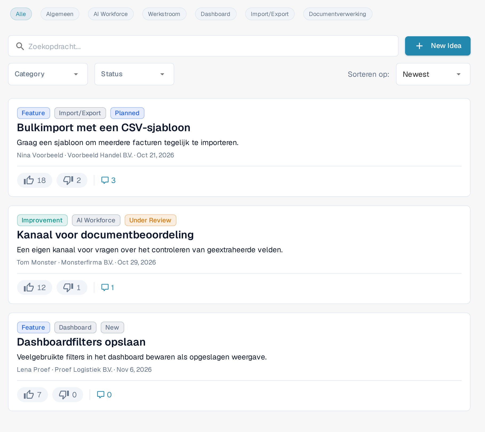
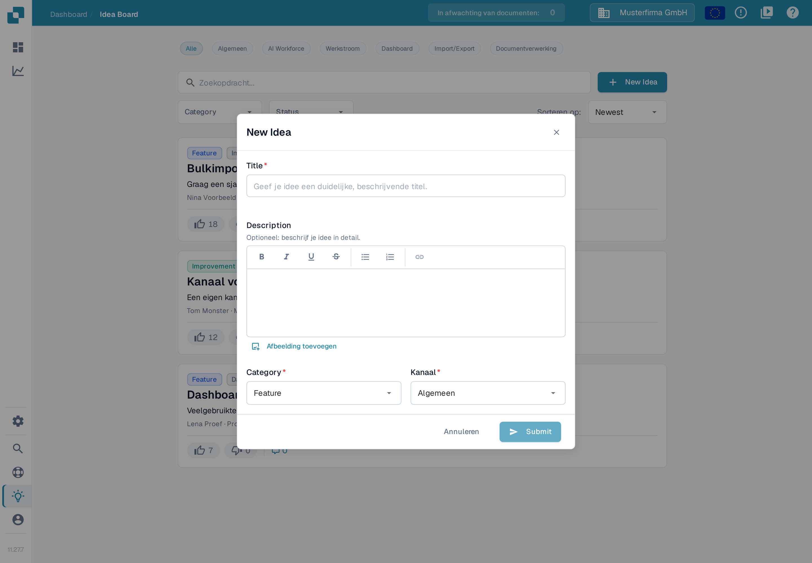
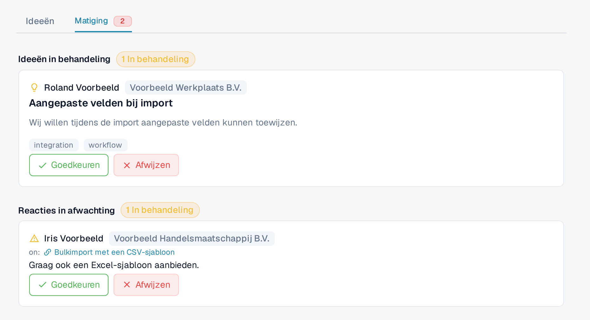

# Ideeënbord

Het Ideeënbord is de plek om functieverzoeken in te dienen, ontbrekende functionaliteit te melden en te stemmen op wat het productteam als volgende zou moeten bouwen. Ideeën zijn ingedeeld per kanaal en hebben commentaar en stemmen. Het bord wordt gedeeld door alle DocBits-organisaties: goedgekeurde ideeën en commentaren kunnen zichtbaar zijn voor gebruikers van andere organisaties. Items die nog op beoordeling wachten of zijn afgewezen, blijven zichtbaar voor gebruikers van de indienende organisatie en voor moderators. Behandel het bord daarom als een gedeeld kanaal voor productfeedback en laat vertrouwelijke bedrijfs-, klant- en documentgegevens weg.

## Hoe u het bord opent

Open de zijbalk en klik op **Idea Board**, of navigeer direct naar `/ideas`.

Een deel van de labels staat in de Nederlandse versie nog in het Engels, bijvoorbeeld **Idea Board**, **New Idea**, **Category**, **Status** en **Submit**. Deze pagina gebruikt de labels zoals ze in het product verschijnen.

<figure><figcaption>
Het Ideeënbord met kanaalchips, zoekveld, de filters <strong>Category</strong> en <strong>Status</strong>, de sorteerkiezer en de knop <strong>New Idea</strong>.
</figcaption></figure>

## Kanalen

Bovenaan het bord staat een rij kanaalchips: **Alle**, **Algemeen**, **AI Workforce**, **Werkstroom**, **Dashboard**, **Import/Export** en **Documentverwerking**. Klik op een chip om alleen de ideeën uit dat productgebied te tonen; **Alle** wist het kanaalfilter. Elk idee hoort bij één kanaal, dat als label op de kaart staat. Het kanaal **AI Workforce** verzamelt ideeën over de functies van [AI Workforce](../../advanced-functions-and-tools/ai_workforce/).

## Ideeën bekijken

Elk idee wordt weergegeven als een kaart met:

* De titel en een opgemaakte beschrijving, die afbeeldingen kan bevatten.
* Aparte knoppen voor **omhoog stemmen** en **omlaag stemmen**, elk met een eigen telling.
* Een categorielabel — bijvoorbeeld Feature, Improvement, Bug, Integration of Other. Het label Bug staat nog in de keuzelijst; gebruik het niet voor storingen die uw werk blokkeren.
* Een kanaallabel — Algemeen, AI Workforce, Werkstroom, Dashboard, Import/Export of Documentverwerking.
* Een statuslabel — New, Under Review, Planned, In Progress, Done of Declined.
* Naam en organisatie van de indiener, plus een relatieve tijdsaanduiding.
* Een schakelaar voor commentaar die de discussie onder de kaart open- en dichtklapt.

Met de paginering onderaan de lijst gaat u naar de volgende of vorige pagina.

## Een nieuw idee indienen

Klik in de kop van het bord op **New Idea**. Het venster vraagt om:

* **Title** — een korte, beschrijvende naam voor het idee.
* **Description** — een optionele opgemaakte editor met vet, cursief, onderstrepen, doorhalen, lijsten en links. U kunt ook afbeeldingen toevoegen: plak ze direct of gebruik **Afbeelding toevoegen** om er een in de beschrijving te zetten.
* **Category** — kies de best passende optie: Feature, Improvement, Bug, Integration of Other. Gebruik een supportticket voor incidenten die uw werk blokkeren.
* **Kanaal** — het productgebied waartoe het idee behoort.

Klik op **Submit** om het idee te versturen. De zichtbaarheid hangt af van de moderatiestatus: het idee kan binnen uw organisatie verschijnen zolang het op beoordeling wacht; na goedkeuring is het op het hele bord zichtbaar — zie [Matiging](#matiging) hieronder.

<figure><figcaption>
Het venster <strong>New Idea</strong> met een lege titel en beschrijving, de keuzelijsten <strong>Category</strong> en <strong>Kanaal</strong> en de knoppen <strong>Annuleren</strong> en <strong>Submit</strong>.
</figcaption></figure>

## Stemmen

Elk idee heeft aparte knoppen voor **omhoog stemmen** en **omlaag stemmen**, elk met een eigen telling. Klik op een knop om uw stem uit te brengen, klik er opnieuw op om hem terug te trekken, of klik op de tegenovergestelde knop om te wisselen. Stemmen geven het productteam een signaal over de vraag en bepalen de sorteervolgorde **Hoogst gewaardeerd**.

## Reageren

Open de commentaarthread van een idee om vragen te stellen, context toe te voegen of workarounds te delen. U kunt commentaren omhoog of omlaag stemmen (maar niet die van uzelf) en commentaren verwijderen die u zelf hebt geplaatst. Moderators van het bord kunnen ook commentaren verwijderen. Eigendom van een idee of het zijn van organisatiebeheerder alleen geeft dat moderatierecht niet.

## Matiging

Heeft uw account toegang tot de moderatie van het bord, dan verschijnt naast **Ideeën** een extra tabblad **Matiging**. Die toegang is voorbehouden aan organisatiebeheerders van vertrouwde organisaties; beheerder zijn van een andere organisatie geeft die toegang niet automatisch. Een rood cijfer bij het tabblad verschijnt zolang er items op beoordeling wachten.

<figure><figcaption>
Het tabblad <strong>Matiging</strong> met de secties <strong>Ideeën in behandeling</strong> en <strong>Reacties in afwachting</strong>.
</figcaption></figure>

Het tabblad heeft twee secties:

* **Ideeën in behandeling** — nieuw ingediende ideeën die op goedkeuring wachten. Elke kaart toont de indiener, de titel, de beschrijving en de labels voor categorie en kanaal. Gebruik **Goedkeuren** om het idee op het hele bord zichtbaar te maken, of **Afwijzen** om het daar niet te tonen.
* **Reacties in afwachting** — commentaren die op beoordeling wachten, getoond met het idee waarop ze zijn geschreven. Gebruik **Goedkeuren** om het commentaar op het hele bord zichtbaar te maken, of **Afwijzen** om het daar niet te tonen.

Afwijzen verwijdert het item niet: gebruikers van de indienende organisatie en moderators van het bord kunnen het nog steeds zien.

Moderators kunnen ook direct in een discussie ingrijpen: het commentaarmenu (drie-stippen-knop) op een goedgekeurd commentaar biedt een optie om het commentaar voor andere organisaties te verbergen. Dat haalt het commentaar uit de organisatieoverstijgende weergave zonder het te verwijderen; gebruikers van de indienende organisatie en moderators kunnen het nog steeds zien.

## Filteren en sorteren

Boven de lijst kunt u combineren:

* De **kanaal**chips.
* Het zoekveld **Zoekopdracht...**, dat zoekt in titel en beschrijving.
* De keuzelijst **Category**.
* De keuzelijst **Status**.
* De sorteerkiezer **Sorteren op:** met **Newest**, **Heet** of **Hoogst gewaardeerd**.

Filters combineren, dus u kunt bijvoorbeeld in enkele klikken inperken tot "Hoogst gewaardeerde verbeteringen met status Under Review".

## Uw eigen idee bewerken of verwijderen

Het kaartmenu (drie-stippen-knop) laat u een idee dat u zelf hebt ingediend bewerken of verwijderen. Moderators van het bord kunnen ook op ideeën van anderen ingrijpen; gewone gebruikers krijgen die rechten niet alleen doordat ze bij dezelfde organisatie horen.

Het Ideeënbord is bedoeld voor productfeedback, niet voor incidentmeldingen. Gebruik een supportticket voor problemen die uw werk vandaag blokkeren.
