# Przyjmowanie zamówień

## Przegląd

Moduł **Przyjmowanie zamówień** odczytuje zamówienia, które wysyłają Ci klienci — e-mailem lub jako wklejony tekst — i przygotowuje je jako zamówienia sprzedaży dla Twojego systemu ERP. DocBits rozpoznaje klienta, odczytuje każdą pozycję, dopasowuje ją do artykułu z Twojej kartoteki artykułów i pokazuje, co jeszcze wymaga decyzji. Sprawdzasz zamówienie, uzupełniasz braki, w razie wątpliwości pytasz klienta i zatwierdzasz zamówienie. Dopiero wtedy zamówienie sprzedaży zostaje utworzone w ERP.

```
E-mail klienta / wklejony tekst
        │
        ▼
  Odczyt pozycji ──► Dopasowanie do artykułów ──► Sprawdzasz i decydujesz ──► Zatwierdź i eksportuj ──► Zamówienie sprzedaży w ERP
                                                         │
                                                         └──► Zapytanie do klienta (e-mail) ──► odpowiedź zostaje uwzględniona
```

**Przykład:** Muster Maschinenbau GmbH pisze w e-mailu „150 Stk MM-4711 Sechskantschrauben M8x40”. DocBits rozpoznaje klienta po adresie e-mail nadawcy, wie, że numer MM-4711 tego klienta odpowiada Twojemu artykułowi 55-3320, i pokazuje pozycję jako **Dopasowane**. Druga pozycja „2 Winkelschleifer 125er” nie ma numeru artykułu, więc DocBits proponuje podobne artykuły i ustawia pozycję na **Do sprawdzenia**. Wybierasz właściwy artykuł, klikasz **Zatwierdź i eksportuj** i zamówienie trafia do ERP.


**Obecne ograniczenia**

* **Zamówienia z plików PDF nie są jeszcze dostępne.** Korzystaj z zamówień e-mailowych lub z funkcji **Importuj z tekstu**.
* **Ceny** są wyświetlane i sprawdzane tylko wtedy, gdy Twój ERP (Infor M3) zwraca ceny dla danego klienta. Bez nich zamówienie i tak zostaje przekazane — cenę ustala ERP.
* **Zapytania do klienta** można wysyłać tylko w przypadku zamówień, które wpłynęły e-mailem.


## Jak aktywować

Moduł Przyjmowanie zamówień wymaga subskrypcji **AI Workforce**.

1. Przejdź do **Ustawienia › Moduł › Zamówienia i finanse** i otwórz sekcję **Przyjmowanie zamówień**.
2. Włącz opcję **Aktywuj panel Przyjmowanie zamówień**. Na pasku bocznym pojawi się pozycja „Przyjmowanie zamówień”.
3. Nadaj roli pracowników obsługujących zamówienia dostęp do modułu Przyjmowanie zamówień w **Ustawienia › Grupy i uprawnienia** (administratorzy mają dostęp zawsze).

<figure>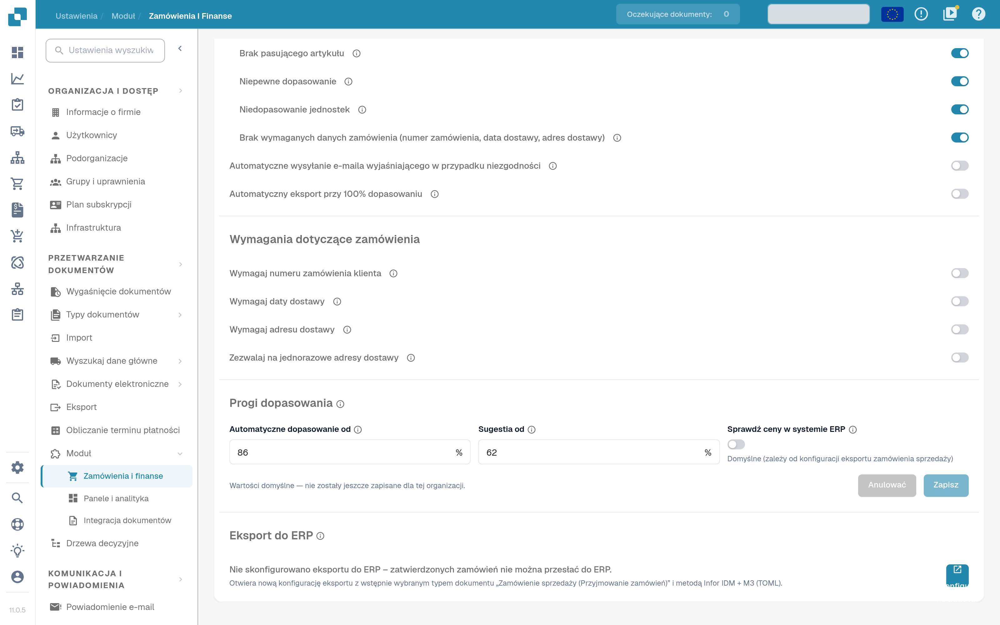<figcaption><p>Ustawienia modułu Przyjmowanie zamówień w sekcji Ustawienia › Moduł › Zamówienia i finanse; na końcu sekcja Eksport do ERP, tu jeszcze bez eksportu do ERP.</p></figcaption></figure>

W tej samej sekcji administrator decyduje, jak działa moduł:

| Grupa | Ustawienie | Działanie |
| --- | --- | --- |
| **Automatyzacja** | **Automatyczne tworzenie odpowiedzi e-mail w przypadku niezgodności** | Domyślnie włączone: agent sam przygotowuje e-mail wyjaśniający w przypadkach zaznaczonych poniżej. Pracownik sprawdza go, chyba że włączone jest wysyłanie automatyczne. |
| | **Przygotuj e-mail wyjaśniający dla pozycji z** … | Problemy, przy których agent przygotowuje pytanie do klienta: **Brak pasującego artykułu**, **Niepewne dopasowanie**, **Niedopasowanie jednostek**, **Brak wymaganych danych zamówienia (numer zamówienia, data dostawy, adres dostawy)**. O brakującą ilość agent pyta zawsze. |
| | **Automatyczne wysyłanie e-maila wyjaśniającego w przypadku niezgodności** | Wyłączone (zalecane): każdy przygotowany e-mail czeka na zatwierdzenie przez pracownika. |
| | **Automatyczny eksport przy 100% dopasowaniu** | Zamówienia, w których każda pozycja została dopasowana dokładnie lub na podstawie nauczonego numeru artykułu klienta i niczego więcej nie brakuje, trafiają do ERP bez zatwierdzania. |
| **Wymagania dotyczące zamówienia** | **Wymagaj numeru zamówienia klienta**, **Wymagaj daty dostawy**, **Wymagaj adresu dostawy** | Po włączeniu zamówienie bez tej wartości otrzymuje otwarty punkt i nie można go zatwierdzić, dopóki wartość nie zostanie uzupełniona. Wszystkie trzy opcje są domyślnie wyłączone. |
| | **Zezwalaj na jednorazowe adresy dostawy** | Po włączeniu pracownicy mogą wpisać adres używany tylko dla tego zamówienia (np. plac budowy). Po wyłączeniu można używać wyłącznie adresów z danych podstawowych klienta. |
| **Progi dopasowania** | **Automatyczne dopasowanie od** (domyślnie 86%), **Sugestia od** (domyślnie 62%) | Automatycznie akceptowane są tylko dokładne numery artykułów i nauczone numery artykułów klienta. Podobne opisy są zawsze pokazywane jako sugestie do sprawdzenia. |
| | **Sprawdź ceny w systemie ERP** | Porównuje cenę netto klienta z ceną netto w ERP. Różnica powyżej dopuszczalnej tolerancji wymaga decyzji; cenę zamówienia i tak ustala ERP. Domyślnie ustawienie to wynika z konfiguracji eksportu do ERP. |
| **Eksport do ERP** | *(tylko status)* | Pokazuje konfiguracje eksportu typu dokumentu **Zamówienie sprzedaży (Przyjmowanie zamówień)**, z którymi zatwierdzone zamówienia trafiają do ERP, każdą z przyciskiem **Redagować**; nieaktywna jest oznaczona jako **Nieaktywny**. Wiersz ostrzeżenia oznacza, że konfiguracja nadal używa przychodzącego typu dokumentu **Przyjmowanie zamówień – dokument przychodzący**; taka konfiguracja nigdy nie jest używana. Jeśli nie ma aktywnej konfiguracji, sekcja pokazuje *Nie skonfigurowano eksportu do ERP – zatwierdzonych zamówień nie można przesłać do ERP.* i miejsce konfiguracji. Administratorzy konfigurują eksport w **Ustawienia › Eksport** (zob. niżej). |

Administratorzy mogą otworzyć te ustawienia z poziomu każdego zamówienia przyciskiem z ikoną koła zębatego (**Ustawienia przyjmowania zamówień**) na górnym pasku.

### Konfiguracja eksportu do ERP (administratorzy)

Zatwierdzone zamówienia trafiają do ERP (Infor M3) wyłącznie przez konfigurację eksportu typu dokumentu **Zamówienie sprzedaży (Przyjmowanie zamówień)**. Administrator konfiguruje ją jednorazowo:

1. Przejdź do **Ustawienia › Eksport** i kliknij **Nowy**.
2. Wpisz **Tytuł konfiguracji** i wybierz jako **Typ dokumentu** **Zamówienie sprzedaży (Przyjmowanie zamówień)**. Jest on dostępny, gdy tylko moduł Przyjmowanie zamówień jest włączony; nie trzeba wcześniej aktywować typu dokumentu.
3. W polu **Eksport** wybierz **Infor**, a w polu **Typ informacji** wybierz **Infor IDM + M3 (TOML)**.
4. Prześlij **Plik API ION** (`.ionapi`) i **Plik mapowania TOML** (`.toml`) swojego połączenia z M3.
5. Kliknij **Zapisz**. Nowa konfiguracja ma status **Aktywny**; dla jednego typu dokumentu aktywna może być tylko jedna konfiguracja.

Sekcja **Eksport do ERP** w ustawieniach modułu Przyjmowanie zamówień pokazuje wtedy konfigurację; **Redagować** ją otwiera, a nieaktywna jest oznaczona jako **Nieaktywny**. Wiersz ostrzeżenia oznacza, że starsza konfiguracja nadal używa przychodzącego typu dokumentu **Przyjmowanie zamówień – dokument przychodzący**: nigdy nie jest używana, więc otwórz ją przyciskiem **Redagować** i zmień typ dokumentu na **Zamówienie sprzedaży (Przyjmowanie zamówień)**. Zamówienia są eksportowane wyłącznie z modułu Przyjmowanie zamówień przyciskiem **Zatwierdź i eksportuj** (lub automatycznie przy włączonym **Automatyczny eksport przy 100% dopasowaniu**); same dokumenty przychodzące nigdy nie są eksportowane.

## Wprowadzanie zamówienia

### E-mailem

Klienci wysyłają zamówienia na skrzynkę zamówień Twojej organizacji. Agent AI odczytuje e-mail, znajduje pozycje i tworzy zamówienie na liście. Klient jest rozpoznawany po **domenie adresu e-mail nadawcy**. Podpisy, zastrzeżenia prawne i cytowane starsze wiadomości nie są odczytywane jako pozycje.

### Importuj z tekstu

Dla zamówienia, które dotarło do Ciebie inną drogą (przepisany faks, wiadomość z czatu, przekazany tekst):

1. Na liście modułu Przyjmowanie zamówień kliknij **Importuj z tekstu**.
2. Wklej zamówienie w pole **Tekst zamówienia**. Dowolna forma jest w porządku — podziały wierszy, skróty i zapis skrótowy są obsługiwane.
3. Wybierz pole **Klient** (wyszukiwanie po nazwie, adresie e-mail lub numerze klienta). Bez klienta zamówienie otwiera się z otwartym punktem *Brak klienta*.
4. Kliknij **Wyodrębnij i dopasuj**.

<figure><figcaption><p>Wklej zamówienie klienta i wybierz klienta.</p></figcaption></figure>

### Nowe zamówienie

Przycisk **Nowe zamówienie** pozwala utworzyć zamówienie ręcznie na podstawie katalogu artykułów: wybierz klienta i adres dostawy, dodaj artykuły i ilości, a następnie kliknij **Zatwierdź i eksportuj**.

## Lista zamówień

Otwórz **Przyjmowanie zamówień** na pasku bocznym. Lista pokazuje każde zamówienie z klientem, źródłem (E-mail, Tekst, Ręcznie), liczbą pozycji, czasem otrzymania, statusem i statusem dopasowania. Mały znak ostrzegawczy obok liczby pozycji pokazuje, ile z nich nadal wymaga decyzji. Kliknij wiersz, aby otworzyć zamówienie.

<figure>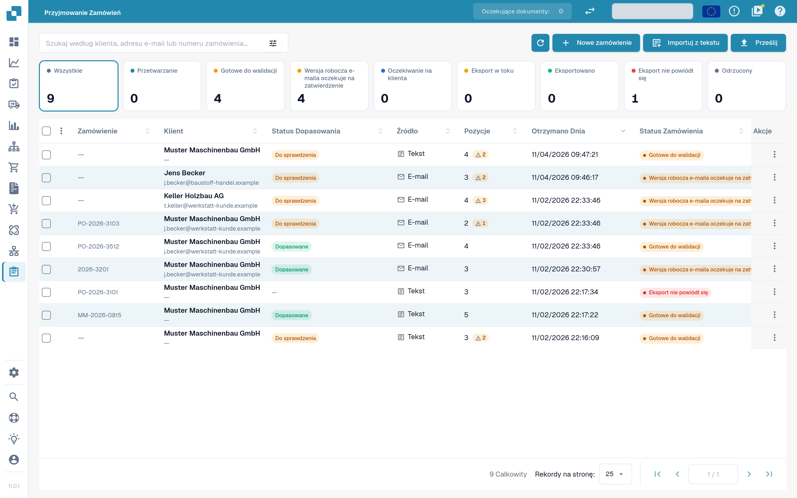<figcaption><p>Lista modułu Przyjmowanie zamówień z kartami statusów.</p></figcaption></figure>

**Karty statusów** nad listą zliczają zamówienia według statusu. Kliknij kartę, aby wyświetlić tylko te zamówienia; karta **Wszystkie** pokazuje wszystko.

| Status | Znaczenie |
| --- | --- |
| **Przetwarzanie** | Zamówienie jest odczytywane lub przygotowywane — na razie nie musisz nic robić. |
| **Gotowe do walidacji** | Odczytane i czeka na pracownika: sprawdź pozycje lub zatwierdź zamówienie. |
| **Wersja robocza e-maila oczekuje na zatwierdzenie** | Przygotowano e-mail do klienta, który czeka na Twoje zatwierdzenie. |
| **Oczekiwanie na klienta** | Wyjaśnienie zostało wysłane, odpowiedź jeszcze nie nadeszła. |
| **Eksport w toku** | Zatwierdzone, ale jeszcze nie przekazane do ERP. |
| **Eksportowano** | Przekazane do ERP. |
| **Eksport nie powiódł się** | ERP odrzucił przekazanie — spróbuj ponownie po usunięciu przyczyny. |
| **Odrzucony** | Odrzucone lub rozpoznane jako duplikat — brak dalszych działań. |

Kolumna **Status dopasowania** pokazuje **Do sprawdzenia**, gdy pozycja, wymagane pole nagłówka lub adres dostawy nadal wymaga decyzji, oraz **Dopasowane**, gdy wszystko jest rozstrzygnięte.

Gdy agent AI, ponowne dopasowanie lub odpowiedź klienta przetwarza zamówienie, jego status pokazuje **Agent pracuje** z obracającą się strzałką. Zamówienie jest zablokowane do zakończenia pracy; lista odświeża się sama.

**Wyszukiwanie i filtrowanie:** wpisz w pole wyszukiwania klienta, adres e-mail lub numer zamówienia. Ikona filtra w polu wyszukiwania filtruje według pola **Źródło** (*E-mail* lub *Ręcznie*).

Menu na końcu wiersza zawiera polecenia **Dzienniki** (każdy krok agenta, użytkowników i systemu oraz historia decyzji: kto co potwierdził lub zmienił) i **Usuwać**.

## Sprawdzanie nowego zamówienia

### Ekran dopasowania

<figure>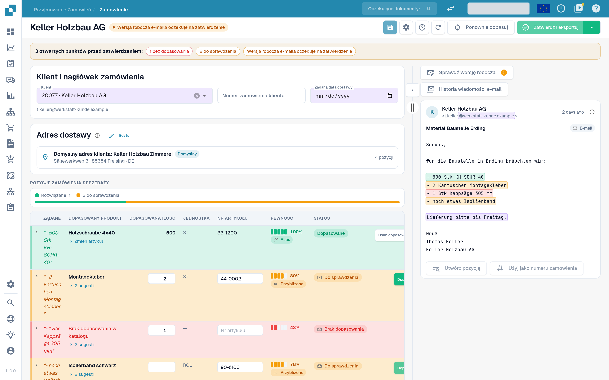<figcaption><p>Ekran dopasowania: dane zamówienia po lewej, e-mail klienta po prawej.</p></figcaption></figure>

* **Górny pasek** — klient, status, wartość zamówienia (tylko z cenami z ERP) oraz akcje **Zapisz**, **Legenda**, **Odświeżać**, **Ponownie dopasuj** i **Zatwierdź i eksportuj**.
* **Otwarte punkty** — bezpośrednio pod górnym paskiem: wszystko, co nadal blokuje zatwierdzenie, np. *Brak klienta*, *Brak numeru zamówienia*, *2 do sprawdzenia*. Kliknij punkt, aby do niego przejść.
* **Klient i nagłówek zamówienia** — klient, numer zamówienia klienta i żądana data dostawy.
* **Adres dostawy** — dokąd trafia zamówienie. Jeśli klient ma adres domyślny, jest on używany automatycznie (*Domyślny adres klienta: …* z oznaczeniem **Domyślny**); przycisk **Edytuj** pozwala go zmienić. Pozycje mogą też trafiać pod różne adresy.
* **Pozycje** — jeden wiersz na każdy zamówiony artykuł z tekstem klienta, dopasowanym artykułem, ilością, jednostką i statusem. Pasek nad tabelą pokazuje, ile pozycji jest rozstrzygniętych, a ile pozostaje do sprawdzenia.
* **Źródło** (po prawej) — e-mail klienta lub wklejony tekst. Pozycje są wyróżnione na zielono, żółto lub czerwono zgodnie z ich statusem, adresy dostawy na niebiesko, a wartości nagłówka (klient, numer zamówienia, data) na fioletowo. Kliknij wyróżnienie, aby przejść do pozycji. Strzałka na separatorze ukrywa lub pokazuje e-mail; przeciągnij separator, aby zmienić szerokość. **Historia wiadomości e-mail** zawiera wszystkie e-maile dotyczące tego zamówienia.

**Legenda** (przycisk ze znakiem zapytania) objaśnia każdy kolor, status i metodę dopasowania.


Żadna zmiana wprowadzona na tym ekranie nie zostanie zapisana, dopóki nie klikniesz **Zapisz** (ikona dyskietki; czerwona kropka oznacza niezapisane zmiany). Zapisać można też skrótem Ctrl+S / Cmd+S. Jeśli opuścisz zamówienie z niezapisanymi zmianami, DocBits zapyta, czy je zapisać, czy odrzucić.


### Statusy pozycji i metody dopasowania

| Status | Znaczenie |
| --- | --- |
| **Dopasowane** | Dopasowane automatycznie (na podstawie nauczonego numeru artykułu klienta lub dokładnego numeru artykułu) albo potwierdzone przez pracownika. |
| **Do sprawdzenia** | Istnieje sugestia, ale trzeba ją sprawdzić. |
| **Brak dopasowania** | Żaden artykuł z kartoteki artykułów nie jest na tyle podobny, aby go zasugerować. |
| **Oczekuje** | Jeszcze niedopasowane. |
| **Zignorowano** | Wykluczone z eksportu. |

| Metoda dopasowania | Znaczenie |
| --- | --- |
| **Alias** | Własny numer artykułu tego klienta został już wcześniej przypisany do Twojego artykułu — przechodzi automatycznie. |
| **Dokładny** | Numer artykułu w zamówieniu dokładnie odpowiada kartotece artykułów — przechodzi automatycznie. |
| **Przybliżone** | Tylko podobny opis — zawsze wymaga sprawdzenia. |
| **Ręczne** | Wybrane lub potwierdzone przez pracownika. |
| **Wyjaśnienie** | Przejęte z odpowiedzi klienta. |

Gdy potwierdzisz artykuł dla numeru artykułu klienta, DocBits **zapamiętuje go jako alias** dla tego klienta: następne zamówienie z tym samym numerem zostanie dopasowane automatycznie. Nauczony alias można usunąć z menu pozycji (**Usuń nauczony alias**).

### Pozycje ze statusem „Do sprawdzenia”

1. Kliknij pozycję, aby ją otworzyć. Sekcja **Zamówione przez klienta** pokazuje ilość, jednostkę, numer artykułu klienta i opis w takiej postaci, w jakiej zapisał je klient.
2. Sekcja **Sugerowane dopasowania** zawiera najlepsze artykuły z numerem artykułu, jednostką, metodą dopasowania i pewnością.
3. Najlepsza sugestia jest już wstępnie wybrana (**Wybrany**). Jeśli właściwy jest inny artykuł, kliknij przy nim **Użyj tego** — albo znajdź go w polu **Lub wyszukaj w katalogu**. Czerwony **x** usuwa wybór.
   Pozycja musi mieć **ilość**, zanim będzie można ją dopasować: bez niej przyciski **Użyj tego** i **Dopasuj** są wyszarzone (*Najpierw wprowadź ilość — pozycja bez ilości nie zostanie dopasowana.*). Najpierw wpisz ilość w wierszu.
4. Okno podręczne porównuje zamówioną pozycję z wybranym artykułem. Sprawdź je i kliknij **Potwierdź dopasowanie**.
5. Kliknij **Zapisz**.

<figure>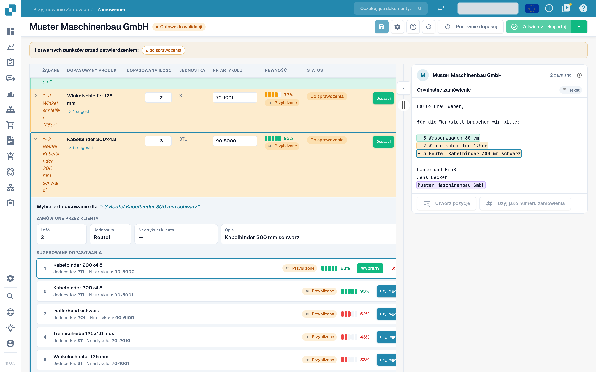<figcaption><p>Pozycja do sprawdzenia: porównaj zamówienie klienta z sugestiami.</p></figcaption></figure>

<figure>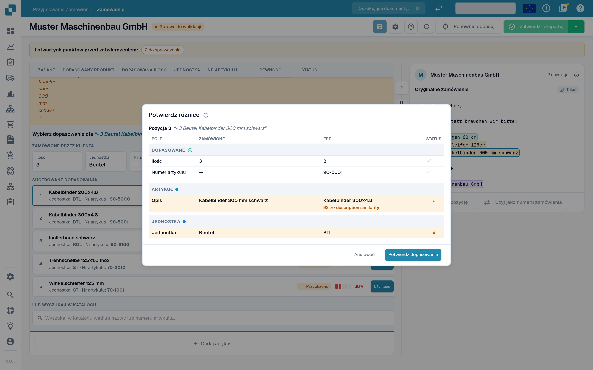<figcaption><p>Potwierdź różnice porównuje zamówienie klienta z wybranym artykułem; tutaj różnią się opis i jednostka. Tekst „description similarity” nie jest jeszcze przetłumaczony w produkcie.</p></figcaption></figure>

Pozycję, która ma już wybraną sugestię, można potwierdzić bezpośrednio przyciskiem **Dopasuj** w jej wierszu. Menu na końcu wiersza zawiera więcej poleceń: **Wyślij klientowi wiadomość e-mail dotyczącą tej pozycji**, **Własna data dostawy…**, **Własny adres dostawy…**, **Ignoruj pozycję** (nie jest eksportowana) i **Usuń pozycję**.

### Różnice w ilości i cenie

* **Ilość:** możesz zmienić ilość pozycji. Jeśli różni się od ilości zamówionej przez klienta, jest wyświetlana na żółto i trzeba ją potwierdzić: otwórz pozycję, wybierz artykuł, a okno **Potwierdź różnice** pokaże ilość. Opcjonalnie dodaj notatkę i kliknij **Potwierdź**. Zamówienie zostanie wyeksportowane z potwierdzoną ilością.
* **Cena** (tylko z cenami z ERP): jeśli cena klienta różni się od ceny netto w ERP o więcej niż dopuszczalna tolerancja, cena jest wyświetlana na żółto ze wskazówką *Cena różni się*. Kliknij **Dopasuj** w wierszu; okno pokazuje obie ceny, różnicę i tolerancję. Kliknij **Potwierdź**, aby zaakceptować cenę z ERP, albo zapytaj klienta (zobacz [Zapytaj klienta](#zapytaj-klienta)). Jeśli cena klienta wygląda na cenę za 10, 100 lub 1000 sztuk, okno proponuje ustawienie jednostki cenowej jednym kliknięciem.

<figure>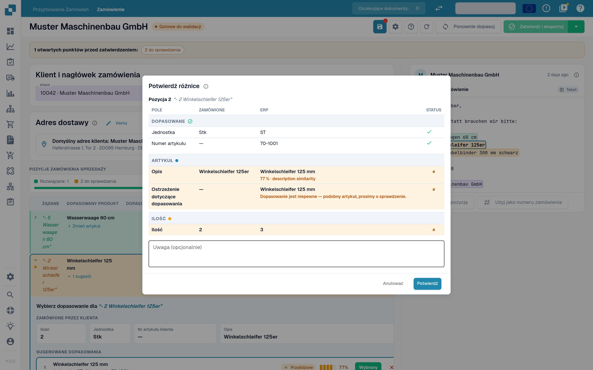<figcaption><p>Ilość różniąca się od zamówienia potwierdzasz z opcjonalną notatką. Tekst „description similarity” nie jest jeszcze przetłumaczony w produkcie.</p></figcaption></figure>

Jeśli ERP nie zwraca ceny dla pozycji, wyświetlany jest komunikat **Brak ceny ERP** z przyczyną po najechaniu kursorem i przyciskiem **Spróbuj ponownie**. Nie blokuje to zamówienia.

### Klient nierozpoznany

Jeśli domena e-mail nadawcy nie jest jeszcze znana, zamówienie ma otwarty punkt **Brak klienta**. Wybierz klienta w sekcji **Klient i nagłówek zamówienia**. DocBits zaproponuje wtedy zapamiętanie domeny nadawcy:

* **Przypisz domenę e-mail** — *Przyszłe wiadomości e-mail od @domena będą automatycznie przypisywane do …* Kliknij **Potwierdzać**; przypisanie zostanie zapisane razem z innymi zmianami po kliknięciu **Zapisz**. **Anulować** cofa wybór klienta.
* Jeśli domena należy już do innego klienta, wybierz **Zachowaj …** (przyszłe e-maile pozostają przy dotychczasowym kliencie, a to zamówienie i tak otrzymuje nowego) albo **Przypisz do …** (przyszłe e-maile trafiają do nowego klienta).

<figure>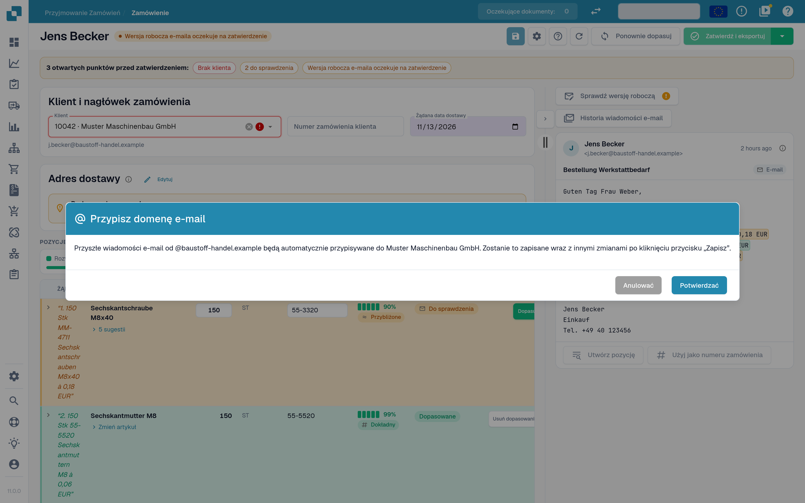<figcaption><p>Przy przypisaniu klienta można też przypisać domenę e-mail nadawcy.</p></figcaption></figure>

<figure>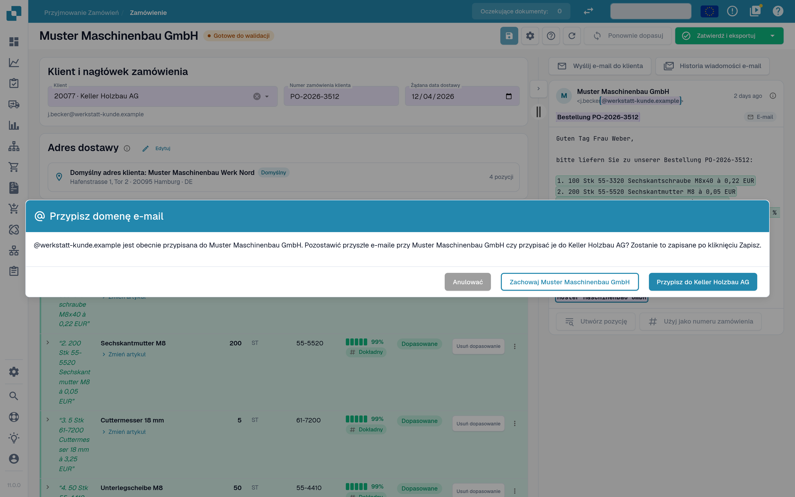<figcaption><p>Domena należy już do innego klienta: zachowaj ją lub przenieś.</p></figcaption></figure>

Publiczne domeny pocztowe (np. gmail.com) nigdy nie są przypisywane do klienta.

### Ponownie dopasuj

Przycisk **Ponownie dopasuj** na górnym pasku jeszcze raz dopasowuje wszystkie otwarte pozycje — na przykład po dodaniu nowych artykułów do kartoteki artykułów lub po zmianie klienta. Potwierdzone i zignorowane pozycje pozostają bez zmian. Komunikat informuje, ile pozycji dopasowano ponownie.

Przycisk jest wyszarzony, gdy dopasowanie nie może nic zmienić; najedź na niego kursorem, aby zobaczyć powód:

| Podpowiedź | Powód |
| --- | --- |
| *Wszystkie pozycje zostały już dopasowane, potwierdzone lub zignorowane.* | Nic nie jest otwarte. |
| *Dopasowywanie czeka, aż agent napisze wyjaśnienie.* | Poczekaj, aż wersja robocza będzie gotowa. |
| *Zamówienie zostało już przekazane lub zamknięte.* | Zamówień zatwierdzonych, wyeksportowanych lub odrzuconych nie można dopasować ponownie. |
| *Zamówienie jest nadal odczytywane.* | Poczekaj na zakończenie odczytu. |

Ponowne dopasowanie jest możliwe także wtedy, gdy zapytanie do klienta jest otwarte: niewysłana wersja robocza zostaje zachowana (jeśli wszystko, o co pyta, jest już rozstrzygnięte, wersja robocza informuje *Nie ma już o co pytać*); zatwierdzona, ale niewysłana wersja robocza wraca do stanu roboczego.

## Poprawianie pominiętej lub błędnej pozycji

Czasami odczyt umieszcza dwa artykuły w jednej pozycji, dzieli jeden artykuł na dwie pozycje albo pomija artykuł zapisany w zdaniu. Popraw to bezpośrednio w e-mailu lub wklejonym tekście:

1. **Zaznacz tekst** artykułu w tekście zamówienia po prawej stronie.
2. Kliknij **Utwórz pozycję** pod tekstem.
3. Okno podręczne pokazuje stan **Przed → Po**. Sprawdź go i kliknij **Potwierdzać**.
4. Kliknij **Zapisz**. Nowe pozycje otrzymują nowe numery, są automatycznie dopasowywane i wyróżniane w tekście.

Wynik zależy od tego, co zaznaczysz:

| Zaznaczasz … | Wynik |
| --- | --- |
| Tekst, który **nie jest jeszcze pozycją** | **Nowa pozycja** — zaznaczenie staje się nową pozycją. |
| **Część pozycji** (np. drugi z dwóch artykułów w jednym wierszu) | **Podział** — pozycja zostaje usunięta i zastąpiona osobną pozycją dla każdego artykułu. |
| **Całość dwóch lub więcej sąsiednich pozycji** | **Połączenie** — stają się jedną pozycją. |
| Jedną pozycję **wraz z innym tekstem** | Pozycja zostaje **zastąpiona** zaznaczonym tekstem. |
| Pozycję **dokładnie w obecnym brzmieniu** | Nic się nie dzieje — *Ten tekst znajduje się już na pozycji n — nic nie zostało utworzone.* |

<figure>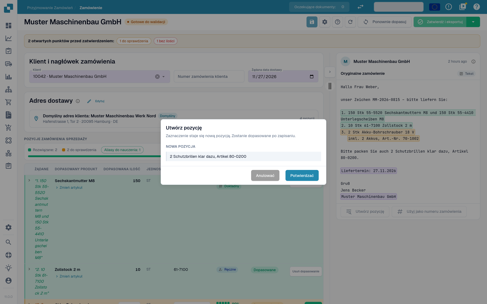<figcaption><p>Utwórz pozycję, którą pominął odczyt.</p></figcaption></figure>

<figure>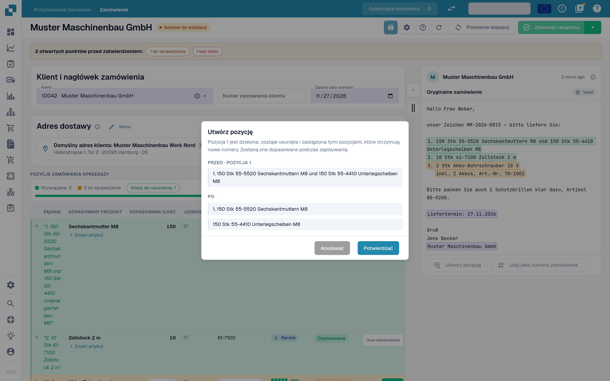<figcaption><p>Podziel pozycję zawierającą dwa artykuły.</p></figcaption></figure>

<figure><figcaption><p>Połącz dwie pozycje, które do siebie należą.</p></figcaption></figure>

<figure>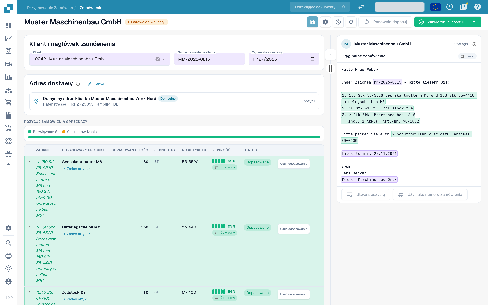<figcaption><p>Po zapisaniu nowe pozycje są dopasowane i wyróżnione w tekście.</p></figcaption></figure>

### Dzielenie pozycji, o której już zdecydowano

Pozycję, która jest **potwierdzona** lub **zignorowana**, ma **własny adres dostawy, datę lub cenę**, zawiera **odpowiedź klienta** albo została **edytowana przez pracownika**, nadal można podzielić. Zostaje ona wtedy **rozdzielona**: każda część staje się nową pozycją, która jest ponownie odczytywana i dopasowywana na podstawie własnego tekstu. Wszystkie nowe pozycje zachowują adres dostawy i datę dostawy i muszą zostać ponownie sprawdzone; otwarte punkty starej pozycji przechodzą do pierwszej nowej pozycji. Okno podręczne dokładnie wymienia, co zostanie utracone wraz ze starą pozycją, na przykład potwierdzenie artykułu, zaakceptowana ilość lub cena z ERP, odpowiedź klienta albo edycja pracownika. Historia zamówienia zachowuje stare wartości.

<figure>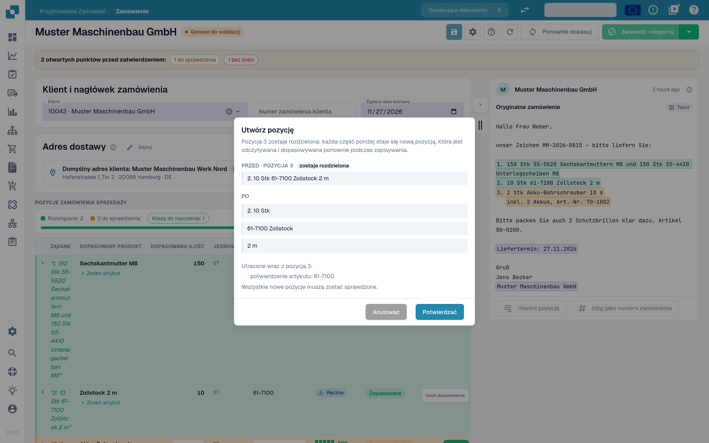<figcaption><p>Podział pozycji, o której już zdecydowano, rozdziela ją; okno wymienia, co zostanie utracone.</p></figcaption></figure>

Takich pozycji nigdy się nie **łączy**. Pozycji z **niezapisanymi zmianami** nie można podzielić: najpierw zapisz lub odrzuć zmiany.

### Gdy nic się nie zmienia

Jeśli zaznaczenie obejmuje tylko część pozycji i tekst poza nią albo dotyka kilku pozycji, nie obejmując ich w całości, nic się nie zmienia, a okno podręczne wyjaśnia dlaczego. Zaznacz tekst w obrębie jednej pozycji albo zaznacz całe pozycje, aby je połączyć. Jeśli dwie pozycje zostały odczytane z tego samego wiersza tekstu, okno informuje, która pozycja również odnosi się do zaznaczonego tekstu i pozostaje bez zmian.

Zawsze możesz dodać pozycję ręcznie przyciskiem **Dodaj artykuł** pod tabelą pozycji albo edytować pola pozycji bezpośrednio w tabeli.

## Poprawianie nagłówka zamówienia

### Numer zamówienia z tekstu

Jeśli numer zamówienia klienta nie został rozpoznany (np. „unser Zeichen MM-2026-0815” bez etykiety), zaznacz w tekście **tylko numer zamówienia** i kliknij **Użyj jako numeru zamówienia**. Po kliknięciu **Zapisz** numer znajdzie się w polu **Numer zamówienia klienta** i zostanie wyróżniony na fioletowo w tekście, aby każdy widział, skąd pochodzi.

<figure>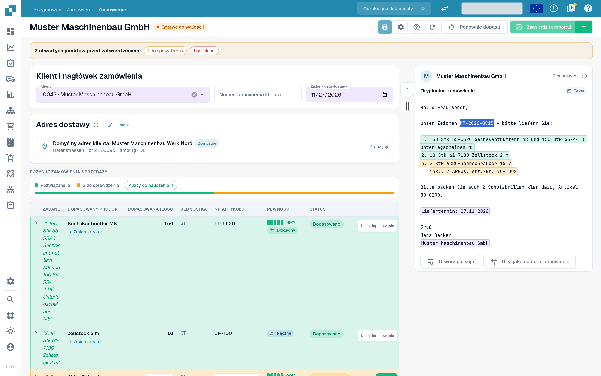<figcaption><p>Zaznacz numer zamówienia w tekście.</p></figcaption></figure>

### Numer zamówienia z tematu

Wielu klientów podaje numer zamówienia tylko w temacie („AW: 4711”). Możesz go zaznaczyć także w **wierszu tematu** e-maila. W temacie dostępna jest tylko akcja **Użyj jako numeru zamówienia** — pozycje są tworzone z tekstu zamówienia.

Numer zamówienia i datę dostawy zawsze możesz też wpisać bezpośrednio w sekcji **Klient i nagłówek zamówienia**.

## Zapytaj klienta

Gdy na pytanie może odpowiedzieć tylko klient — nieznany artykuł, niejasna ilość lub jednostka, brakujący numer zamówienia lub adres dostawy, różnica w cenie — wyślij zapytanie e-mailem. Wiadomość jest wysyłana w wątku pierwotnego zamówienia, a odpowiedź wraca do tego samego zamówienia. Funkcja jest dostępna tylko dla **zamówień e-mailowych**.

### Rozpoczęcie zapytania

1. Kliknij **Wyślij e-mail do klienta** nad e-mailem (albo **Wyślij klientowi wiadomość e-mail dotyczącą tej pozycji** w menu pozycji).
2. Wybierz cel zapytania w polu **Powód** (albo pozostaw je puste i pozwól zdecydować asystentowi), sprawdź pole **Odbiorcy** (w razie potrzeby dodaj **DW**) i zaznacz pozycje w sekcji **Pozycje referencyjne**.
3. Wybierz sposób:
   * **Wyślij automatycznie** — kliknij **Przekaż agentowi**. Agent AI napisze e-mail. Nic nie zostanie wysłane, dopóki pracownik nie zatwierdzi wersji roboczej.
   * **Wyślij ręcznie** — sam napisz temat i treść, a następnie kliknij **Wysłać**.

Podczas gdy agent pisze, przycisk nad e-mailem pokazuje **Wersja robocza w przygotowaniu**, a **Ponownie dopasuj** czeka.

W zależności od ustawień agent może też sam przygotować zapytanie, gdy wpłynie zamówienie z problemami.

Gdy istnieje wersja robocza, przycisk nad e-mailem to **Sprawdź wersję roboczą** zamiast **Wyślij e-mail do klienta**. Gdy zamówienie jest kompletne, przycisk **Sprawdź wersję roboczą** pozostaje dostępny bez żółtego **!** — nadal możesz wysłać wersję roboczą lub ją odrzucić. **Zatwierdź i eksportuj** odrzuca niewysłaną wersję roboczą.

### Sprawdzenie i wysłanie wersji roboczej

Gdy wersja robocza jest gotowa, zamówienie ma status **Wersja robocza e-maila oczekuje na zatwierdzenie**, a przycisk **Sprawdź wersję roboczą** pokazuje żółty **!**. Kliknij go, aby otworzyć okno **Wyjaśnienie z klientem**:

* **Odrzuć** — usuwa wersję roboczą; nic nie zostaje wysłane.
* **Zwróć agentowi** — powiedz agentowi, co zmienić; agent napisze nową wersję roboczą.
* **Edytuj** — samodzielnie zmień temat lub treść.
* **Zatwierdź i wyślij** — wysyła e-mail do klienta.

<figure>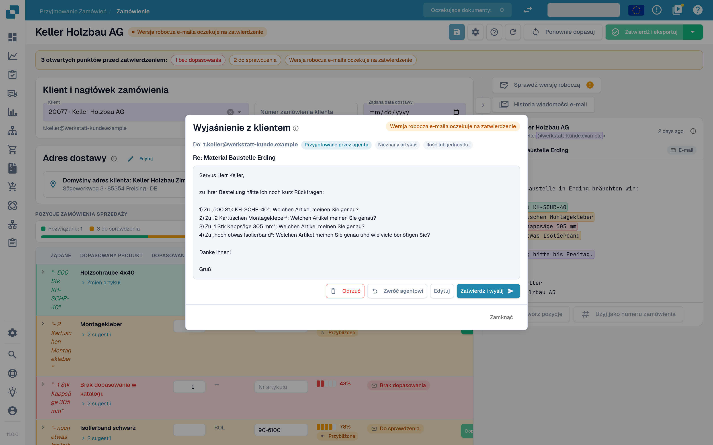<figcaption><p>Wersja robocza agenta czeka na Twoje zatwierdzenie.</p></figcaption></figure>

### Oczekiwanie na odpowiedź

Po wysłaniu zamówienie ma status **Oczekiwanie na klienta**, a przycisk nad e-mailem pokazuje **Oczekiwanie na klienta**. Gdy klient odpowie, agent odczytuje odpowiedź i uwzględnia ją w zamówieniu (zamówienie jest na chwilę zablokowane ze statusem *Czytanie odpowiedzi klienta*); odpowiedź pojawia się w panelu e-maila i w **Historia wiadomości e-mail**. Pozycje, które już potwierdziłeś, nie są nadpisywane — jeśli klient zmieni którąś z nich, zostanie ona oznaczona jako *Zmienione przez maila klienta*, abyś mógł ją ponownie sprawdzić.

Jeśli klient odpowiedział telefonicznie lub w innym e-mailu, otwórz wyjaśnienie i kliknij **Zamknij wyjaśnienie**. DocBits przestaje czekać; odpowiedź, która nadejdzie później, jest wyświetlana, ale nie jest uwzględniana. Przycisk **Nowy e-mail** pozwala zadać kolejne pytanie.

### Gdy wysyłanie się nie powiedzie

Jeśli zatwierdzonego e-maila nie udało się wysłać, zamówienie ma otwarty punkt **E-mail nie został wysłany — wyślij ponownie**. Otwórz wyjaśnienie: pokazuje ono przyczynę. Kliknij **Wyślij ponownie**.

Jeśli e-mail z zamówieniem nie wpłynął przez jedną z Twoich skrzynek importowych (na przykład został przekazany do DocBits w inny sposób), nie ma skrzynki, z której można odpowiedzieć, i e-maila nie da się wysłać. Skonfiguruj skrzynkę importową dla tego adresu albo skontaktuj się z klientem bezpośrednio i odrzuć wersję roboczą.

<figure>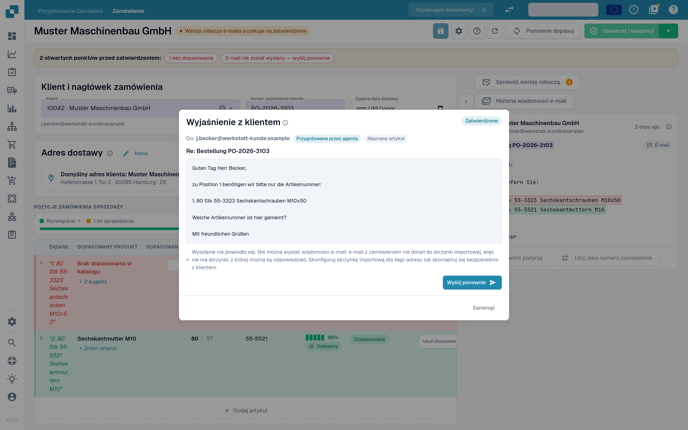<figcaption><p>Wysyłanie nie powiodło się: wyjaśnienie pokazuje przyczynę (tutaj: brak skrzynki importowej, z której można odpowiedzieć) i oferuje Wyślij ponownie.</p></figcaption></figure>

## Zatwierdzanie i przekazywanie

Przycisk **Zatwierdź i eksportuj** na górnym pasku jest aktywny, gdy wszystkie otwarte punkty są rozstrzygnięte: każda pozycja jest dopasowana, potwierdzona lub zignorowana, klient jest przypisany, a wymagane pola nagłówka i adres dostawy są uzupełnione. Dopóki czegoś brakuje, najedź kursorem na wyszarzony przycisk, aby zobaczyć listę.

<figure>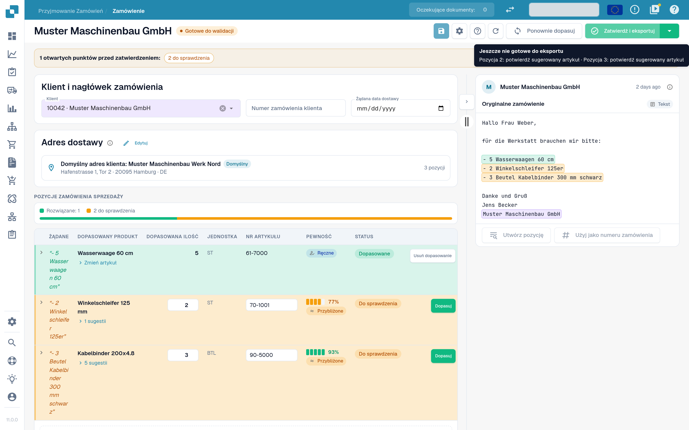<figcaption><p>Zatwierdź i eksportuj pozostaje nieaktywne, dopóki wszystkie otwarte punkty nie zostaną rozstrzygnięte; po najechaniu kursorem widać, czego brakuje.</p></figcaption></figure>

1. Kliknij **Zatwierdź i eksportuj**.
2. Okno podręczne podsumowuje klienta, liczbę pozycji, adresy dostawy (łącznie z domyślnym adresem klienta), numer zamówienia klienta (oraz wartość zamówienia, gdy są ceny z ERP). Informuje też, co stanie się z otwartym zapytaniem: niewysłana wersja robocza zostanie odrzucona, a wysłane zapytanie zamknięte — **Nic nie jest wysyłane do klienta.**
3. Kliknij **Zatwierdź i eksportuj**. Spowoduje to utworzenie zamówienia sprzedaży w ERP.

<figure>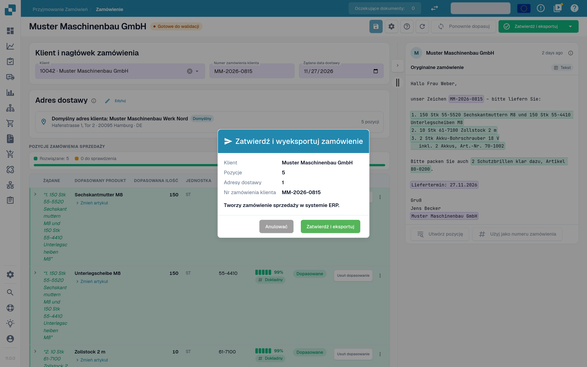<figcaption><p>Ostatnia kontrola, zanim zamówienie trafi do ERP.</p></figcaption></figure>

Zamówienie ma wtedy status **Eksportowano** i pokazuje numer zamówienia w ERP. Jeśli przekazanie się nie powiedzie, status zmienia się na **Eksport nie powiódł się**, a czerwony baner pokazuje przyczynę w Twoim języku — na przykład że ERP odrzucił zamówienie, że był nieosiągalny albo że eksport do ERP nie jest jeszcze skonfigurowany (wtedy nic nie trafiło do ERP; administrator konfiguruje go w **Ustawienia › Eksport** z typem dokumentu **Zamówienie sprzedaży (Przyjmowanie zamówień)**, zob. *Konfiguracja eksportu do ERP (administratorzy)*). Administratorzy widzą ponadto w banerze link **Otwórz ustawienia eksportu do ERP**; po potwierdzeniu otwiera on ustawienia modułu Przyjmowanie zamówień, których sekcja **Eksport do ERP** pokazuje aktualny stan. Usuń przyczynę i kliknij **Ponów próbę eksportu**.

<figure>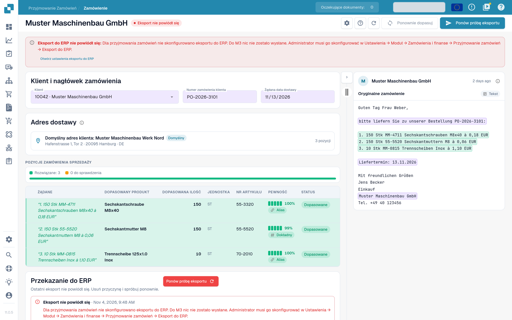<figcaption><p>Jeśli przekazanie do ERP się nie powiedzie, baner pokazuje przyczynę; tu eksport do ERP nie jest skonfigurowany, a administratorzy widzą link Otwórz ustawienia eksportu do ERP. Usuń przyczynę i kliknij Ponów próbę eksportu.</p></figcaption></figure>

### Odrzucanie zamówienia

Aby zatrzymać zamówienie (np. duplikat lub coś, co nie jest prawdziwym zamówieniem), otwórz strzałkę obok przycisku **Zatwierdź i eksportuj** i kliknij **Odrzuć**. Opcjonalnie podaj powód. Nic nie zostanie przekazane do ERP.

Jeśli DocBits wykryje, że zamówienie może być **duplikatem** wcześniejszego (ten sam klient i numer zamówienia albo bardzo podobne pozycje), baner oferuje opcje **Odrzuć jako duplikat**, **Wyświetl duplikaty** i **Kontynuuj mimo wszystko**.
