# 订单接收

## 概述

**订单接收**读取客户发送给您的订单（通过电子邮件或粘贴的文本），并将其准备为 ERP 中的销售订单。DocBits 会识别客户、读取每个订单行、将其与商品主数据中的商品匹配，并显示仍需决定的内容。您检查订单、补全缺失内容、在有疑问时询问客户，然后批准订单。只有这样，才会在 ERP 中创建销售订单。

```
客户电子邮件 / 粘贴的文本
        │
        ▼
  读取订单行 ──► 与您的商品匹配 ──► 您检查并决定 ──► 批准并导出 ──► ERP 销售订单
                                         │
                                         └──► 询问客户（电子邮件） ──► 应用客户回复
```

**示例：** Muster Maschinenbau GmbH 发送电子邮件“150 Stk MM-4711 Sechskantschrauben M8x40”。DocBits 根据发件人的电子邮件地址识别出客户，知道该客户的编号 MM-4711 对应您的商品 55-3320，并将该订单行显示为**已匹配**。第二个订单行“2 Winkelschleifer 125er”没有商品编号，因此 DocBits 会建议相似的商品，并将该订单行置于**审核**状态。您选择正确的商品，点击**批准并导出**，订单即进入 ERP。


**当前限制**

* **暂不支持来自 PDF 文件的订单。** 请使用电子邮件订单或**从文本导入**。
* **价格**仅在您的 ERP（Infor M3）返回该客户的价格时才会显示和检查。没有价格时，订单仍会移交——由 ERP 定价。
* **向客户询问**仅适用于通过电子邮件收到的订单。


## 如何激活

订单接收需要 **AI Workforce** 订阅。

1. 转到**设置 › 模块 › 订单与财务**，打开**订单接收**部分。
2. 开启**激活订单接收仪表板**。侧边栏中随即显示“订单接收”。
3. 在**设置 › 组和权限**下为业务员的角色授予订单接收的访问权限（管理员始终拥有访问权限）。

<figure>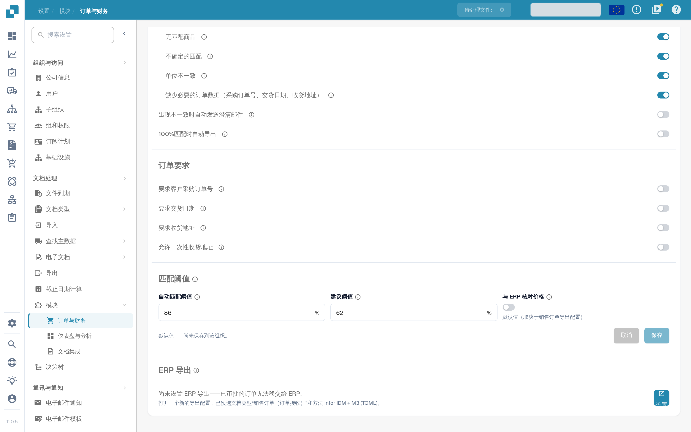<figcaption><p>订单接收设置位于“设置 › 模块 › 订单与财务”下；末尾是“ERP 导出”部分，此处尚未设置 ERP 导出。</p></figcaption></figure>

管理员在同一部分中决定模块的工作方式：

| 分组 | 设置 | 作用 |
| --- | --- | --- |
| **自动化** | **出现不一致时自动起草回复邮件** | 默认开启：对于下方勾选的情况，代理会自动起草澄清邮件。除非开启自动发送，否则由员工审核该邮件。 |
| | **针对以下情况的订单行起草澄清邮件：** … | 哪些问题会让代理起草向客户的询问：**无匹配商品**、**不确定的匹配**、**单位不一致**、**缺少必要的订单数据（采购订单号、交货日期、收货地址）**。缺少数量时始终会询问。 |
| | **出现不一致时自动发送澄清邮件** | 关闭（推荐）：每封起草的邮件都需等待员工批准。 |
| | **100%匹配时自动导出** | 所有订单行均通过精确匹配或已学习的客户商品编号匹配、且没有其他缺失内容的订单，无需批准即会进入 ERP。 |
| **订单要求** | **要求客户采购订单号**、**要求交货日期**、**要求收货地址** | 开启后，缺少该值的订单会产生一个未决事项，在补齐之前无法批准。三项默认均为关闭。 |
| | **允许一次性收货地址** | 开启后，业务员可以输入仅用于本订单的地址（例如施工现场）。关闭后，只能使用客户主数据中的地址。 |
| **匹配阈值** | **自动匹配阈值**（默认 86 %）、**建议阈值**（默认 62 %） | 只有精确的商品编号和已学习的客户商品编号会被自动接受。相似的描述始终作为建议显示，供审核。 |
| | **与 ERP 核对价格** | 将客户的净价与 ERP 净价进行比较。差异超过允许的容差时需要做出决定；无论如何，订单都由 ERP 定价。默认情况下，此项取决于 ERP 导出配置。 |
| **ERP 导出** | *（仅状态）* | 显示文档类型为**销售订单（订单接收）**的导出配置（已批准的订单通过它们发送到 ERP），每个配置都带有**编辑**按钮；未启用的配置标记为**不活跃**。警告行表示某个配置仍在使用传入文档类型**订单接收 – 传入文档**，该配置永远不会被使用。如果没有已启用的配置，该部分会显示*尚未设置 ERP 导出——已审批的订单无法移交给 ERP。*以及设置位置。管理员在**设置 › 导出**中设置导出（见下文）。 |

管理员可以在任何订单中通过顶部栏的**齿轮**按钮打开这些设置。

### 设置 ERP 导出（管理员）

已批准的订单只能通过文档类型为**销售订单（订单接收）**的导出配置到达 ERP（Infor M3）。管理员只需设置一次：

1. 打开**设置 › 导出**，点击**新的**。
2. 输入**配置标题**，并将**文档类型**选为**销售订单（订单接收）**。只要订单接收已开启，就会提供该类型；无需事先激活该文档类型。
3. 在**导出**中选择 **Infor**，在 **Infor 类型**中选择 **Infor IDM + M3 (TOML)**。
4. 上传 M3 连接的 **ION API 文件**（`.ionapi`）和 **TOML映射文件**（`.toml`）。
5. 点击**保存**。新配置的状态为**已启用**；每种文档类型只能有一个已启用的配置。

之后，订单接收设置中的 **ERP 导出** 部分会显示该配置；点击**编辑**可打开它，未启用的配置标记为**不活跃**。如果该部分出现警告行，说明某个旧配置仍在使用传入文档类型**订单接收 – 传入文档**：它永远不会被使用，请用**编辑**打开它，并将文档类型改为**销售订单（订单接收）**。订单只能在订单接收中通过**批准并导出**导出（或在开启 **100%匹配时自动导出** 时自动导出）；传入的订单文档本身永远不会被导出。

## 录入订单

### 通过电子邮件

客户将订单发送到您组织的订单邮箱。AI 代理读取电子邮件、识别订单行，并在列表中创建订单。客户通过**发件人电子邮件地址的域名**识别。签名、免责声明以及引用的较早邮件不会被读取为订单行。

### 从文本导入

对于通过其他途径收到的订单（您录入的传真、聊天消息、转发的文本）：

1. 在订单接收列表中点击**从文本导入**。
2. 将订单粘贴到**订单文本**中。格式不限——换行、缩写和简写都能处理。
3. 选择**客户**（可按名称、电子邮件或客户编号搜索）。未选择客户时，订单打开后会显示未决事项*缺少客户*。
4. 点击**提取并匹配**。

<figure>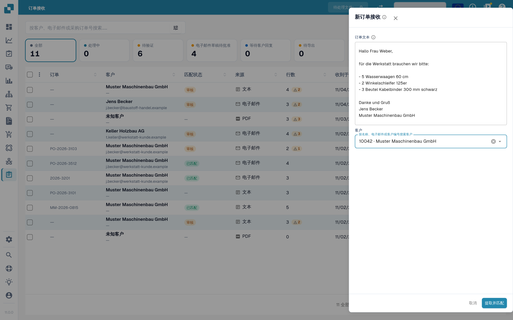<figcaption><p>粘贴客户订单并选择客户。</p></figcaption></figure>

### 新订单

**新订单**用于从您的商品目录手动创建订单：选择客户和收货地址，添加商品和数量，然后点击**批准并导出**。

## 订单接收列表

在侧边栏中打开**订单接收**。列表显示每个订单的客户、来源（电子邮件、文本、手动）、订单行数量、接收时间、状态和匹配状态。订单行数量旁的小警告标志表示仍需决定的订单行数量。点击某一行即可打开订单。

<figure>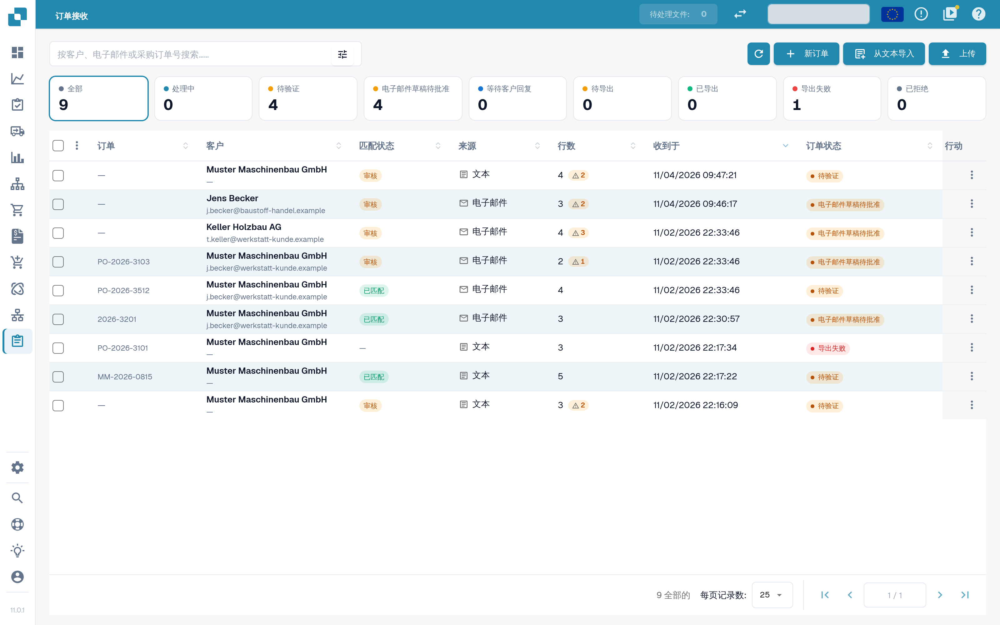<figcaption><p>带有状态卡片的订单接收列表。</p></figcaption></figure>

列表上方的**状态卡片**按状态统计订单数量。点击某张卡片即可只显示这些订单；**全部**显示所有订单。

| 状态 | 含义 |
| --- | --- |
| **处理中** | 正在读取或准备订单——您暂时无需操作。 |
| **待验证** | 已读取，等待员工处理：检查订单行或批准订单。 |
| **电子邮件草稿待批准** | 已起草一封发给客户的邮件，等待您批准。 |
| **等待客户回复** | 澄清已发送，尚未收到回复。 |
| **待导出** | 已批准，但尚未移交给 ERP。 |
| **已导出** | 已移交给 ERP。 |
| **导出失败** | ERP 拒绝了移交——修复原因后重试。 |
| **已拒绝** | 已被拒绝或被识别为重复订单——无需进一步操作。 |

当某个订单行、必填的抬头字段或收货地址仍需决定时，**匹配状态**列显示**审核**；全部解决后显示**已匹配**。

当 AI 代理、重新匹配或客户回复正在处理某个订单时，其状态显示**代理处理中**并带有旋转箭头。在处理完成之前，订单处于锁定状态；列表会自动刷新。

**搜索和筛选：** 在搜索框中输入客户、电子邮件地址或采购订单号。搜索框中的筛选图标可按**来源**（*电子邮件*或*手动*）筛选。

每行末尾的菜单提供**日志**（代理、用户和系统的每一个步骤，以及决策历史：谁确认或更改了什么）和**删除**。

## 检查新订单

### 匹配界面

<figure>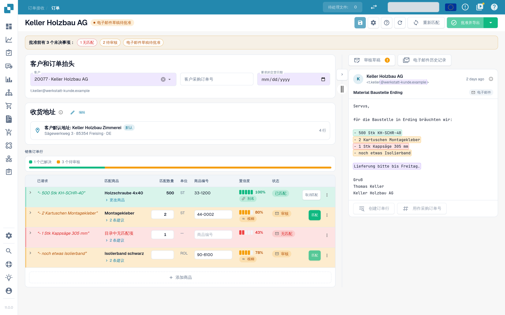<figcaption><p>匹配界面：左侧为订单数据，右侧为客户的电子邮件。</p></figcaption></figure>

* **顶部栏**——客户、状态、订单金额（仅在有 ERP 价格时显示），以及操作**保存**、**图例**、**刷新**、**重新匹配**和**批准并导出**。
* **未决事项**——紧接在顶部栏下方：列出所有仍阻止批准的内容，例如*缺少客户*、*采购订单号缺失*、*2 个待审核*。点击某个事项即可跳转到相应位置。
* **客户和订单抬头**——客户、客户采购订单号和要求的交货日期。
* **收货地址**——订单的送达地址。如果客户有默认地址，系统会自动使用（*客户默认地址：…*，并带有标签**默认**）；点击**编辑**可更改。各订单行也可以发往不同的地址。
* **订单行**——每个订购商品一行，显示客户的文本、匹配的商品、数量、单位和状态。表格上方的进度条显示已解决和仍待审核的订单行数量。
* **来源**（右侧）——客户的电子邮件或粘贴的文本。订单行按其状态以绿色、琥珀色或红色高亮显示，收货地址以蓝色显示，抬头值（客户、采购订单号、日期）以紫色显示。点击高亮内容可跳转到对应的订单行。分隔条上的箭头用于隐藏或显示电子邮件；拖动分隔条可调整宽度。**电子邮件历史记录**列出该订单的所有邮件。

**图例**（问号按钮）说明每种颜色、状态和匹配方式。


在您点击**保存**（磁盘图标；红点表示有未保存的更改）之前，您在此界面上所做的任何更改都不会被存储。也可以按 Ctrl+S / Cmd+S 保存。如果您在有未保存更改的情况下离开订单，DocBits 会询问是保存还是放弃这些更改。


### 订单行状态和匹配方式

| 状态 | 含义 |
| --- | --- |
| **已匹配** | 已自动匹配（通过已学习的客户商品编号或精确的商品编号）或已由员工确认。 |
| **审核** | 存在建议，但必须检查。 |
| **无匹配** | 商品主数据中没有足够相似、可供建议的商品。 |
| **待处理** | 尚未匹配。 |
| **已忽略** | 不参与导出。 |

| 匹配方式 | 含义 |
| --- | --- |
| **别名** | 该客户自己的商品编号之前已映射到您的商品——自动通过。 |
| **精确** | 订单中的商品编号与商品主数据完全一致——自动通过。 |
| **模糊** | 仅描述相似——始终需要审核。 |
| **手动** | 由员工选择或确认。 |
| **澄清** | 取自客户的答复。 |

当您为某个客户商品编号确认商品时，DocBits 会将其**学习为该客户的别名**：下一个包含相同编号的订单会自动匹配。已学习的别名可以通过订单行菜单中的**移除已学习的别名**删除。

### 处于“审核”状态的订单行

1. 点击订单行将其展开。**客户订购**显示客户所写的数量、单位、客户商品编号和描述。
2. **建议的匹配**列出最佳商品及其商品编号、单位、匹配方式和置信度。
3. 最佳建议已预先选中（**已选择**）。如果其他商品才是正确的，请点击该商品上的**使用此项**——或在**或者搜索目录**下查找。红色 **x** 可移除所选内容。
   订单行必须有**数量**才能匹配：没有数量时，**使用此项**和**匹配**呈灰色不可用（*请先输入数量——没有数量的订单行无法匹配。*）。请先在该行中输入数量。
4. 弹窗会将订购内容与所选商品进行比较。检查后点击**确认匹配**。
5. 点击**保存**。

<figure>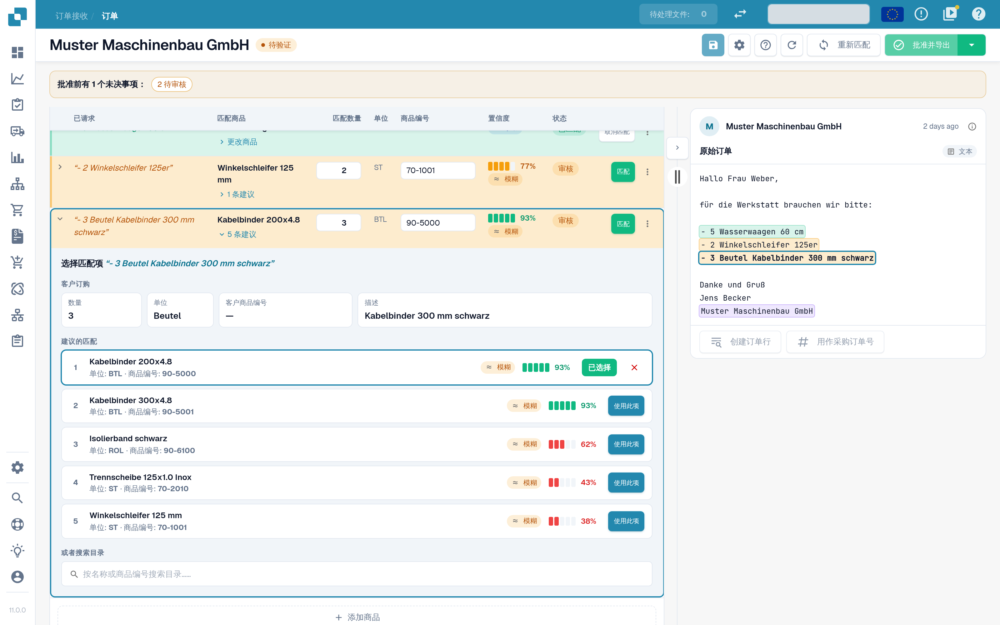<figcaption><p>处于“审核”状态的订单行：将客户订购的内容与建议进行比较。</p></figcaption></figure>

<figure>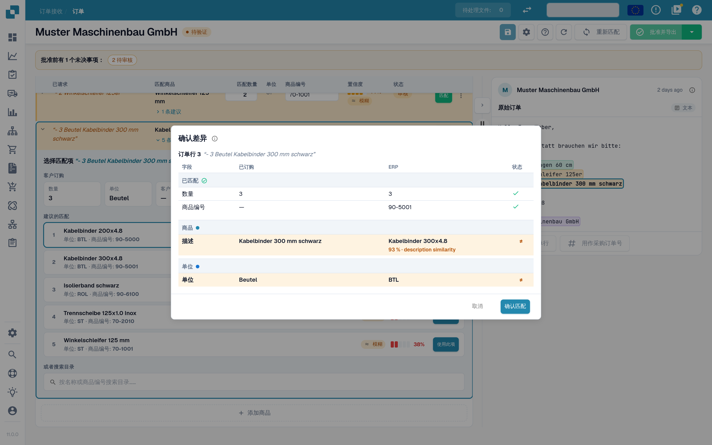<figcaption><p>“确认差异”将客户订购的内容与所选商品进行比较；此处描述和单位不同。产品中“description similarity”字样尚未翻译。</p></figcaption></figure>

已选中建议的订单行可以直接通过其所在行中的**匹配**进行确认。每行末尾的菜单还提供更多操作：**就此订单行给客户发邮件**、**自定交货日期…**、**单独收货地址…**、**忽略此行**（不导出）和**删除行**。

### 数量和价格差异

* **数量：** 您可以更改订单行的数量。如果数量与客户订购的不同，会以琥珀色显示，并且必须确认：展开订单行，选择商品，弹窗**确认差异**会列出该数量。如有需要可添加备注，然后点击**确认**。订单将按已确认的数量导出。
* **价格**（仅在有 ERP 价格时）：如果客户价格与 ERP 净价的差异超过允许的容差，价格会以琥珀色显示，并带有提示*价格不同*。点击该行中的**匹配**；弹窗会显示两个价格、差额和容差。点击**确认**以接受 ERP 价格，或询问客户（参见[询问客户](#ask-the-customer)）。如果客户价格看起来是每 10、100 或 1000 件的价格，弹窗会提供一键设置价格单位的选项。

<figure>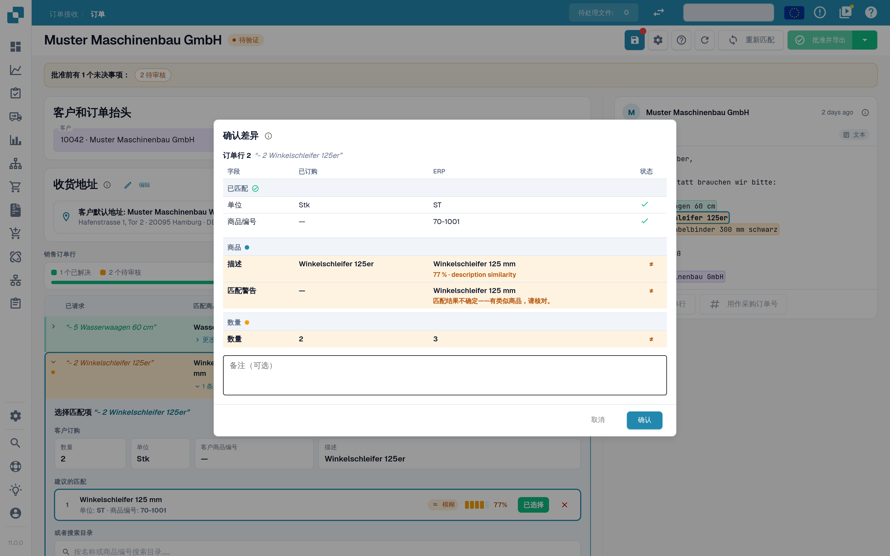<figcaption><p>与订单不同的数量需要确认，可附加备注。产品中“description similarity”字样尚未翻译。</p></figcaption></figure>

如果 ERP 没有返回某个订单行的价格，该行会显示**无ERP价格**，将鼠标悬停可查看原因，并提供**重试**按钮。这不会阻止订单。

### 未识别客户

如果发件人的电子邮件域名尚未登记，订单会显示未决事项**缺少客户**。请在**客户和订单抬头**中选择客户。随后 DocBits 会提供记住发件人域名的选项：

* **分配电子邮件域名**——*来自 @域名 的后续电子邮件将自动分配给该客户。* 点击**确认**；在您点击**保存**时，该设置会与您的其他更改一起保存。**取消**会撤销客户选择。
* 如果该域名已属于另一个客户，请选择**保留**（后续邮件仍归当前客户，本订单仍分配给新客户）或**分配给**（后续邮件归新客户）。按钮上会显示相应的客户名称。

<figure>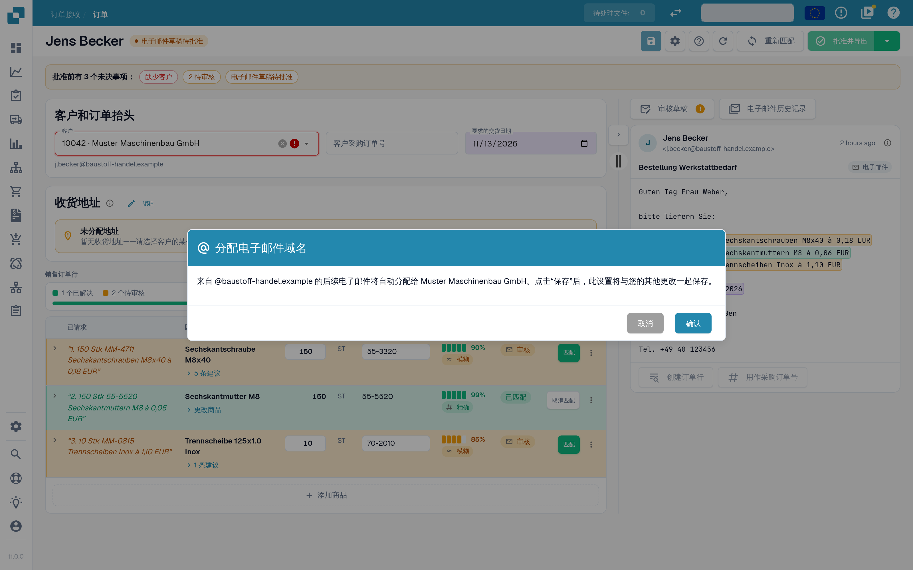<figcaption><p>分配客户时也可以同时分配发件人的电子邮件域名。</p></figcaption></figure>

<figure>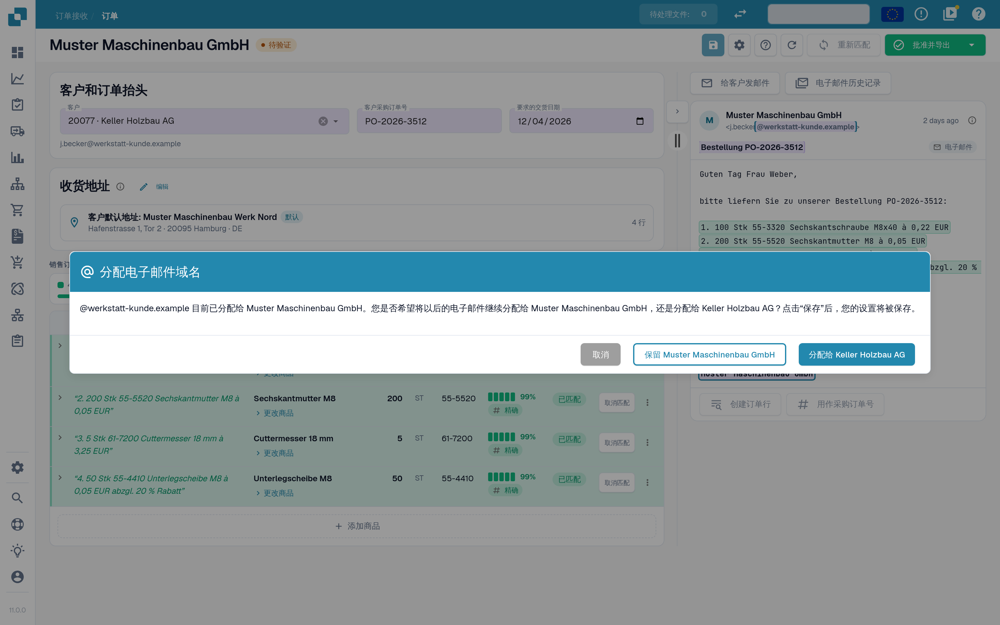<figcaption><p>该域名已属于另一个客户：保留或转移。</p></figcaption></figure>

公共邮箱域名（例如 gmail.com）永远不会分配给客户。

### 重新匹配

顶部栏中的**重新匹配**会对所有未决订单行再次进行匹配——例如在商品主数据中添加了新商品之后，或在您更改了客户之后。已确认和已忽略的订单行不受影响。系统会提示有多少个订单行被重新匹配。

当匹配无法执行任何操作时，该按钮呈灰色；将鼠标悬停在按钮上可查看原因：

| 提示 | 原因 |
| --- | --- |
| *所有订单行均已匹配、确认或忽略。* | 没有未决内容。 |
| *代理撰写澄清期间，匹配将暂停。* | 请等待草稿生成。 |
| *订单已移交或已关闭。* | 已批准、已导出或已拒绝的订单无法重新匹配。 |
| *订单仍在读取中。* | 请等待读取完成。 |

在向客户的询问尚未结束时也可以重新匹配：未发送的草稿会保留（如果草稿所询问的内容均已解决，草稿会显示*没有需要询问的内容*）；已批准但未发送的草稿会退回为草稿。

## 修正遗漏或错误的订单行

有时，读取时会把两个商品放入一个订单行、把一个商品拆成两个订单行，或者遗漏写在句子中的商品。您可以直接在电子邮件或粘贴的文本中修正：

1. 在右侧的订单文本中**选择该商品的文本**。
2. 点击文本下方的**创建订单行**。
3. 弹窗显示**前 → 后**。检查后点击**确认**。
4. 点击**保存**。新订单行会获得新编号，自动匹配，并在文本中高亮显示。

具体结果取决于您选择的内容：

| 您选择…… | 结果 |
| --- | --- |
| **尚不是订单行**的文本 | **新订单行**——所选内容成为一个新的订单行。 |
| **订单行的一部分**（例如一行中两个商品里的第二个） | **拆分**——移除该订单行，并为每个商品各创建一个订单行来替代。 |
| **完整地选择两个或多个相邻订单行** | **合并**——它们合并为一个订单行。 |
| 一个订单行**加上其他文本** | 该订单行被所选文本**替换**。 |
| **与现有订单行完全相同**的文本 | 不会有任何变化——*此文本已是订单行 n*。 |

<figure>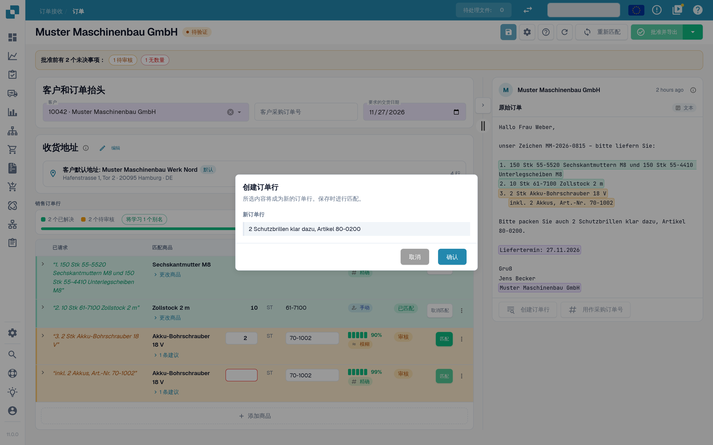<figcaption><p>创建读取时遗漏的订单行。</p></figcaption></figure>

<figure>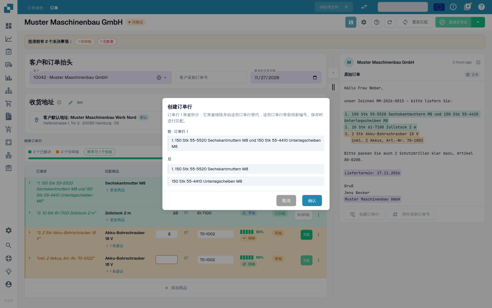<figcaption><p>拆分包含两个商品的订单行。</p></figcaption></figure>

<figure>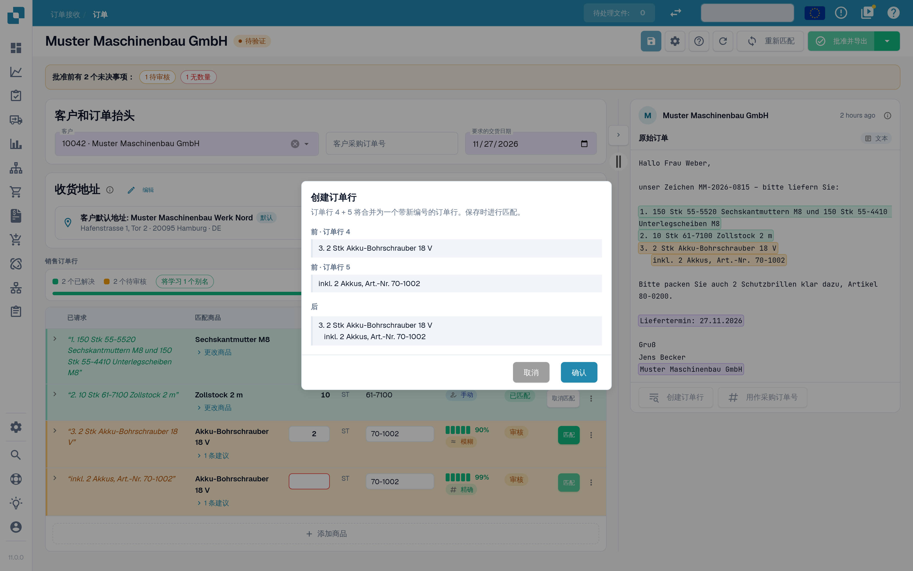<figcaption><p>合并属于一体的两个订单行。</p></figcaption></figure>

<figure>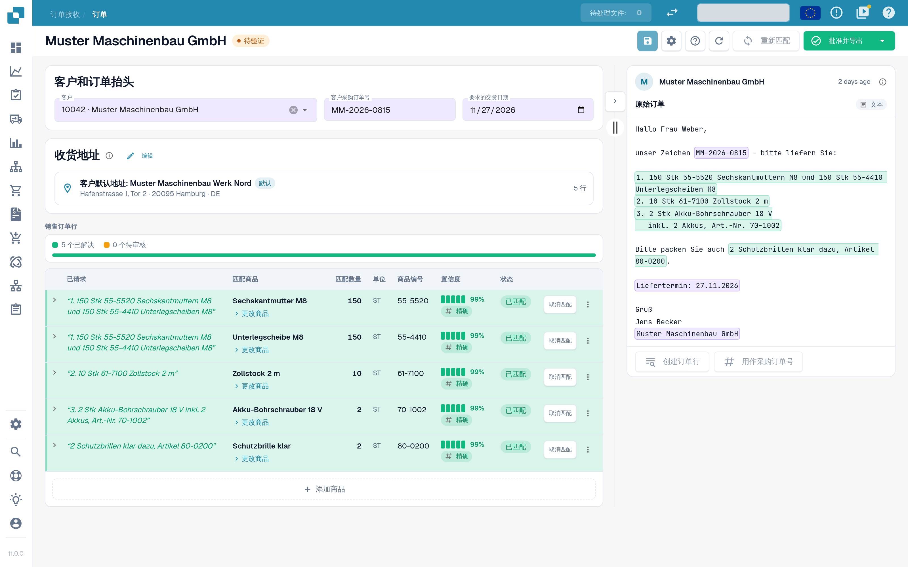<figcaption><p>保存后，新订单行已完成匹配并在文本中高亮显示。</p></figcaption></figure>

### 拆分已决定的订单行

**已确认**或**已忽略**、有**单独的收货地址、日期或价格**、包含**客户答复**或**经员工编辑**的订单行仍然可以拆分。此时该订单行会被**拆解**：每个部分都成为一个新的订单行，并根据其自身文本重新读取和匹配。所有新订单行都会保留收货地址和交货日期，并且必须重新审核；旧订单行的未决事项会移至第一个新订单行。弹窗会准确列出随旧订单行丢失的内容，例如商品确认、已接受的数量或 ERP 价格、客户答复或员工编辑。订单的历史记录会保留旧值。

<figure>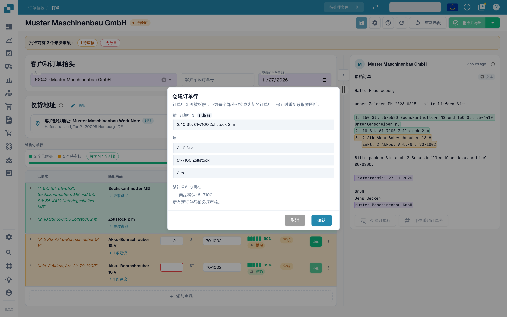<figcaption><p>拆分已决定的订单行会将其拆解；弹窗列出将丢失的内容。</p></figcaption></figure>

此类订单行永远不会被**合并**。有**未保存的更改**的订单行无法拆分：请先保存或放弃这些更改。

### 不做任何更改的情况

如果所选内容仅覆盖某个订单行的一部分以及该订单行之外的文本，或者涉及多个订单行但未完整覆盖它们，则不会做任何更改，弹窗会说明原因。请在单个订单行内选择文本，或完整选择多个订单行以将其合并。如果两个订单行是从同一行文本中读取的，弹窗会说明哪个订单行也引用了所选文本并保持不变。

您随时可以通过订单行表格下方的**添加商品**手动添加订单行，或在表格中编辑订单行的字段。

## 修正订单抬头

### 从文本获取采购订单号

如果未识别出客户的订单号（例如没有标签的“unser Zeichen MM-2026-0815”），请在文本中**只选择订单号**，然后点击**用作采购订单号**。点击**保存**后，该编号会出现在**客户采购订单号**中，并在文本中以紫色高亮显示，便于所有人查看其来源。

<figure>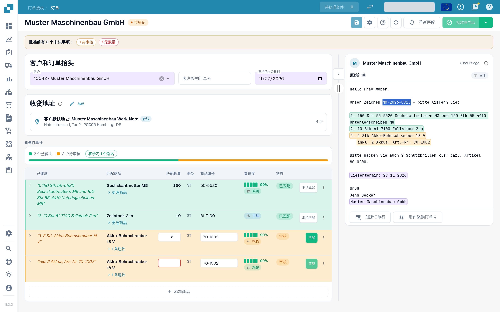<figcaption><p>在文本中标记订单号。</p></figcaption></figure>

### 从主题获取采购订单号

许多客户只在主题中写订单号（“AW: 4711”）。您也可以在电子邮件的**主题行**中选择它。在主题中只能使用**用作采购订单号**——订单行根据订单正文创建。

您随时可以直接在**客户和订单抬头**中输入采购订单号和交货日期。

## 询问客户 <a id="ask-the-customer"></a>

当某些问题只有客户才能回答时——例如未知商品、数量或单位不明确、缺少采购订单号或收货地址、价格差异——请通过电子邮件发送询问。询问会在原始订单的邮件会话中发出，回复也会回到同一订单。此功能仅适用于**电子邮件订单**。

### 发起询问

1. 点击电子邮件上方的**给客户发邮件**（或订单行菜单中的**就此订单行给客户发邮件**）。
2. 在**原因**下选择询问原因（或留空，由助手决定），检查**收件人**（如有需要可添加**抄送**），并在**参考行**下勾选相关订单行。
3. 选择方式：
   * **自动发送**——点击**交给代理**。AI 代理撰写电子邮件。在员工批准草稿之前，不会发送任何内容。
   * **手动发送**——自行填写主题和正文，然后点击**发送**。

代理撰写期间，电子邮件上方的按钮显示**草稿撰写中**，**重新匹配**会等待。

根据设置，当订单带着问题到达时，代理也可能自动起草询问。

存在草稿时，电子邮件上方的按钮会显示**审核草稿**，而不是**给客户发邮件**。订单信息完整后，**审核草稿**仍然可用，但不再带黄色 **!**——您仍可以发送或丢弃该草稿。**批准并导出**会丢弃未发送的草稿。

### 检查并发送草稿

草稿就绪后，订单状态为**电子邮件草稿待批准**，按钮**审核草稿**会显示黄色 **!**。点击该按钮可打开**与客户澄清**：

* **丢弃**——删除草稿；不发送任何内容。
* **退回给代理**——告诉代理需要修改的内容；代理会撰写新的草稿。
* **编辑**——自行修改主题或正文。
* **批准并发送**——将电子邮件发送给客户。

<figure>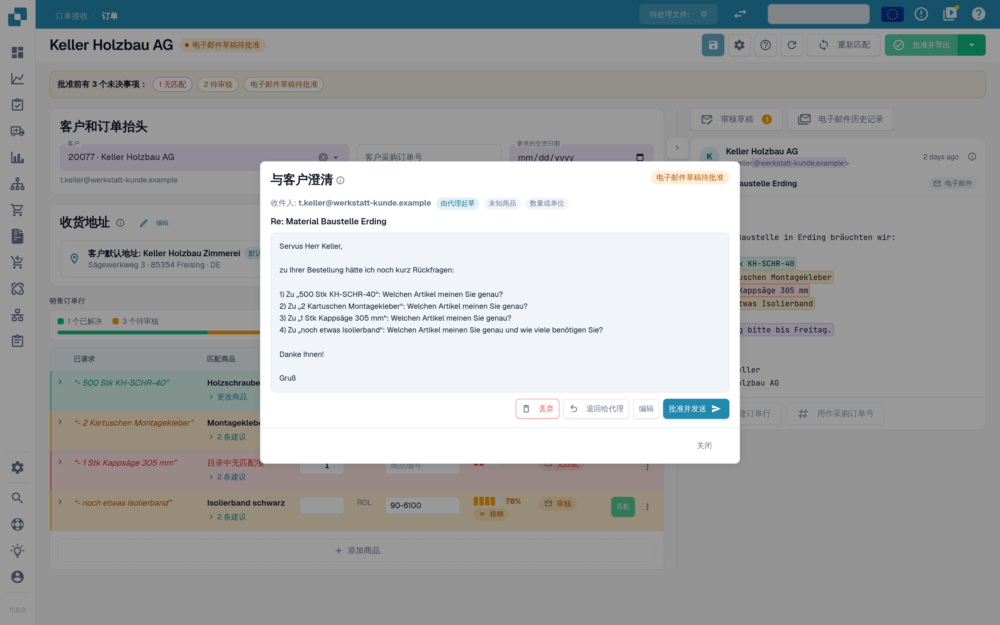<figcaption><p>代理的草稿等待您批准。</p></figcaption></figure>

### 等待回复

发送后，订单状态为**等待客户回复**，电子邮件上方的按钮显示**等待客户回复**。客户回复后，代理会读取答复并将其应用到订单（订单会短暂锁定，显示*正在读取客户回复*）；回复会显示在电子邮件区域和**电子邮件历史记录**中。您已确认的订单行不会被覆盖——如果客户更改了其中某个订单行，该行会被标记为*已被客户邮件更改*，供您再次检查。

如果客户通过电话或另一封邮件作了答复，请打开澄清并点击**关闭澄清**。DocBits 将停止等待；之后收到的回复会显示，但不会被应用。**新邮件**可用于提出进一步的询问。

### 发送失败时

如果已批准的电子邮件无法发送，订单会显示未决事项**邮件发送失败——请重发**。打开澄清：其中会显示原因。点击**再次发送**。

如果订单邮件并非通过您的某个导入邮箱收到（例如通过其他方式转发到 DocBits），则没有可用于回复的邮箱，电子邮件无法发送。请为该地址设置导入邮箱，或直接联系客户并丢弃草稿。

<figure>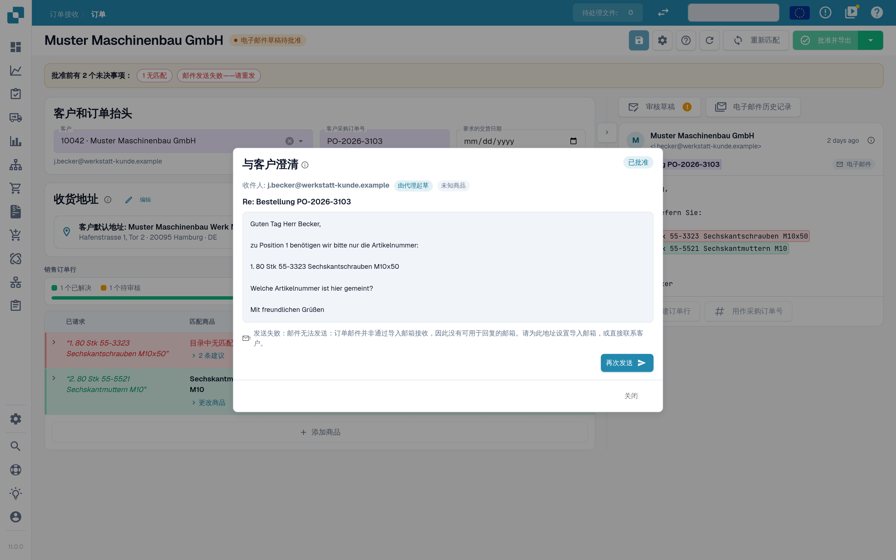<figcaption><p>发送失败：澄清窗口显示原因（此处：没有可用于回复的导入邮箱），并提供“再次发送”。</p></figcaption></figure>

## 批准并移交

当所有未决事项都已解决时，顶部栏中的**批准并导出**才可用：每个订单行均已匹配、确认或忽略，已分配客户，且必填的抬头字段和收货地址均已填写。只要仍有缺失内容，将鼠标悬停在灰色按钮上即可查看清单。

<figure>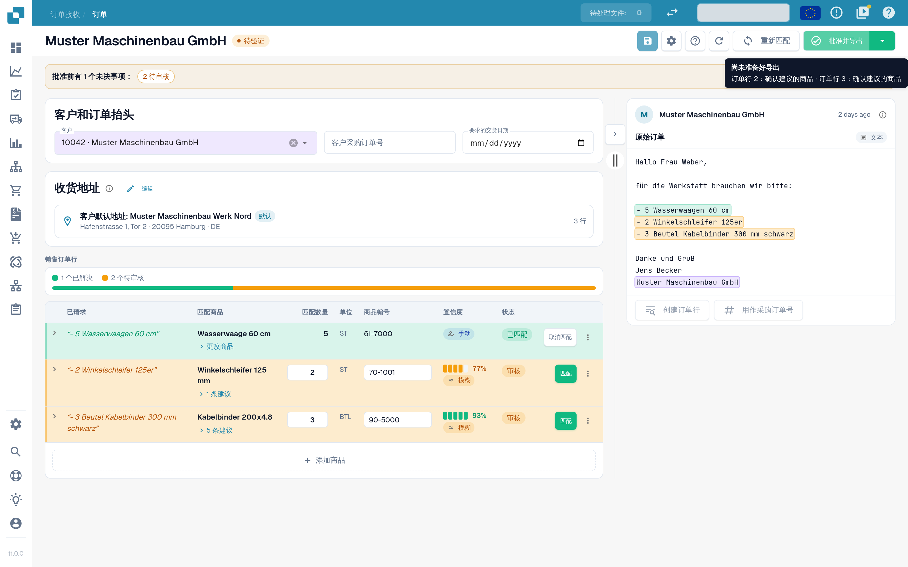<figcaption><p>在所有未决事项解决之前，“批准并导出”保持禁用；将鼠标悬停在按钮上可查看缺少的内容。</p></figcaption></figure>

1. 点击**批准并导出**。
2. 弹窗汇总显示客户、订单行数量、收货地址（包括客户的默认地址）、客户采购订单（以及订单金额，在有 ERP 价格时）。弹窗还会说明未结束的询问将如何处理：未发送的草稿会被丢弃，已发送的询问会被关闭——**不会向客户发送任何内容**。
3. 点击**批准并导出**。这将在 ERP 中创建销售订单。

<figure>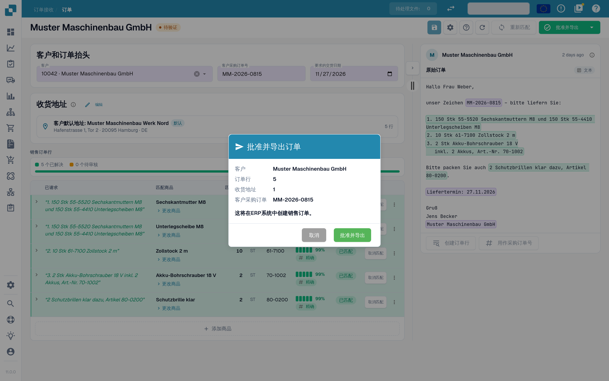<figcaption><p>订单进入 ERP 前的最后检查。</p></figcaption></figure>

随后订单状态变为**已导出**，并显示 ERP 订单号。如果移交失败，状态为**导出失败**，红色横幅会以您的语言显示原因——例如 ERP 拒绝了订单、ERP 无法访问，或尚未设置 ERP 导出（此时没有任何内容到达 ERP；管理员需在**设置 › 导出**中使用文档类型**销售订单（订单接收）**进行设置，参见“设置 ERP 导出（管理员）”）。管理员还会在横幅中看到链接**打开 ERP 导出设置**；确认后会打开订单接收设置，其中的 **ERP 导出** 部分显示当前状态。修复原因后点击**重试导出**。

<figure>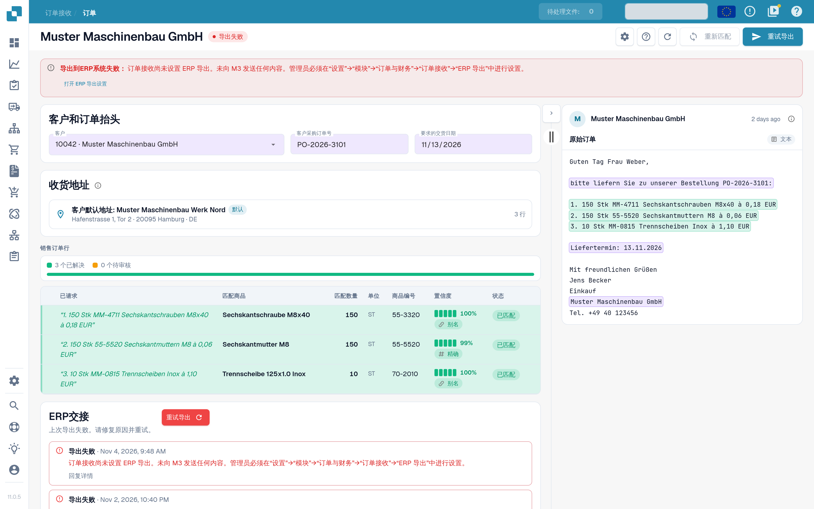<figcaption><p>ERP 移交失败时，横幅会显示原因；此处尚未设置 ERP 导出，管理员会看到链接“打开 ERP 导出设置”。修复原因后点击“重试导出”。</p></figcaption></figure>

### 拒绝订单

要终止某个订单（例如重复订单或并非真实订单），请打开**批准并导出**旁边的箭头，然后点击**拒绝**。如有需要可添加原因。不会向 ERP 移交任何内容。

如果 DocBits 检测到某个订单可能是先前订单的**重复订单**（客户和采购订单号相同，或订单行非常相似），横幅会提供**作为重复订单拒绝**、**查看重复项**和**无论如何继续**。
