# Acquisizione ordini

## Panoramica

**Acquisizione ordini** legge gli ordini che i tuoi clienti ti inviano, via e-mail o come testo incollato, e li prepara come ordini di vendita per il tuo ERP. DocBits individua il cliente, legge ogni posizione, la abbina a un articolo della tua anagrafica articoli e ti mostra cosa richiede ancora una decisione. Tu controlli l'ordine, completi ciò che manca, chiedi al cliente se qualcosa non è chiaro e lo approvi. Solo allora l'ordine di vendita viene creato nell'ERP.

```
E-mail del cliente / testo incollato
        │
        ▼
  Lettura posizioni ──► Abbinamento ai tuoi articoli ──► Controlli e decidi ──► Approva ed esporta ──► Ordine di vendita ERP
                                                              │
                                                              └──► Chiedi al cliente (e-mail) ──► la risposta viene applicata
```

**Esempio:** Muster Maschinenbau GmbH invia via e-mail "150 Stk MM-4711 Sechskantschrauben M8x40". DocBits riconosce il cliente dall'indirizzo e-mail del mittente, sa che il numero MM-4711 di questo cliente corrisponde al tuo articolo 55-3320 e mostra la posizione come **Abbinato**. Una seconda posizione, "2 Winkelschleifer 125er", non ha un codice articolo: DocBits propone articoli simili e mette la posizione in **Revisione**. Scegli l'articolo giusto, fai clic su **Approva ed esporta** e l'ordine è nell'ERP.


**Limiti attuali**

* **Gli ordini da file PDF non sono ancora disponibili.** Usa gli ordini via e-mail o **Importa da testo**.
* I **prezzi** vengono mostrati e controllati solo se il tuo ERP (Infor M3) restituisce i prezzi per il cliente. Senza prezzi l'ordine viene comunque trasmesso: è l'ERP a calcolarne il prezzo.
* Le **domande al cliente** possono essere inviate solo per gli ordini arrivati via e-mail.


## Attivazione

Acquisizione ordini richiede l'abbonamento **AI Workforce**.

1. Vai in **Impostazioni › Modulo › Ordini e finanziamenti** e apri la sezione **Acquisizione ordini**.
2. Attiva **Attiva la dashboard di acquisizione ordini**. Nella barra laterale compare ora "Acquisizione ordini".
3. Concedi al ruolo degli addetti l'accesso ad Acquisizione ordini in **Impostazioni › Gruppi e autorizzazioni** (gli amministratori hanno sempre accesso).

<figure>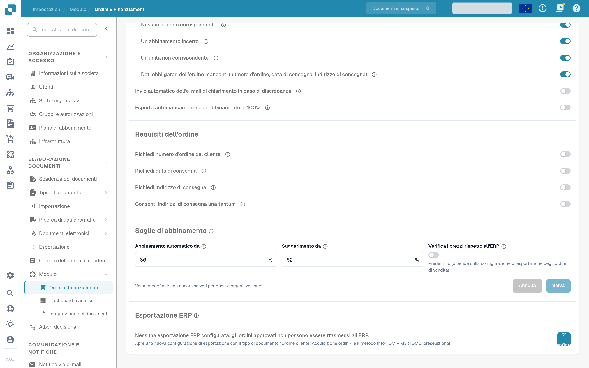<figcaption><p>Impostazioni di Acquisizione ordini in Impostazioni › Modulo › Ordini e finanziamenti; in fondo la sezione Esportazione ERP, qui ancora senza esportazione ERP.</p></figcaption></figure>

Nella stessa sezione un amministratore stabilisce come funziona il modulo:

| Gruppo | Impostazione | Effetto |
| --- | --- | --- |
| **Automazione** | **Redigere automaticamente una risposta via e-mail in caso di mancata corrispondenza** | Attiva per impostazione predefinita: l'agente redige autonomamente un'e-mail di chiarimento per i casi selezionati qui sotto. Un dipendente la controlla, a meno che non sia attivo l'invio automatico. |
| | **Redigere un'e-mail di chiarimento per le posizioni con** … | Quali problemi portano l'agente a redigere una domanda al cliente: **Nessun articolo corrispondente**, **Un abbinamento incerto**, **Un'unità non corrispondente**, **Dati obbligatori dell'ordine mancanti (numero d'ordine, data di consegna, indirizzo di consegna)**. Una quantità mancante viene sempre chiesta. |
| | **Invio automatico dell'e-mail di chiarimento in caso di discrepanza** | Disattivata (consigliato): ogni e-mail redatta attende l'approvazione di un dipendente. |
| | **Esporta automaticamente con abbinamento al 100%** | Gli ordini in cui ogni posizione è stata abbinata in modo esatto o tramite un codice articolo del cliente appreso, e in cui non manca nient'altro, vengono trasmessi all'ERP senza approvazione. |
| **Requisiti dell'ordine** | **Richiedi numero d'ordine del cliente**, **Richiedi data di consegna**, **Richiedi indirizzo di consegna** | Se attiva, un ordine senza questo valore riceve un punto aperto e non può essere approvato finché il valore non è presente. Tutte e tre sono disattivate per impostazione predefinita. |
| | **Consenti indirizzi di consegna una tantum** | Se attiva, gli addetti possono inserire un indirizzo valido solo per questo ordine (ad es. un cantiere). Se disattivata, si possono usare solo gli indirizzi dell'anagrafica clienti. |
| **Soglie di abbinamento** | **Abbinamento automatico da** (predefinito 86 %), **Suggerimento da** (predefinito 62 %) | Vengono accettati automaticamente solo i codici articolo esatti e i codici articolo del cliente appresi. Le descrizioni simili vengono sempre mostrate come suggerimenti da controllare. |
| | **Verifica i prezzi rispetto all'ERP** | Confronta il prezzo netto del cliente con il prezzo netto dell'ERP. Una differenza superiore alla tolleranza ammessa richiede una decisione; in ogni caso è l'ERP a calcolare il prezzo dell'ordine. Per impostazione predefinita segue la configurazione dell'esportazione ERP. |
| **Esportazione ERP** | *(solo stato)* | Mostra le configurazioni di esportazione del tipo di documento **Ordine cliente (Acquisizione ordini)** con cui gli ordini approvati vanno all'ERP, ciascuna con **Modifica**; una configurazione inattiva è contrassegnata come **Inattivo**. Una riga di avviso indica che una configurazione usa ancora il tipo di documento in entrata **Acquisizione ordini – documento in entrata**; non viene mai utilizzata. Se non c'è alcuna configurazione attiva, la sezione indica *Nessuna esportazione ERP configurata: gli ordini approvati non possono essere trasmessi all’ERP.* e dove configurarla. Gli amministratori configurano l'esportazione in **Impostazioni › Esportazione** (vedi sotto). |

Gli amministratori possono aprire queste impostazioni da qualsiasi ordine con il pulsante a forma di **ingranaggio** nella barra superiore.

### Configurare l'esportazione ERP (amministratori)

Gli ordini approvati raggiungono l'ERP (Infor M3) solo tramite una configurazione di esportazione del tipo di documento **Ordine cliente (Acquisizione ordini)**. Un amministratore la configura una volta:

1. Vai su **Impostazioni › Esportazione** e fai clic su **Nuovo**.
2. Inserisci un **Titolo della configurazione** e scegli come **Tipo di documento** **Ordine cliente (Acquisizione ordini)**. Viene proposto non appena Acquisizione ordini è attivata; non è necessario attivare prima il tipo di documento.
3. In **Esportazione** scegli **Infor** e in **Tipo Infor** scegli **Infor IDM + M3 (TOML)**.
4. Carica il **File API ION** (`.ionapi`) e il **File di mappatura TOML** (`.toml`) del tuo collegamento a M3.
5. Fai clic su **Salva**. Una nuova configurazione è **Attivo**; per ogni tipo di documento può essere attiva una sola configurazione.

La sezione **Esportazione ERP** delle impostazioni di Acquisizione ordini mostra quindi la configurazione; **Modifica** la apre e una configurazione inattiva è contrassegnata come **Inattivo**. Una riga di avviso indica che una configurazione precedente usa ancora il tipo di documento in entrata **Acquisizione ordini – documento in entrata**: non viene mai utilizzata, quindi aprila con **Modifica** e cambia il tipo di documento in **Ordine cliente (Acquisizione ordini)**. Gli ordini vengono esportati solo da Acquisizione ordini con **Approva ed esporta** (o automaticamente con **Esporta automaticamente con abbinamento al 100%**); i documenti d'ordine in entrata non vengono mai esportati direttamente.

## Inserire un ordine

### Via e-mail

I clienti inviano i loro ordini alla casella di posta degli ordini della tua organizzazione. L'agente IA legge l'e-mail, individua le posizioni e crea l'ordine nell'elenco. Il cliente viene riconosciuto dal **dominio dell'indirizzo e-mail del mittente**. Firme, avvertenze legali e messaggi precedenti citati non vengono letti come posizioni.

### Importare da testo

Per un ordine arrivato in un altro modo (un fax che hai trascritto, un messaggio in chat, un testo inoltrato):

1. Nell'elenco di Acquisizione ordini fai clic su **Importa da testo**.
2. Incolla l'ordine in **Testo dell'ordine**. Il testo libero va bene: interruzioni di riga, abbreviazioni e forme contratte vengono gestite.
3. Scegli il **Cliente** (cerca per nome, e-mail o numero cliente). Senza cliente, l'ordine si apre con il punto aperto *Cliente mancante*.
4. Fai clic su **Estrai e abbina**.

<figure>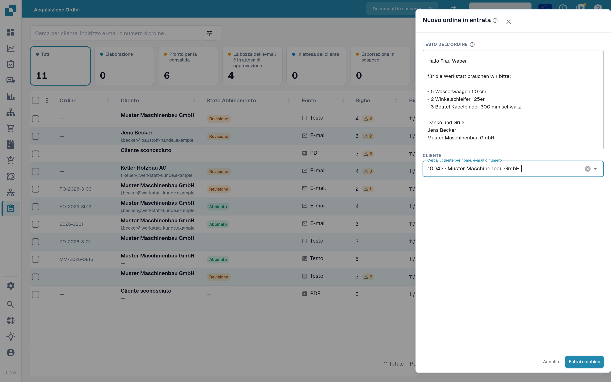<figcaption><p>Incolla un ordine del cliente e scegli il cliente.</p></figcaption></figure>

### Nuovo ordine

**Nuovo ordine** crea un ordine a mano dal tuo catalogo articoli: scegli il cliente e l'indirizzo di consegna, aggiungi gli articoli e le quantità, poi fai clic su **Approva ed esporta**.

## L'elenco di Acquisizione ordini

Apri **Acquisizione ordini** nella barra laterale. L'elenco mostra ogni ordine con il cliente, la fonte (E-mail, Testo, Manuale), il numero di posizioni, la data di ricezione, lo stato e lo stato di abbinamento. Un piccolo segnale di avvertimento accanto al numero di posizioni indica quante richiedono ancora una decisione. Fai clic su una riga per aprire l'ordine.

<figure>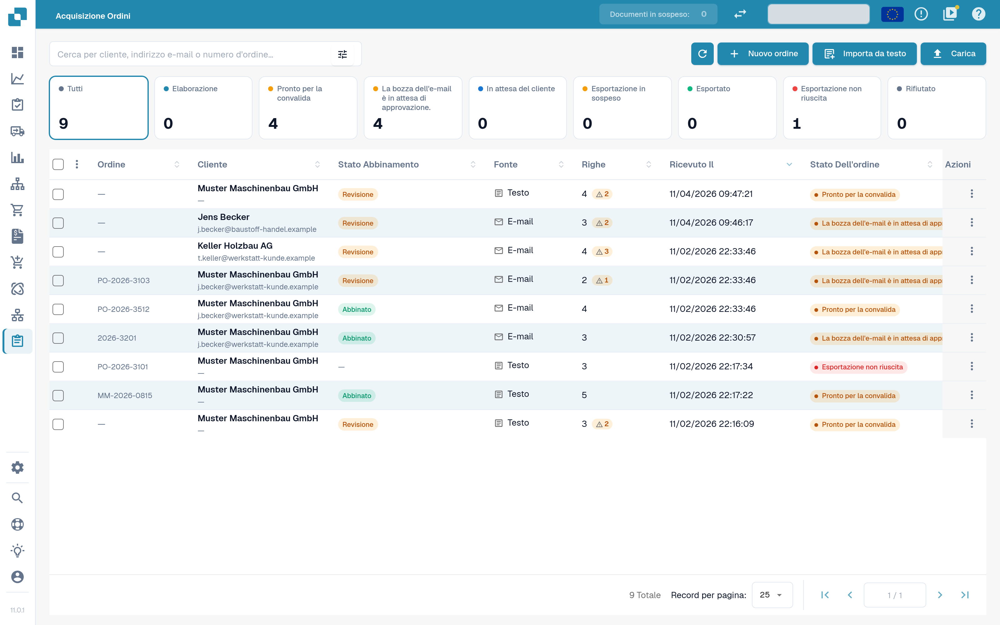<figcaption><p>L'elenco di Acquisizione ordini con le schede di stato.</p></figcaption></figure>

Le **schede di stato** sopra l'elenco contano gli ordini per stato. Fai clic su una scheda per mostrare solo quegli ordini; **Tutti** mostra tutto.

| Stato | Significato |
| --- | --- |
| **Elaborazione** | L'ordine viene letto o preparato: per ora non devi fare nulla. |
| **Pronto per la convalida** | Letto e in attesa di un dipendente: controlla le posizioni o approvalo. |
| **La bozza dell'e-mail è in attesa di approvazione.** | Un'e-mail al cliente è stata redatta e attende la tua approvazione. |
| **In attesa del cliente** | È stato inviato un chiarimento, la risposta non è ancora arrivata. |
| **Esportazione in sospeso** | Approvato, ma non ancora trasmesso all'ERP. |
| **Esportato** | Trasmesso all'ERP. |
| **Esportazione non riuscita** | L'ERP ha rifiutato la trasmissione: riprova dopo aver risolto la causa. |
| **Rifiutato** | Rifiutato o riconosciuto come duplicato: nessuna ulteriore azione. |

La colonna **Stato abbinamento** indica **Revisione** quando una posizione, un campo obbligatorio dell'intestazione o l'indirizzo di consegna richiedono ancora una decisione, e **Abbinato** quando è tutto risolto.

Mentre l'agente IA, un nuovo abbinamento o una risposta del cliente stanno lavorando su un ordine, il suo stato mostra **Agente in funzione** con una freccia che gira. L'ordine resta bloccato finché il lavoro non è terminato; l'elenco si aggiorna da solo.

**Ricerca e filtro:** inserisci un cliente, un indirizzo e-mail o un numero d'ordine nel campo di ricerca. L'icona del filtro nel campo di ricerca filtra per **Fonte** (*E-mail* o *Manuale*).

Il menu alla fine di una riga offre **Registri** (ogni passaggio dell'agente, degli utenti e del sistema, più la cronologia delle decisioni: chi ha confermato o modificato cosa) e **Cancellare**.

## Controllare un nuovo ordine

### La schermata di abbinamento

<figure>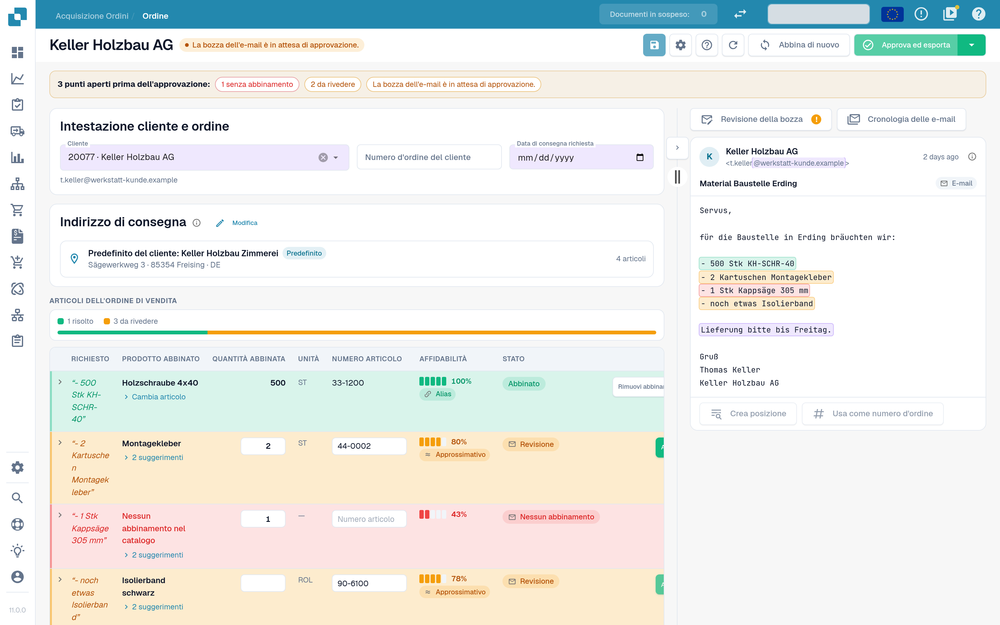<figcaption><p>La schermata di abbinamento: a sinistra i dati dell'ordine, a destra l'e-mail del cliente.</p></figcaption></figure>

* **Barra superiore**: cliente, stato, valore dell'ordine (solo con i prezzi ERP) e le azioni **Salva**, **Legenda**, **Aggiornare**, **Abbina di nuovo** e **Approva ed esporta**.
* **Punti aperti**: subito sotto la barra superiore; tutto ciò che blocca ancora l'approvazione, ad es. *Cliente mancante*, *Numero d'ordine mancante*, *2 da rivedere*. Fai clic su un punto per raggiungerlo.
* **Intestazione cliente e ordine**: cliente, numero d'ordine del cliente e data di consegna richiesta.
* **Indirizzo di consegna**: dove va l'ordine. Se il cliente ha un indirizzo predefinito, viene usato automaticamente (*Impostazione predefinita del cliente: …* con l'etichetta **Predefinito**); **Modifica** lo cambia. Le posizioni possono anche andare a indirizzi diversi.
* **Posizioni**: una riga per ogni articolo ordinato con il testo del cliente, l'articolo abbinato, la quantità, l'unità e lo stato. Sopra la tabella una barra mostra quante posizioni sono risolte e quante sono ancora da rivedere.
* **Fonte** (a destra): l'e-mail del cliente o il testo incollato. Le posizioni sono evidenziate in verde, giallo o rosso come il loro stato, gli indirizzi di consegna in blu e i valori dell'intestazione (cliente, numero d'ordine, data) in viola. Fai clic su un'evidenziazione per raggiungere la posizione. La freccia sul divisore nasconde o mostra l'e-mail; trascina il divisore per cambiarne la larghezza. **Cronologia delle e-mail** elenca tutte le e-mail di questo ordine.

La **Legenda** (pulsante con il punto interrogativo) spiega ogni colore, stato e metodo di abbinamento.


Nessuna modifica fatta in questa schermata viene memorizzata finché non fai clic su **Salva** (l'icona del disco; un punto rosso indica modifiche non salvate). Puoi salvare anche con Ctrl+S / Cmd+S. Se lasci l'ordine con modifiche non salvate, DocBits ti chiede se salvarle o scartarle.


### Stati delle posizioni e metodi di abbinamento

| Stato | Significato |
| --- | --- |
| **Abbinato** | Abbinato automaticamente (tramite un codice articolo del cliente appreso o il codice articolo esatto) oppure confermato da un dipendente. |
| **Revisione** | Esiste un suggerimento, ma deve essere controllato. |
| **Nessun abbinamento** | Nessun articolo dell'anagrafica articoli è abbastanza simile da essere suggerito. |
| **In attesa** | Non ancora abbinato. |
| **Ignorato** | Escluso dall'esportazione. |

| Metodo di abbinamento | Significato |
| --- | --- |
| **Alias** | Il codice articolo proprio di questo cliente è già stato associato in precedenza al tuo articolo: passa automaticamente. |
| **Esatto** | Il codice articolo nell'ordine corrisponde esattamente all'anagrafica articoli: passa automaticamente. |
| **Approssimativo** | Solo descrizione simile: richiede sempre un controllo. |
| **Manuale** | Scelto o confermato da un dipendente. |
| **Chiarimento** | Ripreso dalla risposta del cliente. |

Quando confermi un articolo per un codice articolo del cliente, DocBits lo **apprende come alias** per questo cliente: il prossimo ordine con lo stesso codice viene abbinato automaticamente. Un alias appreso può essere rimosso dal menu della posizione (**Rimuovi l'alias appreso**).

### Posizioni in Revisione

1. Fai clic sulla posizione per aprirla. **Ordinato dal cliente** mostra quantità, unità, codice articolo del cliente e descrizione così come li ha scritti il cliente.
2. **Abbinamenti suggeriti** elenca gli articoli migliori con codice articolo, unità, metodo di abbinamento e affidabilità.
3. Il suggerimento migliore è già preselezionato (**Selezionato**). Se è giusto un altro articolo, fai clic su **Usa questo** accanto a quell'articolo, oppure cercalo in **Oppure cerca nel catalogo**. La **x** rossa rimuove la selezione.
   Una posizione deve avere una **quantità** prima di poter essere abbinata: senza quantità, **Usa questo** e **Abbina** sono disattivati (*Inserisci prima la quantità: una posizione senza quantità non può essere abbinata.*). Inserisci prima la quantità nella riga.
4. Una finestra confronta ciò che è stato ordinato con l'articolo scelto. Controlla e fai clic su **Conferma abbinamento**.
5. Fai clic su **Salva**.

<figure>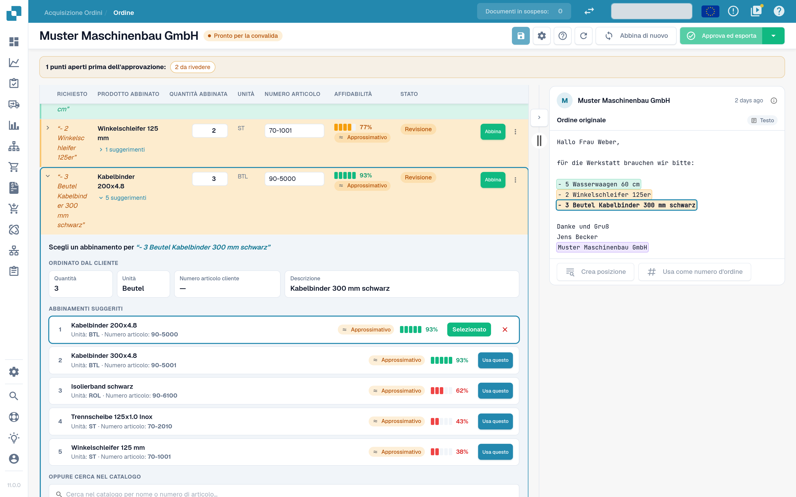<figcaption><p>Una posizione in Revisione: confronta ciò che ha ordinato il cliente con i suggerimenti.</p></figcaption></figure>

<figure>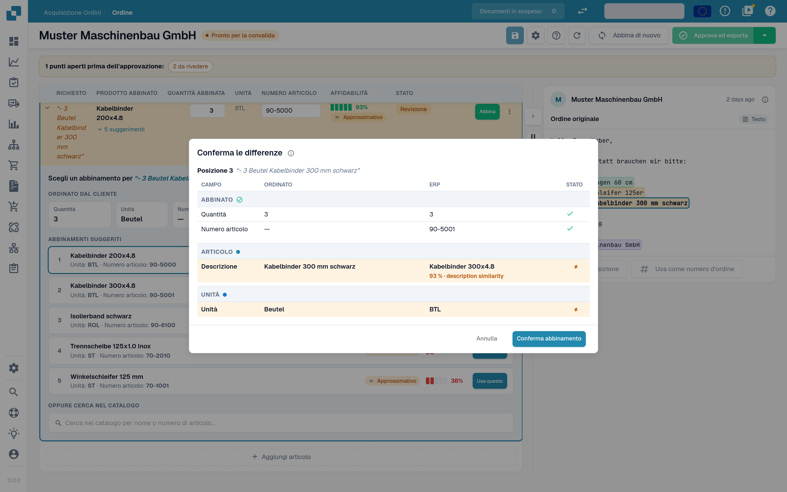<figcaption><p>Conferma le differenze confronta ciò che ha ordinato il cliente con l'articolo scelto; qui differiscono descrizione e unità. Il testo «description similarity» non è ancora tradotto nel prodotto.</p></figcaption></figure>

Una posizione che ha già un suggerimento selezionato può essere confermata direttamente con **Abbina** nella sua riga. Il menu alla fine di una riga offre altre azioni: **Invia un'e-mail al cliente riguardo a questa riga**, **Data di consegna propria…**, **Indirizzo di consegna proprio…**, **Ignora la riga** (non esportata) ed **Elimina riga**.

### Differenze di quantità e di prezzo

* **Quantità:** puoi modificare la quantità di una posizione. Se è diversa da quella ordinata dal cliente, viene mostrata in giallo e deve essere confermata: apri la posizione, scegli l'articolo e la finestra **Conferma le differenze** riporta la quantità. Aggiungi una nota se vuoi e fai clic su **Conferma**. L'ordine viene esportato con la quantità confermata.
* **Prezzo** (solo con i prezzi ERP): se il prezzo del cliente si discosta dal prezzo netto ERP più della tolleranza ammessa, il prezzo viene mostrato in giallo con l'indicazione *Prezzo diverso*. Fai clic su **Abbina** nella riga; la finestra mostra entrambi i prezzi, la differenza e la tolleranza. Fai clic su **Conferma** per accettare il prezzo ERP, oppure chiedi al cliente (vedi [Chiedere al cliente](#chiedere-al-cliente)). Se il prezzo del cliente sembra riferito a 10, 100 o 1000 unità, la finestra propone di impostare la base di prezzo con un clic.

<figure>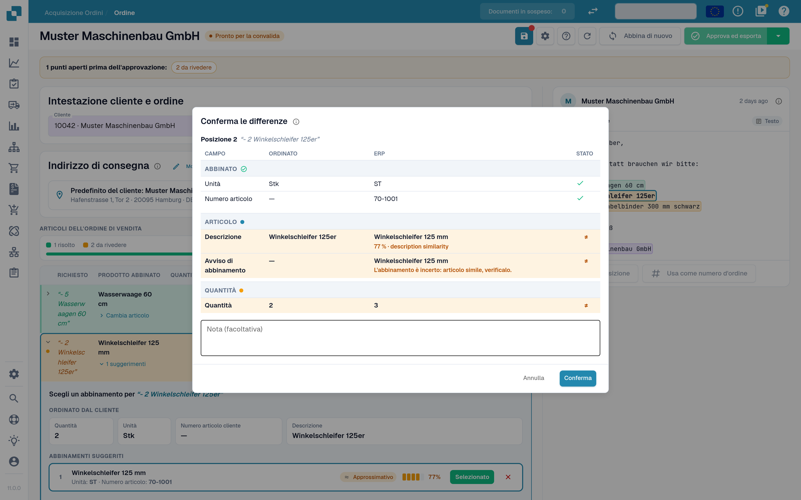<figcaption><p>Una quantità diversa da quella ordinata viene confermata con una nota facoltativa. Il testo «description similarity» non è ancora tradotto nel prodotto.</p></figcaption></figure>

Se l'ERP non restituisce un prezzo per una posizione, questa mostra **Nessun prezzo ERP** con il motivo al passaggio del mouse e un pulsante **Riprova**. Questo non blocca l'ordine.

### Cliente non riconosciuto

Se il dominio e-mail del mittente non è ancora noto, l'ordine mostra il punto aperto **Cliente mancante**. Scegli il cliente in **Intestazione cliente e ordine**. DocBits propone quindi di memorizzare il dominio del mittente:

* **Assegna il dominio di posta elettronica**: *Le future e-mail provenienti da @dominio verranno automaticamente assegnate a …* (il cliente scelto). Fai clic su **Confermare**; l'assegnazione viene salvata insieme alle altre modifiche quando fai clic su **Salva**. **Annulla** annulla la scelta del cliente.
* Se il dominio appartiene già a un altro cliente, scegli **Mantieni …** (le future e-mail restano al cliente attuale, questo ordine riceve comunque il nuovo cliente) oppure **Assegna a …** (le future e-mail vanno al nuovo cliente).

<figure>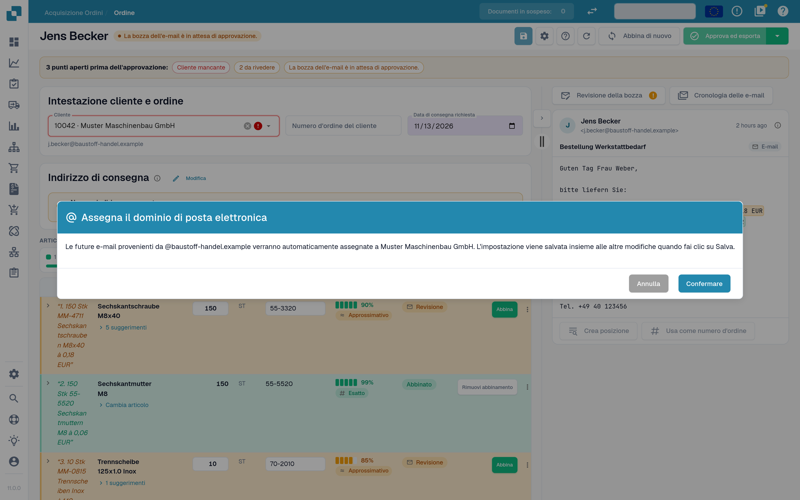<figcaption><p>Assegnando un cliente si può assegnare anche il dominio e-mail del mittente.</p></figcaption></figure>

<figure>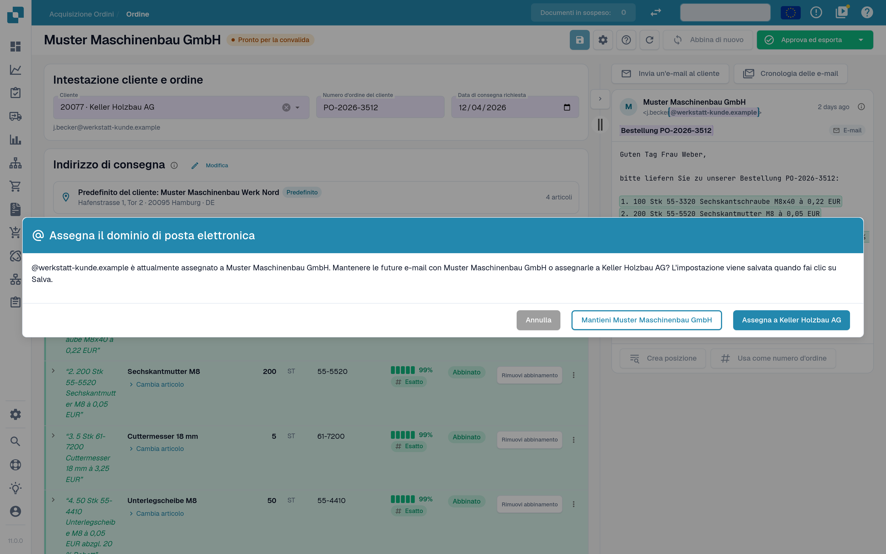<figcaption><p>Il dominio appartiene già a un altro cliente: mantienilo o spostalo.</p></figcaption></figure>

I domini di posta pubblici (come gmail.com) non vengono mai assegnati a un cliente.

### Abbina di nuovo

**Abbina di nuovo** nella barra superiore abbina ancora una volta tutte le posizioni aperte, ad esempio dopo che sono stati aggiunti nuovi articoli all'anagrafica articoli o dopo che hai cambiato il cliente. Le posizioni confermate e ignorate non vengono toccate. Un messaggio ti indica quante posizioni sono state abbinate di nuovo.

Il pulsante è disattivato quando l'abbinamento non può fare nulla; passa il mouse sopra per vederne il motivo:

| Tooltip | Motivo |
| --- | --- |
| *Tutte le posizioni sono già state abbinate, confermate o ignorate.* | Non c'è nulla di aperto. |
| *L'abbinamento attende mentre l'agente sta scrivendo il chiarimento.* | Attendi che la bozza sia pronta. |
| *L'ordine è già stato trasmesso o chiuso.* | Gli ordini approvati, esportati o rifiutati non possono essere abbinati di nuovo. |
| *L'ordine è ancora in fase di lettura.* | Attendi che la lettura sia terminata. |

L'abbinamento ripetuto è possibile anche mentre una domanda al cliente è aperta: una bozza non inviata viene mantenuta (se tutto ciò che chiede è stato risolto, la bozza indica *Non c'è più nulla da chiedere*); una bozza approvata ma non inviata torna allo stato di bozza.

## Correggere una posizione mancante o errata

A volte la lettura inserisce due articoli in un'unica posizione, divide un articolo in due oppure tralascia un articolo scritto all'interno di una frase. Correggilo direttamente nell'e-mail o nel testo incollato:

1. **Seleziona il testo** dell'articolo nel testo dell'ordine a destra.
2. Fai clic su **Crea posizione** sotto il testo.
3. La finestra mostra **Prima → Dopo**. Controlla e fai clic su **Confermare**.
4. Fai clic su **Salva**. Le nuove posizioni ricevono nuovi numeri, vengono abbinate automaticamente ed evidenziate nel testo.

Il risultato dipende da ciò che selezioni:

| Selezioni … | Risultato |
| --- | --- |
| Testo che **non è ancora una posizione** | **Nuova posizione**: la selezione diventa una nuova posizione. |
| **Parte di una posizione** (ad es. il secondo di due articoli in una riga) | **Suddivisione**: la posizione viene rimossa e sostituita da una posizione per ogni articolo. |
| **Due o più posizioni adiacenti per intero** | **Unione**: diventano un'unica posizione. |
| Una posizione **più altro testo** | La posizione viene **sostituita** dal testo selezionato. |
| Una posizione **esattamente com'è** | Non succede nulla: *Questo testo è già la posizione n.* |

<figure>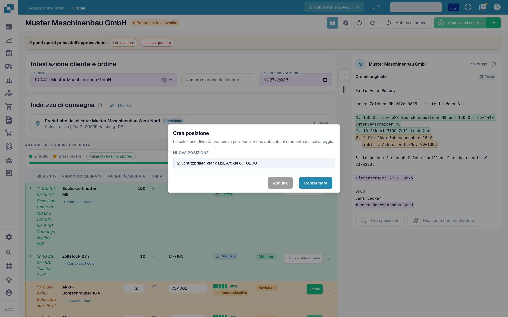<figcaption><p>Crea una posizione che la lettura ha tralasciato.</p></figcaption></figure>

<figure>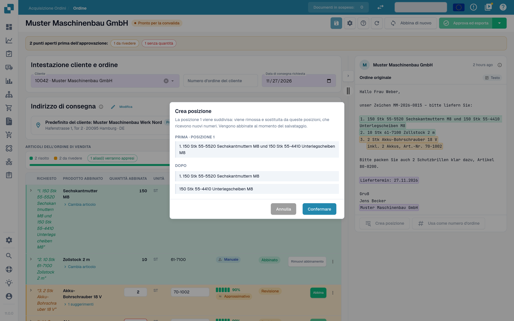<figcaption><p>Suddividi una posizione che contiene due articoli.</p></figcaption></figure>

<figure>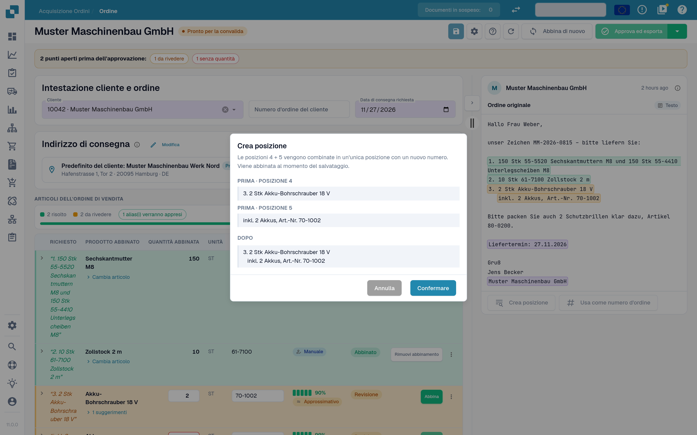<figcaption><p>Unisci due posizioni che vanno insieme.</p></figcaption></figure>

<figure>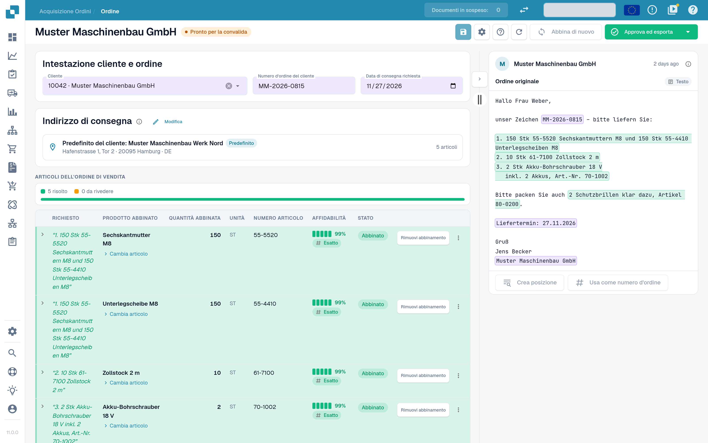<figcaption><p>Dopo il salvataggio le nuove posizioni sono abbinate ed evidenziate nel testo.</p></figcaption></figure>

### Suddividere una posizione già decisa

Una posizione **confermata** o **ignorata**, che ha un **indirizzo di consegna, una data o un prezzo propri**, contiene una **risposta del cliente** o è stata **modificata da un dipendente** può comunque essere suddivisa. In questo caso viene **scomposta**: ogni parte diventa una nuova posizione che viene letta e abbinata di nuovo a partire dal proprio testo. Tutte le nuove posizioni mantengono l'indirizzo di consegna e la data di consegna e devono essere controllate di nuovo; i punti aperti della vecchia posizione passano alla prima nuova posizione. La finestra elenca esattamente cosa si perde con la vecchia posizione, ad esempio la conferma dell'articolo, una quantità o un prezzo ERP accettati, una risposta del cliente o una modifica di un dipendente. La cronologia dell'ordine conserva i vecchi valori.

<figure>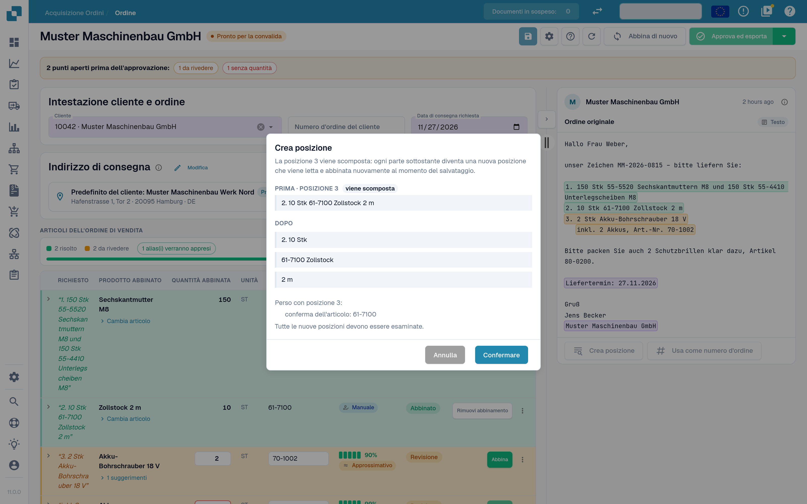<figcaption><p>Suddividere una posizione decisa la scompone; la finestra elenca ciò che si perde.</p></figcaption></figure>

Queste posizioni non vengono mai **unite**. Una posizione con **modifiche non salvate** non può essere suddivisa: prima salva o scarta le modifiche.

### Quando non viene modificato nulla

Se la selezione copre solo una parte di una posizione più del testo al di fuori di essa, oppure tocca diverse posizioni senza coprirle completamente, non viene modificato nulla e la finestra ne spiega il motivo. Seleziona il testo all'interno di una sola posizione, oppure seleziona intere posizioni per unirle. Se due posizioni sono state lette dalla stessa riga di testo, la finestra indica quale posizione fa riferimento anche al testo selezionato e rimane così com'è.

Puoi sempre aggiungere una posizione a mano con **Aggiungi articolo** sotto la tabella delle posizioni, oppure modificare i campi di una posizione nella tabella.

## Correggere l'intestazione dell'ordine

### Numero d'ordine dal testo

Se il numero d'ordine del cliente non è stato riconosciuto (ad es. "unser Zeichen MM-2026-0815" senza un'etichetta), seleziona **solo il numero d'ordine** nel testo e fai clic su **Usa come numero d'ordine**. Dopo **Salva** il numero compare in **Numero d'ordine del cliente** ed è evidenziato in viola nel testo, così tutti possono vedere da dove proviene.

<figure>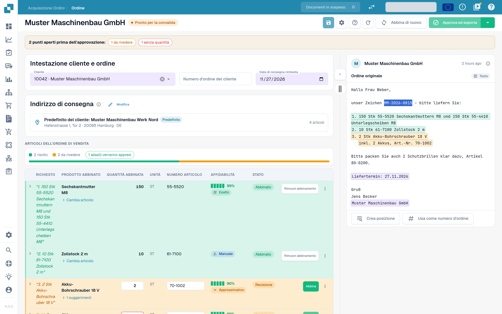<figcaption><p>Seleziona il numero d'ordine nel testo.</p></figcaption></figure>

### Numero d'ordine dall'oggetto

Molti clienti scrivono il numero d'ordine solo nell'oggetto ("AW: 4711"). Puoi selezionarlo anche nella **riga dell'oggetto** dell'e-mail. Nell'oggetto è disponibile solo **Usa come numero d'ordine**: le posizioni vengono create dal testo dell'ordine.

Puoi sempre inserire il numero d'ordine e la data di consegna direttamente in **Intestazione cliente e ordine**.

## Chiedere al cliente

Quando solo il cliente può dare una risposta (un articolo sconosciuto, una quantità o un'unità poco chiara, un numero d'ordine o un indirizzo di consegna mancante, una differenza di prezzo), invia una domanda via e-mail. La domanda parte nel thread dell'ordine originale e la risposta torna allo stesso ordine. Questa funzione è disponibile solo per gli **ordini via e-mail**.

### Avviare una domanda

1. Fai clic su **Invia un'e-mail al cliente** sopra l'e-mail (oppure su **Invia un'e-mail al cliente riguardo a questa riga** nel menu di una posizione).
2. Scegli il motivo della domanda in **Motivo** (oppure lascialo vuoto e lascia decidere all'assistente), controlla i **Destinatari** (aggiungi **Cc** se necessario) e seleziona le posizioni in **Righe di riferimento**.
3. Scegli come procedere:
   * **Invia automaticamente**: fai clic su **Affida all'agente**. L'agente IA scrive l'e-mail. Nulla viene inviato prima che un dipendente approvi la bozza.
   * **Invia manualmente**: scrivi tu l'oggetto e il testo e fai clic su **Inviare**.

Mentre l'agente scrive, il pulsante sopra l'e-mail mostra **Bozza in corso di elaborazione** e **Abbina di nuovo** resta in attesa.

A seconda delle impostazioni, l'agente può anche redigere una domanda di sua iniziativa quando arriva un ordine con dei problemi.

Finché esiste una bozza, il pulsante sopra l'e-mail è **Revisione della bozza** invece di **Invia un'e-mail al cliente**. Quando l'ordine è completo, **Revisione della bozza** resta disponibile senza il **!** giallo: puoi ancora inviare la bozza o scartarla. **Approva ed esporta** scarta una bozza non inviata.

### Controllare e inviare la bozza

Quando la bozza è pronta, l'ordine ha lo stato **La bozza dell'e-mail è in attesa di approvazione.** e il pulsante **Revisione della bozza** mostra un **!** giallo. Fai clic per aprire **Chiarimenti con il cliente**:

* **Scarta**: elimina la bozza; non viene inviato nulla.
* **Restituisci all'agente**: indica all'agente cosa cambiare; l'agente scrive una nuova bozza.
* **Modifica**: cambia tu l'oggetto o il testo.
* **Approva e invia**: invia l'e-mail al cliente.

<figure>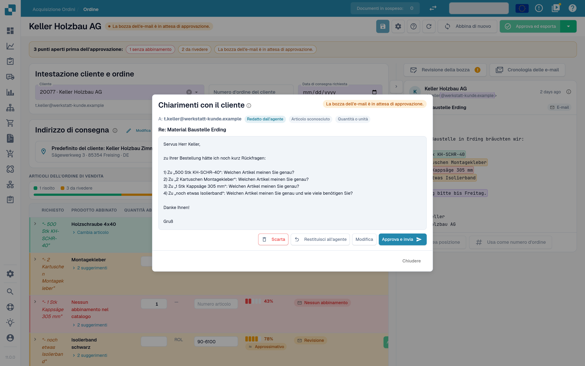<figcaption><p>La bozza dell'agente attende la tua approvazione.</p></figcaption></figure>

### In attesa della risposta

Dopo l'invio, l'ordine è **In attesa del cliente** e anche il pulsante sopra l'e-mail indica **In attesa del cliente**. Quando il cliente risponde, l'agente legge la risposta e la applica all'ordine (l'ordine resta brevemente bloccato con *Lettura della risposta del cliente*); la risposta compare nel riquadro dell'e-mail e in **Cronologia delle e-mail**. Le posizioni che hai già confermato non vengono sovrascritte: se il cliente ne modifica una, viene contrassegnata con *Modificato da un'e-mail del cliente* perché tu la ricontrolli.

Se il cliente ha risposto per telefono o con un'altra e-mail, apri il chiarimento e fai clic su **Chiudi chiarimento**. DocBits smette di attendere; una risposta che arriva più tardi viene mostrata ma non applicata. **Nuova e-mail** pone un'ulteriore domanda.

### Se l'invio non riesce

Se un'e-mail approvata non è stata inviata, l'ordine mostra il punto aperto **E-mail non inviata: invia di nuovo**. Apri il chiarimento: ne mostra il motivo. Fai clic su **Invia di nuovo**.

Se l'e-mail dell'ordine non è arrivata tramite una delle tue caselle di posta di importazione (ad esempio è stata inoltrata in DocBits in un altro modo), non esiste una casella da cui rispondere e l'e-mail non può essere inviata. Configura una casella di posta di importazione per questo indirizzo, oppure contatta direttamente il cliente e scarta la bozza.

<figure>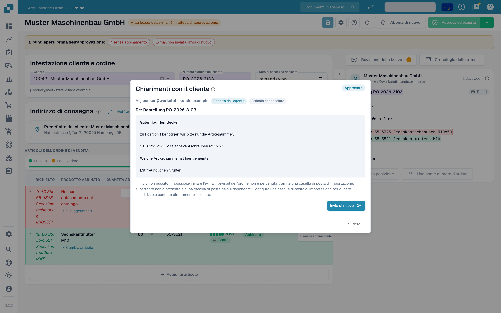<figcaption><p>Invio non riuscito: il chiarimento mostra il motivo (qui: nessuna casella di posta di importazione da cui rispondere) e offre Invia di nuovo.</p></figcaption></figure>

## Approvare e trasmettere

**Approva ed esporta** nella barra superiore è attivo quando ogni punto aperto è risolto: ogni posizione abbinata, confermata o ignorata, il cliente assegnato, i campi obbligatori dell'intestazione e l'indirizzo di consegna presenti. Finché manca qualcosa, passa il mouse sul pulsante disattivato per vedere l'elenco.

<figure>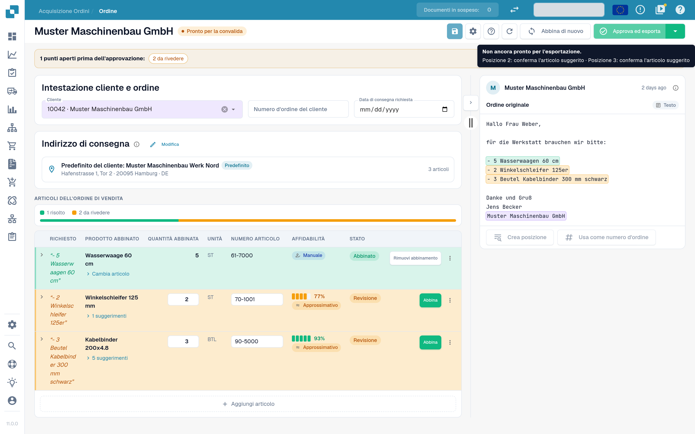<figcaption><p>Approva ed esporta resta disattivato finché tutti i punti aperti non sono risolti; passandoci sopra con il mouse si vede cosa manca.</p></figcaption></figure>

1. Fai clic su **Approva ed esporta**.
2. La finestra riepiloga cliente, numero di posizioni, indirizzi di consegna (incluso l'indirizzo predefinito del cliente), numero d'ordine del cliente (e valore dell'ordine, con i prezzi ERP). Indica anche cosa succede a una domanda aperta: una bozza non inviata viene scartata, una domanda inviata viene chiusa. **Non viene inviato nulla al cliente.**
3. Fai clic su **Approva ed esporta**. In questo modo viene creato l'ordine di vendita nell'ERP.

<figure><figcaption><p>Ultimo controllo prima che l'ordine vada all'ERP.</p></figcaption></figure>

L'ordine è quindi **Esportato** e mostra il numero d'ordine ERP. Se la trasmissione non riesce, lo stato è **Esportazione non riuscita** e un banner rosso mostra il motivo nella tua lingua: ad esempio che l'ERP ha rifiutato l'ordine, che non era raggiungibile, oppure che non è ancora configurata un'esportazione ERP (in questo caso nulla ha raggiunto l'ERP; un amministratore la configura in **Impostazioni › Esportazione** con il tipo di documento **Ordine cliente (Acquisizione ordini)**, vedi *Configurare l'esportazione ERP (amministratori)*). Gli amministratori vedono inoltre nel banner il link **Apri le impostazioni dell’esportazione ERP**; dopo una conferma apre le impostazioni di Acquisizione ordini, la cui sezione **Esportazione ERP** mostra lo stato attuale. Risolvi la causa e fai clic su **Riprova l'esportazione**.

<figure>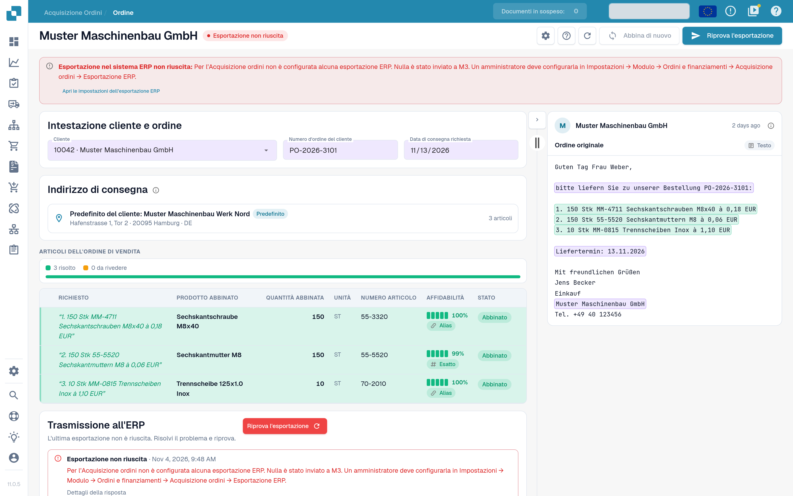<figcaption><p>Se la trasmissione all'ERP non riesce, il banner mostra il motivo; qui non è configurata alcuna esportazione ERP e gli amministratori vedono il link Apri le impostazioni dell’esportazione ERP. Risolvi la causa e fai clic su Riprova l'esportazione.</p></figcaption></figure>

### Rifiutare un ordine

Per fermare un ordine (ad es. un duplicato o un messaggio che non è un vero ordine), apri la freccia accanto ad **Approva ed esporta** e fai clic su **Rifiuta**. Aggiungi un motivo se vuoi. Nulla viene trasmesso all'ERP.

Se DocBits rileva che un ordine potrebbe essere un **duplicato** di uno precedente (stesso cliente e stesso numero d'ordine, oppure posizioni molto simili), un banner offre **Rifiuta in quanto duplicato**, **Visualizza i duplicati** e **Procedere comunque**.
