# Recepción de pedidos

## Descripción general

La **Recepción de pedidos** lee los pedidos que le envían sus clientes —por correo electrónico o como texto pegado— y los prepara como pedidos de venta para su ERP. DocBits identifica al cliente, lee cada posición, la asigna a un artículo de su maestro de artículos y le muestra lo que aún requiere una decisión. Usted comprueba el pedido, completa lo que falta, consulta al cliente si algo no está claro y lo aprueba. Solo entonces se crea el pedido de venta en el ERP.

```
Correo del cliente / texto pegado
        │
        ▼
  Leer posiciones ──► Asignar a sus artículos ──► Usted comprueba y decide ──► Aprobar y exportar ──► Pedido de venta en el ERP
                                                        │
                                                        └──► Consultar al cliente (correo) ──► se aplica la respuesta
```

**Ejemplo:** Muster Maschinenbau GmbH envía por correo electrónico «150 Stk MM-4711 Sechskantschrauben M8x40». DocBits reconoce al cliente por la dirección de correo electrónico del remitente, sabe que el número MM-4711 de este cliente corresponde a su artículo 55-3320 y muestra la posición como **Asignado**. Una segunda posición, «2 Winkelschleifer 125er», no tiene número de artículo, por lo que DocBits sugiere artículos similares y pone la posición en **Revisar**. Usted elige el artículo correcto, hace clic en **Aprobar y exportar** y el pedido ya está en el ERP.


**Limitaciones actuales**

* **Los pedidos a partir de archivos PDF aún no están disponibles.** Utilice pedidos por correo electrónico o **Importar desde texto**.
* **Los precios** solo se muestran y se comprueban si su ERP (Infor M3) devuelve precios para el cliente. Sin ellos, el pedido se transfiere igualmente y el ERP le asigna los precios.
* **Las consultas al cliente** solo se pueden enviar para pedidos recibidos por correo electrónico.


## Cómo activarla

La recepción de pedidos requiere la suscripción a **AI Workforce**.

1. Vaya a **Ajustes › Módulo › Pedido y Finanzas** y abra la sección **Recepción de pedidos**.
2. Active **Activar el panel de control de recepción de pedidos**. «Recepción de pedidos» aparece ahora en la barra lateral.
3. Conceda al rol de los empleados acceso a la recepción de pedidos en **Ajustes › Grupos y Permisos** (los administradores siempre tienen acceso).

<figure>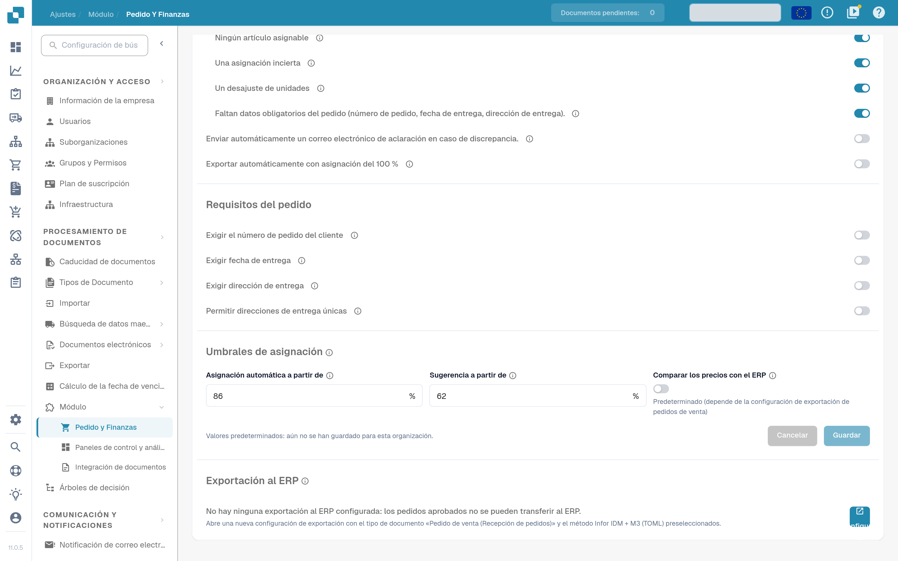<figcaption><p>Ajustes de la recepción de pedidos en Ajustes › Módulo › Pedido y Finanzas; al final, la sección Exportación al ERP, aquí todavía sin exportación al ERP.</p></figcaption></figure>

En la misma sección, un administrador define cómo funciona el módulo:

| Grupo | Ajuste | Qué hace |
| --- | --- | --- |
| **Automatización** | **Redactar automáticamente un correo electrónico de respuesta en caso de discrepancia.** | Activado de forma predeterminada: el agente redacta por sí mismo un correo electrónico de aclaración en los casos marcados a continuación. Un empleado lo revisa, salvo que el envío automático esté activado. |
| | **Redactar un correo electrónico de aclaración para posiciones con** … | Qué problemas hacen que el agente redacte una consulta al cliente: **Ningún artículo asignable**, **Una asignación incierta**, **Un desajuste de unidades**, **Faltan datos obligatorios del pedido (número de pedido, fecha de entrega, dirección de entrega).** Si falta la cantidad, siempre se consulta. |
| | **Enviar automáticamente un correo electrónico de aclaración en caso de discrepancia.** | Desactivado (recomendado): cada correo electrónico redactado espera la aprobación de un empleado. |
| | **Exportar automáticamente con asignación del 100 %** | Los pedidos en los que todas las posiciones se asignaron de forma exacta o mediante un número de artículo del cliente aprendido, y en los que no falta nada más, se envían al ERP sin aprobación. |
| **Requisitos del pedido** | **Exigir el número de pedido del cliente**, **Exigir fecha de entrega**, **Exigir dirección de entrega** | Si están activados, un pedido sin este dato recibe un punto abierto y no se puede aprobar hasta que el dato esté disponible. Los tres están desactivados de forma predeterminada. |
| | **Permitir direcciones de entrega únicas** | Si está activado, los empleados pueden introducir una dirección que solo se utiliza para este pedido (p. ej., una obra). Si está desactivado, solo se pueden utilizar direcciones de los datos maestros del cliente. |
| **Umbrales de asignación** | **Asignación automática a partir de** (86 % de forma predeterminada), **Sugerencia a partir de** (62 % de forma predeterminada) | Solo se aceptan automáticamente los números de artículo exactos y los números de artículo del cliente aprendidos. Las descripciones similares se muestran siempre como sugerencias para revisar. |
| | **Comparar los precios con el ERP** | Compara el precio neto del cliente con el precio neto del ERP. Una diferencia superior a la tolerancia permitida requiere una decisión; en cualquier caso, el ERP asigna los precios al pedido. De forma predeterminada, este ajuste sigue la configuración de la exportación al ERP. |
| **Exportación al ERP** | *(solo estado)* | Muestra las configuraciones de exportación del tipo de documento **Pedido de venta (Recepción de pedidos)** con las que los pedidos aprobados van al ERP, cada una con **Editar**; una inactiva aparece marcada como **Inactivo**. Una fila de advertencia indica que una configuración todavía usa el tipo de documento entrante **Recepción de pedidos – documento entrante**; esa configuración nunca se utiliza. Si no hay ninguna configuración activa, la sección indica *No hay ninguna exportación al ERP configurada: los pedidos aprobados no se pueden transferir al ERP.* y dónde configurarla. Los administradores configuran la exportación en **Ajustes › Exportar** (véase más abajo). |

Los administradores pueden abrir estos ajustes desde cualquier pedido con el botón de la **rueda dentada** de la barra superior.

### Configurar la exportación al ERP (administradores)

Los pedidos aprobados solo llegan al ERP (Infor M3) a través de una configuración de exportación del tipo de documento **Pedido de venta (Recepción de pedidos)**. Un administrador la configura una vez:

1. Vaya a **Ajustes › Exportar** y haga clic en **Nuevo**.
2. Introduzca un **Título de configuración** y elija como **Tipo de Documento** **Pedido de venta (Recepción de pedidos)**. Se ofrece en cuanto la recepción de pedidos está activada; no es necesario activar antes el tipo de documento.
3. En **Exportar** elija **Infor** y en **Tipo de información** elija **Infor IDM + M3 (TOML)**.
4. Suba el **Archivo API de ION** (`.ionapi`) y el **Archivo de mapeo TOML** (`.toml`) de su conexión con M3.
5. Haga clic en **Guardar**. Una configuración nueva está **Activo**; por tipo de documento solo puede haber una configuración activa.

La sección **Exportación al ERP** de los ajustes de la recepción de pedidos muestra entonces la configuración; **Editar** la abre y una inactiva aparece marcada como **Inactivo**. Una fila de advertencia indica que una configuración antigua todavía usa el tipo de documento entrante **Recepción de pedidos – documento entrante**: nunca se utiliza, así que ábrala con **Editar** y cambie su tipo de documento a **Pedido de venta (Recepción de pedidos)**. Los pedidos solo se exportan desde la recepción de pedidos con **Aprobar y exportar** (o automáticamente con **Exportar automáticamente con asignación del 100 %**); los documentos de pedido entrantes nunca se exportan como tales.

## Recibir un pedido

### Por correo electrónico

Los clientes envían sus pedidos al buzón de pedidos de su organización. El agente de IA lee el correo electrónico, identifica las posiciones y crea el pedido en la lista. El cliente se reconoce por el **dominio de la dirección de correo electrónico del remitente**. Las firmas, los avisos legales y los mensajes anteriores citados no se leen como posiciones.

### Importar desde texto

Para un pedido que le ha llegado por otra vía (un fax que ha transcrito, un mensaje de chat, un texto reenviado):

1. En la lista de recepción de pedidos, haga clic en **Importar desde texto**.
2. Pegue el pedido en **Texto del pedido**. Se admite texto libre: los saltos de línea, las abreviaturas y la escritura abreviada se procesan sin problema.
3. Elija el **Cliente** (busque por nombre, correo electrónico o número de cliente). Sin cliente, el pedido se abre con el punto abierto *Falta el cliente*.
4. Haga clic en **Extraer y asignar**.

<figure>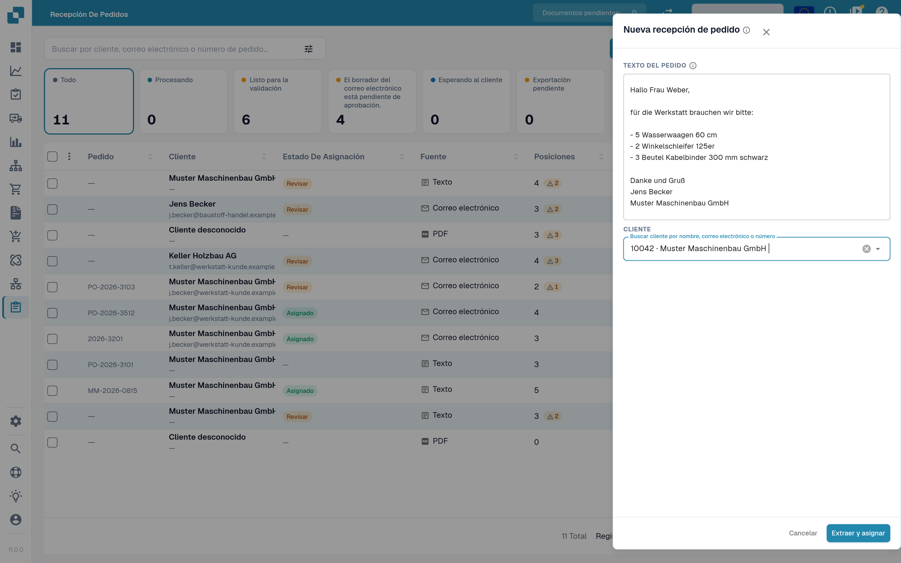<figcaption><p>Pegue el pedido de un cliente y elija el cliente.</p></figcaption></figure>

### Nuevo pedido

**Nuevo pedido** crea un pedido manualmente a partir de su catálogo de artículos: elija el cliente y la dirección de entrega, añada los artículos y las cantidades y, a continuación, haga clic en **Aprobar y exportar**.

## La lista de recepción de pedidos

Abra **Recepción de pedidos** en la barra lateral. La lista muestra cada pedido con su cliente, su fuente (**Correo electrónico**, **Texto**, **Manual**), el número de posiciones, la fecha de recepción, su estado y su estado de asignación. Un pequeño símbolo de advertencia junto al número de posiciones indica cuántas requieren todavía una decisión. Haga clic en una fila para abrir el pedido.

<figure>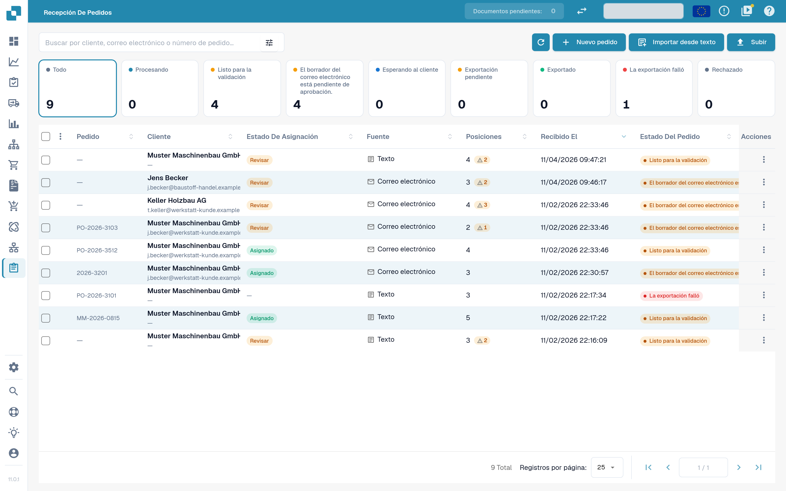<figcaption><p>La lista de recepción de pedidos con las tarjetas de estado.</p></figcaption></figure>

Las **tarjetas de estado** situadas encima de la lista cuentan los pedidos de cada estado. Haga clic en una tarjeta para mostrar solo esos pedidos; **Todo** lo muestra todo.

| Estado | Significado |
| --- | --- |
| **Procesando** | El pedido se está leyendo o preparando; todavía no tiene que hacer nada. |
| **Listo para la validación** | Leído y a la espera de un empleado: compruebe las posiciones o apruébelo. |
| **El borrador del correo electrónico está pendiente de aprobación.** | Hay un correo electrónico al cliente redactado que espera su aprobación. |
| **Esperando al cliente** | Se ha enviado una aclaración y la respuesta está pendiente. |
| **Exportación pendiente** | Aprobado, pero aún no transferido al ERP. |
| **Exportado** | Transferido al ERP. |
| **La exportación falló** | El ERP rechazó la transferencia; inténtelo de nuevo después de solucionar la causa. |
| **Rechazado** | Rechazado o reconocido como duplicado; no se requiere ninguna otra acción. |

La columna **Estado de asignación** indica **Revisar** cuando una posición, un campo obligatorio del encabezado o la dirección de entrega aún requieren una decisión, y **Asignado** cuando todo está resuelto.

Mientras el agente de IA, una reasignación o una respuesta del cliente están procesando un pedido, su estado muestra **Agente trabajando** con una flecha giratoria. El pedido queda bloqueado hasta que termina el proceso; la lista se actualiza sola.

**Buscar y filtrar:** escriba un cliente, una dirección de correo electrónico o un número de pedido en el campo de búsqueda. El icono de filtro del campo de búsqueda filtra por **Fuente** (*Correo electrónico* o *Manual*).

El menú al final de una fila ofrece **Registros** (cada paso del agente, de los usuarios y del sistema, además del historial de decisiones: quién confirmó o modificó qué) y **Borrar**.

## Comprobar un pedido nuevo

### La pantalla de asignación

<figure>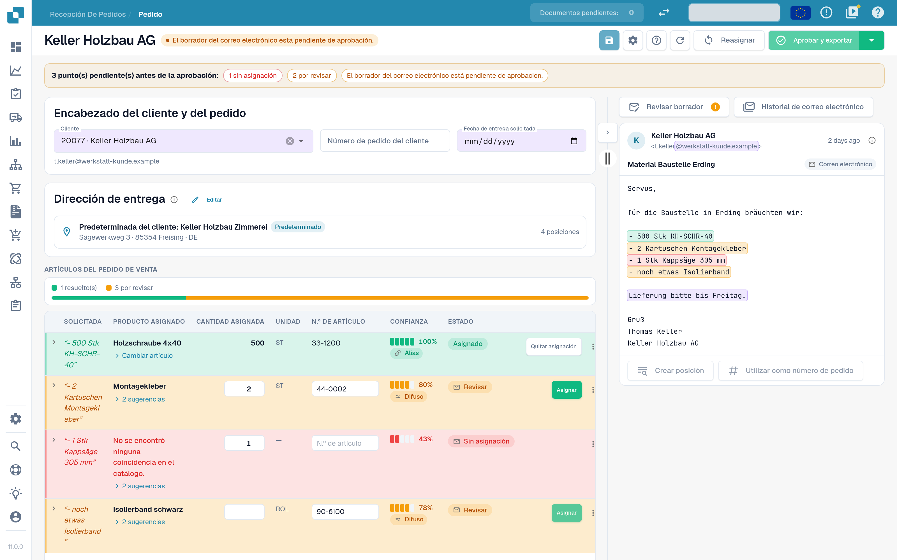<figcaption><p>La pantalla de asignación: los datos del pedido a la izquierda y el correo electrónico del cliente a la derecha.</p></figcaption></figure>

* **Barra superior**: cliente, estado, valor del pedido (solo con precios del ERP) y las acciones **Guardar**, **Leyenda**, **Actualizar**, **Reasignar** y **Aprobar y exportar**.
* **Puntos abiertos**: justo debajo de la barra superior; todo lo que aún bloquea la aprobación, p. ej., *Falta el cliente*, *Falta el número de pedido*, *2 por revisar*. Haga clic en un punto para ir a él.
* **Encabezado del cliente y del pedido**: cliente, número de pedido del cliente y fecha de entrega solicitada.
* **Dirección de entrega**: adónde va el pedido. Si el cliente tiene una dirección predeterminada, se utiliza automáticamente (*Predeterminada del cliente: …* con la etiqueta **Predeterminado**); **Editar** la cambia. Las posiciones también pueden ir a direcciones diferentes.
* **Posiciones**: una fila por cada artículo pedido, con el texto del cliente, el artículo asignado, la cantidad, la unidad y el estado. Encima de la tabla, una barra muestra cuántas posiciones están resueltas y cuántas quedan por revisar.
* **Fuente** (a la derecha): el correo electrónico del cliente o el texto pegado. Las posiciones se resaltan en verde, ámbar o rojo según su estado, las direcciones de entrega en azul y los valores del encabezado (cliente, número de pedido, fecha) en violeta. Haga clic en un resaltado para ir a la posición. La flecha del divisor oculta o muestra el correo electrónico; arrastre el divisor para cambiar el ancho. **Historial de correo electrónico** muestra todos los correos de este pedido.

La **Leyenda** (botón con el signo de interrogación) explica cada color, estado y método de asignación.


Ningún cambio que haga en esta pantalla se guarda hasta que hace clic en **Guardar** (el icono del disquete; un punto rojo indica que hay cambios sin guardar). Ctrl+S / Cmd+S también guarda. Si sale del pedido con cambios sin guardar, DocBits le pregunta si desea guardarlos o descartarlos.


### Estados de las posiciones y métodos de asignación

| Estado | Significado |
| --- | --- |
| **Asignado** | Asignado automáticamente (mediante un número de artículo del cliente aprendido o el número de artículo exacto) o confirmado por un empleado. |
| **Revisar** | Existe una sugerencia, pero debe comprobarse. |
| **Sin asignación** | Ningún artículo del maestro de artículos es lo bastante similar como para sugerirlo. |
| **Pendiente** | Todavía no asignado. |
| **Ignorado** | Excluido de la exportación. |

| Método de asignación | Significado |
| --- | --- |
| **Alias** | El número de artículo propio de este cliente ya se había asignado antes a su artículo; pasa automáticamente. |
| **Exacto** | El número de artículo del pedido coincide exactamente con el maestro de artículos; pasa automáticamente. |
| **Difuso** | Solo la descripción es similar; siempre requiere una revisión. |
| **Manual** | Elegido o confirmado por un empleado. |
| **Aclaración** | Tomado de la respuesta del cliente. |

Cuando usted confirma un artículo para un número de artículo del cliente, DocBits **lo aprende como alias** para este cliente: el siguiente pedido con el mismo número se asigna automáticamente. Un alias aprendido se puede eliminar desde el menú de la posición (**Eliminar alias aprendido**).

### Posiciones en Revisar

1. Haga clic en la posición para abrirla. **Pedido por el cliente** muestra la cantidad, la unidad, el número de artículo del cliente y la descripción tal como los escribió el cliente.
2. **Asignaciones sugeridas** muestra los mejores artículos con su número de artículo, unidad, método de asignación y nivel de confianza.
3. La mejor sugerencia ya está preseleccionada (**Seleccionado**). Si el artículo correcto es otro, haga clic en **Usar este** en ese artículo, o búsquelo en **O busque en el catálogo**. La **x** roja elimina la selección.
   Una posición necesita una **cantidad** para poder asignarse: sin ella, **Usar este** y **Asignar** aparecen en gris (*Introduzca primero una cantidad: una posición sin cantidad no se puede asignar.*). Introduzca primero la cantidad en la fila.
4. Una ventana emergente compara lo pedido con el artículo elegido. Compruébelo y haga clic en **Confirmar asignación**.
5. Haga clic en **Guardar**.

<figure>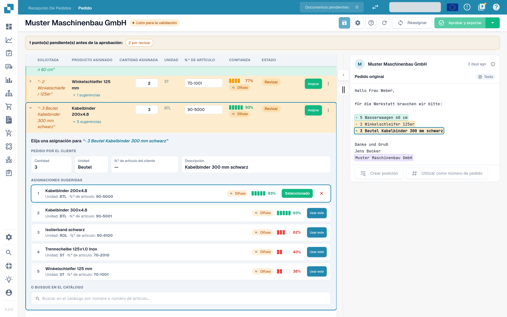<figcaption><p>Una posición en Revisar: compare lo que pidió el cliente con las sugerencias.</p></figcaption></figure>

<figure>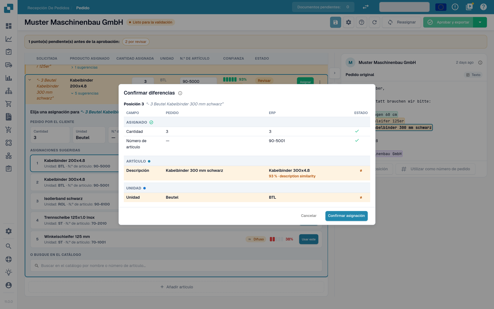<figcaption><p>Confirmar diferencias compara lo que pidió el cliente con el artículo elegido; aquí difieren la descripción y la unidad. El texto «description similarity» aún no está traducido en el producto.</p></figcaption></figure>

Una posición que ya tiene una sugerencia seleccionada se puede confirmar directamente con **Asignar** en su fila. El menú al final de una fila ofrece más opciones: **Enviar un correo electrónico al cliente sobre esta línea**, **Fecha de entrega propia…**, **Dirección de entrega propia…**, **Ignorar línea** (no se exporta) y **Eliminar línea**.

### Diferencias de cantidad y de precio

* **Cantidad:** puede cambiar la cantidad de una posición. Si difiere de lo que pidió el cliente, se muestra en ámbar y debe confirmarse: abra la posición, elija el artículo y la ventana emergente **Confirmar diferencias** mostrará la cantidad. Si lo desea, añada una nota y haga clic en **Confirmar**. El pedido se exporta con la cantidad confirmada.
* **Precio** (solo con precios del ERP): si el precio del cliente difiere del precio neto del ERP en más de la tolerancia permitida, el precio se muestra en ámbar con la indicación *El precio difiere*. Haga clic en **Asignar** en la fila; la ventana emergente muestra ambos precios, la diferencia y la tolerancia. Haga clic en **Confirmar** para aceptar el precio del ERP, o consulte al cliente (consulte [Consultar al cliente](#consultar-al-cliente)). Si el precio del cliente parece un precio por 10, 100 o 1000, la ventana emergente le ofrece establecer la base de precio con un solo clic.

<figure>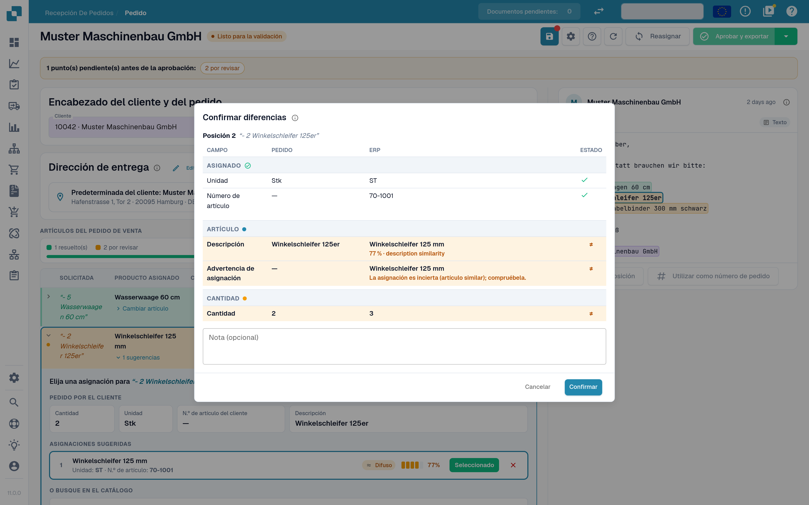<figcaption><p>Una cantidad que difiere del pedido se confirma con una nota opcional. El texto «description similarity» aún no está traducido en el producto.</p></figcaption></figure>

Si el ERP no devuelve ningún precio para una posición, esta muestra **Sin precio ERP**, con el motivo al pasar el cursor, y un botón **Reintentar**. Esto no bloquea el pedido.

### Cliente no reconocido

Si el dominio de correo electrónico del remitente aún no se conoce, el pedido muestra el punto abierto **Falta el cliente**. Elija el cliente en **Encabezado del cliente y del pedido**. A continuación, DocBits le ofrece recordar el dominio del remitente:

* **Asignar dominio de correo electrónico**: *Los correos electrónicos futuros de @dominio se asignarán automáticamente a* este cliente. Haga clic en **Confirmar**; se guarda junto con sus demás cambios cuando hace clic en **Guardar**. **Cancelar** deshace la elección del cliente.
* Si el dominio ya pertenece a otro cliente, elija **Conservar** … (los correos futuros siguen asignados al cliente actual; este pedido recibe igualmente el nuevo) o **Asignar a** … (los correos futuros se asignan al nuevo cliente).

<figure>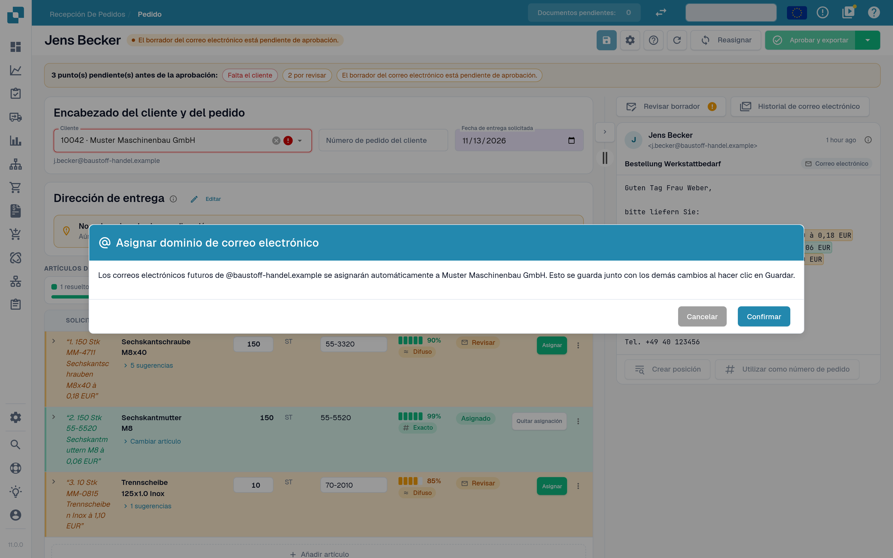<figcaption><p>Al asignar un cliente también se puede asignar el dominio de correo electrónico del remitente.</p></figcaption></figure>

<figure>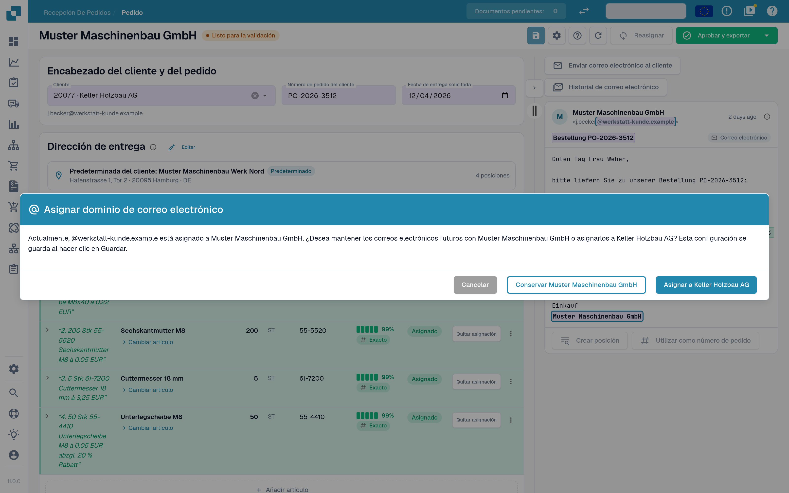<figcaption><p>El dominio ya pertenece a otro cliente: consérvelo o muévalo.</p></figcaption></figure>

Los dominios de correo públicos (como gmail.com) nunca se asignan a un cliente.

### Reasignar

**Reasignar** en la barra superior vuelve a asignar todas las posiciones abiertas; por ejemplo, después de añadir artículos nuevos al maestro de artículos o después de cambiar el cliente. Las posiciones confirmadas e ignoradas no se modifican. Un mensaje le indica cuántas posiciones se han reasignado.

El botón aparece en gris cuando la asignación no puede hacer nada; pase el cursor por encima para ver el motivo:

| Información sobre herramientas | Motivo |
| --- | --- |
| *Todas las posiciones ya están asignadas, confirmadas o ignoradas.* | No hay nada abierto. |
| *La asignación espera mientras el agente redacta la aclaración.* | Espere a que el borrador esté listo. |
| *El pedido ya se ha transferido o cerrado.* | Los pedidos aprobados, exportados o rechazados no se pueden reasignar. |
| *El pedido aún se está leyendo.* | Espere a que termine la lectura. |

También se puede reasignar mientras hay una consulta al cliente abierta: un borrador no enviado se conserva (si todo lo que pregunta ya está resuelto, el borrador indica *No queda nada más que preguntar*); un borrador aprobado que no se haya enviado vuelve a ser borrador.

## Corregir una posición omitida o incorrecta

A veces, la lectura junta dos artículos en una posición, divide un artículo en dos u omite un artículo escrito dentro de una frase. Corríjalo directamente en el correo electrónico o en el texto pegado:

1. **Seleccione el texto** del artículo en el texto del pedido, a la derecha.
2. Haga clic en **Crear posición** debajo del texto.
3. La ventana emergente muestra **Antes → Después**. Compruébelo y haga clic en **Confirmar**.
4. Haga clic en **Guardar**. Las posiciones nuevas reciben números nuevos, se asignan automáticamente y se resaltan en el texto.

Lo que ocurre depende de lo que seleccione:

| Usted selecciona… | Resultado |
| --- | --- |
| Texto que **todavía no es una posición** | **Nueva posición**: la selección se convierte en una posición nueva. |
| **Parte de una posición** (p. ej., el segundo de dos artículos en una línea) | **División**: la posición se elimina y se sustituye por una posición por artículo. |
| **Dos o más posiciones contiguas completas** | **Combinación**: se convierten en una sola posición. |
| Una posición **más otro texto** | La posición se **sustituye** por el texto seleccionado. |
| Una posición **exactamente tal como está** | No ocurre nada: *Este texto ya está en la posición n*. |

<figure>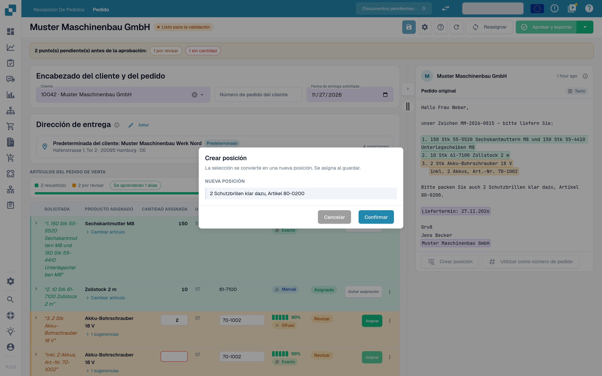<figcaption><p>Cree una posición que la lectura omitió.</p></figcaption></figure>

<figure><figcaption><p>Divida una posición que contiene dos artículos.</p></figcaption></figure>

<figure>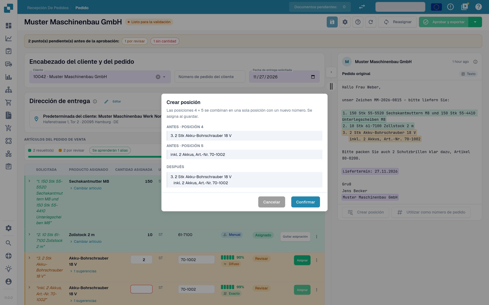<figcaption><p>Combine dos posiciones que van juntas.</p></figcaption></figure>

<figure>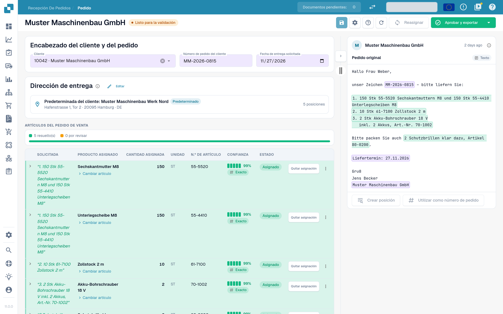<figcaption><p>Después de Guardar, las posiciones nuevas se asignan y se resaltan en el texto.</p></figcaption></figure>

### Dividir una posición que ya se había decidido

Una posición que está **confirmada** o **ignorada**, que tiene **su propia dirección de entrega, fecha o precio**, que contiene una **respuesta del cliente** o que fue **editada por un empleado** también se puede dividir. En ese caso, **se disuelve**: cada parte se convierte en una posición nueva que se vuelve a leer y a asignar a partir de su propio texto. Todas las posiciones nuevas conservan la dirección de entrega y la fecha de entrega y deben revisarse de nuevo; los puntos abiertos de la posición anterior pasan a la primera posición nueva. La ventana emergente indica exactamente qué se pierde con la posición anterior, por ejemplo, la confirmación del artículo, una cantidad o un precio ERP aceptados, una respuesta del cliente o una edición de un empleado. El historial del pedido conserva los valores anteriores.

<figure>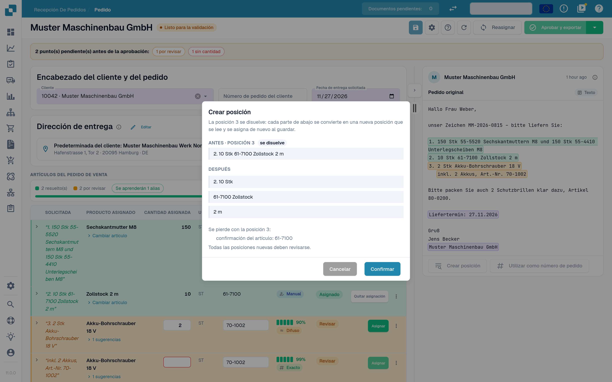<figcaption><p>Al dividir una posición decidida, esta se disuelve; la ventana emergente indica lo que se pierde.</p></figcaption></figure>

Estas posiciones nunca se **combinan**. Una posición con **cambios sin guardar** no se puede dividir: guarde o descarte primero los cambios.

### Cuando no se modifica nada

Si la selección abarca solo una parte de una posición más texto fuera de ella, o toca varias posiciones sin cubrirlas por completo, no se modifica nada y la ventana emergente explica el motivo. Seleccione texto dentro de una sola posición, o seleccione posiciones completas para combinarlas. Si dos posiciones se leyeron de la misma línea de texto, la ventana emergente indica qué posición también se refiere al texto seleccionado y permanece como está.

Siempre puede añadir una posición manualmente con **Añadir artículo** debajo de la tabla de posiciones, o editar los campos de una posición en la tabla.

## Corregir el encabezado del pedido

### Número de pedido a partir del texto

Si no se reconoció el número de pedido del cliente (p. ej., «unser Zeichen MM-2026-0815» sin etiqueta), seleccione **solo el número de pedido** en el texto y haga clic en **Utilizar como número de pedido**. Después de **Guardar**, el número aparece en **Número de pedido del cliente** y se resalta en violeta en el texto, de modo que todos puedan ver de dónde procede.

<figure>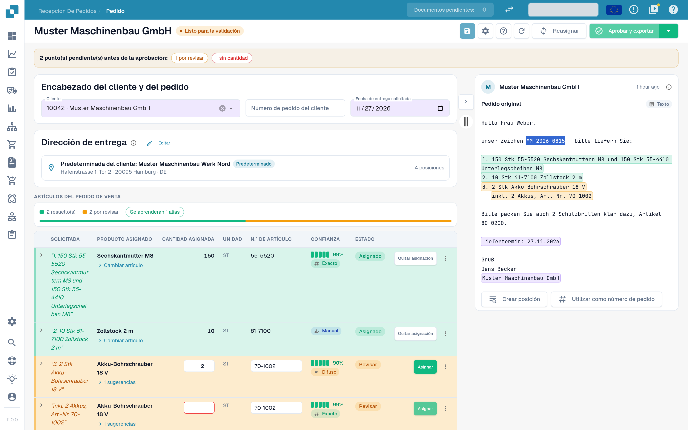<figcaption><p>Marque el número de pedido en el texto.</p></figcaption></figure>

### Número de pedido a partir del asunto

Muchos clientes escriben el número de pedido solo en el asunto («AW: 4711»). También puede seleccionarlo en la **línea de asunto** del correo electrónico. En el asunto solo está disponible **Utilizar como número de pedido**; las posiciones se crean a partir del texto del pedido.

Siempre puede escribir el número de pedido y la fecha de entrega directamente en **Encabezado del cliente y del pedido**.

## Consultar al cliente

Cuando algo solo puede responderlo el cliente —un artículo desconocido, una cantidad o una unidad poco claras, un número de pedido o una dirección de entrega que faltan, una diferencia de precio—, envíe una consulta por correo electrónico. Se envía en el hilo del pedido original y la respuesta vuelve al mismo pedido. Esta función solo está disponible para **pedidos recibidos por correo electrónico**.

### Iniciar una consulta

1. Haga clic en **Enviar correo electrónico al cliente** encima del correo electrónico (o en **Enviar un correo electrónico al cliente sobre esta línea** en el menú de una posición).
2. Elija el motivo de la consulta en **Motivo** (o déjelo vacío y deje que decida el asistente), compruebe los **Destinatarios** (añada **Cc** si es necesario) y marque las posiciones en **Líneas de referencia**.
3. Elija cómo:
   * **Enviar automáticamente**: haga clic en **Entregar al agente**. El agente de IA redacta el correo electrónico. No se envía nada antes de que un empleado apruebe el borrador.
   * **Enviar manualmente**: escriba usted mismo el asunto y el texto y haga clic en **Enviar**.

Mientras el agente redacta, el botón situado encima del correo electrónico muestra **Borrador en curso** y **Reasignar** espera.

Según los ajustes, el agente también puede redactar una consulta por sí mismo cuando llega un pedido con problemas.

Mientras existe un borrador, el botón situado encima del correo electrónico es **Revisar borrador** en lugar de **Enviar correo electrónico al cliente**. Una vez que el pedido está completo, **Revisar borrador** sigue disponible sin el **!** amarillo: todavía puede enviar el borrador o descartarlo. **Aprobar y exportar** descarta un borrador no enviado.

### Comprobar y enviar el borrador

Cuando el borrador está listo, el pedido tiene el estado **El borrador del correo electrónico está pendiente de aprobación.** y el botón **Revisar borrador** muestra un **!** amarillo. Haga clic en él para abrir **Aclaración con el cliente**:

* **Descartar**: elimina el borrador; no se envía nada.
* **Devolver al agente**: indique al agente qué debe cambiar; redactará un borrador nuevo.
* **Editar**: cambie usted mismo el asunto o el texto.
* **Aprobar y enviar**: envía el correo electrónico al cliente.

<figure>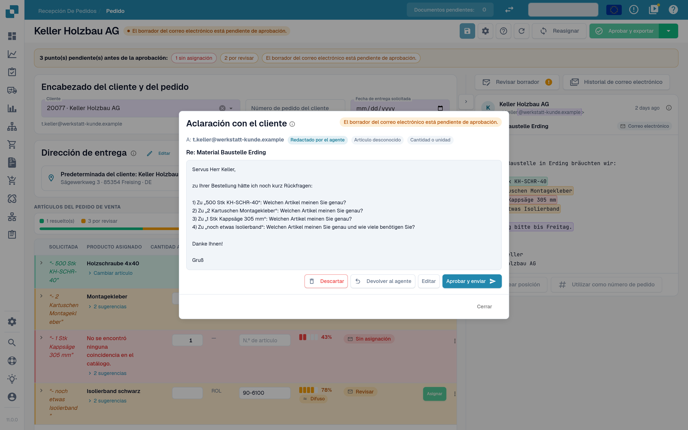<figcaption><p>El borrador del agente espera su aprobación.</p></figcaption></figure>

### A la espera de la respuesta

Tras el envío, el pedido está en **Esperando al cliente** y el botón situado encima del correo electrónico indica **Esperando al cliente**. Cuando el cliente responde, el agente lee la respuesta y la aplica al pedido (el pedido queda bloqueado brevemente con *Leyendo la respuesta del cliente*); la respuesta aparece en el panel del correo electrónico y en **Historial de correo electrónico**. Las posiciones que usted ya ha confirmado no se sobrescriben: si el cliente modifica una de ellas, se marca con *Modificada por un correo del cliente* para que la compruebe de nuevo.

Si el cliente respondió por teléfono o en otro correo, abra la aclaración y haga clic en **Cerrar aclaración**. DocBits deja de esperar; una respuesta que llegue más tarde se muestra, pero no se aplica. **Correo nuevo** envía una consulta adicional.

### Si falla el envío

Si un correo electrónico aprobado no se pudo enviar, el pedido muestra el punto abierto **Correo electrónico no enviado; inténtelo de nuevo.** Abra la aclaración: muestra el motivo. Haga clic en **Enviar de nuevo**.

Si el correo electrónico del pedido no llegó a través de uno de sus buzones de importación (por ejemplo, porque se reenvió a DocBits por otra vía), no hay ningún buzón desde el que responder y el correo electrónico no se puede enviar. Configure un buzón de importación para esta dirección, o póngase en contacto directamente con el cliente y descarte el borrador.

<figure>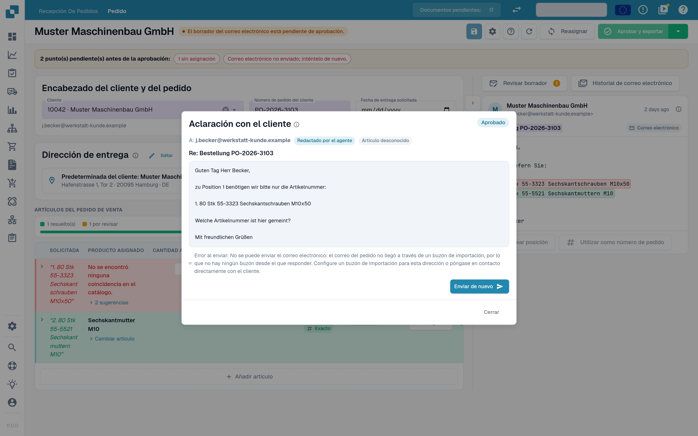<figcaption><p>El envío falló: la aclaración muestra el motivo (aquí: no hay buzón de importación desde el que responder) y ofrece Enviar de nuevo.</p></figcaption></figure>

## Aprobar y transferir

**Aprobar y exportar** en la barra superior se habilita cuando todos los puntos abiertos están resueltos: todas las posiciones asignadas, confirmadas o ignoradas, el cliente asignado, y los campos obligatorios del encabezado y la dirección de entrega presentes. Mientras falte algo, pase el cursor sobre el botón en gris para ver la lista.

<figure>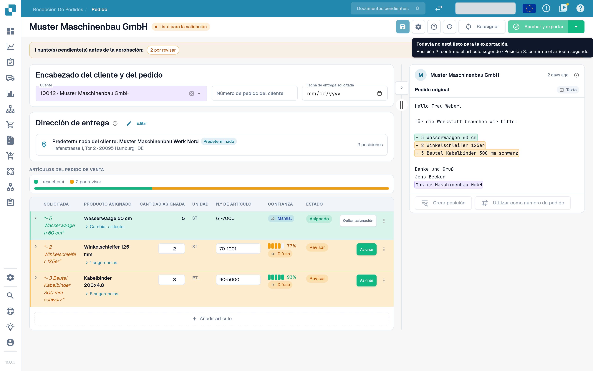<figcaption><p>Aprobar y exportar permanece desactivado hasta que se resuelven todos los puntos abiertos; al pasar el ratón por encima se indica lo que falta.</p></figcaption></figure>

1. Haga clic en **Aprobar y exportar**.
2. La ventana emergente resume el cliente, el número de posiciones, las direcciones de entrega (incluida la dirección predeterminada del cliente) y el número de pedido del cliente (y el valor del pedido, con precios del ERP). También indica qué ocurre con una consulta abierta: un borrador no enviado se descarta y una consulta enviada se cierra; **No se envía nada al cliente.**
3. Haga clic en **Aprobar y exportar**. Esto crea el pedido de venta en el ERP.

<figure><figcaption><p>Última comprobación antes de que el pedido vaya al ERP.</p></figcaption></figure>

A continuación, el pedido pasa a **Exportado** y muestra el número de pedido del ERP. Si la transferencia falla, el estado es **La exportación falló** y un banner rojo muestra el motivo en su idioma; por ejemplo, que el ERP rechazó el pedido, que no estaba accesible o que todavía no hay configurada ninguna exportación al ERP (en ese caso, no ha llegado nada al ERP; un administrador la configura en **Ajustes › Exportar** con el tipo de documento **Pedido de venta (Recepción de pedidos)**, véase *Configurar la exportación al ERP (administradores)*). Los administradores ven además en el banner el enlace **Abrir la configuración de exportación al ERP**; tras una confirmación, abre los ajustes de la recepción de pedidos, cuya sección **Exportación al ERP** muestra el estado actual. Solucione la causa y haga clic en **Reintentar exportación**.

<figure>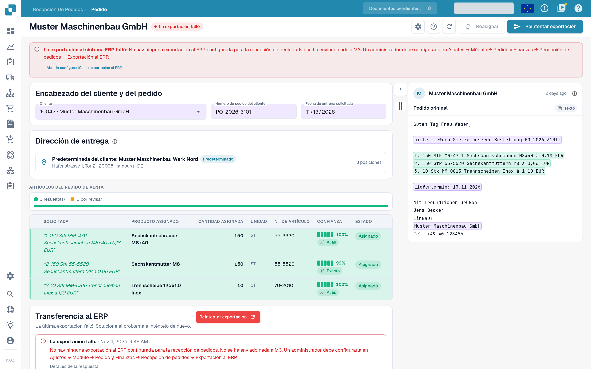<figcaption><p>Si falla la transferencia al ERP, el banner muestra el motivo; aquí no hay ninguna exportación al ERP configurada y los administradores ven el enlace Abrir la configuración de exportación al ERP. Solucione la causa y haga clic en Reintentar exportación.</p></figcaption></figure>

### Rechazar un pedido

Para detener un pedido (p. ej., un duplicado o algo que no es un pedido real), abra la flecha situada junto a **Aprobar y exportar** y haga clic en **Rechazar**. Si lo desea, añada un motivo. No se transfiere nada al ERP.

Si DocBits detecta que un pedido puede ser un **duplicado** de otro anterior (mismo cliente y número de pedido, o posiciones muy similares), un banner ofrece **Rechazar como duplicado**, **Ver duplicados** y **Proceder de todos modos**.
