# Orderverwerking

## Overzicht

**Orderverwerking** leest de bestellingen die uw klanten u sturen, per e-mail of als geplakte tekst, en bereidt ze voor als verkooporders voor uw ERP. DocBits herkent de klant, leest elke positie, koppelt die aan een artikel uit uw artikelstamgegevens en laat zien waarover nog een beslissing nodig is. U controleert de bestelling, vult aan wat ontbreekt, stelt de klant een vraag als iets onduidelijk is en keurt de bestelling goed. Pas dan wordt de verkooporder in het ERP aangemaakt.

```
E-mail van de klant / geplakte tekst
        │
        ▼
  Posities lezen ──► Koppelen aan uw artikelen ──► U controleert en beslist ──► Goedkeuren en exporteren ──► Verkooporder in het ERP
                                                         │
                                                         └──► De klant een vraag stellen (e-mail) ──► antwoord wordt verwerkt
```

**Voorbeeld:** Muster Maschinenbau GmbH e-mailt "150 Stk MM-4711 Sechskantschrauben M8x40". DocBits herkent de klant aan het e-mailadres van de afzender, weet dat het nummer MM-4711 van deze klant uw artikel 55-3320 is, en toont de positie als **Gekoppeld**. Een tweede positie, "2 Winkelschleifer 125er", heeft geen artikelnummer. DocBits stelt daarom vergelijkbare artikelen voor en zet de positie op **Beoordeling**. U kiest het juiste artikel, klikt op **Goedkeuren en exporteren** en de bestelling staat in het ERP.


**Huidige beperkingen**

* **Bestellingen uit PDF-bestanden zijn nog niet beschikbaar.** Gebruik e-mailbestellingen of **Importeren vanuit tekst**.
* **Prijzen** worden alleen getoond en gecontroleerd als uw ERP (Infor M3) prijzen voor de klant teruggeeft. Zonder prijzen wordt de bestelling toch overgedragen; het ERP bepaalt dan de prijs.
* **Vragen aan de klant** kunnen alleen worden verzonden voor bestellingen die per e-mail zijn binnengekomen.


## Activeren

Orderverwerking vereist het abonnement **AI Workforce**.

1. Ga naar **Instellingen › Module › Bestellen & Financiering** en open de sectie **Orderverwerking**.
2. Schakel **Activeer het dashboard voor orderverwerking** in. "Orderverwerking" verschijnt nu in de zijbalk.
3. Geef de rol van de medewerkers toegang tot Orderverwerking onder **Instellingen › Groepen en machtigingen** (beheerders hebben altijd toegang).

<figure><figcaption><p>Instellingen van Orderverwerking onder Instellingen › Module › Bestellen &#x26; Financiering; onderaan het onderdeel ERP-export, hier nog zonder ERP-export.</p></figcaption></figure>

In dezelfde sectie bepaalt een beheerder hoe de module werkt:

| Groep | Instelling | Wat de instelling doet |
| --- | --- | --- |
| **Automatisering** | **Automatisch een antwoordmail opstellen bij een afwijking** | Standaard aan: de agent stelt zelf een verduidelijkingsmail op voor de gevallen die hieronder zijn aangevinkt. Een medewerker controleert die, tenzij automatisch verzenden aan staat. |
| | **Stel een verduidelijkingsmail op voor posities met** … | Bij welke problemen de agent een vraag aan de klant opstelt: **Geen passend artikel**, **Een onzekere koppeling**, **Een afwijkende eenheid**, **Ontbrekende verplichte bestelgegevens (bestelnummer, leverdatum, bezorgadres)**. Naar een ontbrekende hoeveelheid wordt altijd gevraagd. |
| | **Automatisch de verduidelijkingsmail versturen bij een afwijking** | Uit (aanbevolen): elke opgestelde e-mail wacht op de goedkeuring van een medewerker. |
| | **Automatisch exporteren bij 100% koppeling** | Bestellingen waarvan elke positie exact of via een geleerd klantartikelnummer is gekoppeld en waarin verder niets ontbreekt, gaan zonder goedkeuring naar het ERP. |
| **Bestelvereisten** | **Klantbestelnummer vereist**, **Leverdatum vereist**, **Bezorgadres vereist** | Indien ingeschakeld krijgt een bestelling zonder deze waarde een open punt en kan ze pas worden goedgekeurd als de waarde aanwezig is. Alle drie staan standaard uit. |
| | **Eenmalige bezorgadressen toestaan** | Indien ingeschakeld kunnen medewerkers een adres invoeren dat alleen voor deze bestelling geldt (bijvoorbeeld een bouwplaats). Indien uitgeschakeld kunnen alleen adressen uit de stamgegevens van de klant worden gebruikt. |
| **Koppelingsdrempels** | **Automatische koppeling vanaf** (standaard 86 %), **Suggestie van** (standaard 62 %) | Alleen exacte artikelnummers en geleerde klantartikelnummers worden automatisch geaccepteerd. Vergelijkbare omschrijvingen worden altijd als suggestie ter beoordeling getoond. |
| | **Prijzen controleren met het ERP** | Vergelijkt de nettoprijs van de klant met de nettoprijs in het ERP. Een verschil boven de toegestane tolerantie vraagt om een beslissing; het ERP bepaalt de prijs van de bestelling in elk geval. Standaard volgt deze instelling de configuratie van de ERP-export. |
| **ERP-export** | *(alleen status)* | Toont de exportconfiguraties van het documenttype **Verkooporder (Orderverwerking)** waarmee goedgekeurde bestellingen naar het ERP gaan, elk met **Bewerking**; een inactieve is gemarkeerd als **Inactief**. Een waarschuwingsregel betekent dat een configuratie nog het inkomende documenttype **Orderverwerking – inkomend document** gebruikt; die wordt nooit gebruikt. Is er geen actieve configuratie, dan staat er *Geen ERP-export ingesteld – goedgekeurde bestellingen kunnen niet naar het ERP worden verzonden.* en waar u de export instelt. Beheerders stellen de export in onder **Instellingen › Exporteren** (zie hieronder). |

Beheerders kunnen deze instellingen vanuit elke bestelling openen met de tandwielknop in de bovenste balk (**Instellingen Orderverwerking openen**).

### ERP-export instellen (beheerders)

Goedgekeurde bestellingen komen alleen via een exportconfiguratie van het documenttype **Verkooporder (Orderverwerking)** in het ERP (Infor M3). Een beheerder stelt die één keer in:

1. Ga naar **Instellingen › Exporteren** en klik op **Nieuw**.
2. Vul een **Configuratietitel** in en kies als **Documenttype** **Verkooporder (Orderverwerking)**. Dit type wordt aangeboden zodra Orderverwerking is ingeschakeld; u hoeft het documenttype niet eerst te activeren.
3. Kies onder **Exporteren** **Infor** en onder **Informatietype** **Infor IDM + M3 (TOML)**.
4. Upload het **ION API-bestand** (`.ionapi`) en het **TOML-mappingbestand** (`.toml`) van uw M3-koppeling.
5. Klik op **Opslaan**. Een nieuwe configuratie is **Actief**; per documenttype kan maar één configuratie actief zijn.

Het onderdeel **ERP-export** in de instellingen van Orderverwerking toont daarna de configuratie; **Bewerking** opent die, en een inactieve is gemarkeerd als **Inactief**. Een waarschuwingsregel betekent dat een oudere configuratie nog het inkomende documenttype **Orderverwerking – inkomend document** gebruikt: die wordt nooit gebruikt, dus open haar met **Bewerking** en wijzig het documenttype in **Verkooporder (Orderverwerking)**. Bestellingen worden alleen vanuit Orderverwerking geëxporteerd met **Goedkeuren en exporteren** (of automatisch met **Automatisch exporteren bij 100% koppeling**); de inkomende orderdocumenten zelf worden nooit geëxporteerd.

## Een bestelling binnenhalen

### Per e-mail

Klanten sturen hun bestellingen naar de ordermailbox van uw organisatie. De AI-agent leest de e-mail, vindt de posities en maakt de bestelling aan in de lijst. De klant wordt herkend aan het **domein van het e-mailadres van de afzender**. Handtekeningen, disclaimers en geciteerde oudere berichten worden niet als posities gelezen.

### Importeren vanuit tekst

Voor een bestelling die u op een andere manier heeft bereikt (een overgetypte fax, een chatbericht, een doorgestuurde tekst):

1. Klik in de lijst van Orderverwerking op **Importeren vanuit tekst**.
2. Plak de bestelling in **Besteltekst**. Vrije tekst is geen probleem: regeleinden, afkortingen en verkorte notaties worden verwerkt.
3. Kies de **Klant** (zoeken op naam, e-mailadres of klantnummer). Zonder klant wordt de bestelling geopend met het open punt *Klant ontbreekt*.
4. Klik op **Extraheren & koppelen**.

<figure>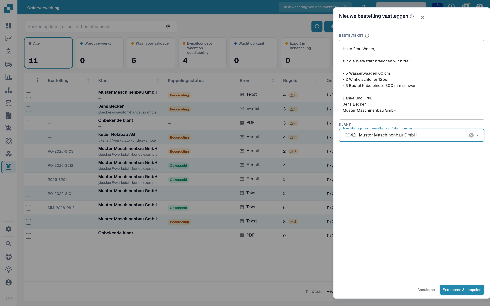<figcaption><p>Plak een bestelling van een klant en kies de klant.</p></figcaption></figure>

### Nieuwe bestelling

Met **Nieuwe bestelling** stelt u een bestelling handmatig samen uit uw artikelcatalogus: kies de klant en het bezorgadres, voeg de artikelen en hoeveelheden toe en klik daarna op **Goedkeuren en exporteren**.

## De lijst van Orderverwerking

Open **Orderverwerking** in de zijbalk. De lijst toont elke bestelling met de klant, de bron (E-mail, Tekst, Handmatig), het aantal posities, het tijdstip van ontvangst, de status en de koppelingsstatus. Een klein waarschuwingsteken naast het aantal posities laat zien hoeveel posities nog een beslissing nodig hebben. Klik op een rij om de bestelling te openen.

<figure>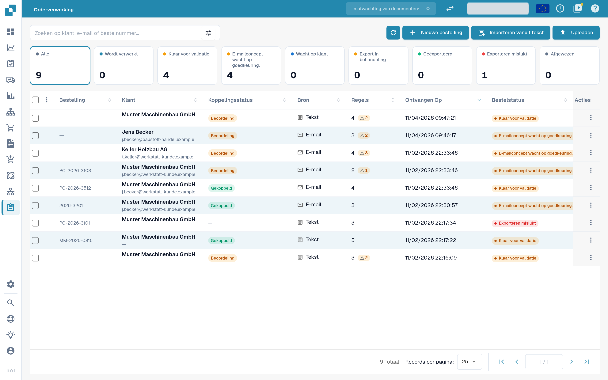<figcaption><p>De lijst van Orderverwerking met de statuskaarten.</p></figcaption></figure>

De **statuskaarten** boven de lijst tellen de bestellingen per status. Klik op een kaart om alleen die bestellingen te tonen; **Alle** toont alles.

| Status | Betekenis |
| --- | --- |
| **Wordt verwerkt** | De bestelling wordt gelezen of voorbereid. U hoeft nog niets te doen. |
| **Klaar voor validatie** | Ingelezen en wacht op een medewerker: controleer de posities of keur de bestelling goed. |
| **E-mailconcept wacht op goedkeuring.** | Er is een e-mail aan de klant opgesteld die op uw goedkeuring wacht. |
| **Wacht op klant** | Er is een verduidelijking verzonden; het antwoord is nog niet binnen. |
| **Export in behandeling** | Goedgekeurd, maar nog niet aan het ERP overgedragen. |
| **Geëxporteerd** | Overgedragen aan het ERP. |
| **Exporteren mislukt** | Het ERP heeft de overdracht geweigerd. Probeer het opnieuw nadat u de oorzaak heeft verholpen. |
| **Afgewezen** | Afgewezen of herkend als duplicaat. Er volgt geen verdere actie. |

De kolom **Koppelingsstatus** toont **Beoordeling** als een positie, een verplicht kopveld of het bezorgadres nog een beslissing nodig heeft, en **Gekoppeld** als alles is opgelost.

Terwijl de AI-agent, een nieuwe koppeling of een antwoord van de klant met een bestelling bezig is, toont de status **Agent aan het werk** met een draaiende pijl. De bestelling is vergrendeld tot het werk klaar is; de lijst wordt vanzelf bijgewerkt.

**Zoeken en filteren:** typ een klant, een e-mailadres of een bestelnummer in het zoekveld. Met het filterpictogram in het zoekveld filtert u op **Bron** (*E-mail* of *Handmatig*).

Het menu aan het einde van een rij biedt **Logboeken** (elke stap van de agent, de gebruikers en het systeem, plus de besluitgeschiedenis: wie wat heeft bevestigd of gewijzigd) en **Verwijderen**.

## Een nieuwe bestelling controleren

### Het koppelingsscherm

<figure>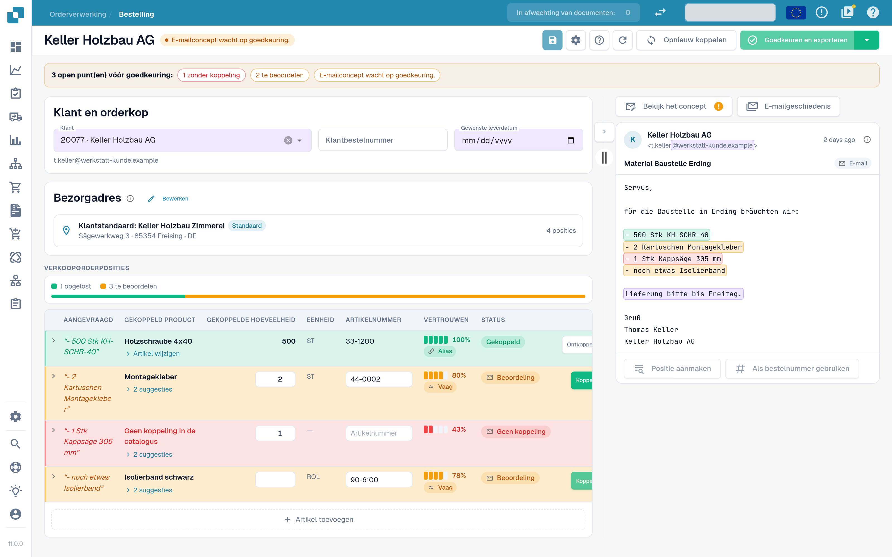<figcaption><p>Het koppelingsscherm: de bestelgegevens links, de e-mail van de klant rechts.</p></figcaption></figure>

* **Bovenste balk**: klant, status, de orderwaarde (alleen met ERP-prijzen) en de acties **Opslaan**, **Legenda**, **Vernieuwen**, **Opnieuw koppelen** en **Goedkeuren en exporteren**.
* **Open punten**: direct onder de bovenste balk staat alles wat de goedkeuring nog blokkeert, bijvoorbeeld *Klant ontbreekt*, *Bestelnummer ontbreekt* of *2 te beoordelen*. Klik op een punt om ernaartoe te gaan.
* **Klant en orderkop**: klant, klantbestelnummer en gewenste leverdatum.
* **Bezorgadres**: waar de bestelling naartoe gaat. Als de klant een standaardadres heeft, wordt dat automatisch gebruikt (*Klantstandaard: …* met het label **Standaard**); met **Bewerken** wijzigt u het. Posities kunnen ook naar verschillende adressen gaan.
* **Posities**: één rij per besteld artikel met de tekst van de klant, het gekoppelde artikel, de hoeveelheid, de eenheid en de status. Boven de tabel toont een balk hoeveel posities zijn opgelost en hoeveel nog moeten worden beoordeeld.
* **Bron** (rechts): de e-mail van de klant of de geplakte tekst. Posities zijn gemarkeerd in groen, oranje of rood, net als hun status, bezorgadressen in blauw en kopwaarden (klant, bestelnummer, datum) in violet. Klik op een markering om naar de positie te gaan. Met de pijl op de scheidingslijn verbergt of toont u de e-mail; sleep de scheidingslijn om de breedte te wijzigen. **E-mailgeschiedenis** toont elke e-mail van deze bestelling.

De **Legenda** (knop met het vraagteken) legt elke kleur, status en koppelingsmethode uit.


Niets wat u op dit scherm wijzigt, wordt opgeslagen voordat u op **Opslaan** klikt (het diskettepictogram; een rode stip betekent niet-opgeslagen wijzigingen). Ctrl+S / Cmd+S slaat ook op. Als u de bestelling met niet-opgeslagen wijzigingen verlaat, vraagt DocBits of u ze wilt opslaan of verwerpen.


### Statussen van posities en koppelingsmethoden

| Status | Betekenis |
| --- | --- |
| **Gekoppeld** | Automatisch gekoppeld (via een geleerd klantartikelnummer of het exacte artikelnummer) of bevestigd door een medewerker. |
| **Beoordeling** | Er is een suggestie, maar die moet worden gecontroleerd. |
| **Geen koppeling** | Geen enkel artikel uit de artikelstamgegevens lijkt genoeg om te worden voorgesteld. |
| **In behandeling** | Nog niet gekoppeld. |
| **Genegeerd** | Uitgesloten van de export. |

| Koppelingsmethode | Betekenis |
| --- | --- |
| **Alias** | Het eigen artikelnummer van deze klant is eerder aan uw artikel gekoppeld; gaat automatisch door. |
| **Exact** | Het artikelnummer in de bestelling komt exact overeen met de artikelstamgegevens; gaat automatisch door. |
| **Vaag** | Alleen een vergelijkbare omschrijving; moet altijd worden beoordeeld. |
| **Handmatig** | Gekozen of bevestigd door een medewerker. |
| **Verduidelijking** | Overgenomen uit het antwoord van de klant. |

Wanneer u een artikel voor een klantartikelnummer bevestigt, **leert DocBits dit als alias** voor deze klant: de volgende bestelling met hetzelfde nummer wordt automatisch gekoppeld. Een geleerde alias kunt u verwijderen via het menu van de positie (**Verwijder geleerde alias**).

### Posities in Beoordeling

1. Klik op de positie om die te openen. **Besteld door de klant** toont hoeveelheid, eenheid, klantartikelnummer en omschrijving zoals de klant ze heeft geschreven.
2. **Voorgestelde koppelingen** toont de best passende artikelen met artikelnummer, eenheid, koppelingsmethode en betrouwbaarheid.
3. De beste suggestie is al voorgeselecteerd (**Gekozen**). Is een ander artikel juist, klik dan bij dat artikel op **Gebruik dit**, of zoek het via **Of zoek in de catalogus.** De rode **x** verwijdert de keuze.
   Een positie heeft een **hoeveelheid** nodig voordat ze kan worden gekoppeld: zonder hoeveelheid zijn **Gebruik dit** en **Koppelen** grijs (*Voer eerst een hoeveelheid in; een positie zonder hoeveelheid kan niet worden gekoppeld.*). Typ eerst de hoeveelheid in de rij.
4. Een pop-up vergelijkt wat er is besteld met het gekozen artikel. Controleer dit en klik op **Koppeling bevestigen**.
5. Klik op **Opslaan**.

<figure>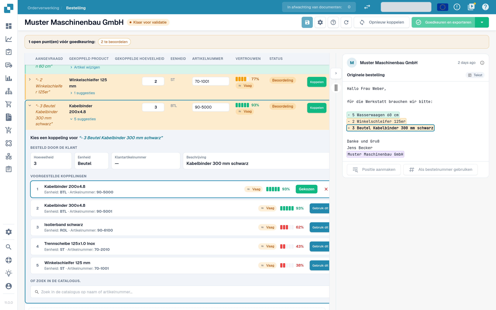<figcaption><p>Een positie in Beoordeling: vergelijk wat de klant heeft besteld met de suggesties.</p></figcaption></figure>

<figure>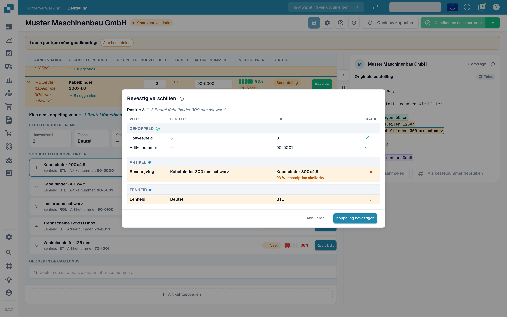<figcaption><p>Bevestig verschillen vergelijkt wat de klant heeft besteld met het gekozen artikel; hier verschillen de omschrijving en de eenheid. De tekst ‘description similarity’ is in het product nog niet vertaald.</p></figcaption></figure>

Een positie waarvoor al een suggestie is gekozen, kunt u direct in de rij bevestigen met **Koppelen**. Het menu aan het einde van een rij biedt meer: **Stuur de klant een e-mail over deze positie.**, **Eigen leverdatum…**, **Eigen bezorgadres…**, **Negeer de regel** (wordt niet geëxporteerd) en **Verwijder regel**.

### Verschillen in hoeveelheid en prijs

* **Hoeveelheid:** u kunt de hoeveelheid van een positie wijzigen. Wijkt die af van wat de klant heeft besteld, dan wordt ze in oranje getoond en moet ze worden bevestigd: open de positie, kies het artikel, en de pop-up **Bevestig verschillen** toont de hoeveelheid. Voeg desgewenst een opmerking toe en klik op **Bevestigen**. De bestelling wordt met de bevestigde hoeveelheid geëxporteerd.
* **Prijs** (alleen met ERP-prijzen): wijkt de prijs van de klant meer dan de toegestane tolerantie af van de nettoprijs in het ERP, dan wordt de prijs in oranje getoond met de hint *De prijs verschilt.* Klik in de rij op **Koppelen**; de pop-up toont beide prijzen, het verschil en de tolerantie. Klik op **Bevestigen** om de ERP-prijs te accepteren, of stel de klant een vraag (zie [De klant een vraag stellen](#de-klant-een-vraag-stellen)). Lijkt de prijs van de klant een prijs per 10, 100 of 1000 te zijn, dan biedt de pop-up aan om de prijsbasis met één klik in te stellen.

<figure>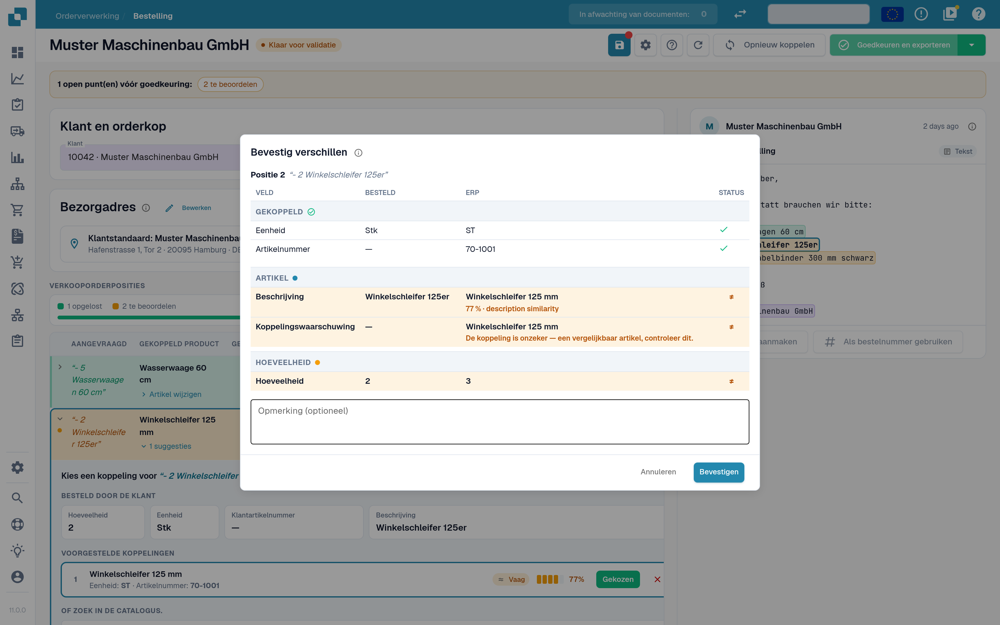<figcaption><p>Een hoeveelheid die afwijkt van de bestelling wordt bevestigd met een optionele opmerking. De tekst ‘description similarity’ is in het product nog niet vertaald.</p></figcaption></figure>

Geeft het ERP geen prijs voor een positie, dan toont die positie **Geen ERP-prijs**, met de reden als u erover beweegt, en een knop **Opnieuw proberen**. Dit blokkeert de bestelling niet.

### Klant niet herkend

Is het e-maildomein van de afzender nog niet bekend, dan toont de bestelling het open punt **Klant ontbreekt**. Kies de klant in **Klant en orderkop**. DocBits biedt dan aan om het domein van de afzender te onthouden:

* **Wijs een e-maildomein toe**: *Toekomstige e-mails van @domein worden automatisch toegewezen aan* de gekozen klant. Klik op **Bevestigen**; dit wordt samen met uw andere wijzigingen opgeslagen wanneer u op **Opslaan** klikt. **Annuleren** maakt de keuze van de klant ongedaan.
* Hoort het domein al bij een andere klant, kies dan **Behoud …** (toekomstige e-mails blijven bij de huidige klant, deze bestelling krijgt toch de nieuwe klant) of **Toewijzen aan …** (toekomstige e-mails gaan naar de nieuwe klant). Op de knoppen staat de naam van de betreffende klant.

<figure>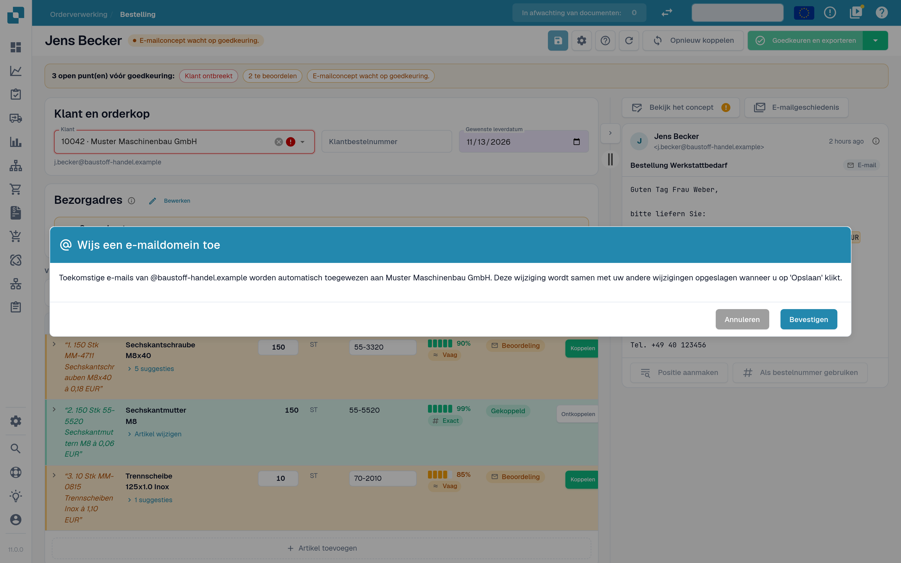<figcaption><p>Bij het toewijzen van een klant kunt u ook het e-maildomein van de afzender toewijzen.</p></figcaption></figure>

<figure>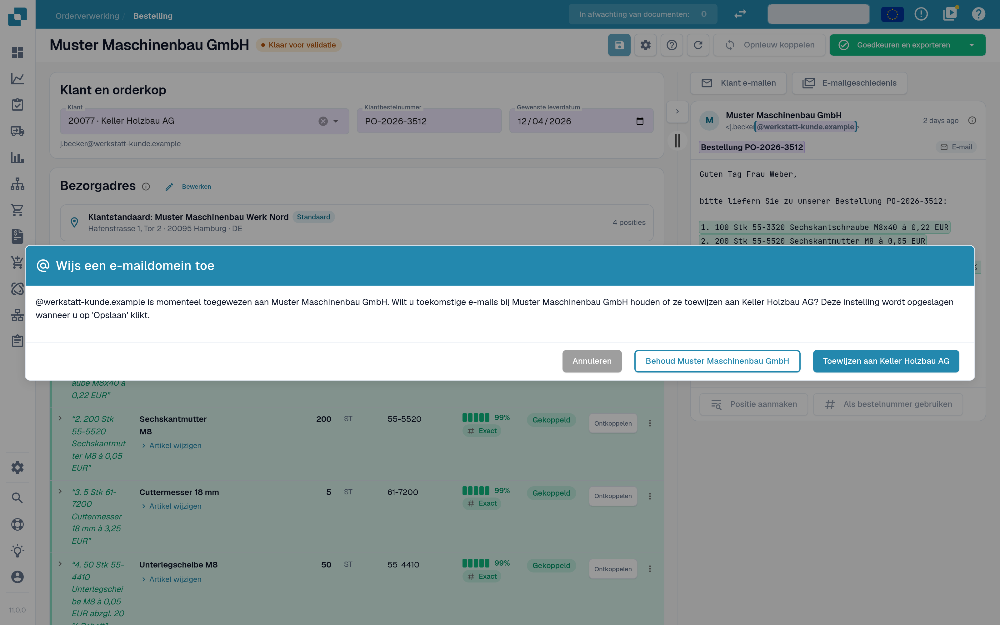<figcaption><p>Het domein hoort al bij een andere klant: behoud het of verplaats het.</p></figcaption></figure>

Openbare maildomeinen (zoals gmail.com) worden nooit aan een klant toegewezen.

### Opnieuw koppelen

**Opnieuw koppelen** in de bovenste balk koppelt alle open posities nog een keer, bijvoorbeeld nadat er nieuwe artikelen aan de artikelstamgegevens zijn toegevoegd of nadat u de klant heeft gewijzigd. Bevestigde en genegeerde posities blijven ongewijzigd. Een melding laat zien hoeveel posities opnieuw zijn gekoppeld.

De knop is grijs wanneer koppelen niets kan doen; beweeg erover om de reden te zien:

| Tooltip | Reden |
| --- | --- |
| *Alle posities zijn al gekoppeld, bevestigd of genegeerd.* | Er staat niets meer open. |
| *Het koppelen wacht terwijl de agent de verduidelijking schrijft.* | Wacht tot het concept er is. |
| *De bestelling is al overgedragen of afgesloten.* | Goedgekeurde, geëxporteerde of afgewezen bestellingen kunnen niet opnieuw worden gekoppeld. |
| *De bestelling wordt nog ingelezen.* | Wacht tot het inlezen klaar is. |

Opnieuw koppelen kan ook terwijl er een vraag aan de klant openstaat: een niet-verzonden concept blijft bewaard (is alles waarnaar het vraagt opgelost, dan meldt het concept *Er valt niets meer te vragen*); een goedgekeurd maar niet verzonden concept wordt weer een concept.

## Een gemiste of verkeerde positie corrigeren

Soms zet het inlezen twee artikelen in één positie, splitst het één artikel in twee posities of mist het een artikel dat in een zin staat. Corrigeer dit direct in de e-mail of de geplakte tekst:

1. **Selecteer de tekst** van het artikel in de besteltekst rechts.
2. Klik onder de tekst op **Positie aanmaken**.
3. De pop-up toont **Voor → Na**. Controleer dit en klik op **Bevestigen**.
4. Klik op **Opslaan**. De nieuwe posities krijgen nieuwe nummers, worden automatisch gekoppeld en in de tekst gemarkeerd.

Wat er gebeurt, hangt af van wat u selecteert:

| U selecteert … | Resultaat |
| --- | --- |
| Tekst die **nog geen positie** is | **Nieuwe positie**: de selectie wordt een nieuwe positie. |
| **Een deel van een positie** (bijvoorbeeld het tweede van twee artikelen op één regel) | **Splitsen**: de positie wordt verwijderd en vervangen door één positie per artikel. |
| **Twee of meer aangrenzende posities volledig** | **Samenvoegen**: ze worden één positie. |
| Eén positie **plus andere tekst** | De positie wordt **vervangen** door de geselecteerde tekst. |
| Een positie **precies zoals ze is** | Er gebeurt niets: *Deze tekst is al positie n.* |

<figure>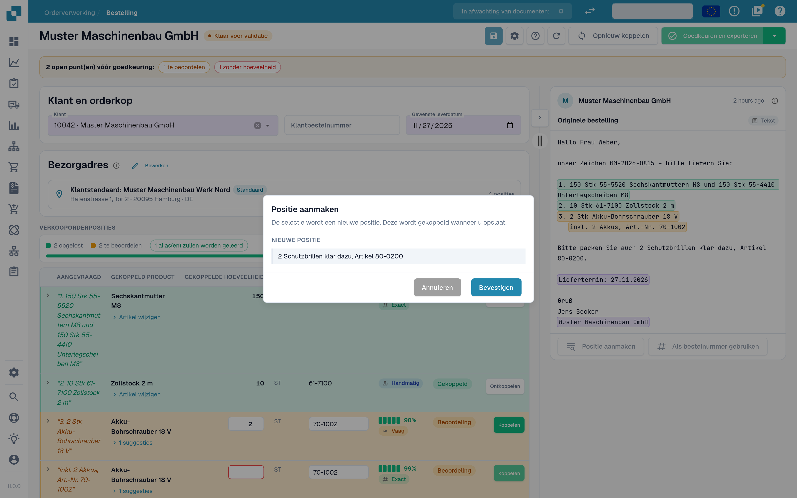<figcaption><p>Een positie aanmaken die bij het inlezen is gemist.</p></figcaption></figure>

<figure><figcaption><p>Een positie met twee artikelen splitsen.</p></figcaption></figure>

<figure>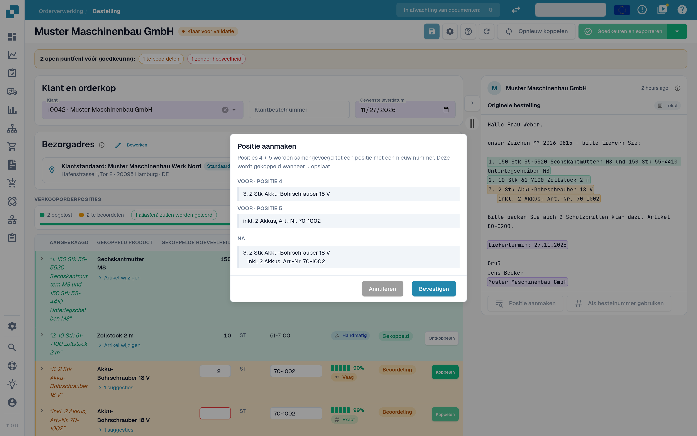<figcaption><p>Twee posities die bij elkaar horen samenvoegen.</p></figcaption></figure>

<figure>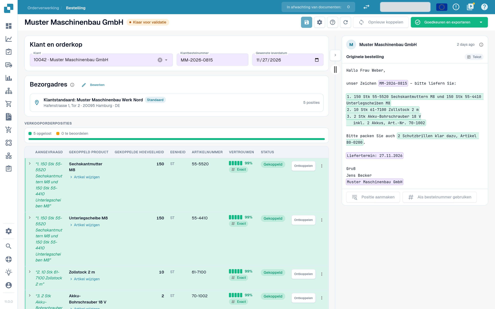<figcaption><p>Na Opslaan zijn de nieuwe posities gekoppeld en in de tekst gemarkeerd.</p></figcaption></figure>

### Een positie splitsen waarover al is beslist

Een positie die is **bevestigd** of **genegeerd**, een **eigen bezorgadres, leverdatum of prijs** heeft, een **antwoord van de klant** bevat of **door een medewerker is bewerkt**, kan toch worden gesplitst. Ze wordt dan **opgeheven**: elk deel wordt een nieuwe positie die opnieuw uit de eigen tekst wordt gelezen en gekoppeld. Alle nieuwe posities behouden het bezorgadres en de leverdatum en moeten opnieuw worden beoordeeld; open punten van de oude positie gaan naar de eerste nieuwe positie. De pop-up toont precies wat met de oude positie verloren gaat, bijvoorbeeld de bevestiging van het artikel, een geaccepteerde hoeveelheid of ERP-prijs, een antwoord van de klant of een bewerking door een medewerker. De geschiedenis van de bestelling bewaart de oude waarden.

<figure>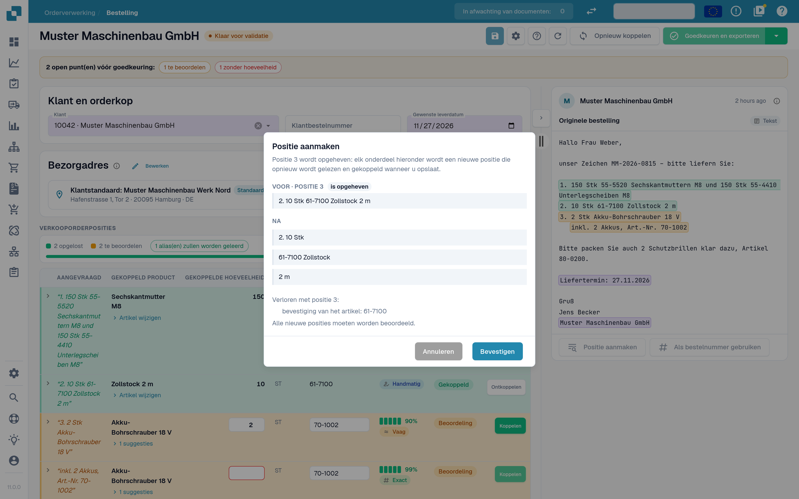<figcaption><p>Wie een positie splitst waarover al is beslist, heft die op; de pop-up toont wat verloren gaat.</p></figcaption></figure>

Zulke posities worden nooit **samengevoegd**. Een positie met **niet-opgeslagen wijzigingen** kan niet worden gesplitst: sla de wijzigingen eerst op of verwerp ze.

### Wanneer er niets verandert

Omvat de selectie slechts een deel van een positie plus tekst daarbuiten, of raakt ze meerdere posities zonder ze volledig te omvatten, dan verandert er niets en legt de pop-up uit waarom. Selecteer tekst binnen één positie, of selecteer hele posities om ze samen te voegen. Zijn twee posities uit dezelfde tekstregel gelezen, dan meldt de pop-up welke positie ook naar de geselecteerde tekst verwijst en zoals ze is blijft.

U kunt altijd handmatig een positie toevoegen met **Artikel toevoegen** onder de positietabel, of de velden van een positie in de tabel bewerken.

## De orderkop corrigeren

### Bestelnummer uit de tekst

Is het bestelnummer van de klant niet herkend (bijvoorbeeld "unser Zeichen MM-2026-0815" zonder label), selecteer dan **alleen het bestelnummer** in de tekst en klik op **Als bestelnummer gebruiken**. Na **Opslaan** staat het nummer in **Klantbestelnummer** en is het in de tekst in violet gemarkeerd, zodat iedereen ziet waar het vandaan komt.

<figure>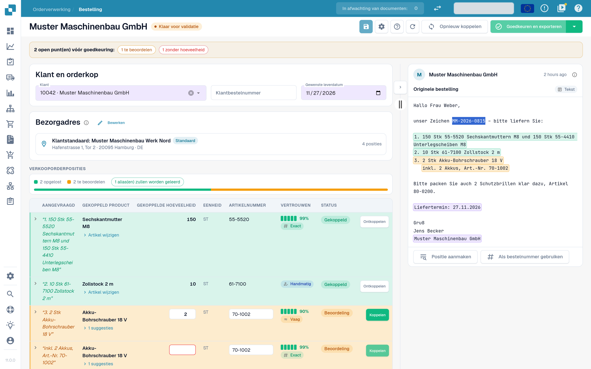<figcaption><p>Markeer het bestelnummer in de tekst.</p></figcaption></figure>

### Bestelnummer uit het onderwerp

Veel klanten zetten het bestelnummer alleen in het onderwerp ("AW: 4711"). U kunt het ook in de **onderwerpregel** van de e-mail selecteren. In het onderwerp is alleen **Als bestelnummer gebruiken** beschikbaar; posities worden uit de besteltekst aangemaakt.

U kunt het bestelnummer en de leverdatum ook altijd direct invoeren in **Klant en orderkop**.

## De klant een vraag stellen

Als iets alleen door de klant kan worden beantwoord (een onbekend artikel, een onduidelijke hoeveelheid of eenheid, een ontbrekend bestelnummer of bezorgadres, een prijsverschil), stuurt u een vraag per e-mail. De e-mail wordt verzonden in de conversatie van de oorspronkelijke bestelling, en het antwoord komt terug bij dezelfde bestelling. Dit is alleen beschikbaar voor **e-mailbestellingen**.

### Een vraag starten

1. Klik boven de e-mail op **Klant e-mailen** (of op **Stuur de klant een e-mail over deze positie.** in het menu van een positie).
2. Kies onder **Reden** waarom u de vraag stelt (of laat het leeg en laat de assistent beslissen), controleer de **Ontvangers** (voeg zo nodig **Cc** toe) en vink de posities aan onder **Referentieregels**.
3. Kies hoe:
   * **Automatisch verzenden**: klik op **Overhandigen aan de agent**. De AI-agent schrijft de e-mail. Er wordt niets verzonden voordat een medewerker het concept heeft goedgekeurd.
   * **Handmatig verzenden**: schrijf het onderwerp en de tekst zelf en klik op **Versturen**.

Terwijl de agent schrijft, toont de knop boven de e-mail **Concept in bewerking** en wacht **Opnieuw koppelen**.

Afhankelijk van de instellingen kan de agent ook zelf een vraag opstellen wanneer een bestelling met problemen binnenkomt.

Zolang er een concept is, heet de knop boven de e-mail **Bekijk het concept** in plaats van **Klant e-mailen**. Zodra de bestelling compleet is, blijft **Bekijk het concept** beschikbaar zonder het gele **!**: u kunt het concept nog steeds verzenden of weggooien. **Goedkeuren en exporteren** verwijdert een niet-verzonden concept.

### Het concept controleren en verzenden

Wanneer het concept klaar is, heeft de bestelling de status **E-mailconcept wacht op goedkeuring.** en toont de knop **Bekijk het concept** een geel **!**. Klik erop om **Verduidelijking met de klant** te openen:

* **Weggooien**: het concept verwijderen; er wordt niets verzonden.
* **Terug naar agent**: vertel de agent wat er moet veranderen; de agent schrijft een nieuw concept.
* **Bewerken**: onderwerp of tekst zelf wijzigen.
* **Goedkeuren en verzenden**: de e-mail naar de klant sturen.

<figure>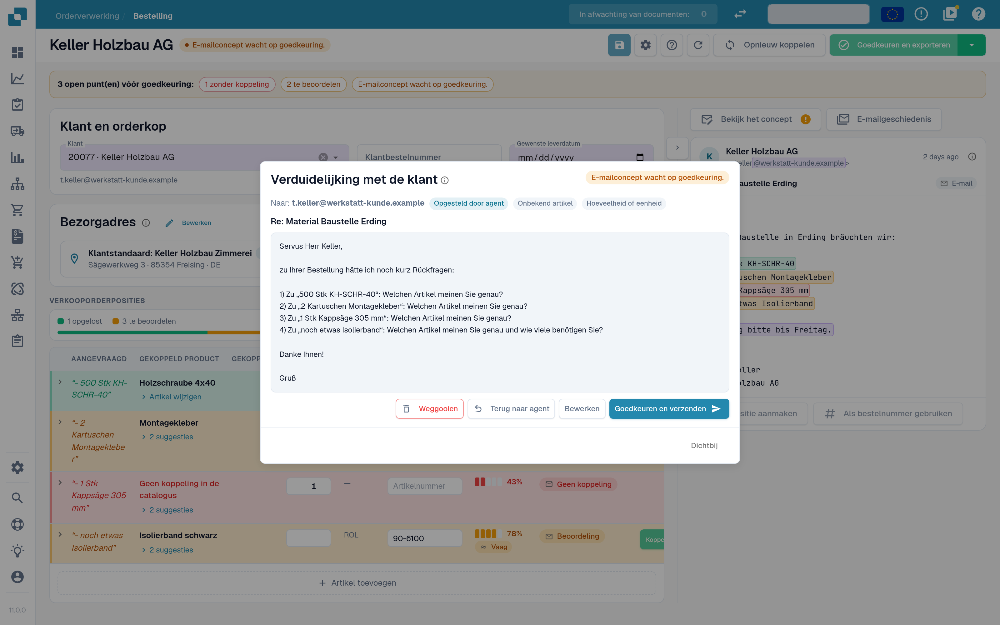<figcaption><p>Het concept van de agent wacht op uw goedkeuring. De knop rechtsonder heet in het product nog ‘Dichtbij’; hij sluit de pop-up (Sluiten).</p></figcaption></figure>

### Wachten op het antwoord

Na het verzenden heeft de bestelling de status **Wacht op klant** en staat op de knop boven de e-mail **Wacht op klant**. Wanneer de klant antwoordt, leest de agent het antwoord en verwerkt het in de bestelling (de bestelling is kort vergrendeld met *Klantreactie lezen*); het antwoord verschijnt in het e-mailvenster en in **E-mailgeschiedenis**. Posities die u al heeft bevestigd, worden niet overschreven. Wijzigt de klant zo'n positie, dan wordt die gemarkeerd met *Gewijzigd door een e-mail van de klant*, zodat u ze opnieuw kunt controleren.

Heeft de klant telefonisch of in een andere e-mail geantwoord, open dan de verduidelijking en klik op **Sluit de verduidelijking**. DocBits wacht dan niet langer; een antwoord dat later binnenkomt, wordt getoond maar niet verwerkt. Met **Nieuwe e-mail** stelt u een volgende vraag.

### Als het verzenden mislukt

Kon een goedgekeurde e-mail niet worden verzonden, dan toont de bestelling het open punt **E-mail niet verzonden — opnieuw verzenden**. Open de verduidelijking: daar staat de reden. Klik op **Opnieuw verzenden**.

Is de bestel-e-mail niet via een van uw importmailboxen binnengekomen (bijvoorbeeld omdat ze op een andere manier naar DocBits is doorgestuurd), dan is er geen mailbox om vanuit te antwoorden en kan de e-mail niet worden verzonden. Stel een importmailbox in voor dit adres, of neem rechtstreeks contact op met de klant en gooi het concept weg.

<figure>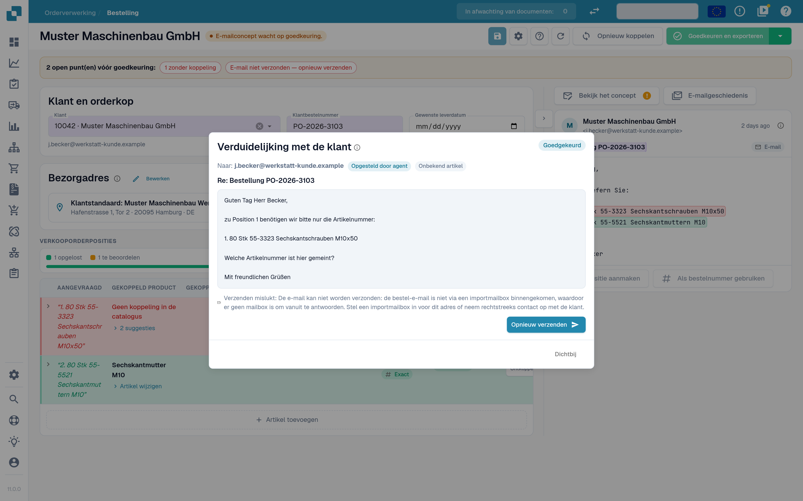<figcaption><p>Verzenden mislukt: de verduidelijking toont de reden (hier: geen importmailbox om vanuit te antwoorden) en biedt Opnieuw verzenden. De knop ‘Dichtbij’ sluit de pop-up (Sluiten).</p></figcaption></figure>

## Goedkeuren en overdragen

**Goedkeuren en exporteren** in de bovenste balk is beschikbaar zodra elk open punt is opgelost: elke positie gekoppeld, bevestigd of genegeerd, de klant toegewezen, en de verplichte kopvelden en het bezorgadres aanwezig. Zolang er iets ontbreekt, beweegt u over de grijze knop om de lijst te zien.

<figure>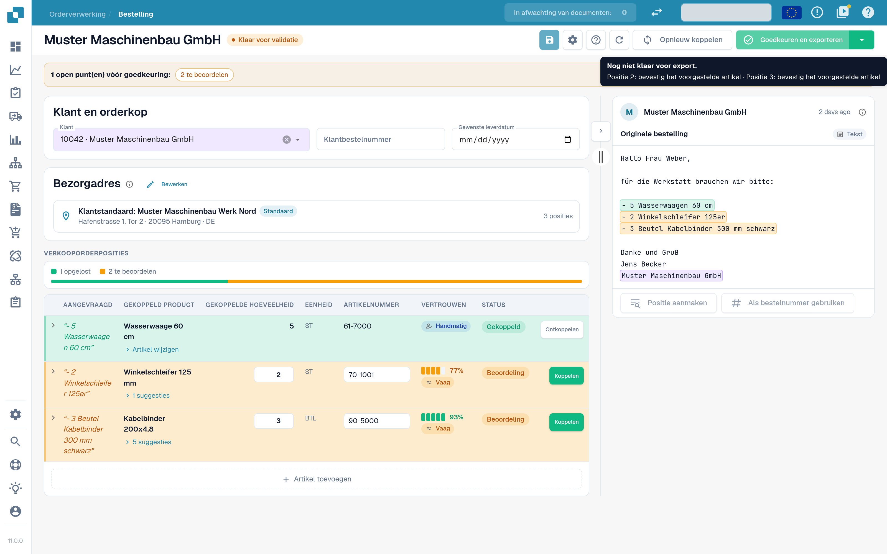<figcaption><p>Goedkeuren en exporteren blijft uitgeschakeld tot alle open punten zijn opgelost; als u de muis erop houdt, ziet u wat nog ontbreekt.</p></figcaption></figure>

1. Klik op **Goedkeuren en exporteren**.
2. De pop-up vat klant, aantal posities, bezorgadressen (inclusief het standaardadres van de klant) en klantbestelnummer samen (en de orderwaarde, met ERP-prijzen). Ook staat erin wat er met een openstaande vraag gebeurt: een niet-verzonden concept wordt verwijderd, een verzonden vraag wordt gesloten. **Er wordt niets naar de klant verzonden.**
3. Klik op **Goedkeuren en exporteren**. Hiermee wordt de verkooporder in het ERP aangemaakt.

<figure>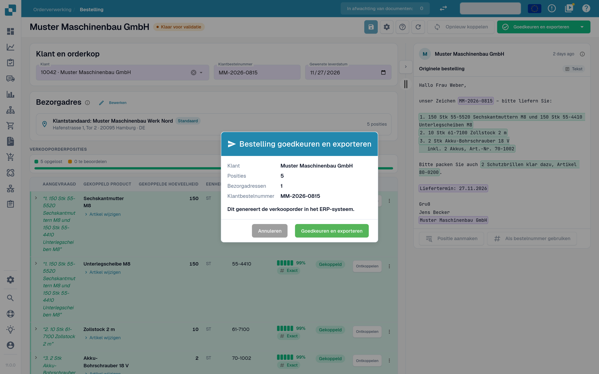<figcaption><p>Laatste controle voordat de bestelling naar het ERP gaat.</p></figcaption></figure>

Daarna heeft de bestelling de status **Geëxporteerd** en toont ze het ordernummer uit het ERP. Mislukt de overdracht, dan is de status **Exporteren mislukt** en toont een rode banner de reden in uw taal, bijvoorbeeld dat het ERP de bestelling heeft geweigerd, dat het niet bereikbaar was of dat er nog geen ERP-export is ingesteld (dan heeft niets het ERP bereikt; een beheerder stelt de export in onder **Instellingen › Exporteren** met het documenttype **Verkooporder (Orderverwerking)**, zie *ERP-export instellen (beheerders)*). Beheerders zien in de banner bovendien de link **Instellingen ERP-export openen**; na een bevestiging opent die de instellingen van Orderverwerking, waarvan het onderdeel **ERP-export** de huidige status toont. Verhelp de oorzaak en klik op **Export opnieuw proberen**.

<figure>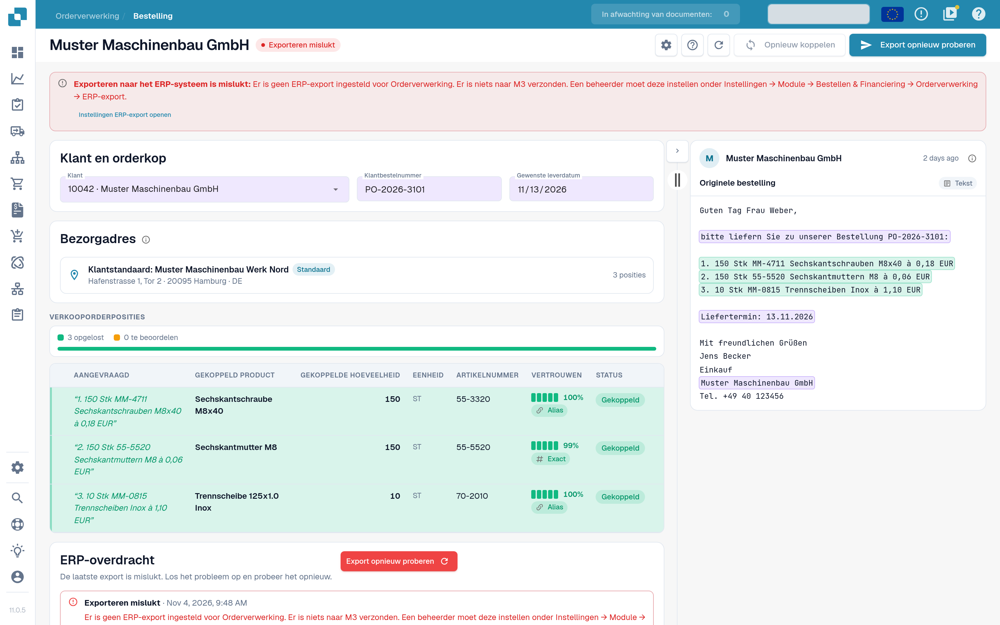<figcaption><p>Mislukt de overdracht aan het ERP, dan toont de banner de reden; hier is geen ERP-export ingesteld en zien beheerders de link Instellingen ERP-export openen. Verhelp de oorzaak en klik op Export opnieuw proberen.</p></figcaption></figure>

### Een bestelling afwijzen

Om een bestelling te stoppen (bijvoorbeeld een duplicaat of geen echte bestelling), opent u de pijl naast **Goedkeuren en exporteren** en klikt u op **Afwijzen**. Voeg desgewenst een reden toe. Er wordt niets aan het ERP overgedragen.

Herkent DocBits dat een bestelling mogelijk een **duplicaat** van een eerdere bestelling is (dezelfde klant en hetzelfde bestelnummer, of zeer vergelijkbare posities), dan biedt een banner **Afwijzen als duplicaat**, **Duplicaten bekijken** en **Ga toch door**.
