# Entrada de Pedidos

## Visão geral

A **Entrada de Pedidos** lê os pedidos que seus clientes enviam — por e-mail ou como texto colado — e os prepara como pedidos de venda para o seu ERP. O DocBits identifica o cliente, lê cada posição, faz a correspondência com um item do seu cadastro de itens e mostra o que ainda precisa de uma decisão. Você verifica o pedido, completa o que falta, consulta o cliente quando algo não está claro e aprova o pedido. Só então o pedido de venda é criado no ERP.

```
E-mail do cliente / texto colado
        │
        ▼
  Ler posições ──► Corresponder aos seus itens ──► Você verifica e decide ──► Aprovar e exportar ──► Pedido de venda no ERP
                                                         │
                                                         └──► Consultar o cliente (e-mail) ──► a resposta é aplicada
```

**Exemplo:** a Muster Maschinenbau GmbH envia por e-mail "150 Stk MM-4711 Sechskantschrauben M8x40". O DocBits reconhece o cliente pelo endereço de e-mail do remetente, sabe que o número MM-4711 desse cliente corresponde ao seu item 55-3320 e mostra a posição como **Correspondido**. Uma segunda posição, "2 Winkelschleifer 125er", não tem número de item; por isso o DocBits sugere itens semelhantes e coloca a posição em **Revisão**. Você escolhe o item certo, clica em **Aprovar e exportar** e o pedido está no ERP.


**Limitações atuais**

* **Pedidos a partir de arquivos PDF ainda não estão disponíveis.** Use pedidos por e-mail ou **Importar do texto**.
* Os **preços** só são exibidos e verificados quando o seu ERP (Infor M3) retorna preços para o cliente. Sem eles, o pedido é transferido mesmo assim — o ERP define os preços.
* **Consultas ao cliente** só podem ser enviadas para pedidos que chegaram por e-mail.


## Como ativar

A Entrada de Pedidos requer a assinatura **AI Workforce**.

1. Acesse **Configurações › Módulo › Ordem e Finanças** e abra a seção **Entrada de Pedidos**.
2. Ative **Ativar painel de controle de entrada de pedidos**. "Entrada de Pedidos" passa a aparecer na barra lateral.
3. Dê à função dos atendentes acesso à Entrada de Pedidos em **Configurações › Grupos e Permissões** (administradores sempre têm acesso).

<figure>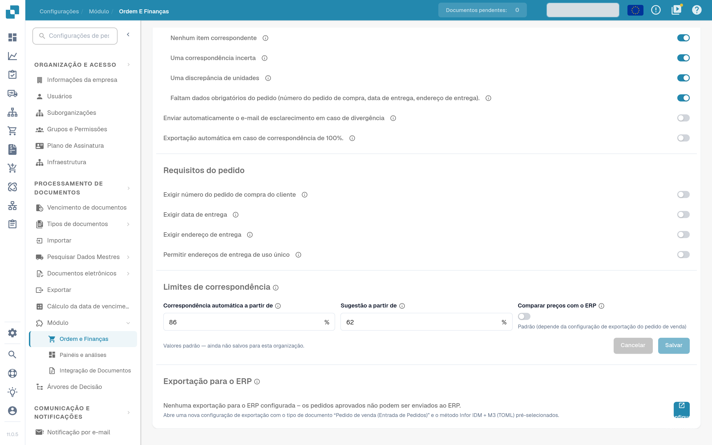<figcaption><p>Configurações da Entrada de Pedidos em Settings › Module › Order &#x26; Finance; no fim, a seção ERP export, aqui ainda sem exportação para o ERP.</p></figcaption></figure>

Na mesma seção, um administrador define como o módulo funciona:

| Grupo | Configuração | O que faz |
| --- | --- | --- |
| **Automação** | **Redigir automaticamente um e-mail de resposta em caso de divergência** | Ativada por padrão: o agente redige sozinho um e-mail de esclarecimento nos casos marcados abaixo. Um funcionário revisa o e-mail, a menos que o envio automático esteja ativado. |
| | **Redigir um e-mail de esclarecimento para posições com** … | Quais problemas fazem o agente redigir uma pergunta ao cliente: **Nenhum item correspondente**, **Uma correspondência incerta**, **Uma discrepância de unidades**, **Faltam dados obrigatórios do pedido (número do pedido de compra, data de entrega, endereço de entrega)**. Uma quantidade ausente é sempre perguntada. |
| | **Enviar automaticamente o e-mail de esclarecimento em caso de divergência** | Desativada (recomendado): cada e-mail redigido aguarda a aprovação de um funcionário. |
| | **Exportação automática em caso de correspondência de 100%** | Pedidos em que todas as posições foram correspondidas exatamente ou por um número de item do cliente aprendido, e em que não falta mais nada, vão para o ERP sem aprovação. |
| **Requisitos do pedido** | **Exigir número do pedido de compra do cliente**, **Exigir data de entrega**, **Exigir endereço de entrega** | Quando ativada, um pedido sem esse valor recebe um ponto em aberto e não pode ser aprovado até que o valor seja informado. As três estão desativadas por padrão. |
| | **Permitir endereços de entrega de uso único** | Quando ativada, os atendentes podem digitar um endereço usado somente neste pedido (por exemplo, um canteiro de obras). Quando desativada, só podem ser usados endereços dos dados cadastrais do cliente. |
| **Limites de correspondência** | **Correspondência automática a partir de** (padrão 86 %), **Sugestão a partir de** (padrão 62 %) | Somente números de item exatos e números de item do cliente aprendidos são aceitos automaticamente. Descrições semelhantes são sempre exibidas como sugestões para revisão. |
| | **Comparar preços com o ERP** | Compara o preço líquido do cliente com o preço líquido do ERP. Uma diferença acima da tolerância permitida exige uma decisão; em qualquer caso, o ERP define o preço do pedido. Por padrão, essa opção segue a configuração da exportação para o ERP. |
| **Exportação para o ERP** | *(apenas status)* | Mostra as configurações de exportação do tipo de documento **Pedido de venda (Entrada de Pedidos)** com as quais os pedidos aprovados vão para o ERP, cada uma com **Editar**; uma inativa aparece marcada como **Inativo**. Uma linha de aviso significa que uma configuração ainda usa o tipo de documento de entrada **Entrada de Pedidos – documento recebido**; ela nunca é utilizada. Se não houver nenhuma configuração ativa, a seção mostra *Nenhuma exportação para o ERP configurada – os pedidos aprovados não podem ser enviados ao ERP.* e onde configurá-la. Os administradores configuram a exportação em **Configurações › Exportar** (veja abaixo). |

Os administradores podem abrir essas configurações a partir de qualquer pedido com o botão de **engrenagem** na barra superior.

### Configurar a exportação para o ERP (administradores)

Os pedidos aprovados só chegam ao ERP (Infor M3) por meio de uma configuração de exportação do tipo de documento **Pedido de venda (Entrada de Pedidos)**. Um administrador a configura uma vez:

1. Acesse **Configurações › Exportar** e clique em **Novo**.
2. Informe um **Título da configuração** e escolha como **Tipo de documento** **Pedido de venda (Entrada de Pedidos)**. Ele é oferecido assim que a Entrada de Pedidos estiver ativada; não é necessário ativar o tipo de documento antes.
3. Em **Exportar**, escolha **Infor** e, em **Tipo de Infor**, escolha **Infor IDM + M3 (TOML)**.
4. Envie o **Arquivo da API ION** (`.ionapi`) e o **Arquivo de mapeamento TOML** (`.toml`) da sua conexão com o M3.
5. Clique em **Salvar**. Uma nova configuração fica **Ativo**; só pode haver uma configuração ativa por tipo de documento.

A seção **Exportação para o ERP** das configurações da Entrada de Pedidos mostra então a configuração; **Editar** a abre, e uma inativa aparece marcada como **Inativo**. Uma linha de aviso significa que uma configuração antiga ainda usa o tipo de documento de entrada **Entrada de Pedidos – documento recebido**: ela nunca é utilizada, então abra-a com **Editar** e altere o tipo de documento para **Pedido de venda (Entrada de Pedidos)**. Os pedidos só são exportados a partir da Entrada de Pedidos com **Aprovar e exportar** (ou automaticamente com **Exportação automática em caso de correspondência de 100%.**); os documentos de pedido recebidos nunca são exportados diretamente.

## Receber um pedido

### Por e-mail

Os clientes enviam seus pedidos para a caixa de correio de pedidos da sua organização. O agente de IA lê o e-mail, identifica as posições e cria o pedido na lista. O cliente é reconhecido pelo **domínio do endereço de e-mail do remetente**. Assinaturas, avisos legais e mensagens anteriores citadas não são lidas como posições.

### Importar do texto

Para um pedido que chegou por outro meio (um fax que você digitou, uma mensagem de chat, um texto encaminhado):

1. Na lista da Entrada de Pedidos, clique em **Importar do texto**.
2. Cole o pedido em **Texto de pedido**. Texto livre não é problema — quebras de linha, abreviações e anotações rápidas são tratadas.
3. Escolha o **Cliente** (pesquise por nome, e-mail ou número do cliente). Sem cliente, o pedido é aberto com o ponto em aberto *Cliente ausente*.
4. Clique em **Extrair e corresponder**.

<figure>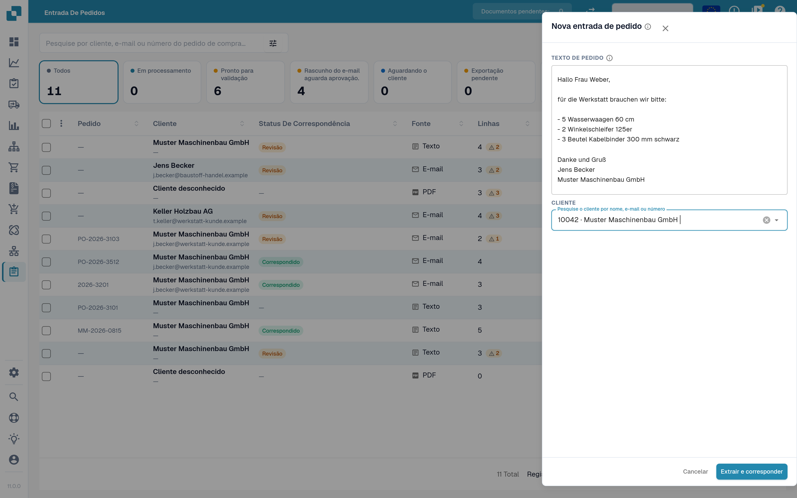<figcaption><p>Cole o pedido de um cliente e escolha o cliente.</p></figcaption></figure>

### Novo pedido

**Novo pedido** monta um pedido manualmente a partir do seu catálogo de itens: escolha o cliente e o endereço de entrega, adicione os itens e as quantidades e clique em **Aprovar e exportar**.

## A lista da Entrada de Pedidos

Abra **Entrada de Pedidos** na barra lateral. A lista mostra cada pedido com o cliente, a fonte (E-mail, Texto, Manual), o número de posições, quando foi recebido, o status e o status de correspondência. Um pequeno sinal de alerta ao lado do número de posições mostra quantas ainda precisam de uma decisão. Clique em uma linha para abrir o pedido.

<figure>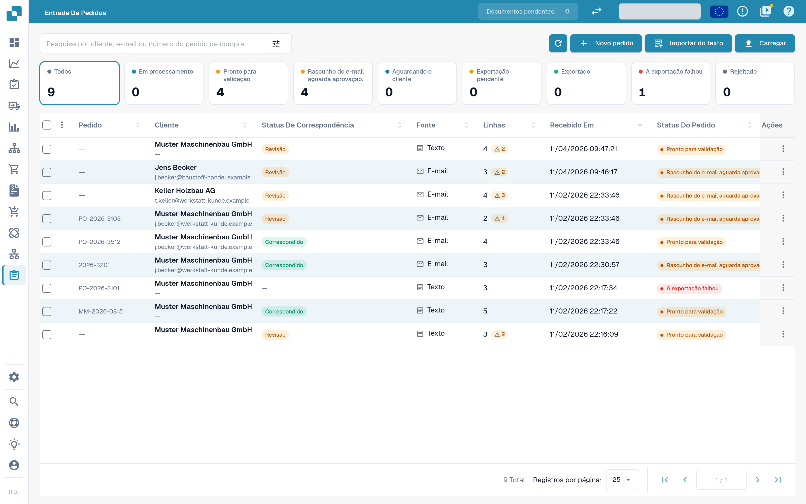<figcaption><p>A lista da Entrada de Pedidos com os cartões de status.</p></figcaption></figure>

Os **cartões de status** acima da lista contam os pedidos por status. Clique em um cartão para mostrar somente esses pedidos; **Todos** mostra tudo.

| Status | Significado |
| --- | --- |
| **Em processamento** | O pedido está sendo lido ou preparado — você ainda não precisa fazer nada. |
| **Pronto para validação** | Lido e aguardando um funcionário: verifique as posições ou aprove o pedido. |
| **Rascunho do e-mail aguarda aprovação** | Um e-mail para o cliente foi redigido e aguarda sua aprovação. |
| **Aguardando o cliente** | Um esclarecimento foi enviado e a resposta ainda está pendente. |
| **Exportação pendente** | Aprovado, mas ainda não transferido ao ERP. |
| **Exportado** | Transferido ao ERP. |
| **A exportação falhou** | O ERP rejeitou a transferência — tente novamente depois de corrigir a causa. |
| **Rejeitado** | Rejeitado ou reconhecido como duplicado — nenhuma ação adicional. |

A coluna **Status de correspondência** mostra **Revisão** quando uma posição, um campo obrigatório do cabeçalho ou o endereço de entrega ainda precisa de uma decisão, e **Correspondido** quando tudo está resolvido.

Enquanto o agente de IA, uma nova correspondência ou uma resposta do cliente está sendo processada em um pedido, o status mostra **Agente em atividade** com uma seta girando. O pedido fica bloqueado até o fim do processamento; a lista se atualiza sozinha.

**Pesquisar e filtrar:** digite um cliente, um endereço de e-mail ou um número de pedido de compra no campo de pesquisa. O ícone de filtro no campo de pesquisa filtra por **Fonte** (*E-mail* ou *Manual*).

O menu no final de uma linha oferece **Registros** (cada etapa do agente, dos usuários e do sistema, além do histórico de decisões: quem confirmou ou alterou o quê) e **Excluir**.

## Verificar um novo pedido

### A tela de correspondência

<figure>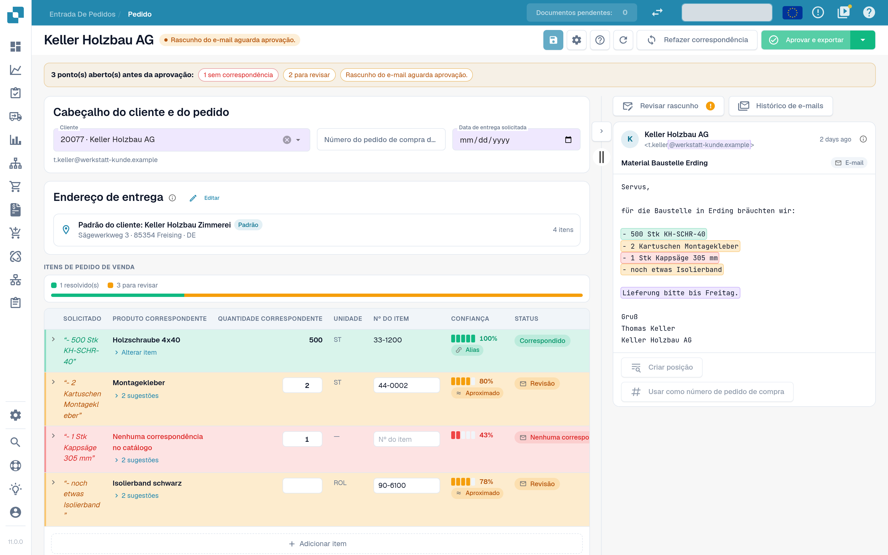<figcaption><p>A tela de correspondência: dados do pedido à esquerda, o e-mail do cliente à direita.</p></figcaption></figure>

* **Barra superior** — cliente, status, o valor do pedido (somente com preços do ERP) e as ações **Salvar**, **Legenda**, **Atualizar**, **Refazer correspondência** e **Aprovar e exportar**.
* **Pontos em aberto** — logo abaixo da barra superior: tudo o que ainda impede a aprovação, por exemplo *Cliente ausente*, *Número do pedido de compra ausente*, *2 para revisar*. Clique em um ponto para ir até ele.
* **Cabeçalho do cliente e do pedido** — cliente, número do pedido de compra do cliente e data de entrega solicitada.
* **Endereço de entrega** — para onde vai o pedido. Se o cliente tiver um endereço padrão, ele é usado automaticamente (*Padrão do cliente: …* com a etiqueta **Padrão**); **Editar** altera o endereço. As posições também podem ir para endereços diferentes.
* **Posições** — uma linha por item pedido, com o texto do cliente, o item correspondido, a quantidade, a unidade e o status. Acima da tabela, uma barra mostra quantas posições estão resolvidas e quantas ainda precisam ser revisadas.
* **Fonte** (à direita) — o e-mail do cliente ou o texto colado. As posições são destacadas em verde, âmbar ou vermelho, de acordo com o status, os endereços de entrega em azul e os valores do cabeçalho (cliente, número do pedido de compra, data) em violeta. Clique em um destaque para ir até a posição. A seta no divisor oculta ou mostra o e-mail; arraste o divisor para alterar a largura. **Histórico de e-mails** lista todos os e-mails deste pedido.

A **Legenda** (botão de ponto de interrogação) explica cada cor, status e método de correspondência.


Nada do que você altera nesta tela é armazenado até você clicar em **Salvar** (o ícone de disquete; um ponto vermelho indica alterações não salvas). Ctrl+S / Cmd+S também salva. Se você sair do pedido com alterações não salvas, o DocBits pergunta se deseja salvá-las ou descartá-las.


### Status das posições e métodos de correspondência

| Status | Significado |
| --- | --- |
| **Correspondido** | Correspondido automaticamente (por um número de item do cliente aprendido ou pelo número de item exato) ou confirmado por um funcionário. |
| **Revisão** | Existe uma sugestão, mas ela precisa ser verificada. |
| **Nenhuma correspondência** | Nenhum item do cadastro de itens é semelhante o suficiente para ser sugerido. |
| **Pendente** | Ainda não correspondido. |
| **Ignorado** | Excluído da exportação. |

| Método de correspondência | Significado |
| --- | --- |
| **Alias** | O número de item próprio deste cliente já foi associado ao seu item antes — passa automaticamente. |
| **Exato** | O número do item no pedido corresponde exatamente ao cadastro de itens — passa automaticamente. |
| **Aproximado** | Apenas descrição semelhante — sempre precisa de revisão. |
| **Manual** | Escolhido ou confirmado por um funcionário. |
| **Esclarecimento** | Obtido da resposta do cliente. |

Quando você confirma um item para um número de item do cliente, o DocBits **aprende essa associação como alias** para esse cliente: o próximo pedido com o mesmo número é correspondido automaticamente. Um alias aprendido pode ser removido pelo menu da posição (**Remover alias aprendido**).

### Posições em Revisão

1. Clique na posição para abri-la. **Pedido pelo cliente** mostra a quantidade, a unidade, o número do item do cliente e a descrição como o cliente os escreveu.
2. **Sugestões de correspondência** lista os melhores itens com o número do item, a unidade, o método de correspondência e o grau de confiança.
3. A melhor sugestão já vem pré-selecionada (**Selecionado**). Se outro item for o correto, clique em **Usar este** nele — ou procure-o em **Ou pesquise no catálogo**. O **x** vermelho remove a seleção.
   Uma posição precisa de uma **quantidade** antes de poder ser correspondida: sem ela, **Usar este** e **Corresponder** ficam desativados (*Insira primeiro uma quantidade — uma posição sem quantidade não poderá ser correspondida.*). Primeiro digite a quantidade na linha.
4. Uma janela compara o que foi pedido com o item escolhido. Verifique e clique em **Confirmar correspondência**.
5. Clique em **Salvar**.

<figure>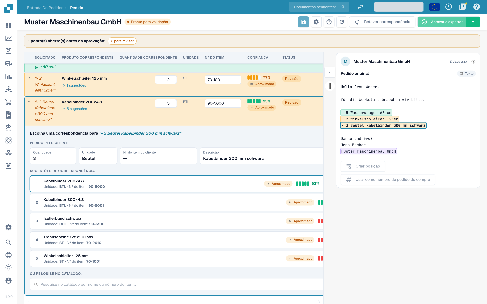<figcaption><p>Uma posição em Revisão: compare o que o cliente pediu com as sugestões. Na imagem, a tabela é mais larga do que a área visível: os botões Usar este e Corresponder ficam à direita, fora do recorte.</p></figcaption></figure>

<figure>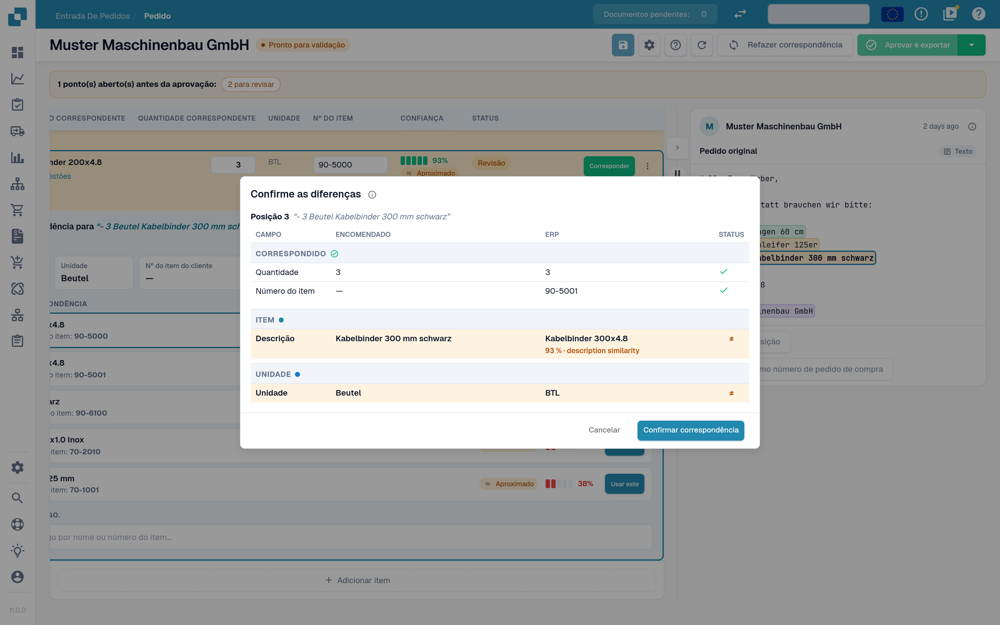<figcaption><p>Confirme as diferenças compara o que o cliente pediu com o item escolhido; aqui diferem a descrição e a unidade. O texto “description similarity” ainda não está traduzido no produto.</p></figcaption></figure>

Uma posição que já tem uma sugestão selecionada pode ser confirmada diretamente com **Corresponder** na própria linha. O menu no final de uma linha oferece mais opções: **Enviar e-mail ao cliente sobre esta linha**, **Data de entrega própria…**, **Endereço de entrega próprio…**, **Ignorar linha** (não exportada) e **Apagar linha**.

### Diferenças de quantidade e de preço

* **Quantidade:** você pode alterar a quantidade de uma posição. Se ela for diferente do que o cliente pediu, é exibida em âmbar e precisa ser confirmada: abra a posição, escolha o item, e a janela **Confirme as diferenças** lista a quantidade. Se quiser, adicione uma observação e clique em **Confirmar**. O pedido é exportado com a quantidade confirmada.
* **Preço** (somente com preços do ERP): se o preço do cliente diferir do preço líquido do ERP em mais do que a tolerância permitida, o preço é exibido em âmbar com o aviso *Preço diferente*. Clique em **Corresponder** na linha; a janela mostra os dois preços, a diferença e a tolerância. Clique em **Confirmar** para aceitar o preço do ERP ou consulte o cliente (veja [Consultar o cliente](#consultar-o-cliente)). Se o preço do cliente parecer um preço por 10, 100 ou 1000, a janela oferece definir a base de preço com um clique.

<figure>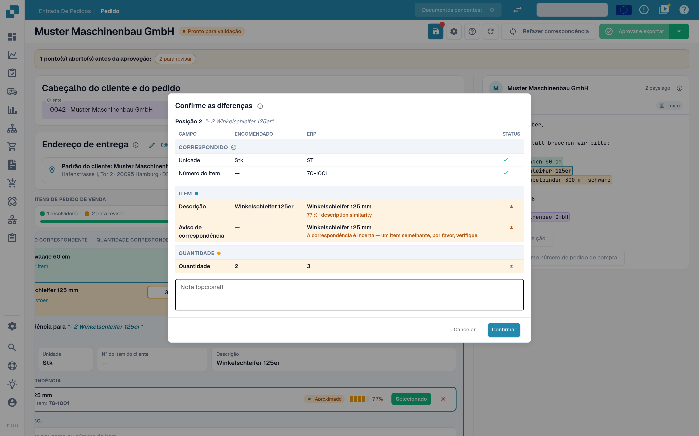<figcaption><p>Uma quantidade diferente da pedida é confirmada com uma observação opcional. O texto “description similarity” ainda não está traduzido no produto.</p></figcaption></figure>

Se o ERP não retornar preço para uma posição, ela mostra **Sem preço ERP**, com o motivo ao passar o mouse, e um botão **Tentar novamente**. Isso não bloqueia o pedido.

### Cliente não reconhecido

Se o domínio de e-mail do remetente ainda não for conhecido, o pedido mostra o ponto em aberto **Cliente ausente**. Escolha o cliente em **Cabeçalho do cliente e do pedido**. O DocBits então se oferece para memorizar o domínio do remetente:

* **Atribuir domínio de e-mail** — *Os e-mails futuros de @domínio serão atribuídos automaticamente a este cliente.* Clique em **Confirmar**; a atribuição é salva junto com as demais alterações quando você clica em **Salvar**. **Cancelar** desfaz a escolha do cliente.
* Se o domínio já pertencer a outro cliente, escolha **Manter** … (os e-mails futuros continuam com o cliente atual; este pedido recebe o novo cliente mesmo assim) ou **Atribuir a** … (os e-mails futuros vão para o novo cliente).

<figure>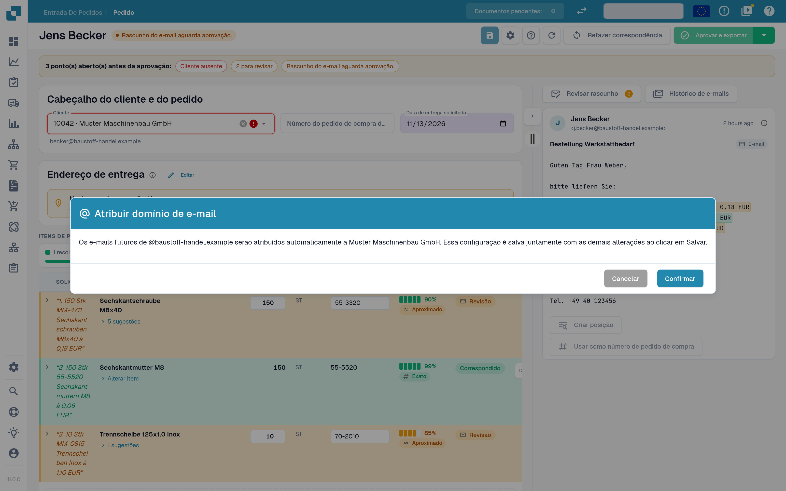<figcaption><p>Ao atribuir um cliente, também é possível atribuir o domínio de e-mail do remetente.</p></figcaption></figure>

<figure>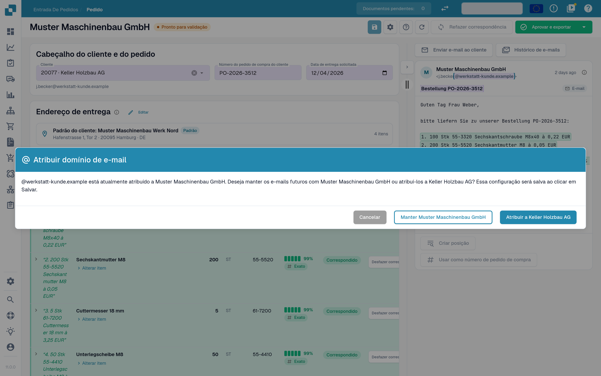<figcaption><p>O domínio já pertence a outro cliente: mantenha-o ou transfira-o.</p></figcaption></figure>

Domínios de e-mail públicos (como gmail.com) nunca são atribuídos a um cliente.

### Refazer correspondência

**Refazer correspondência** na barra superior faz novamente a correspondência de todas as posições em aberto — por exemplo, depois que novos itens foram adicionados ao cadastro de itens ou depois que você alterou o cliente. Posições confirmadas e ignoradas não são alteradas. Uma mensagem informa quantas posições foram correspondidas novamente.

O botão fica desativado quando a correspondência não tem nada a fazer; passe o mouse sobre ele para ver o motivo:

| Dica de ferramenta | Motivo |
| --- | --- |
| *Todas as posições já foram correspondidas, confirmadas ou ignoradas.* | Não há nada em aberto. |
| *O processo de correspondência aguarda enquanto o agente redige o esclarecimento.* | Aguarde até que o rascunho esteja pronto. |
| *O pedido já foi entregue ou concluído.* | Pedidos aprovados, exportados ou rejeitados não podem ser correspondidos novamente. |
| *O pedido ainda está sendo lido.* | Aguarde até o fim da leitura. |

Também é possível refazer a correspondência enquanto uma consulta ao cliente está em aberto: um rascunho não enviado é mantido (se tudo o que ele pergunta já estiver resolvido, o rascunho indica *Não há mais nada a perguntar*); um rascunho aprovado que ainda não foi enviado volta a ser rascunho.

## Corrigir uma posição não reconhecida ou incorreta

Às vezes, a leitura coloca dois itens em uma única posição, divide um item em dois ou deixa passar um item escrito no meio de uma frase. Corrija isso diretamente no e-mail ou no texto colado:

1. **Selecione o texto** do item no texto do pedido, à direita.
2. Clique em **Criar posição** abaixo do texto.
3. A janela mostra **Antes → Depois**. Verifique e clique em **Confirmar**.
4. Clique em **Salvar**. As novas posições recebem números novos, são correspondidas automaticamente e ficam destacadas no texto.

O resultado depende do que você seleciona:

| Você seleciona … | Resultado |
| --- | --- |
| Um texto que **ainda não é uma posição** | **Nova posição** — a seleção se torna uma nova posição. |
| **Parte de uma posição** (por exemplo, o segundo de dois itens em uma linha) | **Dividir** — a posição é removida e substituída por uma posição por item. |
| **Duas ou mais posições vizinhas por completo** | **Combinar** — elas se tornam uma única posição. |
| Uma posição **e mais algum texto** | A posição é **substituída** pelo texto selecionado. |
| Uma posição **exatamente como ela é** | Nada acontece — *Este texto já é a posição n.* |

<figure><figcaption><p>Criar uma posição que a leitura deixou passar.</p></figcaption></figure>

<figure>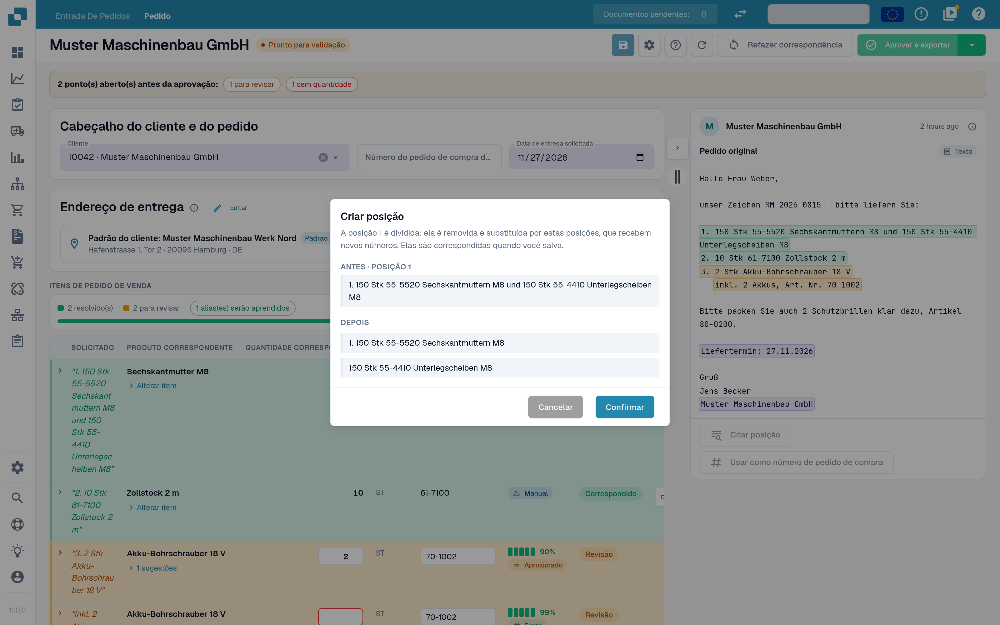<figcaption><p>Dividir uma posição que contém dois itens.</p></figcaption></figure>

<figure>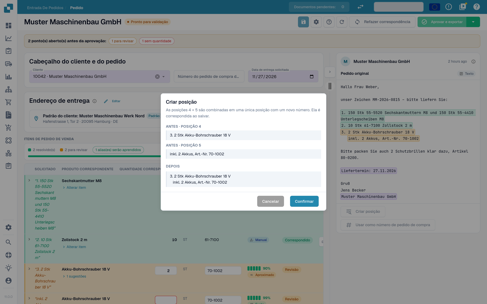<figcaption><p>Combinar duas posições que pertencem uma à outra.</p></figcaption></figure>

<figure>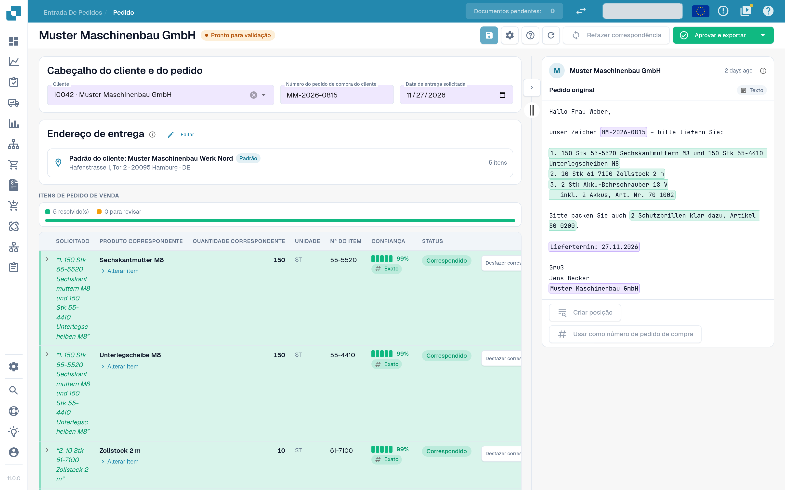<figcaption><p>Depois de salvar, as novas posições são correspondidas e destacadas no texto.</p></figcaption></figure>

### Dividir uma posição já decidida

Uma posição que foi **confirmada** ou **ignorada**, que tem **endereço de entrega, data ou preço próprios**, que contém uma **resposta do cliente** ou que foi **editada por um funcionário** também pode ser dividida. Nesse caso, ela é **dissolvida**: cada parte se torna uma nova posição, que é lida e correspondida novamente a partir do próprio texto. Todas as novas posições mantêm o endereço de entrega e a data de entrega e precisam ser revisadas de novo; os pontos em aberto da posição antiga passam para a primeira nova posição. A janela lista exatamente o que se perde com a posição antiga, por exemplo a confirmação do item, uma quantidade ou um preço do ERP aceitos, uma resposta do cliente ou uma edição de funcionário. O histórico do pedido guarda os valores antigos.

<figure>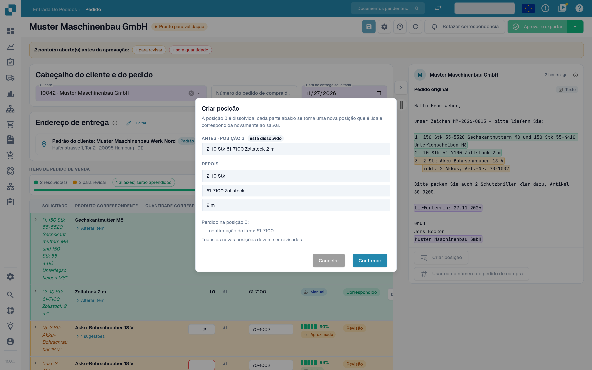<figcaption><p>Dividir uma posição decidida a dissolve; a janela lista o que se perde.</p></figcaption></figure>

Essas posições nunca são **combinadas**. Uma posição com **alterações não salvas** não pode ser dividida: primeiro salve ou descarte as alterações.

### Quando nada é alterado

Se a seleção abranger apenas parte de uma posição e mais texto fora dela, ou tocar várias posições sem cobri-las por completo, nada é alterado e a janela explica o motivo. Selecione um texto dentro de uma única posição ou selecione posições inteiras para combiná-las. Se duas posições foram lidas da mesma linha de texto, a janela informa qual posição também se refere ao texto selecionado e permanece como está.

Você sempre pode adicionar uma posição manualmente com **Adicionar item** abaixo da tabela de posições ou editar os campos de uma posição na tabela.

## Corrigir o cabeçalho do pedido

### Número do pedido de compra a partir do texto

Se o número do pedido do cliente não foi reconhecido (por exemplo, "unser Zeichen MM-2026-0815" sem rótulo), selecione **somente o número do pedido** no texto e clique em **Usar como número de pedido de compra**. Depois de **Salvar**, o número aparece em **Número do pedido de compra do cliente** e fica destacado em violeta no texto, para que todos vejam de onde ele veio.

<figure><figcaption><p>Marque o número do pedido no texto.</p></figcaption></figure>

### Número do pedido de compra a partir do assunto

Muitos clientes escrevem o número do pedido apenas no assunto ("AW: 4711"). Você também pode selecioná-lo na **linha de assunto** do e-mail. No assunto, só está disponível **Usar como número de pedido de compra** — as posições são criadas a partir do texto do pedido.

Você sempre pode digitar o número do pedido de compra e a data de entrega diretamente em **Cabeçalho do cliente e do pedido**.

## Consultar o cliente

Quando algo só pode ser respondido pelo cliente — um item desconhecido, uma quantidade ou unidade pouco clara, um número de pedido de compra ou um endereço de entrega ausente, uma diferença de preço —, envie uma pergunta por e-mail. Ela é enviada na mesma conversa do pedido original, e a resposta volta para o mesmo pedido. Isso só está disponível para **pedidos por e-mail**.

### Iniciar uma consulta

1. Clique em **Enviar e-mail ao cliente** acima do e-mail (ou em **Enviar e-mail ao cliente sobre esta linha** no menu de uma posição).
2. Escolha o motivo da consulta em **Motivo** (ou deixe em branco e deixe o assistente decidir), verifique os **Destinatários** (adicione **Cc** se necessário) e marque as posições em **Linhas de referência**.
3. Escolha como:
   * **Enviar automaticamente** — clique em **Entregar ao agente**. O agente de IA redige o e-mail. Nada é enviado antes que um funcionário aprove o rascunho.
   * **Enviar manualmente** — escreva você mesmo o assunto e o texto e clique em **Enviar**.

Enquanto o agente escreve, o botão acima do e-mail mostra **Rascunho em andamento** e **Refazer correspondência** aguarda.

Dependendo das configurações, o agente também pode redigir uma pergunta por conta própria quando um pedido chega com problemas.

Enquanto existir um rascunho, o botão acima do e-mail é **Revisar rascunho** em vez de **Enviar e-mail ao cliente**. Quando o pedido estiver completo, **Revisar rascunho** continua disponível sem o **!** amarelo — você ainda pode enviar ou descartar o rascunho. **Aprovar e exportar** descarta um rascunho não enviado.

### Verificar e enviar o rascunho

Quando o rascunho estiver pronto, o pedido terá o status **Rascunho do e-mail aguarda aprovação** e o botão **Revisar rascunho** mostrará um **!** amarelo. Clique nele para abrir **Esclarecimento com o cliente**:

* **Descartar** — exclui o rascunho; nada é enviado.
* **Retornar ao agente** — diga ao agente o que mudar; ele redige um novo rascunho.
* **Editar** — altere você mesmo o assunto ou o texto.
* **Aprovar e enviar** — envia o e-mail ao cliente.

<figure>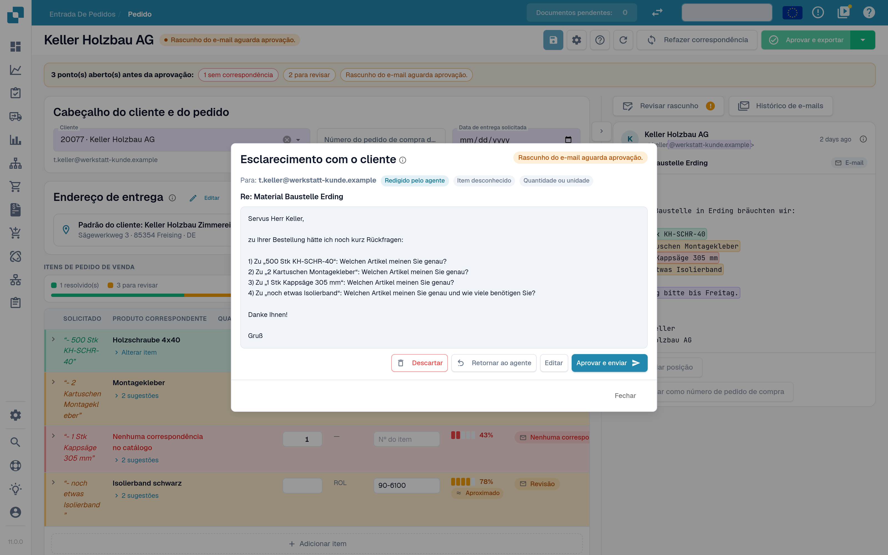<figcaption><p>O rascunho do agente aguarda sua aprovação.</p></figcaption></figure>

### Aguardar a resposta

Depois do envio, o pedido fica em **Aguardando o cliente** e o botão acima do e-mail mostra **Aguardando o cliente**. Quando o cliente responde, o agente lê a resposta e a aplica ao pedido (o pedido fica bloqueado por um instante com *Lendo a resposta do cliente*); a resposta aparece no painel do e-mail e em **Histórico de e-mails**. As posições que você já confirmou não são sobrescritas — se o cliente alterar uma delas, ela é marcada com *Alterado por e-mail do cliente* para que você a verifique novamente.

Se o cliente respondeu por telefone ou em outro e-mail, abra o esclarecimento e clique em **Encerrar esclarecimento**. O DocBits deixa de aguardar; uma resposta que chegar depois é exibida, mas não é aplicada. **Novo e-mail** envia uma nova pergunta.

### Se o envio falhar

Se um e-mail aprovado não puder ser enviado, o pedido mostra o ponto em aberto **E-mail não enviado — envie novamente**. Abra o esclarecimento: ele mostra o motivo. Clique em **Enviar novamente**.

Se o e-mail do pedido não chegou por uma das suas caixas de correio de importação (por exemplo, foi encaminhado ao DocBits por outro meio), não há caixa de correio a partir da qual responder e o e-mail não pode ser enviado. Configure uma caixa de correio de importação para esse endereço ou entre em contato diretamente com o cliente e descarte o rascunho.

<figure>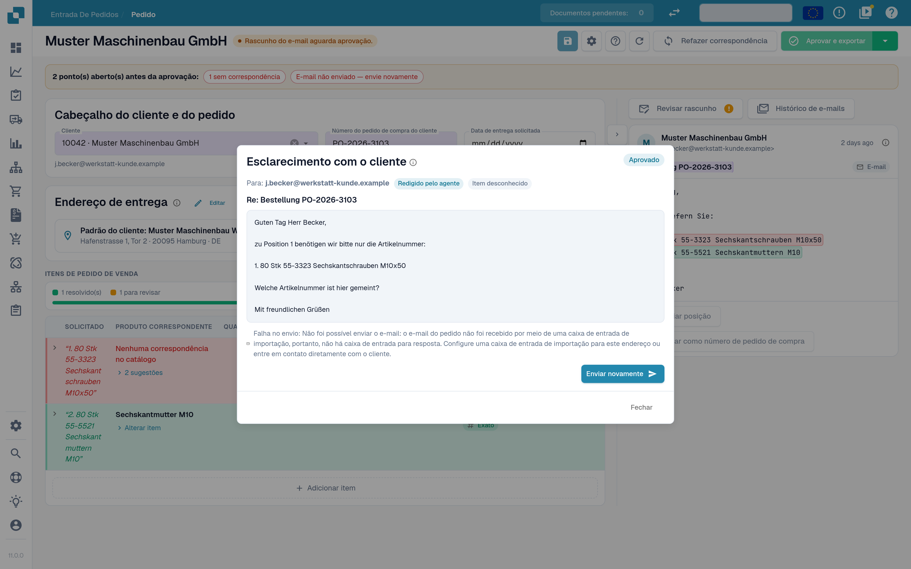<figcaption><p>Falha no envio: o esclarecimento mostra o motivo (aqui: nenhuma caixa de correio de importação para responder) e oferece Enviar novamente.</p></figcaption></figure>

## Aprovar e transferir

**Aprovar e exportar** na barra superior fica ativo quando todos os pontos em aberto estão resolvidos: todas as posições correspondidas, confirmadas ou ignoradas, o cliente atribuído e os campos obrigatórios do cabeçalho e o endereço de entrega preenchidos. Enquanto faltar algo, passe o mouse sobre o botão desativado para ver a lista.

<figure>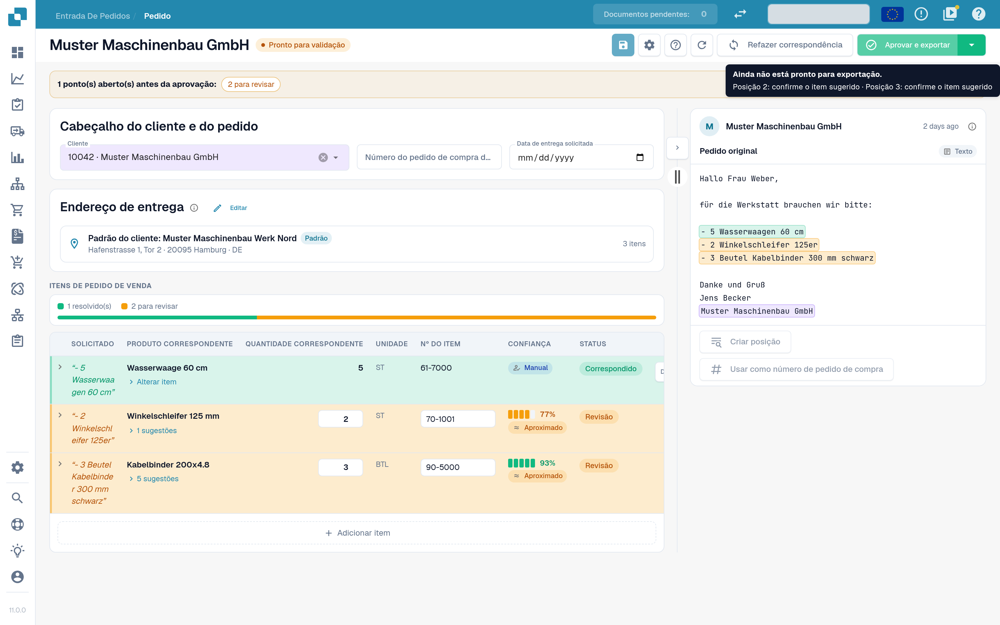<figcaption><p>Aprovar e exportar fica desativado até que todos os pontos em aberto estejam resolvidos; ao passar o mouse, aparece o que falta.</p></figcaption></figure>

1. Clique em **Aprovar e exportar**.
2. A janela resume o cliente, o número de posições, os endereços de entrega (incluindo o endereço padrão do cliente) e o pedido de compra do cliente (e o valor do pedido, com preços do ERP). Ela também informa o que acontece com uma consulta em aberto: um rascunho não enviado é descartado e uma consulta já enviada é encerrada — **nada é enviado ao cliente**.
3. Clique em **Aprovar e exportar**. Isso cria o pedido de venda no ERP.

<figure>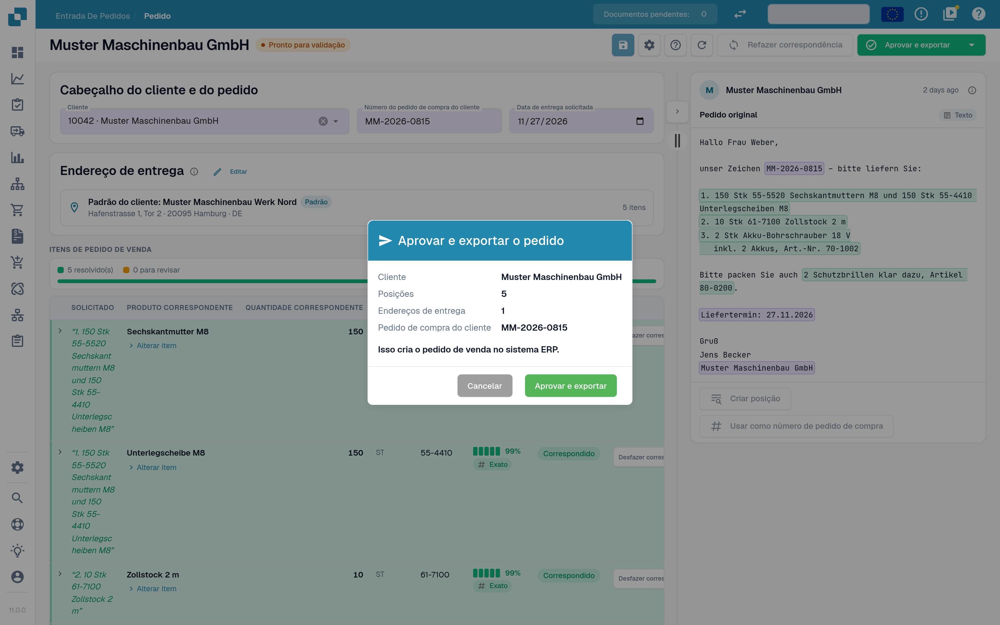<figcaption><p>Última verificação antes de o pedido ir para o ERP.</p></figcaption></figure>

Em seguida, o pedido fica como **Exportado** e mostra o número do pedido no ERP. Se a transferência falhar, o status é **A exportação falhou** e um banner vermelho mostra o motivo no seu idioma — por exemplo, que o ERP recusou o pedido, que ele não estava acessível ou que ainda não há exportação para o ERP configurada (nesse caso, nada chegou ao ERP; um administrador a configura em **Configurações › Exportar** com o tipo de documento **Pedido de venda (Entrada de Pedidos)**, veja *Configurar a exportação para o ERP (administradores)*). Os administradores veem também no banner o link **Abrir configurações da exportação para o ERP**; após uma confirmação, ele abre as configurações da Entrada de Pedidos, cuja seção **Exportação para o ERP** mostra o status atual. Corrija a causa e clique em **Tentar exportar novamente**.

<figure>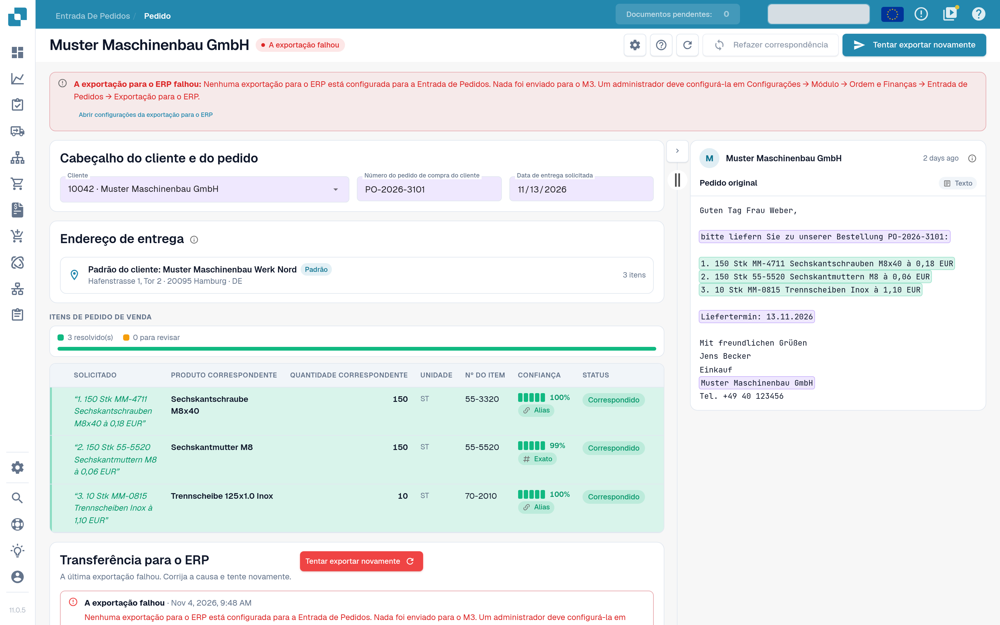<figcaption><p>Se a transferência ao ERP falhar, o banner mostra o motivo; aqui não há exportação para o ERP configurada e os administradores veem o link Abrir configurações da exportação para o ERP. Corrija a causa e clique em Tentar exportar novamente.</p></figcaption></figure>

### Rejeitar um pedido

Para interromper um pedido (por exemplo, um duplicado ou algo que não é um pedido de verdade), abra a seta ao lado de **Aprovar e exportar** e clique em **Rejeitar**. Se quiser, informe um motivo. Nada é transferido ao ERP.

Se o DocBits detectar que um pedido pode ser um **duplicado** de um pedido anterior (mesmo cliente e mesmo número de pedido de compra, ou posições muito semelhantes), um banner oferece **Rejeitar como duplicado**, **Ver duplicatas** e **Prossiga de qualquer maneira**.
