# Order Intake

## Overview

**Order Intake** reads the orders your customers send you — by e-mail or as pasted text — and prepares them as sales orders for your ERP. DocBits finds the customer, reads every position, matches it to an item of your item master and shows you what still needs a decision. You check the order, fix what is missing, ask the customer if something is unclear, and approve it. Only then is the sales order created in the ERP.

```
Customer e-mail / pasted text
        │
        ▼
  Read positions ──► Match to your items ──► You check and decide ──► Approve and export ──► ERP sales order
                                                   │
                                                   └──► Ask the customer (e-mail) ──► reply is applied
```

**Example:** Muster Maschinenbau GmbH e-mails "150 Stk MM-4711 Sechskantschrauben M8x40". DocBits recognises the customer from the sender's e-mail address, knows that this customer's number MM-4711 is your item 55-3320, and shows the position as **Matched**. A second position "2 Winkelschleifer 125er" has no item number, so DocBits suggests similar items and puts the position into **Review**. You pick the right item, click **Approve and export**, and the order is in the ERP.


**Current limits**

* **Orders from PDF files are not available yet.** Use e-mail orders or **Import from text**.
* **Prices** are shown and checked only when your ERP (Infor M3) returns prices for the customer. Without them, the order is still handed over — the ERP prices it.
* **Questions to the customer** can only be sent for orders that came in by e-mail.


## How to activate

Order Intake needs the **AI Workforce** subscription.

1. Go to **Settings › Module › Order & Finance** and open the **Order Intake** section.
2. Switch on **Activate Order Intake dashboard**. "Order Intake" now appears in the sidebar.
3. Give the clerks' role access to Order Intake under **Settings › Groups and Permissions** (administrators always have access).

<figure>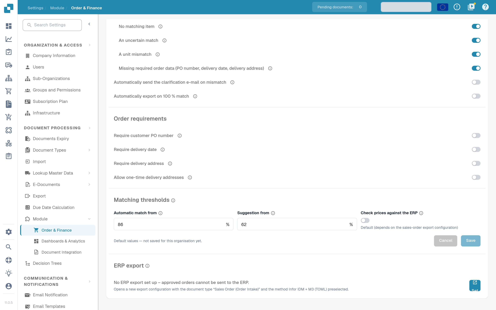<figcaption><p>Order Intake settings under Settings › Module › Order &#x26; Finance; at the end the ERP export section, here without an ERP export.</p></figcaption></figure>

In the same section an administrator decides how the module works:

| Group | Setting | What it does |
| --- | --- | --- |
| **Automation** | **Automatically draft a reply e-mail on mismatch** | On by default: the agent drafts a clarification e-mail by itself for the cases ticked below. An employee reviews it unless automatic sending is on. |
| | **Draft a clarification e-mail for positions with** … | Which problems make the agent draft a question to the customer: **No matching item**, **An uncertain match**, **A unit mismatch**, **Missing required order data (PO number, delivery date, delivery address)**. A missing quantity is always asked. |
| | **Automatically send the clarification e-mail on mismatch** | Off (recommended): every drafted e-mail waits for an employee's approval. |
| | **Automatically export on 100 % match** | Orders where every position matched exactly or by a learned customer item number, and nothing else is missing, go to the ERP without approval. |
| **Order requirements** | **Require customer PO number**, **Require delivery date**, **Require delivery address** | When on, an order without this value gets an open point and cannot be approved until it is there. All three are off by default. |
| | **Allow one-time delivery addresses** | When on, clerks can type an address that is used for this order only (e.g. a construction site). When off, only addresses from the customer master data can be used. |
| **Matching thresholds** | **Automatic match from** (default 86 %), **Suggestion from** (default 62 %) | Only exact item numbers and learned customer item numbers are accepted automatically. Similar descriptions are always shown as suggestions for review. |
| | **Check prices against the ERP** | Compares the customer's net price with the ERP net price. A difference above the allowed tolerance needs a decision; the ERP prices the order either way. By default this follows the ERP export configuration. |
| **ERP export** | *(status only)* | Shows the export configurations of the document type **Sales Order (Order Intake)** with which approved orders go to the ERP, each with **Edit**; an inactive one is marked **Inactive**. A warning row means that a configuration still uses the incoming document type **Order Intake – incoming document**; it is never used. If there is no active configuration, the section says *No ERP export set up – approved orders cannot be sent to the ERP.* and where to set it up. Administrators set up the export under **Settings › Export** (see below). |

Administrators can open these settings from any order with the **cog** button in the top bar.

### Set up the ERP export (administrators)

Approved orders reach the ERP (Infor M3) only through an export configuration of the document type **Sales Order (Order Intake)**. An administrator sets it up once:

1. Go to **Settings › Export** and click **New**.
2. Enter a **Configuration Title** and choose the **Document Type** **Sales Order (Order Intake)**. It is offered as soon as Order Intake is switched on; you don't have to activate the document type first.
3. Under **Export** choose **Infor**, and under **Infor Type** choose **Infor IDM + M3 (TOML)**.
4. Upload the **ION API File** (`.ionapi`) and the **TOML Mapping File** (`.toml`) of your M3 connection.
5. Click **Save**. A new configuration is **Active**; only one configuration per document type can be active.

The **ERP export** section in the Order Intake settings then shows the configuration; **Edit** opens it, and an inactive one is marked **Inactive**. A warning row there means that an older configuration still uses the incoming document type **Order Intake – incoming document**: it is never used, so open it with **Edit** and change its document type to **Sales Order (Order Intake)**. Orders are exported only from Order Intake with **Approve and export** (or automatically with **Automatically export on 100 % match**); the incoming order documents themselves are never exported.

## Bring an order in

### By e-mail

Customers send their orders to your organisation's order mailbox. The AI agent reads the e-mail, finds the positions and creates the order in the list. The customer is recognised by the **domain of the sender's e-mail address**. Signatures, disclaimers and quoted older messages are not read as positions.

### Import from text

For an order that reached you another way (a fax you typed, a chat message, a forwarded text):

1. In the Order Intake list click **Import from text**.
2. Paste the order into **Order text**. Free-form is fine — line breaks, abbreviations and shorthand are handled.
3. Choose the **Customer** (search by name, e-mail or customer number). Without a customer, the order opens with the open point *Customer missing*.
4. Click **Extract & match**.

<figure>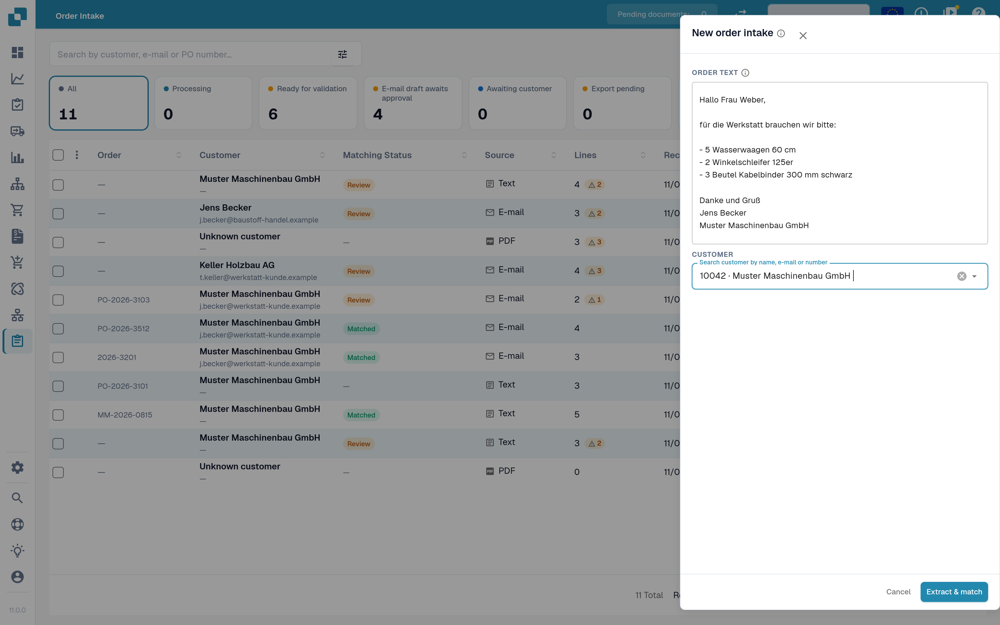<figcaption><p>Paste a customer order and choose the customer.</p></figcaption></figure>

### New order

**New order** builds an order by hand from your item catalog: choose the customer and the delivery address, add the items and quantities, then **Approve and export**.

## The Order Intake list

Open **Order Intake** in the sidebar. The list shows every order with its customer, source (E-mail, Text, Manual), number of positions, when it was received, its status and its matching status. A small warning sign next to the number of positions shows how many still need a decision. Click a row to open the order.

<figure>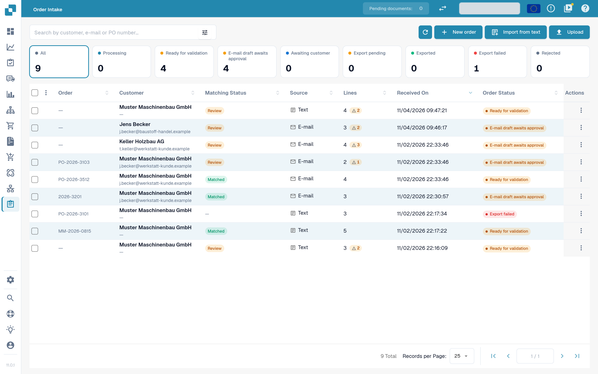<figcaption><p>The Order Intake list with the status cards.</p></figcaption></figure>

The **status cards** above the list count the orders per status. Click a card to show only those orders; **All** shows everything.

| Status | Meaning |
| --- | --- |
| **Processing** | The order is being read or prepared — nothing to do for you yet. |
| **Ready for validation** | Read and waiting for an employee: check the positions or approve it. |
| **E-mail draft awaits approval** | A mail to the customer is drafted and waits for your approval. |
| **Awaiting customer** | A clarification was sent, the reply is outstanding. |
| **Export pending** | Approved, but not yet handed over to the ERP. |
| **Exported** | Handed over to the ERP. |
| **Export failed** | The ERP rejected the hand-over — retry after fixing the cause. |
| **Rejected** | Rejected or recognised as a duplicate — no further action. |

The **Matching status** column says **Review** when a position, a required header field or the delivery address still needs a decision, and **Matched** when everything is resolved.

While the AI agent, a re-match or a customer reply is working on an order, its status shows **Agent working** with a turning arrow. The order is locked until the work is done; the list refreshes by itself.

**Search and filter:** type a customer, an e-mail address or a PO number into the search field. The filter icon in the search field filters by **Source** (*E-mail* or *Manual*).

The menu at the end of a row offers **Logs** (every step of the agent, the users and the system, plus the decision history: who confirmed or changed what) and **Delete**.

## Check a new order

### The matching screen

<figure>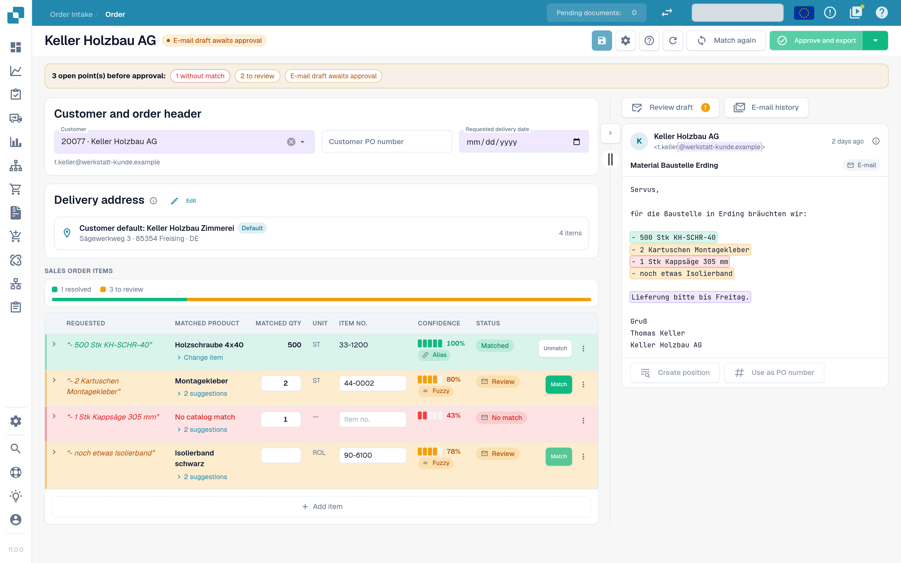<figcaption><p>The matching screen: order data on the left, the customer's e-mail on the right.</p></figcaption></figure>

* **Top bar** — customer, status, the order value (only with ERP prices), and the actions **Save**, **Legend**, **Refresh**, **Match again** and **Approve and export**.
* **Open points** — directly below the top bar: everything that still blocks the approval, e.g. *Customer missing*, *PO number missing*, *2 to review*. Click a point to jump to it.
* **Customer and order header** — customer, customer PO number and requested delivery date.
* **Delivery address** — where the order goes. If the customer has a default address, it is used automatically (*Customer default: …* with the tag **Default**); **Edit** changes it. Positions can also go to different addresses.
* **Positions** — one row per ordered item with the customer's text, the matched item, quantity, unit and status. Above the table a bar shows how many positions are resolved and how many are still to review.
* **Source** (right) — the customer's e-mail or the pasted text. Positions are highlighted in green, amber or red like their status, delivery addresses in blue and header values (customer, PO number, date) in violet. Click a highlight to jump to the position. The arrow on the divider hides or shows the e-mail; drag the divider to change the width. **E-mail history** lists every mail of this order.

The **Legend** (question-mark button) explains every colour, status and match method.


Nothing you change on this screen is stored until you click **Save** (the disk icon; a red dot means unsaved changes). Ctrl+S / Cmd+S also saves. If you leave the order with unsaved changes, DocBits asks whether to save or discard them.


### Position statuses and match methods

| Status | Meaning |
| --- | --- |
| **Matched** | Matched automatically (by a learned customer item number or the exact item number) or confirmed by an employee. |
| **Review** | A suggestion exists but must be checked. |
| **No match** | No item of the item master is similar enough to be suggested. |
| **Pending** | Not matched yet. |
| **Ignored** | Excluded from the export. |

| Match method | Meaning |
| --- | --- |
| **Alias** | This customer's own item number was mapped to your item before — passes automatically. |
| **Exact** | The item number in the order matches the item master exactly — passes automatically. |
| **Fuzzy** | Similar description only — always needs a review. |
| **Manual** | Chosen or confirmed by an employee. |
| **Clarification** | Taken from the customer's answer. |

When you confirm an item for a customer item number, DocBits **learns it as an alias** for this customer: the next order with the same number matches automatically. A learned alias can be removed from the position's menu (**Remove learned alias**).

### Positions in Review

1. Click the position to open it. **Ordered by the customer** shows quantity, unit, customer item number and description as the customer wrote them.
2. **Suggested matches** lists the best items with their item number, unit, match method and confidence.
3. The best suggestion is already preselected (**Selected**). If another item is right, click **Use this** on it — or find it under **Or search the catalog**. The red **x** removes the selection.
   A position needs a **quantity** before it can be matched: without one, **Use this** and **Match** are greyed out (*Enter a quantity first — a position without a quantity cannot be matched.*). Type the quantity into the row first.
4. A pop-up compares what was ordered with the chosen item. Check it and click **Confirm match**.
5. Click **Save**.

<figure>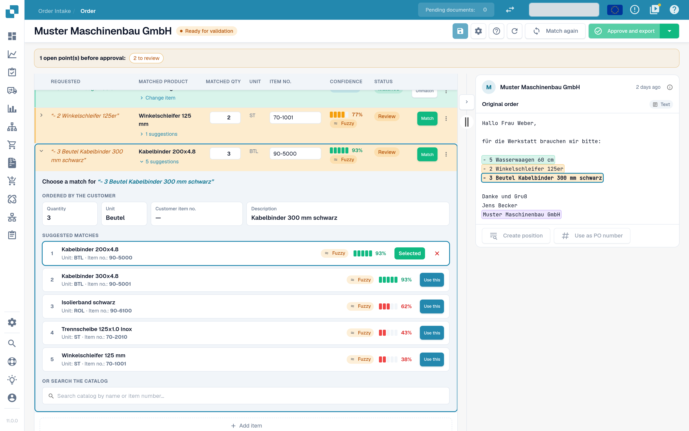<figcaption><p>A position in Review: compare what the customer ordered with the suggestions.</p></figcaption></figure>

<figure>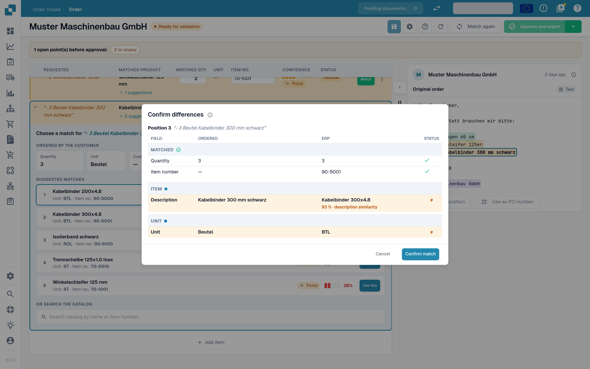<figcaption><p>Confirm differences compares what the customer ordered with the chosen item; here the description and the unit differ.</p></figcaption></figure>

A position that already has a suggestion selected can be confirmed directly with **Match** in its row. The menu at the end of a row offers more: **Email customer about this line**, **Own delivery date…**, **Own delivery address…**, **Ignore line** (not exported) and **Delete line**.

### Quantity and price differences

* **Quantity:** you can change the quantity of a position. If it differs from what the customer ordered, it is shown in amber and must be confirmed: open the position, choose the item, and the pop-up **Confirm differences** lists the quantity. Add a note if you like and click **Confirm**. The order is exported with the confirmed quantity.
* **Price** (only with ERP prices): if the customer's price differs from the ERP net price by more than the allowed tolerance, the price is shown in amber with the hint *Price differs*. Click **Match** in the row; the pop-up shows both prices, the difference and the tolerance. Click **Confirm** to accept the ERP price, or ask the customer (see [Ask the customer](#ask-the-customer)). If the customer's price looks like a price per 10, 100 or 1000, the pop-up offers to set the price basis with one click.

<figure>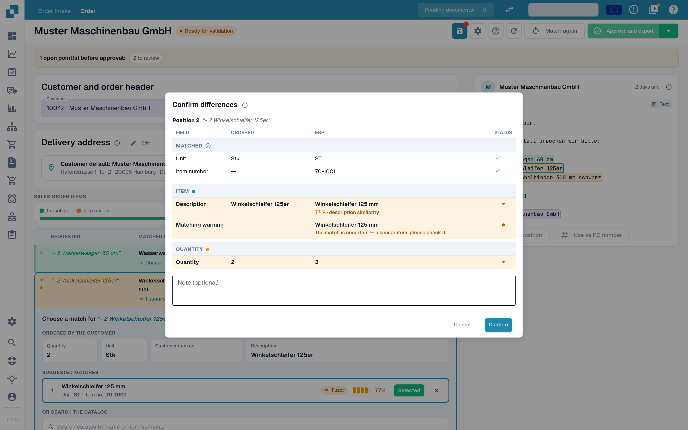<figcaption><p>A quantity that differs from the order is confirmed with an optional note.</p></figcaption></figure>

If the ERP returns no price for a position, it shows **No ERP price** with the reason on hover and a **Retry** button. This does not block the order.

### Customer not recognised

If the sender's e-mail domain is not known yet, the order shows the open point **Customer missing**. Choose the customer in **Customer and order header**. DocBits then offers to remember the sender's domain:

* **Assign e-mail domain** — *Future e-mails from @domain will be assigned to this customer automatically.* Click **Confirm**; it is saved together with your other changes when you click **Save**. **Cancel** undoes the customer choice.
* If the domain already belongs to another customer, choose **Keep** (future mails stay with the current customer, this order still gets the new one) or **Assign to** (future mails go to the new customer).

<figure>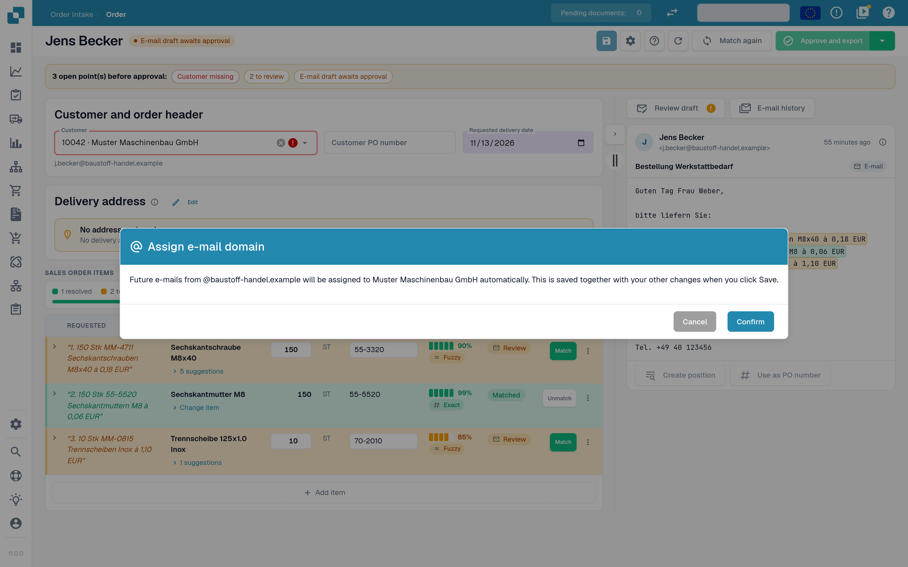<figcaption><p>Assigning a customer can also assign the sender's e-mail domain.</p></figcaption></figure>

<figure>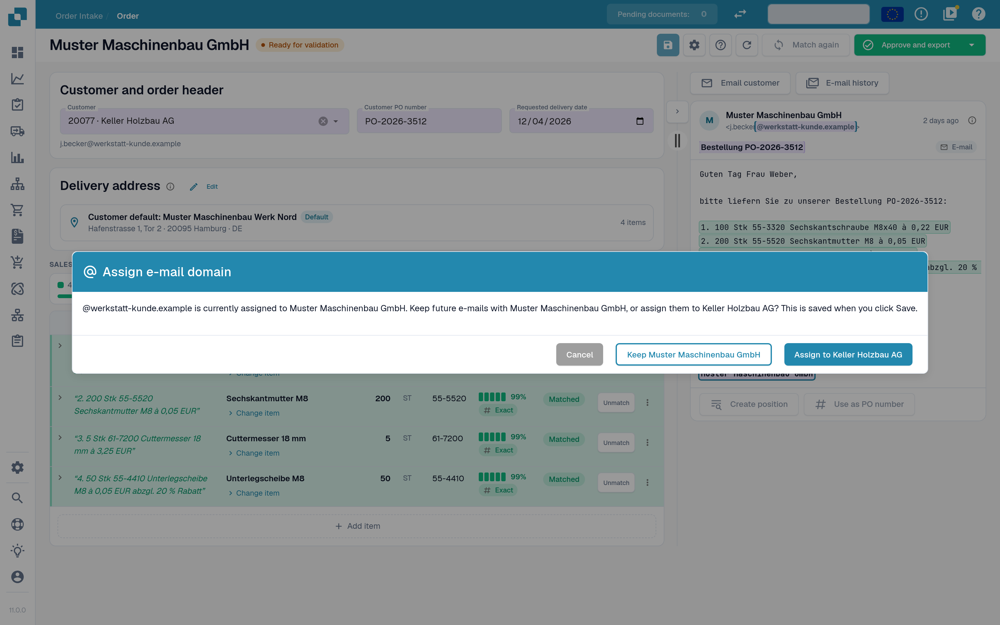<figcaption><p>The domain already belongs to another customer: keep it or move it.</p></figcaption></figure>

Public mail domains (such as gmail.com) are never assigned to a customer.

### Match again

**Match again** in the top bar matches all open positions once more — for example after new items were added to the item master or after you changed the customer. Confirmed and ignored positions are not touched. A message tells you how many positions were matched again.

The button is greyed out when matching cannot do anything; hover it to see why:

| Tooltip | Why |
| --- | --- |
| *All positions are already matched, confirmed or ignored.* | Nothing is open. |
| *Matching waits while the agent is writing the clarification.* | Wait until the draft is there. |
| *The order is already handed over or closed.* | Approved, exported or rejected orders cannot be matched again. |
| *The order is still being read.* | Wait until reading is finished. |

Matching again is also possible while a question to the customer is open: an unsent draft is kept (if everything it asks about is resolved, the draft says *Nothing left to ask*); an approved draft that was not sent goes back to draft.

## Fix a missed or wrong position

Sometimes the reading puts two items into one position, splits one item into two, or misses an item written in a sentence. Fix it directly in the e-mail or pasted text:

1. **Select the text** of the item in the order text on the right.
2. Click **Create position** below the text.
3. The pop-up shows **before → after**. Check it and click **Confirm**.
4. Click **Save**. The new positions get new numbers, are matched automatically and are highlighted in the text.

What happens depends on what you select:

| You select … | Result |
| --- | --- |
| Text that is **not a position yet** | **New position** — the selection becomes a new position. |
| **Part of a position** (e.g. the second of two items in one line) | **Split** — the position is removed and replaced by one position per item. |
| **Two or more neighbouring positions completely** | **Combine** — they become one position. |
| One position **plus other text** | The position is **replaced** by the selected text. |
| A position **exactly as it is** | Nothing happens — *This text is already position n.* |

<figure>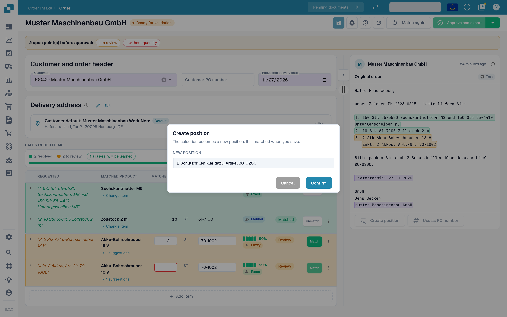<figcaption><p>Create a position the reading missed.</p></figcaption></figure>

<figure>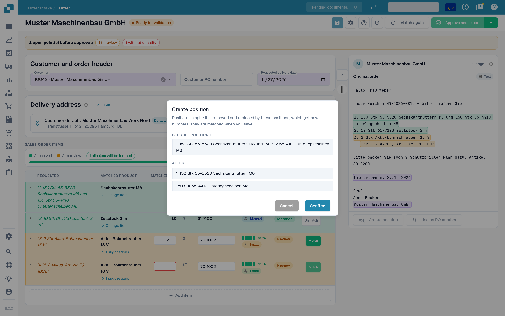<figcaption><p>Split a position that contains two items.</p></figcaption></figure>

<figure>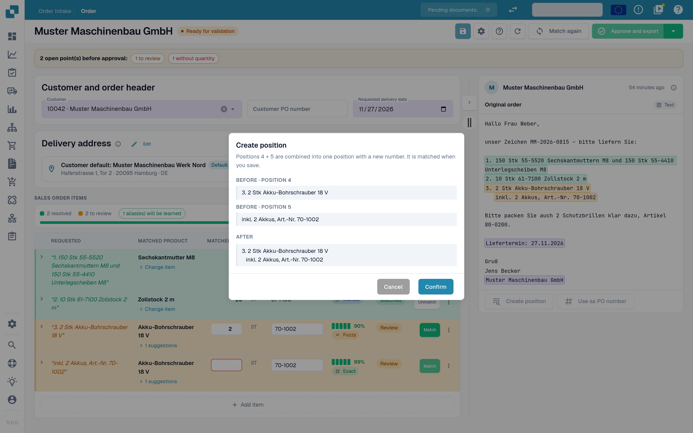<figcaption><p>Combine two positions that belong together.</p></figcaption></figure>

<figure>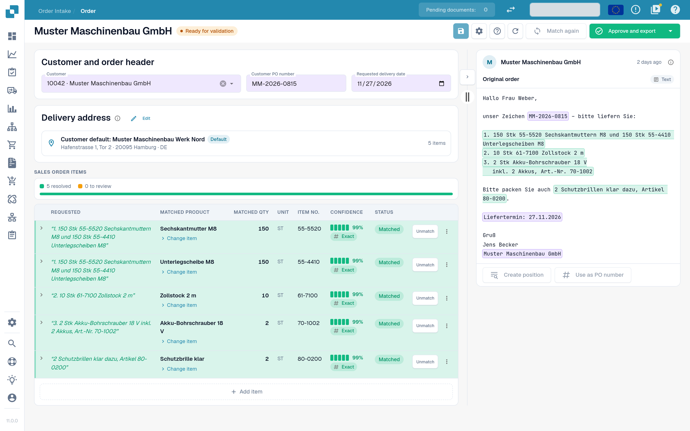<figcaption><p>After Save the new positions are matched and highlighted in the text.</p></figcaption></figure>

### Splitting a position that was already decided

A position that is **confirmed** or **ignored**, has its **own delivery address, date or price**, holds a **customer answer** or was **edited by an employee** can still be split. It is then **dissolved**: every part becomes a new position that is read and matched again from its own text. All new positions keep the delivery address and the delivery date and must be reviewed again; open points of the old position move to the first new position. The pop-up lists exactly what is lost with the old position, for example the confirmation of the item, an accepted quantity or ERP price, a customer answer or an employee edit. The history of the order keeps the old values.

<figure>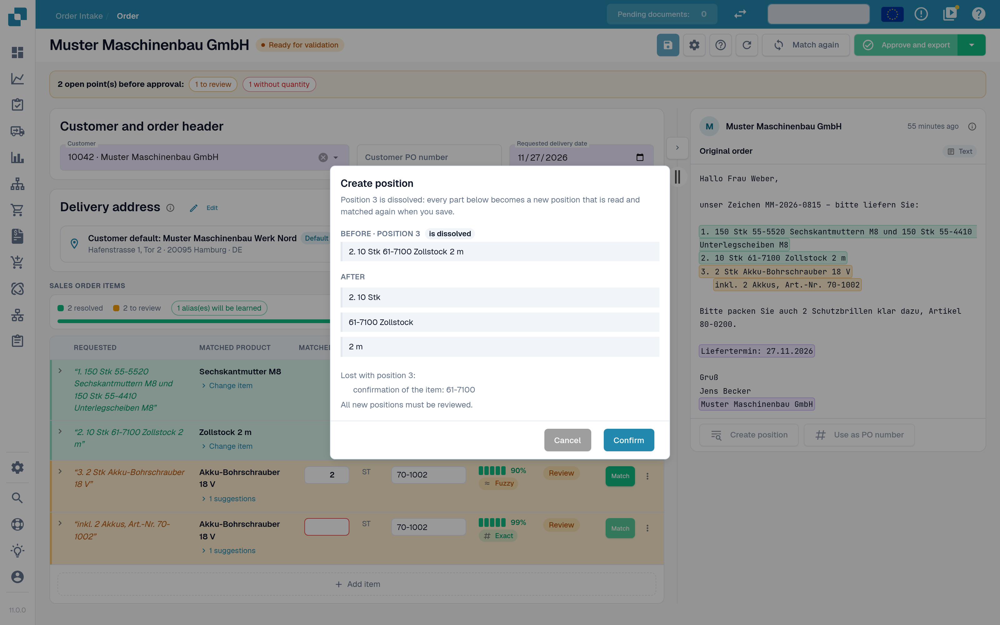<figcaption><p>Splitting a decided position dissolves it; the pop-up lists what is lost.</p></figcaption></figure>

Such positions are never **combined**. A position with **unsaved changes** cannot be split: save or discard the changes first.

### When nothing is changed

If the selection covers only part of a position plus text outside it, or touches several positions without covering them completely, nothing is changed and the pop-up explains why. Select text within one position, or select whole positions to combine them. If two positions were read from the same line of text, the pop-up says which position also refers to the selected text and stays as it is.

You can always add a position by hand with **Add item** below the positions table, or edit the fields of a position in the table.

## Fix the order header

### PO number from the text

If the customer's order number was not recognised (e.g. "unser Zeichen MM-2026-0815" without a label), select **only the order number** in the text and click **Use as PO number**. After **Save** the number is in **Customer PO number** and highlighted in violet in the text, so everyone can see where it came from.

<figure>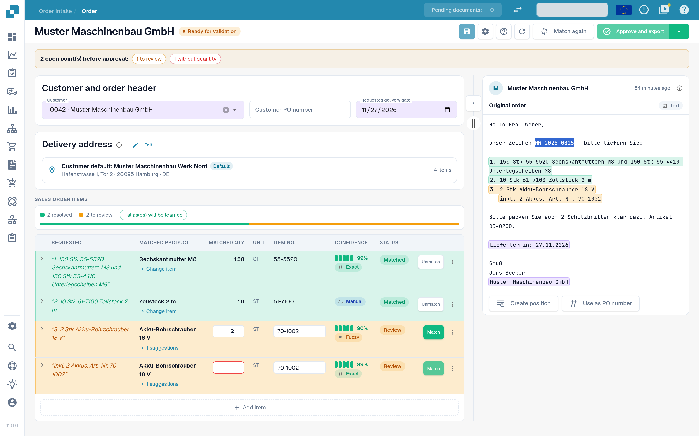<figcaption><p>Mark the order number in the text.</p></figcaption></figure>

### PO number from the subject

Many customers write the order number only in the subject ("AW: 4711"). You can select it in the **subject line** of the e-mail too. In the subject only **Use as PO number** is available — positions are created from the order text.

You can always type the PO number and the delivery date directly into **Customer and order header**.

## Ask the customer

When something can only be answered by the customer — an unknown item, an unclear quantity or unit, a missing PO number or delivery address, a price difference — send a question by e-mail. It goes out in the thread of the original order, and the reply comes back to the same order. This is available for **e-mail orders** only.

### Start a question

1. Click **Email customer** above the e-mail (or **Email customer about this line** in a position's menu).
2. Choose why you ask under **Reason** (or leave it empty and let the assistant decide), check **Recipients** (add **Cc** if needed) and tick the positions under **Reference lines**.
3. Choose how:
   * **Send automatically** — click **Hand to agent**. The AI agent writes the e-mail. Nothing is sent before an employee approves the draft.
   * **Send manually** — write the subject and text yourself and click **Send**.

While the agent writes, the button above the e-mail shows **Draft in progress** and **Match again** waits.

Depending on the settings, the agent may also draft a question by itself when an order arrives with problems.

While a draft exists, the button above the e-mail is **Review draft** instead of **Email customer**. Once the order is complete, **Review draft** stays available without the yellow **!** — you can still send the draft or discard it. **Approve and export** discards an unsent draft.

### Check and send the draft

When the draft is ready, the order has the status **E-mail draft awaits approval** and the button **Review draft** shows a yellow **!**. Click it to open **Clarification with the customer**:

* **Discard** — delete the draft; nothing is sent.
* **Return to agent** — tell the agent what to change; it writes a new draft.
* **Edit** — change subject or text yourself.
* **Approve & send** — send the e-mail to the customer.

<figure>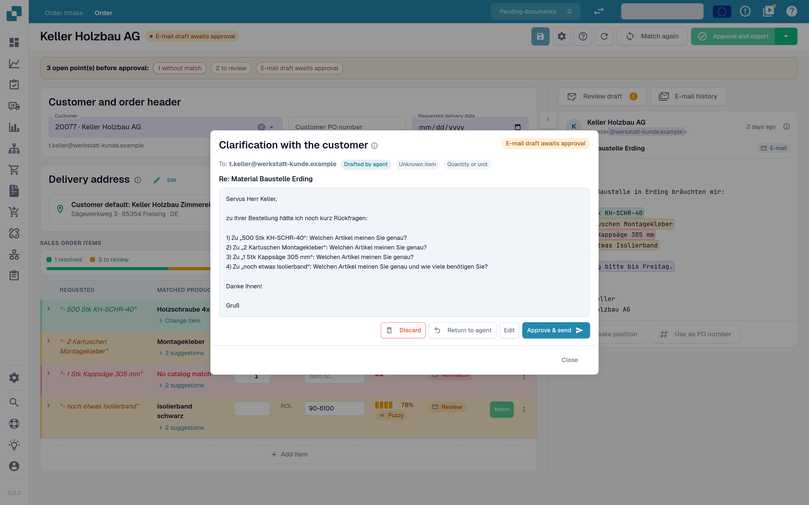<figcaption><p>The agent's draft waits for your approval.</p></figcaption></figure>

### Waiting for the reply

After sending, the order is **Awaiting customer** and the button above the e-mail says **Awaiting customer**. When the customer replies, the agent reads the answer and applies it to the order (the order is briefly locked with *Reading customer reply*); the reply appears in the e-mail pane and in **E-mail history**. Positions you already confirmed are not overwritten — if the customer changes one, it is marked *Changed by a customer mail* for you to check again.

If the customer answered by phone or in another mail, open the clarification and click **Close clarification**. DocBits stops waiting; a reply that arrives later is shown but not applied. **New mail** asks a further question.

### If sending fails

If an approved e-mail could not be sent, the order shows the open point **E-mail not sent — send again**. Open the clarification: it shows the reason. Click **Send again**.

If the order e-mail did not come in through one of your import mailboxes (for example, it was forwarded into DocBits another way), there is no mailbox to answer from and the e-mail cannot be sent. Set up an import mailbox for this address, or contact the customer directly and discard the draft.

<figure>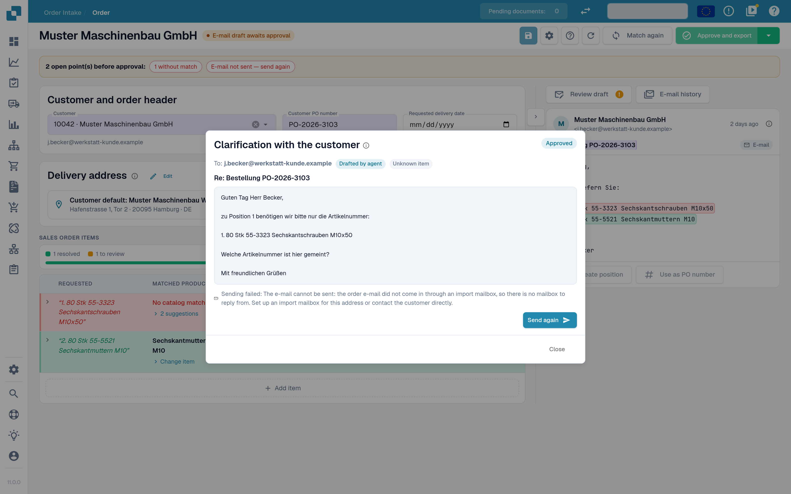<figcaption><p>Sending failed: the clarification shows the reason (here: no import mailbox to reply from) and offers Send again.</p></figcaption></figure>

## Approve and hand over

**Approve and export** in the top bar is enabled when every open point is resolved: every position matched, confirmed or ignored, the customer assigned, and the required header fields and the delivery address present. While something is missing, hover the greyed button to see the list.

<figure>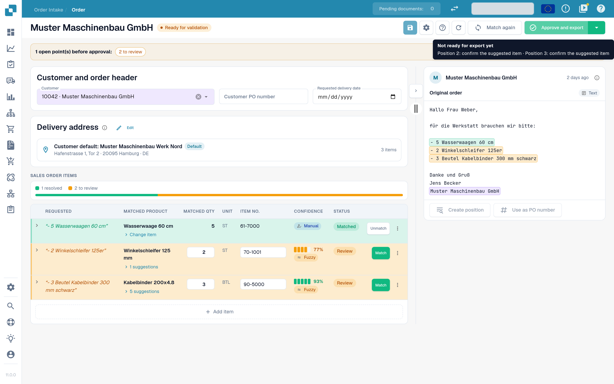<figcaption><p>Approve and export stays disabled until all open points are resolved; hovering it lists what is missing.</p></figcaption></figure>

1. Click **Approve and export**.
2. The pop-up summarises customer, number of positions, delivery addresses (including the customer's default address), customer PO (and order value, with ERP prices). It also says what happens to an open question: an unsent draft is discarded, a sent question is closed — **nothing is sent to the customer**.
3. Click **Approve and export**. This creates the sales order in the ERP.

<figure>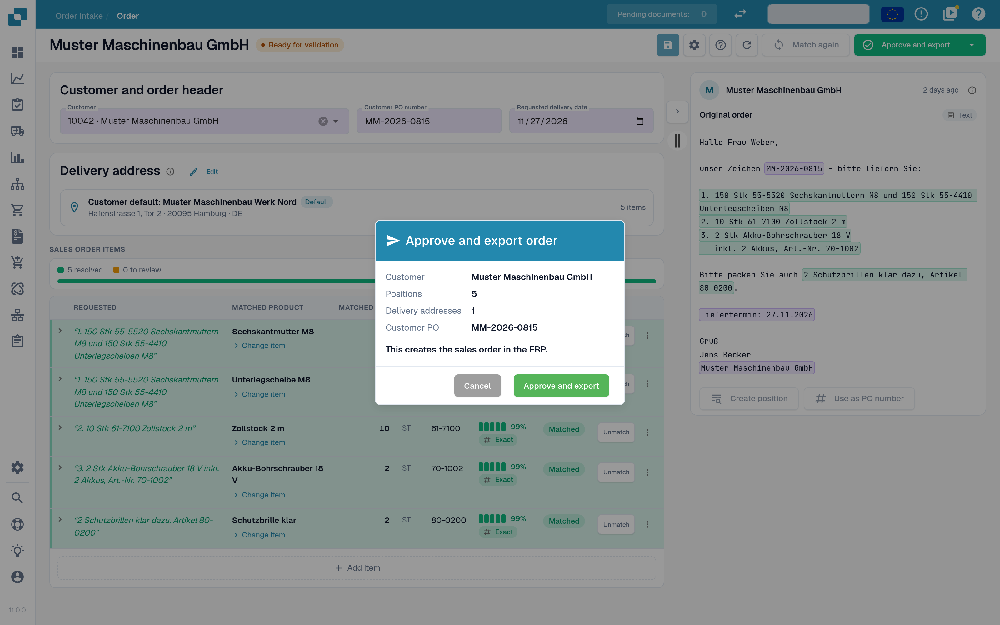<figcaption><p>Last check before the order goes to the ERP.</p></figcaption></figure>

The order is then **Exported** and shows the ERP order number. If the hand-over fails, the status is **Export failed** and a red banner shows the reason in your language — for example that the ERP refused the order, that it was not reachable, or that no ERP export is set up yet (then nothing reached the ERP; an administrator sets it up under **Settings › Export** with the document type **Sales Order (Order Intake)**, see *Set up the ERP export (administrators)*). Administrators also see the link **Open ERP export settings** in the banner; after a confirmation it opens the Order Intake settings, whose **ERP export** section shows the current status. Fix the cause and click **Retry export**.

<figure>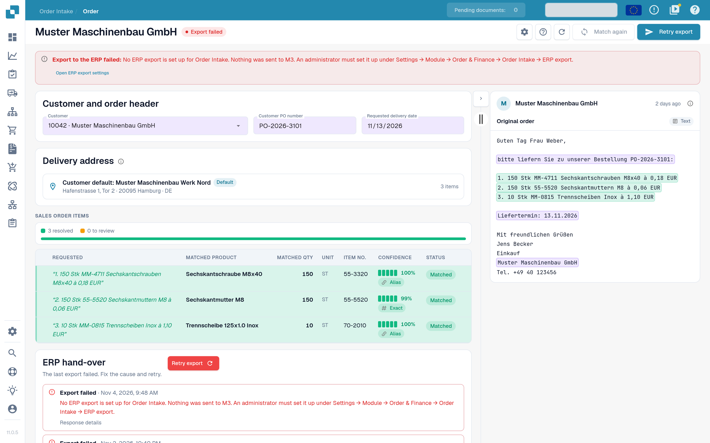<figcaption><p>If the ERP hand-over fails, the banner shows the reason; here no ERP export is set up, and administrators get the link Open ERP export settings. Fix the cause and click Retry export.</p></figcaption></figure>

### Reject an order

To stop an order (e.g. a duplicate or not a real order), open the arrow next to **Approve and export** and click **Reject**. Add a reason if you like. Nothing is handed over to the ERP.

If DocBits detects that an order may be a **duplicate** of an earlier one (same customer and PO number, or very similar positions), a banner offers **Reject as duplicate**, **View Duplicates** and **Proceed Anyway**.
