# Auftragseingang

## Überblick

Der **Auftragseingang** liest die Bestellungen Ihrer Kunden — per E-Mail oder als eingefügten Text — und bereitet sie als Kundenaufträge für Ihr ERP vor. DocBits erkennt den Kunden, liest jede Position, ordnet sie einem Artikel Ihres Artikelstamms zu und zeigt, was noch eine Entscheidung braucht. Sie prüfen den Auftrag, ergänzen Fehlendes, fragen bei Unklarheiten beim Kunden nach und geben ihn frei. Erst dann wird der Kundenauftrag im ERP angelegt.

```
Kunden-E-Mail / eingefügter Text
        │
        ▼
  Positionen lesen ──► Artikeln zuordnen ──► Sie prüfen und entscheiden ──► Freigeben und exportieren ──► Kundenauftrag im ERP
                                                     │
                                                     └──► Beim Kunden nachfragen (E-Mail) ──► Antwort wird übernommen
```

**Beispiel:** Die Muster Maschinenbau GmbH schreibt „150 Stk MM-4711 Sechskantschrauben M8x40“. DocBits erkennt den Kunden an der Absenderadresse, weiß, dass dessen Nummer MM-4711 Ihr Artikel 55-3320 ist, und zeigt die Position als **Zugeordnet**. Eine zweite Position „2 Winkelschleifer 125er“ hat keine Artikelnummer — DocBits schlägt ähnliche Artikel vor und setzt die Position auf **Prüfen**. Sie wählen den richtigen Artikel, klicken auf **Freigeben und exportieren**, und der Auftrag ist im ERP.


**Aktuelle Grenzen**

* **Aufträge aus PDF-Dateien sind noch nicht verfügbar.** Nutzen Sie E-Mail-Aufträge oder **Aus Text importieren**.
* **Preise** werden nur angezeigt und geprüft, wenn Ihr ERP (Infor M3) Preise für den Kunden liefert. Ohne Preise wird der Auftrag trotzdem übergeben — das ERP bepreist ihn.
* **Rückfragen an den Kunden** sind nur bei Aufträgen möglich, die per E-Mail kamen.


## Aktivieren

Der Auftragseingang setzt das Abonnement **AI Workforce** voraus.

1. Öffnen Sie **Einstellungen › Module › Bestellung & Finanzen** und dort den Abschnitt **Auftragseingang**.
2. Schalten Sie **Auftragseingang-Dashboard aktivieren** ein. „Auftragseingang“ erscheint jetzt in der Seitenleiste.
3. Geben Sie der Rolle der Sachbearbeiter unter **Einstellungen › Gruppen und Berechtigungen** Zugriff auf den Auftragseingang (Administratoren haben immer Zugriff).

<figure>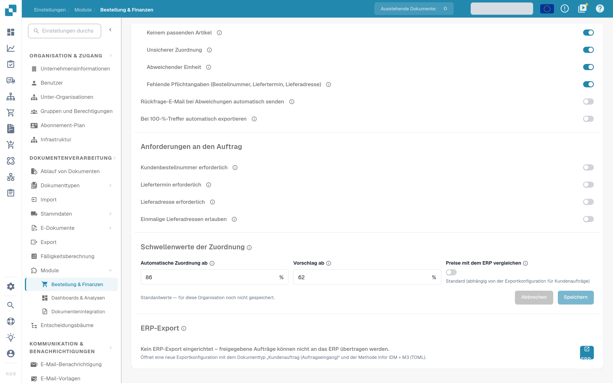<figcaption><p>Einstellungen des Auftragseingangs unter Einstellungen › Module › Bestellung &#x26; Finanzen; am Ende der Abschnitt ERP-Export, hier noch ohne ERP-Export.</p></figcaption></figure>

Im selben Abschnitt legt ein Administrator fest, wie das Modul arbeitet:

| Gruppe | Einstellung | Wirkung |
| --- | --- | --- |
| **Automatisierung** | **Bei Abweichungen automatisch eine Antwort-E-Mail entwerfen** | Standardmäßig ein: Der Agent entwirft für die unten eingeschalteten Fälle selbst eine Rückfrage. Ein Mitarbeiter prüft sie, solange das automatische Senden aus ist. |
| | **Rückfrage-E-Mail entwerfen bei Positionen mit** … | Bei welchen Problemen der Agent eine Rückfrage entwirft: **Keinem passenden Artikel**, **Unsicherer Zuordnung**, **Abweichender Einheit**, **Fehlende Pflichtangaben (Bestellnummer, Liefertermin, Lieferadresse)**. Eine fehlende Menge wird immer erfragt. |
| | **Rückfrage-E-Mail bei Abweichungen automatisch senden** | Aus (empfohlen): Jede entworfene E-Mail wartet auf die Freigabe durch einen Mitarbeiter. |
| | **Bei 100-%-Treffer automatisch exportieren** | Aufträge, bei denen jede Position exakt oder über eine gelernte Kunden-Artikelnummer zugeordnet ist und nichts anderes fehlt, gehen ohne Freigabe ins ERP. |
| **Anforderungen an den Auftrag** | **Kundenbestellnummer erforderlich**, **Liefertermin erforderlich**, **Lieferadresse erforderlich** | Wenn eingeschaltet, bekommt ein Auftrag ohne diesen Wert einen offenen Punkt und kann erst freigegeben werden, wenn der Wert da ist. Standardmäßig sind alle drei aus. |
| | **Einmalige Lieferadressen erlauben** | Wenn eingeschaltet, können Sachbearbeiter eine Adresse eintippen, die nur für diesen Auftrag gilt (z. B. eine Baustelle). Sonst sind nur Adressen aus den Kundenstammdaten möglich. |
| **Schwellenwerte der Zuordnung** | **Automatische Zuordnung ab** (Standard 86 %), **Vorschlag ab** (Standard 62 %) | Automatisch übernommen werden nur exakte Artikelnummern und gelernte Kunden-Artikelnummern. Ähnliche Beschreibungen werden immer als Vorschlag zur Prüfung gezeigt. |
| | **Preise mit dem ERP vergleichen** | Vergleicht den Nettopreis des Kunden mit dem ERP-Nettopreis. Eine Abweichung über der erlaubten Toleranz braucht eine Entscheidung; die Preise setzt in jedem Fall das ERP. Standardmäßig richtet sich das nach der Konfiguration des ERP-Exports. |
| **ERP-Export** | *(nur Status)* | Zeigt die Exportkonfigurationen vom Dokumenttyp **Kundenauftrag (Auftragseingang)**, mit denen freigegebene Aufträge ins ERP gehen, jeweils mit **Bearbeiten**; eine inaktive ist mit **Inaktiv** markiert. Eine Warnzeile bedeutet, dass eine Konfiguration noch den eingehenden Dokumenttyp **Auftragseingang – eingehendes Dokument** nutzt; sie wird nie verwendet. Gibt es keine aktive Konfiguration, steht dort *Kein ERP-Export eingerichtet – freigegebene Aufträge können nicht an das ERP übertragen werden.* und wo er eingerichtet wird. Administratoren richten den Export unter **Einstellungen › Export** ein (siehe unten). |

Administratoren öffnen diese Einstellungen auch aus jedem Auftrag über das **Zahnrad** in der Kopfleiste.

### ERP-Export einrichten (Administratoren)

Freigegebene Aufträge gelangen nur über eine Exportkonfiguration vom Dokumenttyp **Kundenauftrag (Auftragseingang)** ins ERP (Infor M3). Ein Administrator richtet sie einmal ein:

1. Öffnen Sie **Einstellungen › Export** und klicken Sie auf **Neu**.
2. Geben Sie einen **Konfigurationstitel** ein und wählen Sie als **Dokumenttyp** **Kundenauftrag (Auftragseingang)**. Er wird angeboten, sobald der Auftragseingang eingeschaltet ist; Sie müssen den Dokumenttyp nicht vorher aktivieren.
3. Wählen Sie unter **Export** **Infor** und unter **Infotyp** **Infor IDM + M3 (TOML)**.
4. Laden Sie die **ION API-Datei** (`.ionapi`) und die **TOML-Zuordnungsdatei** (`.toml`) Ihrer M3-Anbindung hoch.
5. Klicken Sie auf **Speichern**. Eine neue Konfiguration ist **Aktiv**; je Dokumenttyp kann nur eine Konfiguration aktiv sein.

Der Abschnitt **ERP-Export** in den Einstellungen des Auftragseingangs zeigt danach die Konfiguration; **Bearbeiten** öffnet sie, eine inaktive ist mit **Inaktiv** markiert. Eine Warnzeile dort bedeutet, dass eine ältere Konfiguration noch den eingehenden Dokumenttyp **Auftragseingang – eingehendes Dokument** nutzt: Sie wird nie verwendet – öffnen Sie sie mit **Bearbeiten** und ändern Sie den Dokumenttyp auf **Kundenauftrag (Auftragseingang)**. Aufträge werden nur aus dem Auftragseingang mit **Freigeben und exportieren** exportiert (oder automatisch mit **Bei 100-%-Treffer automatisch exportieren**); die eingehenden Auftragsdokumente selbst werden nie exportiert.

## Einen Auftrag erfassen

### Per E-Mail

Kunden senden ihre Bestellungen an das Auftragspostfach Ihrer Organisation. Der KI-Agent liest die E-Mail, findet die Positionen und legt den Auftrag in der Liste an. Der Kunde wird an der **Domain der Absenderadresse** erkannt. Signaturen, Pflichtangaben und zitierte ältere Nachrichten werden nicht als Positionen gelesen.

### Aus Text importieren

Für Bestellungen, die Sie auf anderem Weg erreicht haben (ein abgetipptes Fax, eine Chat-Nachricht, ein weitergeleiteter Text):

1. Klicken Sie in der Auftragsliste auf **Aus Text importieren**.
2. Fügen Sie die Bestellung in **Bestelltext** ein. Freitext ist in Ordnung — Zeilenumbrüche, Abkürzungen und Kurzschreibweisen werden verarbeitet.
3. Wählen Sie den **Kunden** (Suche nach Name, E-Mail oder Kundennummer). Ohne Kunde öffnet sich der Auftrag mit dem offenen Punkt *Kunde fehlt*.
4. Klicken Sie auf **Erkennen & zuordnen**.

<figure><figcaption><p>Kundenbestellung einfügen und Kunden wählen.</p></figcaption></figure>

### Neuer Auftrag

**Neuer Auftrag** erfasst einen Auftrag von Hand aus Ihrem Artikelkatalog: Kunden und Lieferadresse wählen, Artikel und Mengen hinzufügen, dann **Freigeben und exportieren**.

## Die Auftragsliste

Öffnen Sie **Auftragseingang** in der Seitenleiste. Die Liste zeigt jeden Auftrag mit Kunde, Quelle (E-Mail, Text, Manuell), Anzahl der Positionen, Eingangszeit, Status und Zuordnungsstatus. Ein kleines Warnzeichen neben der Positionsanzahl zeigt, wie viele noch eine Entscheidung brauchen. Klicken Sie auf eine Zeile, um den Auftrag zu öffnen.

<figure>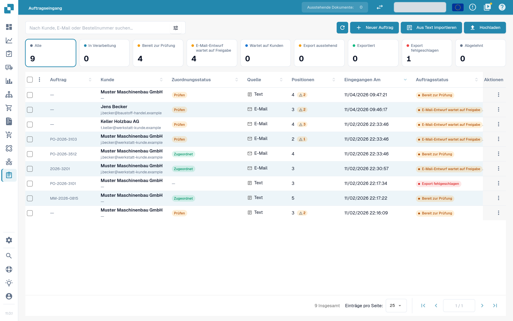<figcaption><p>Die Auftragsliste mit den Statuskarten.</p></figcaption></figure>

Die **Statuskarten** über der Liste zählen die Aufträge je Status. Ein Klick auf eine Karte zeigt nur diese Aufträge; **Alle** zeigt alles.

| Status | Bedeutung |
| --- | --- |
| **In Verarbeitung** | Der Auftrag wird gelesen oder vorbereitet — noch nichts zu tun. |
| **Bereit zur Prüfung** | Gelesen und wartet auf einen Mitarbeiter: Positionen prüfen oder freigeben. |
| **E-Mail-Entwurf wartet auf Freigabe** | Eine Mail an den Kunden ist entworfen und wartet auf Ihre Freigabe. |
| **Wartet auf Kunden** | Eine Rückfrage wurde gesendet, die Antwort steht aus. |
| **Export ausstehend** | Freigegeben, aber noch nicht an das ERP übergeben. |
| **Exportiert** | An das ERP übergeben. |
| **Export fehlgeschlagen** | Das ERP hat die Übergabe abgelehnt — nach Behebung der Ursache erneut versuchen. |
| **Abgelehnt** | Abgelehnt oder als Dublette erkannt — nichts weiter zu tun. |

Die Spalte **Zuordnungsstatus** zeigt **Prüfen**, wenn eine Position, ein Pflichtfeld im Kopf oder die Lieferadresse noch eine Entscheidung braucht, und **Zugeordnet**, wenn alles geklärt ist.

Solange der KI-Agent, eine Neuzuordnung oder eine Kundenantwort an einem Auftrag arbeitet, zeigt sein Status **Agent arbeitet** mit einem drehenden Pfeil. Der Auftrag ist bis dahin gesperrt; die Liste aktualisiert sich selbst.

**Suchen und filtern:** Geben Sie einen Kunden, eine E-Mail-Adresse oder eine Bestellnummer in das Suchfeld ein. Das Filtersymbol im Suchfeld filtert nach **Quelle** (*E-Mail* oder *Manuell*).

Das Menü am Zeilenende bietet **Protokoll** (jeder Schritt von Agent, Benutzern und System sowie die Entscheidungshistorie: wer was bestätigt oder geändert hat) und **Löschen**.

## Einen neuen Auftrag prüfen

### Der Zuordnungsbildschirm

<figure>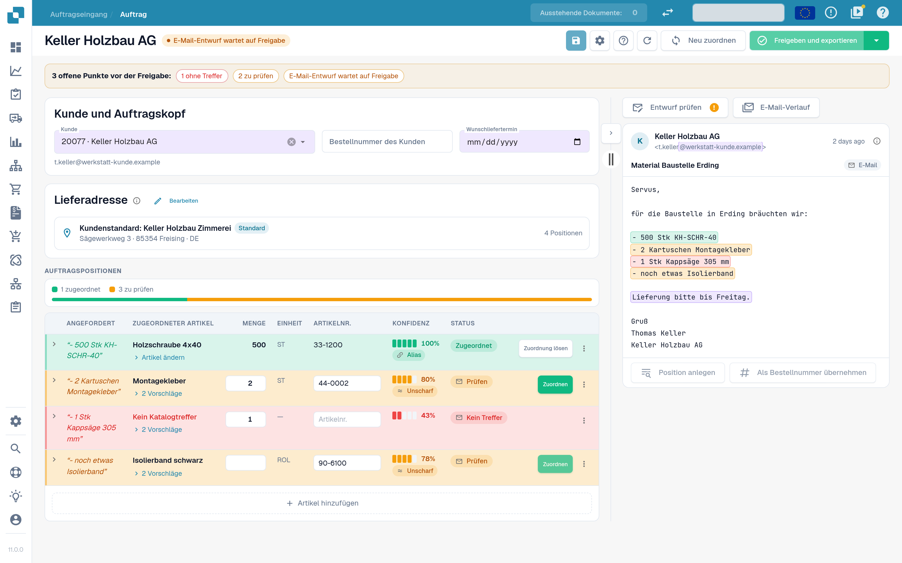<figcaption><p>Der Zuordnungsbildschirm: links die Auftragsdaten, rechts die E-Mail des Kunden.</p></figcaption></figure>

* **Kopfleiste** — Kunde, Status, Auftragswert (nur mit ERP-Preisen) und die Aktionen **Speichern**, **Legende**, **Aktualisieren**, **Neu zuordnen** und **Freigeben und exportieren**.
* **Offene Punkte** — direkt unter der Kopfleiste: alles, was die Freigabe noch blockiert, z. B. *Kunde fehlt*, *Bestellnummer fehlt*, *2 zu prüfen*. Ein Klick springt zur Stelle.
* **Kunde und Auftragskopf** — Kunde, Bestellnummer des Kunden und Wunschliefertermin.
* **Lieferadresse** — wohin der Auftrag geht. Hat der Kunde eine Standardadresse, wird sie automatisch verwendet (*Kundenstandard: …* mit dem Kennzeichen **Standard**); **Bearbeiten** ändert sie. Positionen können auch an verschiedene Adressen gehen.
* **Positionen** — eine Zeile je bestelltem Artikel mit dem Text des Kunden, dem zugeordneten Artikel, Menge, Einheit und Status. Über der Tabelle zeigt ein Balken, wie viele Positionen geklärt sind und wie viele noch zu prüfen sind.
* **Quelle** (rechts) — die E-Mail des Kunden oder der eingefügte Text. Positionen sind grün, gelb oder rot markiert wie ihr Status, Lieferadressen blau und Kopfwerte (Kunde, Bestellnummer, Datum) violett. Ein Klick auf eine Markierung springt zur Position. Der Pfeil am Trenner blendet die E-Mail aus oder ein; durch Ziehen am Trenner ändern Sie die Breite. **E-Mail-Verlauf** listet alle Mails dieses Auftrags.

Die **Legende** (Fragezeichen-Button) erklärt alle Farben, Status und Zuordnungsarten.


Was Sie auf diesem Bildschirm ändern, wird erst mit **Speichern** übernommen (Disketten-Symbol; ein roter Punkt bedeutet ungespeicherte Änderungen). Strg+S / Cmd+S speichert ebenfalls. Verlassen Sie den Auftrag mit ungespeicherten Änderungen, fragt DocBits, ob gespeichert oder verworfen werden soll.


### Positionsstatus und Zuordnungsarten

| Status | Bedeutung |
| --- | --- |
| **Zugeordnet** | Automatisch zugeordnet (über eine gelernte Kunden-Artikelnummer oder die exakte Artikelnummer) oder von einem Mitarbeiter bestätigt. |
| **Prüfen** | Es gibt einen Vorschlag, der geprüft werden muss. |
| **Kein Treffer** | Kein Artikel des Artikelstamms ist ähnlich genug für einen Vorschlag. |
| **Offen** | Noch nicht zugeordnet. |
| **Ignoriert** | Wird nicht exportiert. |

| Zuordnungsart | Bedeutung |
| --- | --- |
| **Alias** | Die eigene Artikelnummer dieses Kunden wurde Ihrem Artikel schon einmal zugeordnet — wird automatisch übernommen. |
| **Exakt** | Die Artikelnummer im Auftrag stimmt exakt mit dem Artikelstamm überein — wird automatisch übernommen. |
| **Unscharf** | Nur eine ähnliche Beschreibung — muss immer geprüft werden. |
| **Manuell** | Von einem Mitarbeiter gewählt oder bestätigt. |
| **Rückfrage** | Aus der Antwort des Kunden übernommen. |

Wenn Sie für eine Kunden-Artikelnummer einen Artikel bestätigen, **lernt DocBits sie als Alias** für diesen Kunden: Der nächste Auftrag mit derselben Nummer wird automatisch zugeordnet. Ein gelernter Alias lässt sich im Menü der Position wieder entfernen (**Gelernten Alias entfernen**).

### Positionen mit Status „Prüfen“

1. Klicken Sie auf die Position. **Vom Kunden bestellt** zeigt Menge, Einheit, Kunden-Artikelnummer und Beschreibung, wie der Kunde sie geschrieben hat.
2. **Vorgeschlagene Artikel** listet die besten Artikel mit Artikelnummer, Einheit, Zuordnungsart und Trefferquote.
3. Der beste Vorschlag ist bereits vorausgewählt (**Gewählt**). Passt ein anderer Artikel, klicken Sie dort auf **Verwenden** — oder suchen Sie ihn unter **Oder im Katalog suchen**. Das rote **x** hebt die Auswahl auf.
   Eine Position braucht eine **Menge**, bevor sie zugeordnet werden kann: Ohne Menge sind **Verwenden** und **Zuordnen** ausgegraut (*Bitte zuerst eine Menge eintragen — eine Position ohne Menge kann nicht zugeordnet werden.*). Tragen Sie zuerst die Menge in der Zeile ein.
4. Ein Fenster vergleicht die Bestellung mit dem gewählten Artikel. Prüfen Sie es und klicken Sie auf **Zuordnung bestätigen**.
5. Klicken Sie auf **Speichern**.

<figure>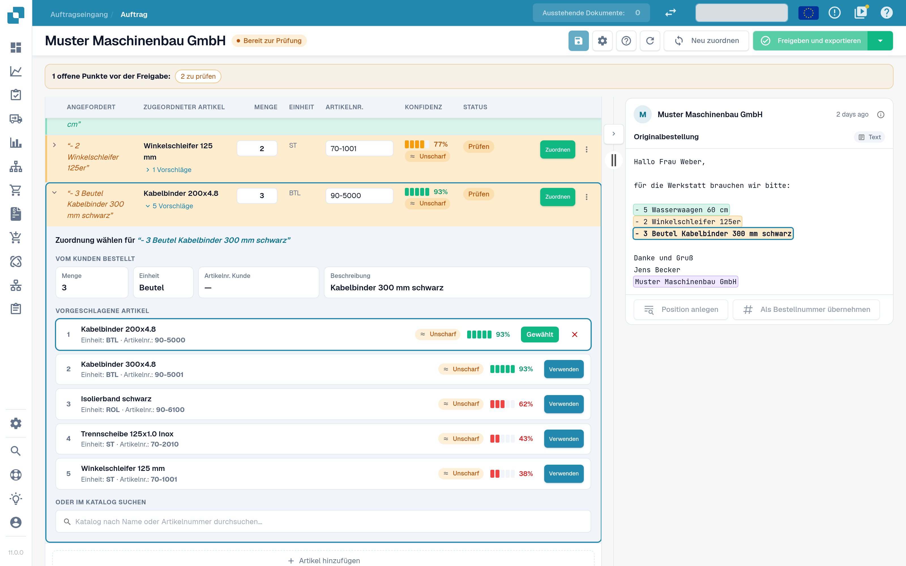<figcaption><p>Eine Position mit Status „Prüfen“: Bestellung und Vorschläge vergleichen.</p></figcaption></figure>

<figure>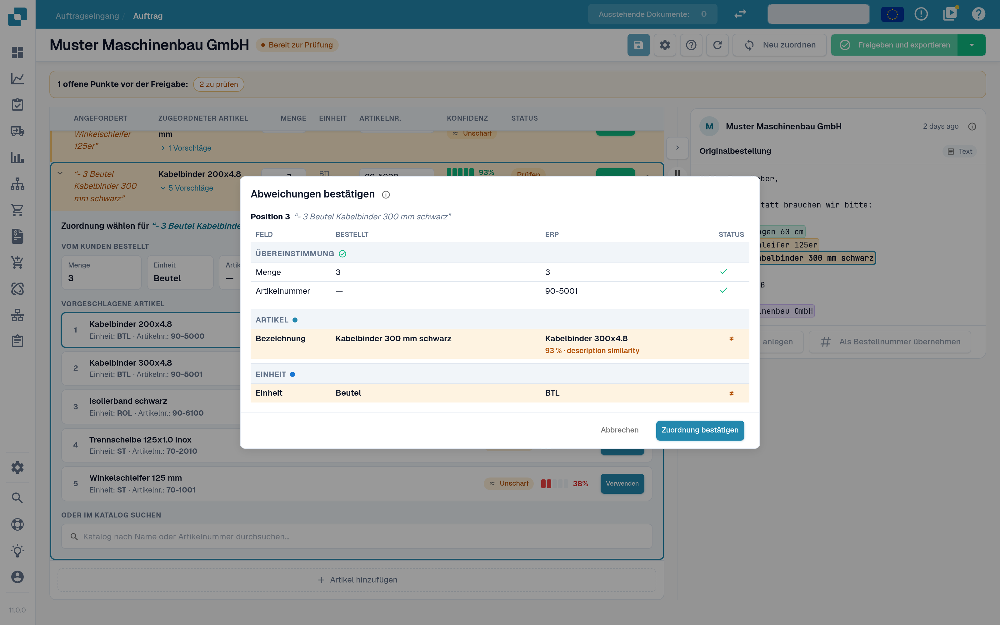<figcaption><p>Abweichungen bestätigen vergleicht die Bestellung des Kunden mit dem gewählten Artikel; hier weichen Beschreibung und Einheit ab. Der Hinweis „description similarity“ ist im Produkt noch nicht übersetzt.</p></figcaption></figure>

Ist bei einer Position schon ein Vorschlag ausgewählt, bestätigen Sie ihn direkt mit **Zuordnen** in der Zeile. Das Menü am Zeilenende bietet mehr: **Kunden zu dieser Position anschreiben**, **Eigenes Lieferdatum…**, **Eigene Lieferadresse…**, **Position ignorieren** (wird nicht exportiert) und **Position löschen**.

### Mengen- und Preisabweichungen

* **Menge:** Sie können die Menge einer Position ändern. Weicht sie von der Bestellung ab, wird sie gelb angezeigt und muss bestätigt werden: Position öffnen, Artikel wählen — das Fenster **Abweichungen bestätigen** zeigt die Menge. Optional eine Notiz eingeben und **Bestätigen** klicken. Exportiert wird die bestätigte Menge.
* **Preis** (nur mit ERP-Preisen): Weicht der Preis des Kunden um mehr als die erlaubte Toleranz vom ERP-Nettopreis ab, wird der Preis gelb angezeigt mit dem Hinweis *Preis weicht ab*. Klicken Sie in der Zeile auf **Zuordnen**; das Fenster zeigt beide Preise, die Differenz und die Toleranz. Mit **Bestätigen** übernehmen Sie den ERP-Preis — oder Sie fragen beim Kunden nach (siehe [Beim Kunden nachfragen](#beim-kunden-nachfragen)). Sieht der Kundenpreis nach einem Preis je 10, 100 oder 1000 aus, bietet das Fenster an, die Preiseinheit mit einem Klick zu setzen.

<figure>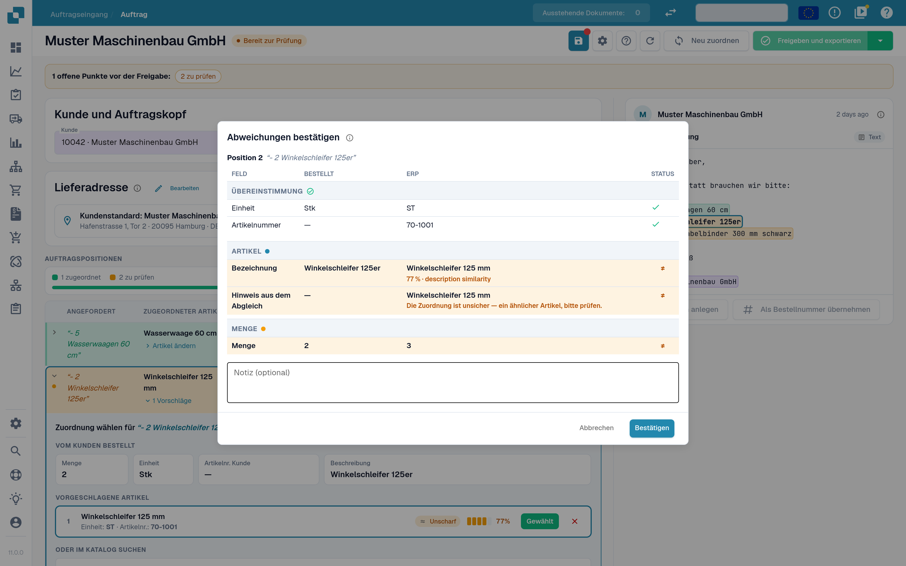<figcaption><p>Eine abweichende Menge wird mit optionaler Notiz bestätigt. Der Hinweis „description similarity“ ist im Produkt noch nicht übersetzt.</p></figcaption></figure>

Liefert das ERP für eine Position keinen Preis, steht dort **Kein ERP-Preis** mit dem Grund beim Darüberfahren und einem Button **Erneut versuchen**. Das blockiert den Auftrag nicht.

### Kunde nicht erkannt

Ist die Domain des Absenders noch unbekannt, zeigt der Auftrag den offenen Punkt **Kunde fehlt**. Wählen Sie den Kunden unter **Kunde und Auftragskopf**. DocBits bietet dann an, sich die Domain des Absenders zu merken:

* **E-Mail-Domain zuordnen** — *Künftige E-Mails von @domain werden automatisch diesem Kunden zugeordnet.* Klicken Sie auf **Bestätigen**; das wird zusammen mit Ihren anderen Änderungen beim **Speichern** gespeichert. **Abbrechen** nimmt die Kundenwahl zurück.
* Gehört die Domain schon einem anderen Kunden, wählen Sie **Bei … belassen** (künftige Mails bleiben beim bisherigen Kunden, dieser Auftrag bekommt trotzdem den neuen) oder **… zuordnen** (künftige Mails gehen an den neuen Kunden).

<figure>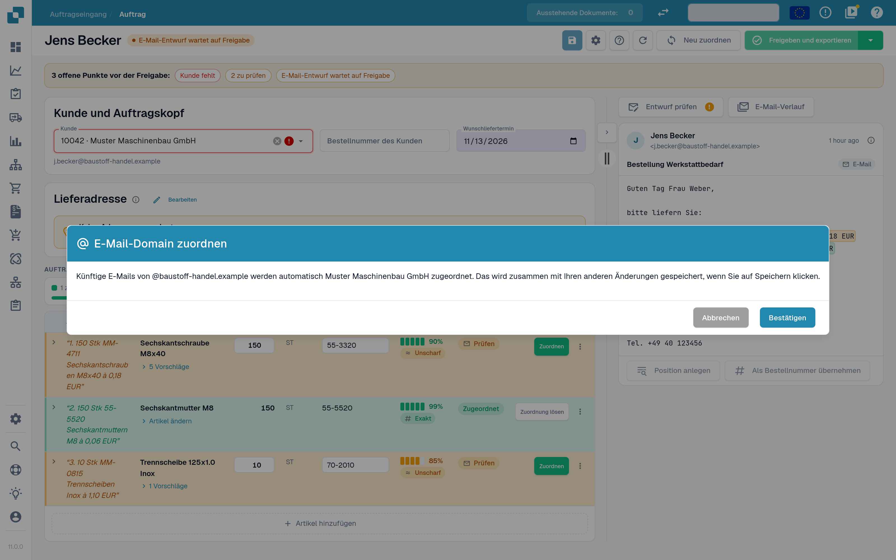<figcaption><p>Mit dem Kunden kann auch die E-Mail-Domain des Absenders zugeordnet werden.</p></figcaption></figure>

<figure>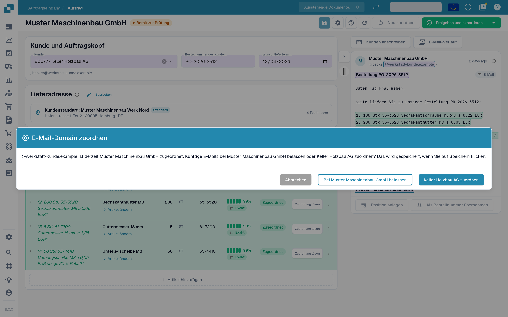<figcaption><p>Die Domain gehört schon einem anderen Kunden: belassen oder umhängen.</p></figcaption></figure>

Öffentliche Mail-Domains (etwa gmail.com) werden nie einem Kunden zugeordnet.

### Neu zuordnen

**Neu zuordnen** in der Kopfleiste ordnet alle offenen Positionen noch einmal zu — zum Beispiel nachdem neue Artikel in den Artikelstamm kamen oder Sie den Kunden geändert haben. Bestätigte und ignorierte Positionen bleiben unberührt. Eine Meldung sagt, wie viele Positionen neu zugeordnet wurden.

Der Button ist ausgegraut, wenn eine Zuordnung nichts bewirken kann; beim Darüberfahren steht der Grund:

| Hinweis | Warum |
| --- | --- |
| *Alle Positionen sind bereits zugeordnet, bestätigt oder ignoriert.* | Nichts ist offen. |
| *Der Abgleich wartet, während der Agent die Klärung schreibt.* | Warten, bis der Entwurf da ist. |
| *Der Auftrag ist bereits übergeben oder abgeschlossen.* | Freigegebene, exportierte oder abgelehnte Aufträge werden nicht neu zugeordnet. |
| *Der Auftrag wird noch gelesen.* | Warten, bis das Lesen fertig ist. |

Neu zuordnen geht auch bei offener Rückfrage: Ein nicht gesendeter Entwurf bleibt erhalten (ist alles geklärt, wonach er fragt, zeigt er *Nichts mehr zu fragen*); ein freigegebener, aber nicht gesendeter Entwurf wird wieder zum Entwurf.

## Fehlende oder falsche Position korrigieren

Manchmal fasst das Lesen zwei Artikel in einer Position zusammen, teilt einen Artikel auf zwei Positionen auf oder übersieht einen Artikel, der in einem Satz steht. Korrigieren Sie das direkt in der E-Mail oder im eingefügten Text:

1. **Markieren Sie den Text** des Artikels im Auftragstext rechts.
2. Klicken Sie unter dem Text auf **Position anlegen**.
3. Das Fenster zeigt **Vorher → Nachher**. Prüfen Sie es und klicken Sie auf **Bestätigen**.
4. Klicken Sie auf **Speichern**. Die neuen Positionen erhalten neue Nummern, werden automatisch zugeordnet und im Text markiert.

Was passiert, hängt von der Markierung ab:

| Sie markieren … | Ergebnis |
| --- | --- |
| Text, der **noch keine Position** ist | **Neue Position** — die Markierung wird eine neue Position. |
| **Einen Teil einer Position** (z. B. den zweiten von zwei Artikeln in einer Zeile) | **Aufteilen** — die Position wird entfernt und durch eine Position je Artikel ersetzt. |
| **Zwei oder mehr benachbarte Positionen vollständig** | **Zusammenfassen** — sie werden eine Position. |
| Eine Position **plus weiteren Text** | Die Position wird durch den markierten Text **ersetzt**. |
| Eine Position **genau so, wie sie ist** | Nichts passiert — *Dieser Text ist bereits Position n.* |

<figure>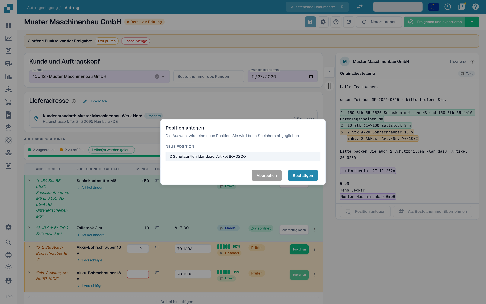<figcaption><p>Eine übersehene Position anlegen.</p></figcaption></figure>

<figure>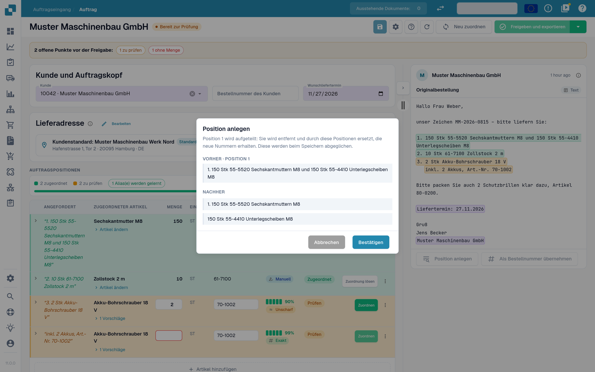<figcaption><p>Eine Position mit zwei Artikeln aufteilen.</p></figcaption></figure>

<figure>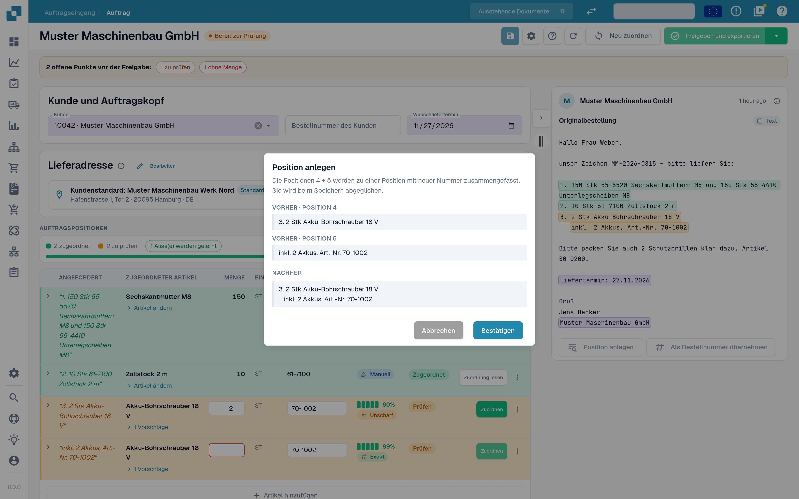<figcaption><p>Zwei zusammengehörende Positionen zusammenfassen.</p></figcaption></figure>

<figure>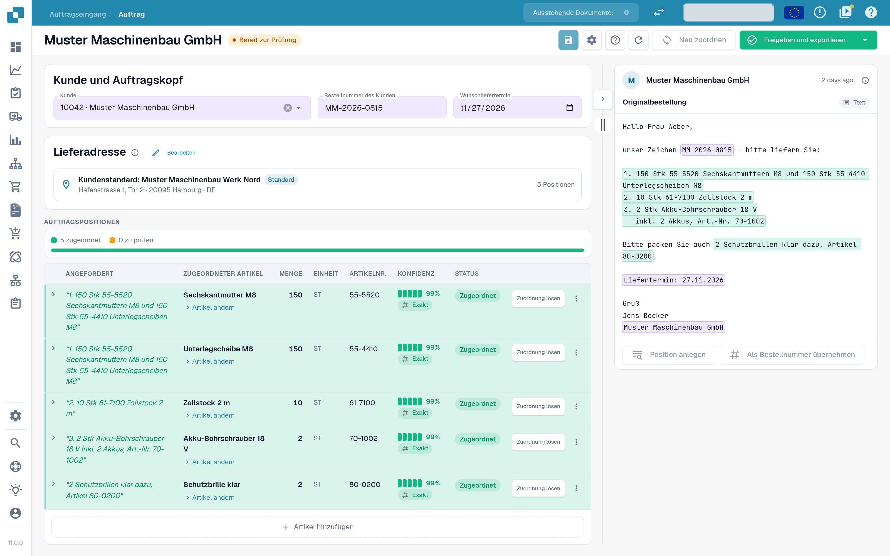<figcaption><p>Nach dem Speichern sind die neuen Positionen zugeordnet und im Text markiert.</p></figcaption></figure>

### Eine bereits entschiedene Position aufteilen

Eine Position, die **bestätigt** oder **ignoriert** ist, eine **eigene Lieferadresse, ein eigenes Datum oder einen eigenen Preis** hat, eine **Kundenantwort** enthält oder **von einem Mitarbeiter geändert** wurde, können Sie trotzdem aufteilen. Sie wird dann **aufgelöst**: Jeder Teil wird eine neue Position, die aus ihrem eigenen Text neu gelesen und zugeordnet wird. Alle neuen Positionen behalten Lieferadresse und Liefertermin und müssen erneut geprüft werden; offene Prüfpunkte der alten Position wandern zur ersten neuen Position. Das Fenster listet genau auf, was mit der alten Position verloren geht, zum Beispiel die Bestätigung des Artikels, eine akzeptierte Menge oder ein akzeptierter ERP-Preis, eine Kundenantwort oder eine Mitarbeiter-Änderung. Der Verlauf des Auftrags behält die alten Werte.

<figure>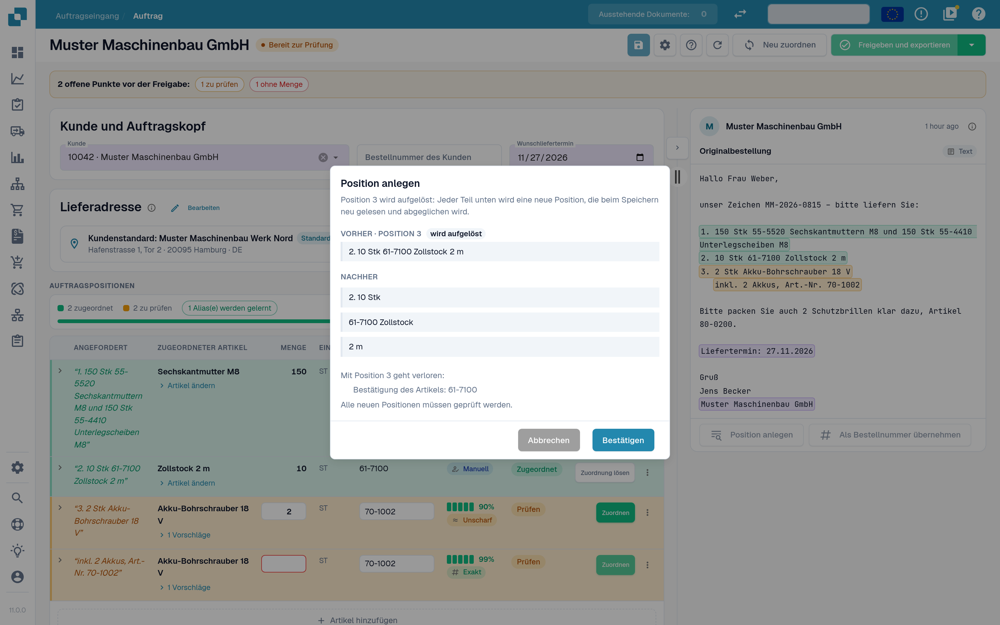<figcaption><p>Das Aufteilen einer entschiedenen Position löst sie auf; das Fenster listet auf, was verloren geht.</p></figcaption></figure>

Solche Positionen werden nie **zusammengefasst**. Eine Position mit **ungespeicherten Änderungen** kann nicht aufgeteilt werden: Speichern oder verwerfen Sie die Änderungen zuerst.

### Wenn nichts geändert wird

Umfasst die Markierung nur einen Teil einer Position und Text außerhalb davon, oder berührt sie mehrere Positionen, ohne sie ganz zu umfassen, wird nichts geändert und das Fenster erklärt den Grund. Markieren Sie Text innerhalb einer Position oder ganze Positionen zum Zusammenfassen. Wurden zwei Positionen aus derselben Textzeile gelesen, nennt das Fenster die Position, die sich ebenfalls auf den markierten Text bezieht und unverändert bleibt.

Eine Position können Sie jederzeit auch von Hand mit **Artikel hinzufügen** unter der Positionstabelle anlegen oder ihre Felder in der Tabelle bearbeiten.

## Auftragskopf korrigieren

### Bestellnummer aus dem Text

Wurde die Bestellnummer des Kunden nicht erkannt (z. B. „unser Zeichen MM-2026-0815“ ohne Bezeichnung), markieren Sie **nur die Bestellnummer** im Text und klicken auf **Als Bestellnummer übernehmen**. Nach dem **Speichern** steht die Nummer in **Bestellnummer des Kunden** und ist im Text violett markiert — so sieht jeder, woher sie stammt.

<figure>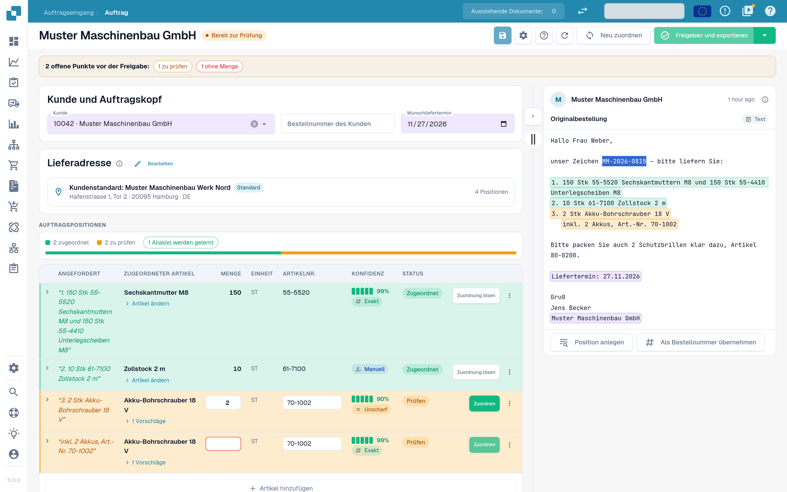<figcaption><p>Die Bestellnummer im Text markieren.</p></figcaption></figure>

### Bestellnummer aus dem Betreff

Viele Kunden schreiben die Bestellnummer nur in den Betreff („AW: 4711“). Sie können sie auch in der **Betreffzeile** der E-Mail markieren. Im Betreff gibt es nur **Als Bestellnummer übernehmen** — Positionen werden aus dem Auftragstext angelegt.

Bestellnummer und Liefertermin können Sie jederzeit auch direkt unter **Kunde und Auftragskopf** eintippen.

## Beim Kunden nachfragen

Wenn nur der Kunde etwas beantworten kann — ein unbekannter Artikel, eine unklare Menge oder Einheit, eine fehlende Bestellnummer oder Lieferadresse, eine Preisabweichung —, senden Sie eine Rückfrage per E-Mail. Sie geht im Verlauf der ursprünglichen Bestellung hinaus, und die Antwort kommt zum selben Auftrag zurück. Das ist nur bei **E-Mail-Aufträgen** möglich.

### Rückfrage starten

1. Klicken Sie über der E-Mail auf **Kunden anschreiben** (oder im Menü einer Position auf **Kunden zu dieser Position anschreiben**).
2. Wählen Sie unter **Grund**, warum Sie fragen (oder lassen Sie es leer — *Den Assistenten entscheiden lassen*), prüfen Sie die **Empfänger** (bei Bedarf **Cc** ergänzen) und haken Sie die Positionen unter **Bezugspositionen** an.
3. Wählen Sie, wie:
   * **Automatisch senden** — klicken Sie auf **An Agenten übergeben**. Der KI-Agent schreibt die E-Mail. Nichts wird gesendet, bevor ein Mitarbeiter den Entwurf freigibt.
   * **Manuell senden** — schreiben Sie Betreff und Text selbst und klicken Sie auf **Senden**.

Während der Agent schreibt, zeigt der Button über der E-Mail **Entwurf in Arbeit**, und **Neu zuordnen** wartet.

Je nach Einstellung entwirft der Agent eine Rückfrage auch selbst, wenn ein Auftrag mit Problemen eingeht.

Solange ein Entwurf existiert, heißt der Button über der E-Mail **Entwurf prüfen** statt **Kunden anschreiben**. Ist der Auftrag vollständig, bleibt **Entwurf prüfen** ohne das gelbe **!** verfügbar — Sie können den Entwurf weiterhin senden oder verwerfen. **Freigeben und exportieren** verwirft einen nicht gesendeten Entwurf.

### Entwurf prüfen und senden

Ist der Entwurf fertig, hat der Auftrag den Status **E-Mail-Entwurf wartet auf Freigabe**, und der Button **Entwurf prüfen** zeigt ein gelbes **!**. Klicken Sie darauf, um **Rückfrage an den Kunden** zu öffnen:

* **Verwerfen** — Entwurf löschen; nichts wird gesendet.
* **An Agent zurückgeben** — dem Agenten sagen, was er ändern soll; er schreibt einen neuen Entwurf.
* **Bearbeiten** — Betreff oder Text selbst ändern.
* **Freigeben & senden** — die E-Mail an den Kunden senden.

<figure>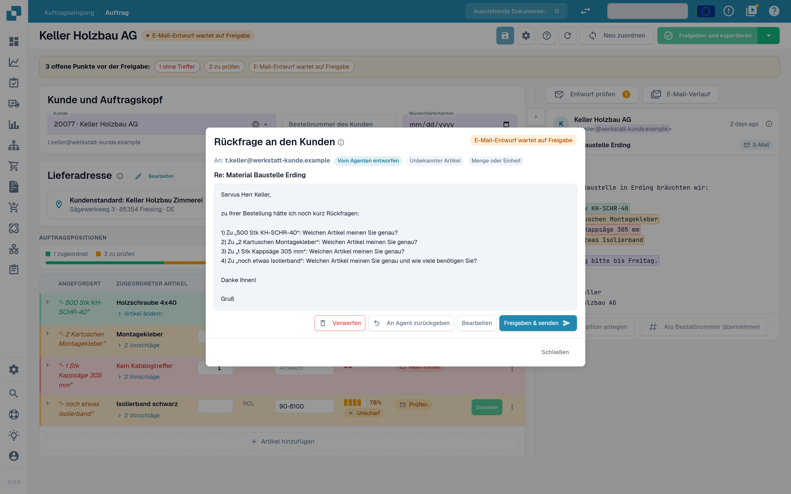<figcaption><p>Der Entwurf des Agenten wartet auf Ihre Freigabe.</p></figcaption></figure>

### Auf die Antwort warten

Nach dem Senden hat der Auftrag den Status **Wartet auf Kunden**, und der Button über der E-Mail heißt **Wartet auf Kunden**. Antwortet der Kunde, liest der Agent die Antwort und übernimmt sie in den Auftrag (der Auftrag ist kurz gesperrt mit *Kundenantwort wird gelesen*); die Antwort erscheint im E-Mail-Bereich und im **E-Mail-Verlauf**. Bereits bestätigte Positionen werden nicht überschrieben — ändert der Kunde eine davon, wird sie mit *Durch eine Kundenmail geändert* markiert, damit Sie sie erneut prüfen.

Hat der Kunde telefonisch oder per anderer Mail geantwortet, öffnen Sie die Rückfrage und klicken auf **Klärung abschließen**. DocBits wartet dann nicht mehr; eine später eintreffende Antwort wird angezeigt, aber nicht übernommen. **Neue E-Mail** stellt eine weitere Frage.

### Wenn das Senden fehlschlägt

Konnte eine freigegebene E-Mail nicht gesendet werden, zeigt der Auftrag den offenen Punkt **E-Mail nicht gesendet — erneut senden**. Öffnen Sie die Rückfrage: Sie zeigt den Grund. Klicken Sie auf **Erneut senden**.

Kam die Auftrags-E-Mail nicht über eines Ihrer Import-Postfächer herein (zum Beispiel, weil sie auf anderem Weg in DocBits weitergeleitet wurde), gibt es kein Postfach für die Antwort, und die E-Mail kann nicht gesendet werden. Richten Sie für diese Adresse ein Import-Postfach ein, oder wenden Sie sich direkt an den Kunden und verwerfen Sie den Entwurf.

<figure>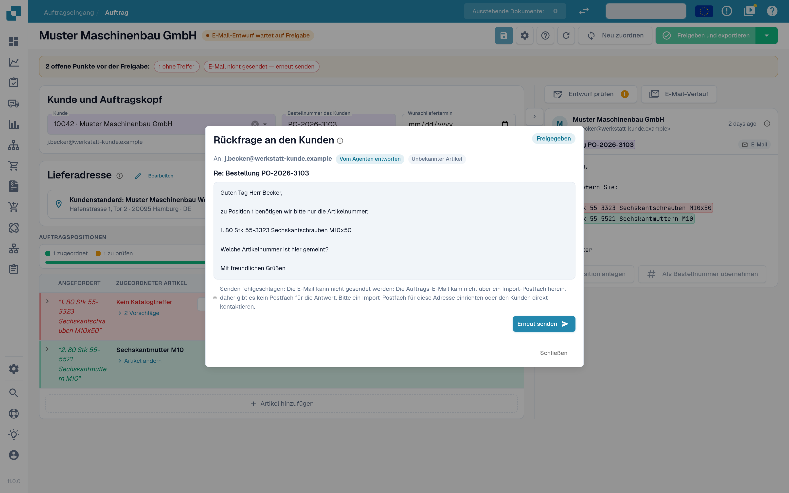<figcaption><p>Senden fehlgeschlagen: Die Rückfrage zeigt den Grund (hier: kein Import-Postfach für die Antwort) und bietet Erneut senden an.</p></figcaption></figure>

## Freigeben und übergeben

**Freigeben und exportieren** in der Kopfleiste ist aktiv, wenn alle offenen Punkte erledigt sind: jede Position zugeordnet, bestätigt oder ignoriert, der Kunde zugeordnet, die Pflichtfelder im Kopf und die Lieferadresse vorhanden. Solange etwas fehlt, zeigt der ausgegraute Button beim Darüberfahren die Liste.

<figure>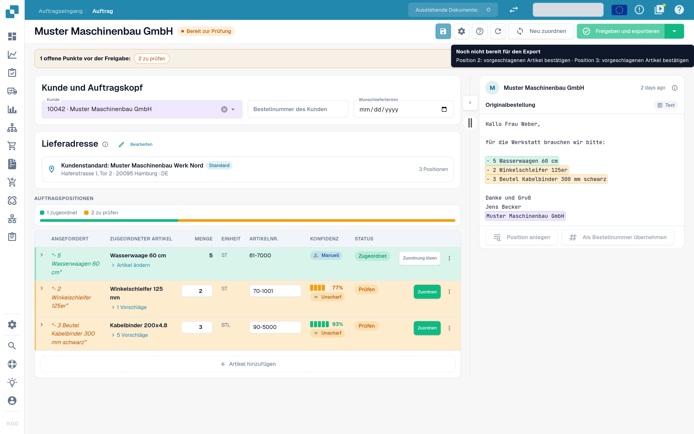<figcaption><p>Freigeben und exportieren bleibt ausgegraut, bis alle offenen Punkte erledigt sind; der Tooltip listet auf, was noch fehlt.</p></figcaption></figure>

1. Klicken Sie auf **Freigeben und exportieren**.
2. Das Fenster fasst Kunde, Anzahl der Positionen, Lieferadressen (einschließlich der Standardadresse des Kunden), Bestellnummer (und mit ERP-Preisen den Auftragswert) zusammen. Es sagt auch, was mit einer offenen Rückfrage passiert: Ein nicht gesendeter Entwurf wird verworfen, eine gesendete Rückfrage abgeschlossen — **dem Kunden wird nichts gesendet**.
3. Klicken Sie auf **Freigeben und exportieren**. Dadurch wird der Kundenauftrag im ERP angelegt.

<figure>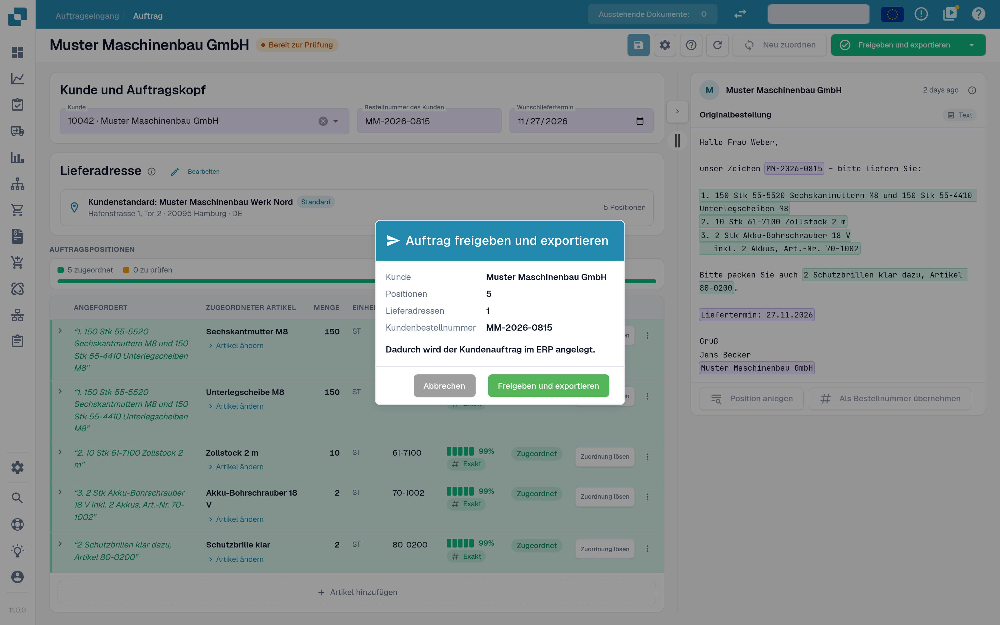<figcaption><p>Letzte Prüfung, bevor der Auftrag ins ERP geht.</p></figcaption></figure>

Der Auftrag ist danach **Exportiert** und zeigt die ERP-Auftragsnummer. Schlägt die Übergabe fehl, ist der Status **Export fehlgeschlagen**, und ein rotes Banner zeigt den Grund in Ihrer Sprache — zum Beispiel, dass das ERP den Auftrag abgelehnt hat, nicht erreichbar war oder dass noch kein ERP-Export eingerichtet ist (dann hat nichts das ERP erreicht; ein Administrator richtet ihn unter **Einstellungen › Export** mit dem Dokumenttyp **Kundenauftrag (Auftragseingang)** ein, siehe *ERP-Export einrichten (Administratoren)*). Administratoren sehen im Banner zusätzlich den Link **ERP-Export-Einstellungen öffnen**; nach einer Rückfrage öffnet er die Einstellungen des Auftragseingangs, deren Abschnitt **ERP-Export** den aktuellen Stand zeigt. Beheben Sie die Ursache und klicken Sie auf **Export wiederholen**.

<figure>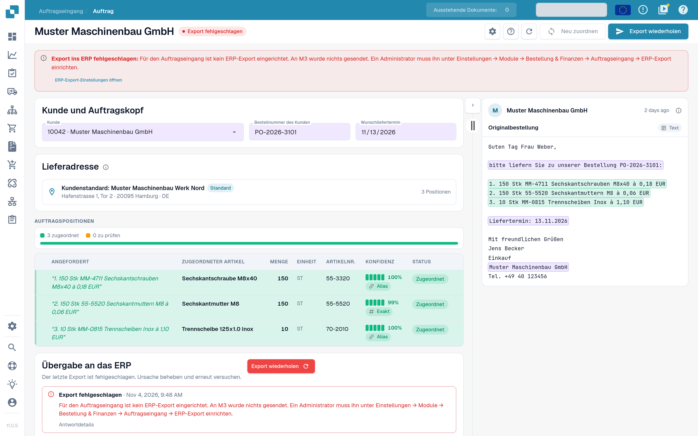<figcaption><p>Schlägt die Übergabe ans ERP fehl, zeigt das Banner den Grund; hier ist kein ERP-Export eingerichtet, und Administratoren erhalten den Link ERP-Export-Einstellungen öffnen. Beheben Sie die Ursache und klicken Sie auf Export wiederholen.</p></figcaption></figure>

### Auftrag ablehnen

Um einen Auftrag zu stoppen (z. B. eine Dublette oder keine echte Bestellung), öffnen Sie den Pfeil neben **Freigeben und exportieren** und klicken auf **Ablehnen**. Ein Grund ist optional. Es wird nichts ans ERP übergeben.

Erkennt DocBits, dass ein Auftrag eine **Dublette** eines früheren sein könnte (gleicher Kunde und gleiche Bestellnummer oder sehr ähnliche Positionen), bietet ein Banner **Als Duplikat ablehnen**, **Duplikate anzeigen** und **Trotzdem fortfahren**.
