# Prise de commandes

## Vue d'ensemble

La **Prise de commandes** lit les commandes que vos clients vous envoient — par e-mail ou sous forme de texte collé — et les prépare en tant que commandes client pour votre ERP. DocBits identifie le client, lit chaque position, l'associe à un article de votre fichier articles et vous montre ce qui demande encore une décision. Vous vérifiez la commande, complétez ce qui manque, interrogez le client si un point n'est pas clair, puis vous l'approuvez. Ce n'est qu'à ce moment que la commande client est créée dans l'ERP.

```
E-mail du client / texte collé
        │
        ▼
  Lecture des positions ──► Association à vos articles ──► Vous vérifiez et décidez ──► Approbation et export ──► Commande client dans l'ERP
                                                                │
                                                                └──► Question au client (e-mail) ──► la réponse est appliquée
```

**Exemple :** Muster Maschinenbau GmbH envoie l'e-mail « 150 Stk MM-4711 Sechskantschrauben M8x40 ». DocBits reconnaît le client à l'adresse e-mail de l'expéditeur, sait que le numéro MM-4711 de ce client correspond à votre article 55-3320 et affiche la position comme **Associée**. Une deuxième position, « 2 Winkelschleifer 125er », n'a pas de numéro d'article : DocBits propose des articles similaires et place la position en **À vérifier**. Vous choisissez le bon article, cliquez sur **Approuver et exporter**, et la commande est dans l'ERP.


**Limites actuelles**

* **Les commandes provenant de fichiers PDF ne sont pas encore disponibles.** Utilisez les commandes par e-mail ou **Importer à partir de texte**.
* **Les prix** ne sont affichés et vérifiés que si votre ERP (Infor M3) renvoie des prix pour le client. Sans prix, la commande est tout de même transmise — c'est l'ERP qui la valorise.
* **Les questions au client** ne peuvent être envoyées que pour les commandes reçues par e-mail.


## Activation

La Prise de commandes nécessite l'abonnement **AI Workforce**.

1. Accédez à **Paramètres › Module › Commande et financement** et ouvrez la section **Prise de commandes**.
2. Activez **Activer le tableau de bord Prise de commandes**. « Prise de commandes » apparaît alors dans la barre latérale.
3. Donnez au rôle des gestionnaires l'accès à la Prise de commandes sous **Paramètres › Groupes et Autorisations** (les administrateurs ont toujours accès).

<figure>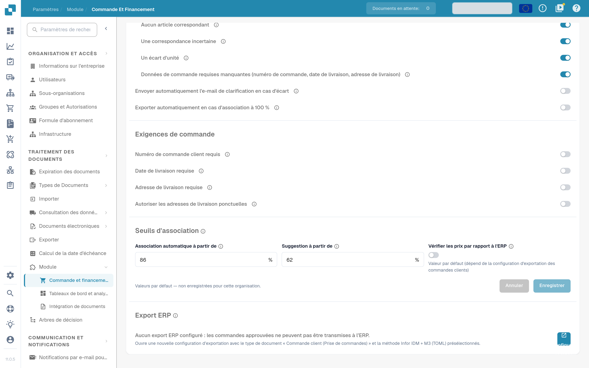<figcaption><p>Paramètres Order Intake sous Settings › Module › Order &#x26; Finance ; à la fin, la section Export ERP, ici sans export ERP.</p></figcaption></figure>

Dans la même section, un administrateur définit le fonctionnement du module :

| Groupe | Paramètre | Effet |
| --- | --- | --- |
| **Automatisation** | **Rédiger automatiquement un e-mail de réponse en cas d'écart** | Activé par défaut : l'agent rédige de lui-même un e-mail de clarification pour les cas cochés ci-dessous. Un employé le vérifie, sauf si l'envoi automatique est activé. |
| | **Rédiger un e-mail de clarification pour les positions avec** … | Les problèmes pour lesquels l'agent rédige une question au client : **Aucun article correspondant**, **Une correspondance incertaine**, **Un écart d'unité**, **Données de commande requises manquantes (numéro de commande, date de livraison, adresse de livraison)**. Une quantité manquante est toujours demandée. |
| | **Envoyer automatiquement l'e-mail de clarification en cas d'écart** | Désactivé (recommandé) : chaque e-mail rédigé attend l'approbation d'un employé. |
| | **Exporter automatiquement en cas d'association à 100 %** | Les commandes dont chaque position est associée exactement ou par un numéro d'article client appris, et où rien d'autre ne manque, sont transmises à l'ERP sans approbation. |
| **Exigences de commande** | **Numéro de commande client requis**, **Date de livraison requise**, **Adresse de livraison requise** | Si l'option est activée, une commande sans cette valeur reçoit un point ouvert et ne peut pas être approuvée tant que la valeur manque. Les trois options sont désactivées par défaut. |
| | **Autoriser les adresses de livraison ponctuelles** | Si l'option est activée, les gestionnaires peuvent saisir une adresse utilisée uniquement pour cette commande (p. ex. un chantier). Si elle est désactivée, seules les adresses des données de base du client sont utilisables. |
| **Seuils d'association** | **Association automatique à partir de** (86 % par défaut), **Suggestion à partir de** (62 % par défaut) | Seuls les numéros d'article exacts et les numéros d'article client appris sont acceptés automatiquement. Les descriptions similaires sont toujours présentées comme suggestions à vérifier. |
| | **Vérifier les prix par rapport à l'ERP** | Compare le prix net du client avec le prix net de l'ERP. Un écart supérieur à la tolérance autorisée demande une décision ; dans tous les cas, c'est l'ERP qui valorise la commande. Par défaut, ce paramètre suit la configuration de l'export ERP. |
| **Export ERP** | *(état uniquement)* | Affiche les configurations d'export du type de document **Commande client (Prise de commandes)** avec lesquelles les commandes approuvées sont transmises à l'ERP, chacune avec **Éditer** ; une configuration inactive est marquée **Inactif**. Une ligne d'avertissement signifie qu'une configuration utilise encore le type de document entrant **Prise de commandes – document entrant** ; elle n'est jamais utilisée. S'il n'y a aucune configuration active, la section indique *Aucun export ERP configuré : les commandes approuvées ne peuvent pas être transmises à l’ERP.* et où le configurer. Les administrateurs configurent l'export dans **Paramètres › Exporter** (voir ci-dessous). |

Les administrateurs peuvent ouvrir ces paramètres depuis n'importe quelle commande avec le bouton en forme de **roue dentée** dans la barre supérieure (*Ouvrir les paramètres de Prise de commandes*).

### Configurer l'export ERP (administrateurs)

Les commandes approuvées ne parviennent à l'ERP (Infor M3) que par une configuration d'export du type de document **Commande client (Prise de commandes)**. Un administrateur la configure une seule fois :

1. Allez dans **Paramètres › Exporter** et cliquez sur **Nouveau**.
2. Saisissez un **Titre de la configuration** et choisissez comme **Type de document** **Commande client (Prise de commandes)**. Il est proposé dès que la Prise de commandes est activée ; il n'est pas nécessaire d'activer le type de document au préalable.
3. Sous **Exporter**, choisissez **Informations** (Infor), et sous **Type d'information**, choisissez **Infor IDM + M3 (TOML)**.
4. Téléversez le **Fichier API ION** (`.ionapi`) et le **Fichier de mappage TOML** (`.toml`) de votre connexion M3.
5. Cliquez sur **Enregistrer**. Une nouvelle configuration est **Actif** ; une seule configuration peut être active par type de document.

La section **Export ERP** des paramètres de la Prise de commandes affiche ensuite la configuration ; **Éditer** l'ouvre, et une configuration inactive est marquée **Inactif**. Une ligne d'avertissement signifie qu'une ancienne configuration utilise encore le type de document entrant **Prise de commandes – document entrant** : elle n'est jamais utilisée ; ouvrez-la avec **Éditer** et changez son type de document en **Commande client (Prise de commandes)**. Les commandes ne sont exportées que depuis la Prise de commandes avec **Approuver et exporter** (ou automatiquement avec **Exporter automatiquement en cas d'association à 100 %**) ; les documents de commande entrants eux-mêmes ne sont jamais exportés.

## Faire entrer une commande

### Par e-mail

Vos clients envoient leurs commandes à la boîte de réception des commandes de votre organisation. L'agent IA lit l'e-mail, identifie les positions et crée la commande dans la liste. Le client est reconnu grâce au **domaine de l'adresse e-mail de l'expéditeur**. Les signatures, mentions légales et anciens messages cités ne sont pas lus comme des positions.

### Importer à partir de texte

Pour une commande qui vous est parvenue autrement (un fax que vous avez saisi, un message de chat, un texte transféré) :

1. Dans la liste de la Prise de commandes, cliquez sur **Importer à partir de texte**.
2. Collez la commande dans **Texte de commande**. Le format libre convient — les retours à la ligne, abréviations et notations raccourcies sont pris en charge.
3. Choisissez le **Client** (recherche par nom, e-mail ou numéro de client). Sans client, la commande s'ouvre avec le point ouvert *Client manquant*.
4. Cliquez sur **Extraire et associer**.

<figure>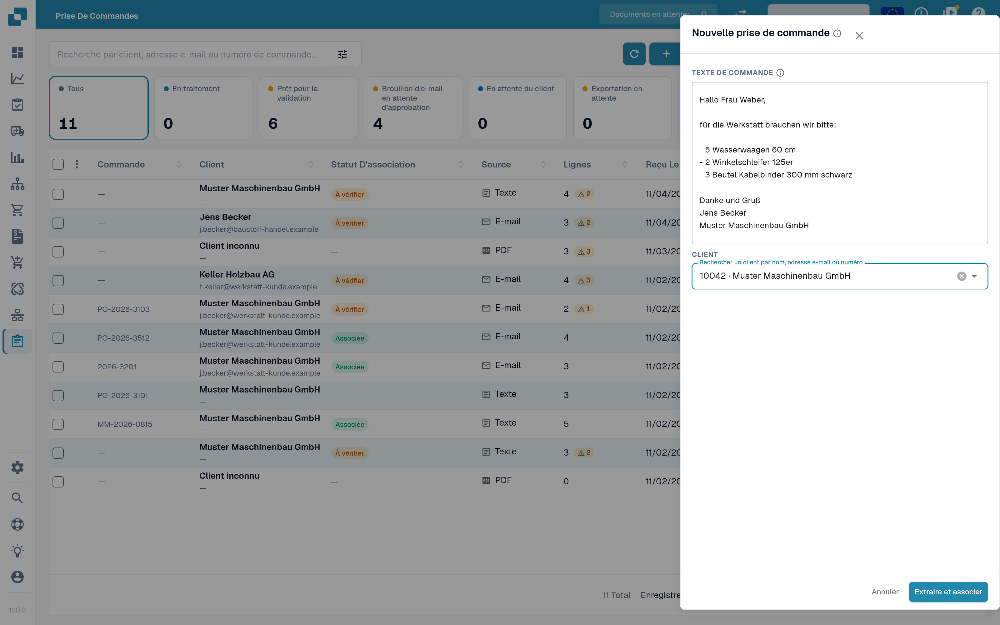<figcaption><p>Collez une commande client et choisissez le client.</p></figcaption></figure>

### Nouvelle commande

**Nouvelle commande** permet de saisir une commande à la main à partir de votre catalogue d'articles : choisissez le client et l'adresse de livraison, ajoutez les articles et les quantités, puis cliquez sur **Approuver et exporter**.

## La liste de la Prise de commandes

Ouvrez **Prise de commandes** dans la barre latérale. La liste affiche chaque commande avec son client, sa source (**E-mail**, **Texte**, **Manuel**), son nombre de positions, sa date de réception, son statut et son statut d'association. Un petit signe d'avertissement à côté du nombre de positions indique combien d'entre elles demandent encore une décision. Cliquez sur une ligne pour ouvrir la commande.

<figure>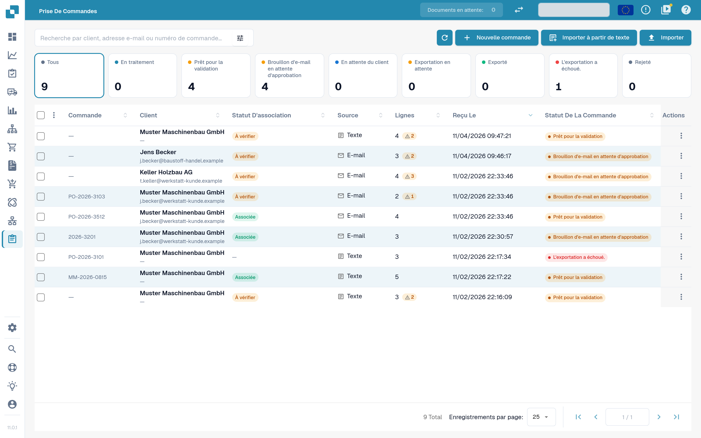<figcaption><p>La liste de la Prise de commandes avec les cartes de statut.</p></figcaption></figure>

Les **cartes de statut** au-dessus de la liste comptent les commandes par statut. Cliquez sur une carte pour n'afficher que ces commandes ; **Tous** affiche tout.

| Statut | Signification |
| --- | --- |
| **En traitement** | La commande est en cours de lecture ou de préparation — rien à faire pour vous pour l'instant. |
| **Prêt pour la validation** | Lue et en attente d'un employé : vérifiez les positions ou approuvez-la. |
| **Brouillon d'e-mail en attente d'approbation** | Un e-mail au client a été rédigé et attend votre approbation. |
| **En attente du client** | Une clarification a été envoyée, la réponse n'est pas encore arrivée. |
| **Exportation en attente** | Approuvée, mais pas encore transmise à l'ERP. |
| **Exporté** | Transmise à l'ERP. |
| **L'exportation a échoué.** | L'ERP a refusé la transmission — réessayez après avoir corrigé la cause. |
| **Rejeté** | Rejetée ou reconnue comme doublon — aucune autre action. |

La colonne **Statut d'association** indique **À vérifier** lorsqu'une position, un champ d'en-tête obligatoire ou l'adresse de livraison demande encore une décision, et **Associée** lorsque tout est résolu.

Pendant que l'agent IA, une réassociation ou une réponse du client traite une commande, son statut affiche **Agent en cours** avec une flèche qui tourne. La commande est verrouillée jusqu'à la fin du traitement ; la liste s'actualise d'elle-même.

**Rechercher et filtrer :** saisissez un client, une adresse e-mail ou un numéro de commande dans le champ de recherche. L'icône de filtre du champ de recherche permet de filtrer par **Source** (*E-mail* ou *Manuel*).

Le menu en fin de ligne propose **Journaux** (chaque étape de l'agent, des utilisateurs et du système, ainsi que l'historique des décisions : qui a confirmé ou modifié quoi) et **Supprimer**.

## Vérifier une nouvelle commande

### L'écran d'association

<figure>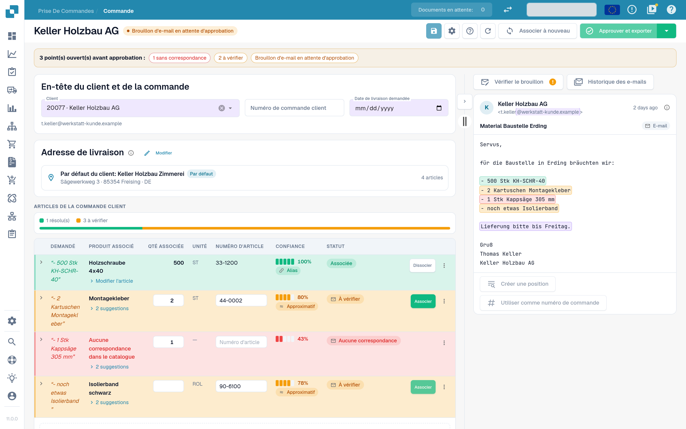<figcaption><p>L'écran d'association : les données de la commande à gauche, l'e-mail du client à droite.</p></figcaption></figure>

* **Barre supérieure** — client, statut, valeur de la commande (uniquement avec les prix ERP) et les actions **Enregistrer**, **Légende**, **Actualiser**, **Associer à nouveau** et **Approuver et exporter**.
* **Points ouverts** — juste sous la barre supérieure : tout ce qui bloque encore l'approbation, p. ex. *Client manquant*, *Numéro de commande manquant*, *2 à vérifier*. Cliquez sur un point pour y accéder.
* **En-tête du client et de la commande** — client, numéro de commande client et date de livraison souhaitée.
* **Adresse de livraison** — l'endroit où la commande est livrée. Si le client a une adresse par défaut, elle est utilisée automatiquement (*Par défaut du client : …* avec la mention **Par défaut**) ; **Modifier** permet de la changer. Les positions peuvent aussi être livrées à des adresses différentes.
* **Positions** — une ligne par article commandé avec le texte du client, l'article associé, la quantité, l'unité et le statut. Au-dessus du tableau, une barre indique combien de positions sont résolues et combien restent à vérifier.
* **Source** (à droite) — l'e-mail du client ou le texte collé. Les positions sont surlignées en vert, orange ou rouge selon leur statut, les adresses de livraison en bleu et les valeurs d'en-tête (client, numéro de commande, date) en violet. Cliquez sur un surlignage pour accéder à la position. La flèche sur le séparateur masque ou affiche l'e-mail ; faites glisser le séparateur pour modifier la largeur. **Historique des e-mails** liste tous les e-mails de cette commande.

La **Légende** (bouton avec un point d'interrogation) explique chaque couleur, chaque statut et chaque méthode d'association.


Aucune modification effectuée sur cet écran n'est conservée tant que vous n'avez pas cliqué sur **Enregistrer** (l'icône de disquette ; un point rouge signale des modifications non enregistrées). Ctrl+S / Cmd+S enregistre également. Si vous quittez la commande avec des modifications non enregistrées, DocBits vous demande s'il faut les enregistrer ou les abandonner.


### Statuts des positions et méthodes d'association

| Statut | Signification |
| --- | --- |
| **Associée** | Associée automatiquement (par un numéro d'article client appris ou par le numéro d'article exact) ou confirmée par un employé. |
| **À vérifier** | Une suggestion existe, mais elle doit être vérifiée. |
| **Aucune correspondance** | Aucun article du fichier articles n'est suffisamment similaire pour être suggéré. |
| **En attente** | Pas encore associée. |
| **Ignoré** | Exclue de l'export. |

| Méthode d'association | Signification |
| --- | --- |
| **Alias** | Le numéro d'article propre à ce client a déjà été rattaché à votre article — passe automatiquement. |
| **Exact** | Le numéro d'article de la commande correspond exactement au fichier articles — passe automatiquement. |
| **Approximatif** | Description similaire uniquement — demande toujours une vérification. |
| **Manuel** | Choisi ou confirmé par un employé. |
| **Clarification** | Repris de la réponse du client. |

Lorsque vous confirmez un article pour un numéro d'article client, DocBits **l'apprend comme alias** pour ce client : la prochaine commande comportant le même numéro est associée automatiquement. Un alias appris peut être supprimé depuis le menu de la position (**Supprimer l'alias appris**).

### Positions à vérifier

1. Cliquez sur la position pour l'ouvrir. **Commandé par le client** affiche la quantité, l'unité, le numéro d'article client et la description tels que le client les a écrits.
2. **Correspondances suggérées** liste les meilleurs articles avec leur numéro d'article, leur unité, leur méthode d'association et leur niveau de confiance.
3. La meilleure suggestion est déjà présélectionnée (**Sélectionné**). Si un autre article est le bon, cliquez sur **Utiliser ceci** sur cet article — ou recherchez-le sous **Ou rechercher dans le catalogue**. Le **x** rouge supprime la sélection.
   Une position doit avoir une **quantité** pour pouvoir être associée : sans quantité, **Utiliser ceci** et **Associer** sont grisés (*Veuillez d'abord indiquer une quantité — une position sans quantité ne peut pas être associée.*). Saisissez d'abord la quantité dans la ligne.
4. Une fenêtre compare ce qui a été commandé avec l'article choisi. Vérifiez-la et cliquez sur **Confirmer la correspondance**.
5. Cliquez sur **Enregistrer**.

<figure>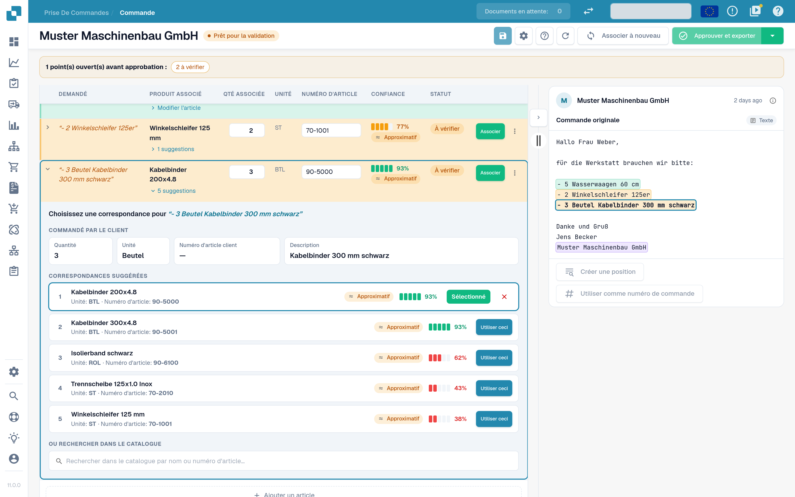<figcaption><p>Une position à vérifier : comparez ce que le client a commandé avec les suggestions.</p></figcaption></figure>

<figure>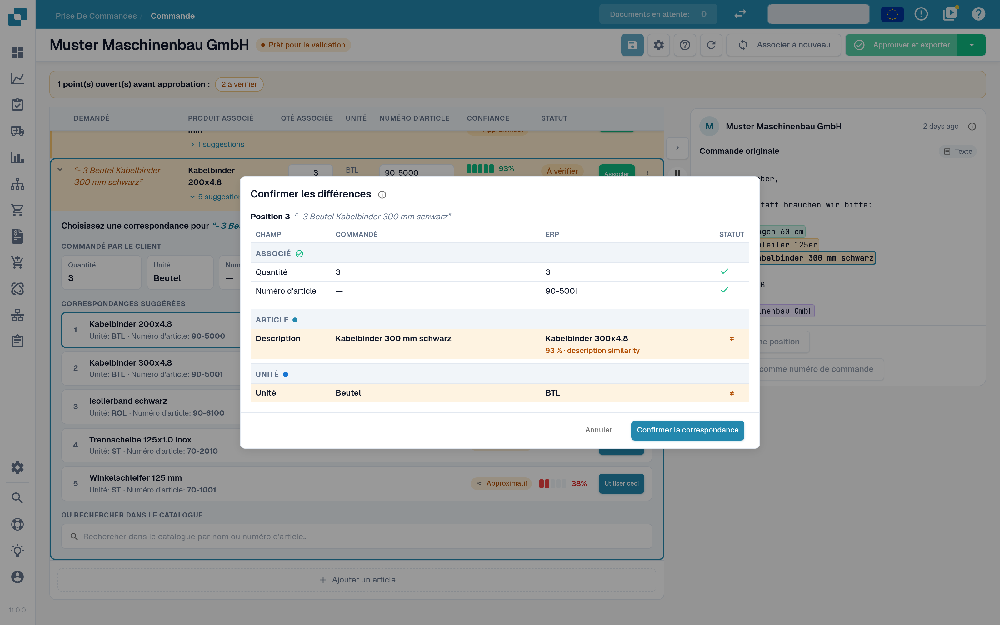<figcaption><p>Confirmer les différences compare ce que le client a commandé avec l'article choisi ; ici, la description et l'unité diffèrent. Le texte « description similarity » n'est pas encore traduit dans le produit.</p></figcaption></figure>

Une position pour laquelle une suggestion est déjà sélectionnée peut être confirmée directement avec **Associer** dans sa ligne. Le menu en fin de ligne propose d'autres actions : **Envoyer un e-mail au client à propos de cette ligne**, **Date de livraison propre…**, **Adresse de livraison propre…**, **Ignorer la ligne** (non exportée) et **Supprimer la ligne**.

### Écarts de quantité et de prix

* **Quantité :** vous pouvez modifier la quantité d'une position. Si elle diffère de ce que le client a commandé, elle s'affiche en orange et doit être confirmée : ouvrez la position, choisissez l'article, et la fenêtre **Confirmer les différences** indique la quantité. Ajoutez une note si vous le souhaitez et cliquez sur **Confirmer**. La commande est exportée avec la quantité confirmée.
* **Prix** (uniquement avec les prix ERP) : si le prix du client s'écarte du prix net ERP de plus que la tolérance autorisée, le prix s'affiche en orange avec la mention *Le prix diffère*. Cliquez sur **Associer** dans la ligne ; la fenêtre affiche les deux prix, l'écart et la tolérance. Cliquez sur **Confirmer** pour accepter le prix ERP, ou interrogez le client (voir [Poser une question au client](#poser-une-question-au-client)). Si le prix du client ressemble à un prix pour 10, 100 ou 1000 unités, la fenêtre propose de définir la base de prix en un clic.

<figure>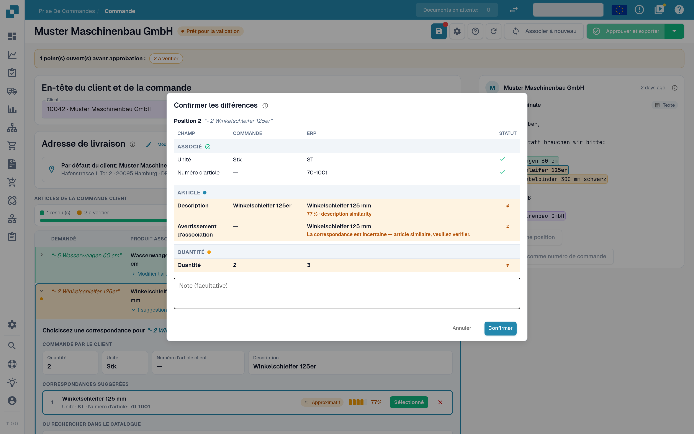<figcaption><p>Une quantité qui diffère de la commande est confirmée avec une note facultative. Le texte « description similarity » n'est pas encore traduit dans le produit.</p></figcaption></figure>

Si l'ERP ne renvoie aucun prix pour une position, celle-ci affiche **Prix ERP non disponible** avec la raison au survol et un bouton **Réessayer**. Cela ne bloque pas la commande.

### Client non reconnu

Si le domaine e-mail de l'expéditeur n'est pas encore connu, la commande affiche le point ouvert **Client manquant**. Choisissez le client dans **En-tête du client et de la commande**. DocBits propose alors de mémoriser le domaine de l'expéditeur :

* **Attribuer un domaine e-mail** — *Les futurs e-mails provenant de @domaine seront automatiquement attribués à ce client.* Cliquez sur **Confirmer** ; l'attribution est enregistrée avec vos autres modifications lorsque vous cliquez sur **Enregistrer**. **Annuler** annule le choix du client.
* Si le domaine appartient déjà à un autre client, choisissez **Conserver …** (les futurs e-mails restent attribués au client actuel, cette commande reçoit quand même le nouveau client) ou **Attribuer à …** (les futurs e-mails sont attribués au nouveau client).

<figure>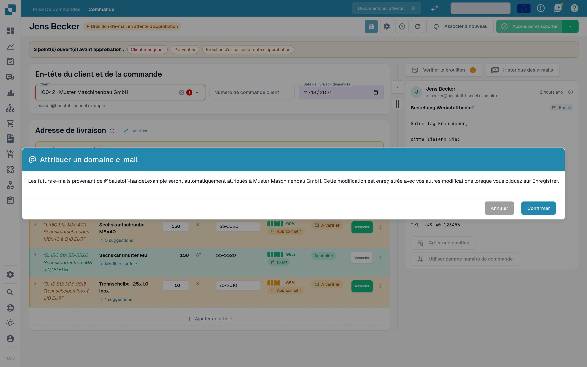<figcaption><p>L'attribution d'un client peut aussi attribuer le domaine e-mail de l'expéditeur.</p></figcaption></figure>

<figure>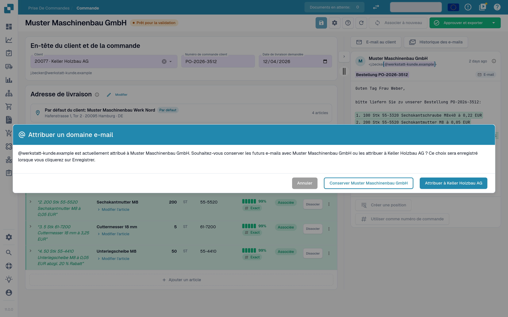<figcaption><p>Le domaine appartient déjà à un autre client : conservez-le ou déplacez-le.</p></figcaption></figure>

Les domaines de messagerie publics (comme gmail.com) ne sont jamais attribués à un client.

### Associer à nouveau

**Associer à nouveau** dans la barre supérieure associe une nouvelle fois toutes les positions ouvertes — par exemple après l'ajout de nouveaux articles au fichier articles ou après un changement de client. Les positions confirmées et ignorées ne sont pas modifiées. Un message indique combien de positions ont été réassociées.

Le bouton est grisé lorsque l'association ne peut rien faire ; survolez-le pour en connaître la raison :

| Info-bulle | Raison |
| --- | --- |
| *Toutes les positions sont déjà associées, confirmées ou ignorées.* | Rien n'est ouvert. |
| *L'association attend pendant que l'agent rédige la clarification.* | Attendez que le brouillon soit prêt. |
| *La commande a déjà été transmise ou clôturée.* | Les commandes approuvées, exportées ou rejetées ne peuvent plus être réassociées. |
| *La commande est encore en cours de lecture.* | Attendez la fin de la lecture. |

La réassociation est également possible pendant qu'une question au client est ouverte : un brouillon non envoyé est conservé (si tout ce qu'il demande est résolu, le brouillon indique *Plus rien à demander*) ; un brouillon approuvé mais non envoyé redevient un brouillon.

## Corriger une position manquée ou erronée

Il arrive que la lecture regroupe deux articles dans une seule position, scinde un article en deux ou manque un article mentionné dans une phrase. Corrigez-le directement dans l'e-mail ou dans le texte collé :

1. **Sélectionnez le texte** de l'article dans le texte de la commande à droite.
2. Cliquez sur **Créer une position** sous le texte.
3. La fenêtre affiche **Avant → Après**. Vérifiez-la et cliquez sur **Confirmer**.
4. Cliquez sur **Enregistrer**. Les nouvelles positions reçoivent de nouveaux numéros, sont associées automatiquement et sont surlignées dans le texte.

Le résultat dépend de ce que vous sélectionnez :

| Vous sélectionnez … | Résultat |
| --- | --- |
| Du texte qui **n'est pas encore une position** | **Nouvelle position** — la sélection devient une nouvelle position. |
| **Une partie d'une position** (p. ex. le deuxième de deux articles sur une même ligne) | **Scission** — la position est supprimée et remplacée par une position par article. |
| **Deux positions voisines ou plus, entièrement** | **Regroupement** — elles deviennent une seule position. |
| Une position **plus d'autre texte** | La position est **remplacée** par le texte sélectionné. |
| Une position **exactement telle qu'elle est** | Rien ne se passe — *Ce texte correspond déjà à la position n.* |

<figure><figcaption><p>Créez une position que la lecture a manquée.</p></figcaption></figure>

<figure>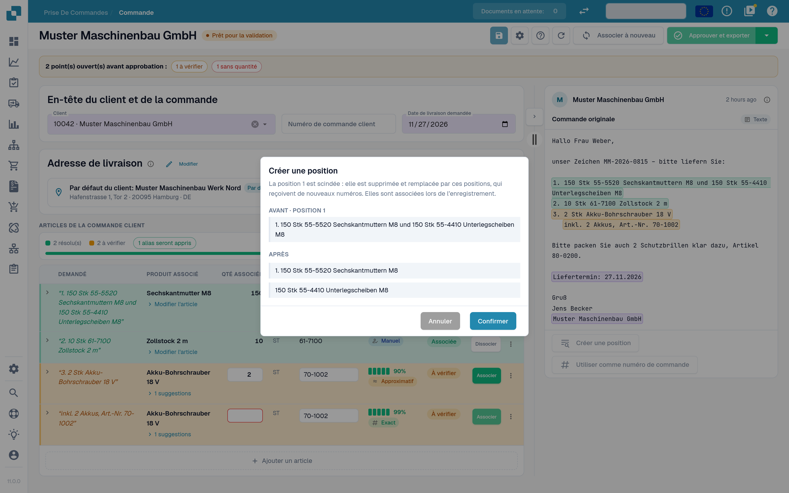<figcaption><p>Scindez une position qui contient deux articles.</p></figcaption></figure>

<figure>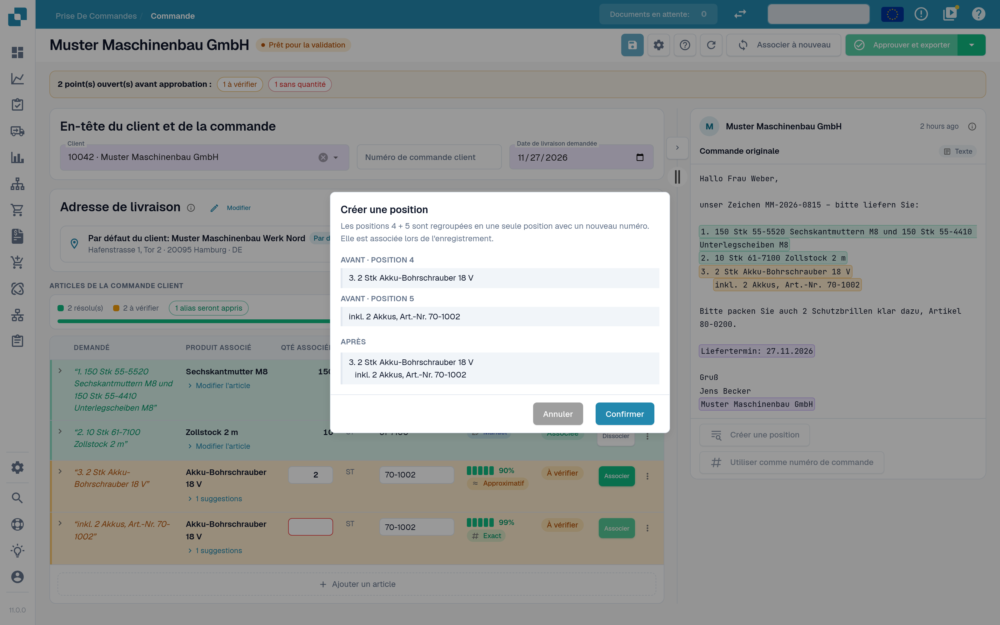<figcaption><p>Regroupez deux positions qui vont ensemble.</p></figcaption></figure>

<figure>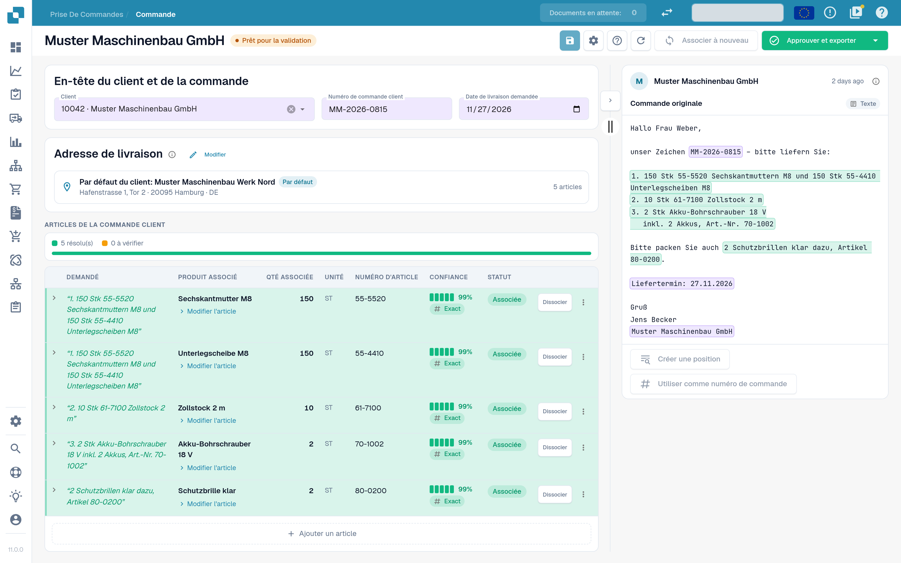<figcaption><p>Après l'enregistrement, les nouvelles positions sont associées et surlignées dans le texte.</p></figcaption></figure>

### Scinder une position déjà décidée

Une position **confirmée** ou **ignorée**, qui a sa **propre adresse de livraison, date ou son propre prix**, qui contient une **réponse du client** ou qui a été **modifiée par un employé** peut tout de même être scindée. Elle est alors **dissoute** : chaque partie devient une nouvelle position, relue et réassociée à partir de son propre texte. Toutes les nouvelles positions conservent l'adresse de livraison et la date de livraison et doivent être vérifiées à nouveau ; les points ouverts de l'ancienne position passent à la première nouvelle position. La fenêtre indique précisément ce qui est perdu avec l'ancienne position, par exemple la confirmation de l'article, une quantité ou un prix ERP acceptés, une réponse du client ou une modification par un employé. L'historique de la commande conserve les anciennes valeurs.

<figure>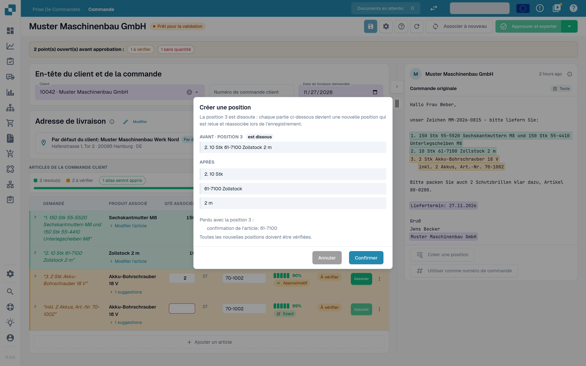<figcaption><p>Scinder une position décidée la dissout ; la fenêtre indique ce qui est perdu.</p></figcaption></figure>

De telles positions ne sont jamais **regroupées**. Une position comportant des **modifications non enregistrées** ne peut pas être scindée : enregistrez ou abandonnez d'abord les modifications.

### Lorsque rien n'est modifié

Si la sélection ne couvre qu'une partie d'une position plus du texte situé en dehors, ou si elle touche plusieurs positions sans les couvrir entièrement, rien n'est modifié et la fenêtre en explique la raison. Sélectionnez du texte à l'intérieur d'une seule position, ou sélectionnez des positions entières pour les regrouper. Si deux positions ont été lues à partir de la même ligne de texte, la fenêtre indique quelle position fait également référence au texte sélectionné ; celle-ci reste inchangée.

Vous pouvez toujours ajouter une position à la main avec **Ajouter un article** sous le tableau des positions, ou modifier les champs d'une position dans le tableau.

## Corriger l'en-tête de la commande

### Numéro de commande à partir du texte

Si le numéro de commande du client n'a pas été reconnu (p. ex. « unser Zeichen MM-2026-0815 » sans libellé), sélectionnez **uniquement le numéro de commande** dans le texte et cliquez sur **Utiliser comme numéro de commande**. Après **Enregistrer**, le numéro figure dans **Numéro de commande client** et est surligné en violet dans le texte, afin que chacun puisse voir d'où il provient.

<figure>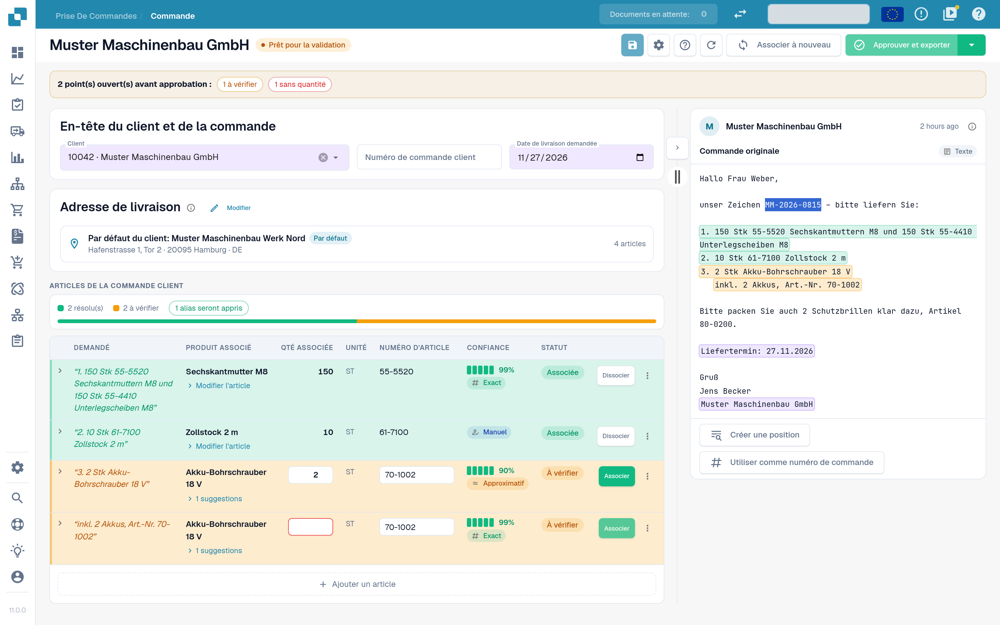<figcaption><p>Marquez le numéro de commande dans le texte.</p></figcaption></figure>

### Numéro de commande à partir de l'objet

De nombreux clients n'indiquent le numéro de commande que dans l'objet (« AW: 4711 »). Vous pouvez également le sélectionner dans l'**objet** de l'e-mail. Dans l'objet, seule l'action **Utiliser comme numéro de commande** est disponible — les positions sont créées à partir du texte de la commande.

Vous pouvez toujours saisir directement le numéro de commande et la date de livraison dans **En-tête du client et de la commande**.

## Poser une question au client

Lorsque seul le client peut répondre — un article inconnu, une quantité ou une unité peu claire, un numéro de commande ou une adresse de livraison manquants, un écart de prix —, envoyez-lui une question par e-mail. Elle part dans le fil de la commande d'origine, et la réponse revient dans la même commande. Cette fonction n'est disponible que pour les **commandes reçues par e-mail**.

### Lancer une question

1. Cliquez sur **E-mail au client** au-dessus de l'e-mail (ou sur **Envoyer un e-mail au client à propos de cette ligne** dans le menu d'une position).
2. Indiquez le motif de votre question sous **Raison** (ou laissez le champ vide et laissez l'assistant décider), vérifiez les **Destinataires** (ajoutez des destinataires en **Cc** si nécessaire) et cochez les positions concernées sous **Lignes de référence**.
3. Choisissez le mode d'envoi :
   * **Envoyer automatiquement** — cliquez sur **Remettre à l'agent**. L'agent IA rédige l'e-mail. Rien n'est envoyé avant qu'un employé ait approuvé le brouillon.
   * **Envoyer manuellement** — rédigez vous-même l'objet et le texte, puis cliquez sur **Envoyer**.

Pendant que l'agent rédige, le bouton au-dessus de l'e-mail affiche **Brouillon en cours** et **Associer à nouveau** est en attente.

Selon les paramètres, l'agent peut aussi rédiger une question de lui-même lorsqu'une commande arrive avec des problèmes.

Tant qu'un brouillon existe, le bouton au-dessus de l'e-mail est **Vérifier le brouillon** au lieu de **E-mail au client**. Une fois la commande complète, **Vérifier le brouillon** reste disponible sans le **!** jaune — vous pouvez toujours envoyer ou abandonner le brouillon. **Approuver et exporter** abandonne un brouillon non envoyé.

### Vérifier et envoyer le brouillon

Lorsque le brouillon est prêt, la commande a le statut **Brouillon d'e-mail en attente d'approbation** et le bouton **Vérifier le brouillon** affiche un **!** jaune. Cliquez dessus pour ouvrir **Clarification avec le client** :

* **Abandonner** — supprime le brouillon ; rien n'est envoyé.
* **Retourner à l'agent** — indiquez à l'agent ce qu'il doit modifier ; il rédige un nouveau brouillon.
* **Modifier** — modifiez vous-même l'objet ou le texte.
* **Approuver et envoyer** — envoie l'e-mail au client.

<figure>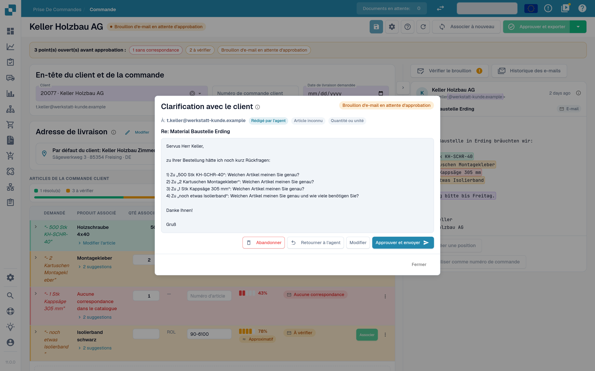<figcaption><p>Le brouillon de l'agent attend votre approbation.</p></figcaption></figure>

### En attente de la réponse

Après l'envoi, la commande est **En attente du client** et le bouton au-dessus de l'e-mail indique **En attente du client**. Lorsque le client répond, l'agent lit la réponse et l'applique à la commande (la commande est brièvement verrouillée avec *Lecture de la réponse du client*) ; la réponse apparaît dans le volet de l'e-mail et dans **Historique des e-mails**. Les positions que vous avez déjà confirmées ne sont pas écrasées — si le client en modifie une, elle est marquée *Modifiée par un e-mail du client* afin que vous la vérifiiez à nouveau.

Si le client a répondu par téléphone ou dans un autre e-mail, ouvrez la clarification et cliquez sur **Clôturer la clarification**. DocBits cesse d'attendre ; une réponse qui arrive plus tard est affichée, mais pas appliquée. **Nouvel e-mail** permet de poser une autre question.

### Si l'envoi échoue

Si un e-mail approuvé n'a pas pu être envoyé, la commande affiche le point ouvert **E-mail non envoyé — renvoyez-le**. Ouvrez la clarification : elle en indique la raison. Cliquez sur **Renvoyer**.

Si l'e-mail de commande n'est pas arrivé par l'une de vos boîtes de réception d'import (par exemple, s'il a été transféré dans DocBits par un autre moyen), aucune boîte de réception ne permet d'y répondre et l'e-mail ne peut pas être envoyé. Configurez une boîte de réception d'import pour cette adresse, ou contactez directement le client et abandonnez le brouillon.

<figure>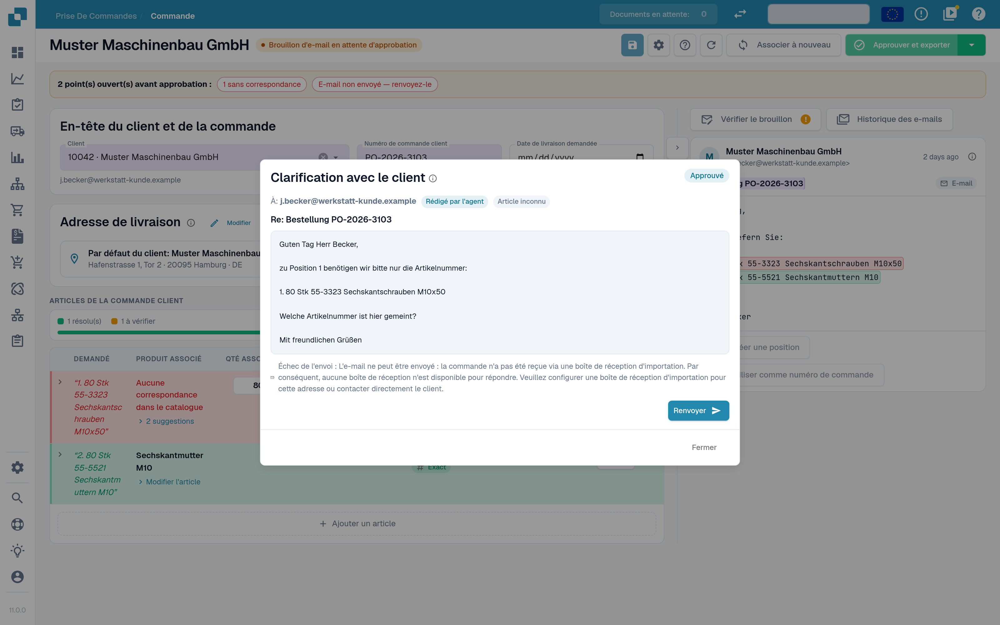<figcaption><p>L'envoi a échoué : la clarification indique la raison (ici : aucune boîte de réception d'import depuis laquelle répondre) et propose Renvoyer.</p></figcaption></figure>

## Approuver et transmettre

**Approuver et exporter** dans la barre supérieure est activé lorsque tous les points ouverts sont résolus : chaque position est associée, confirmée ou ignorée, le client est attribué, et les champs d'en-tête obligatoires ainsi que l'adresse de livraison sont renseignés. Tant qu'il manque quelque chose, survolez le bouton grisé pour afficher la liste.

<figure>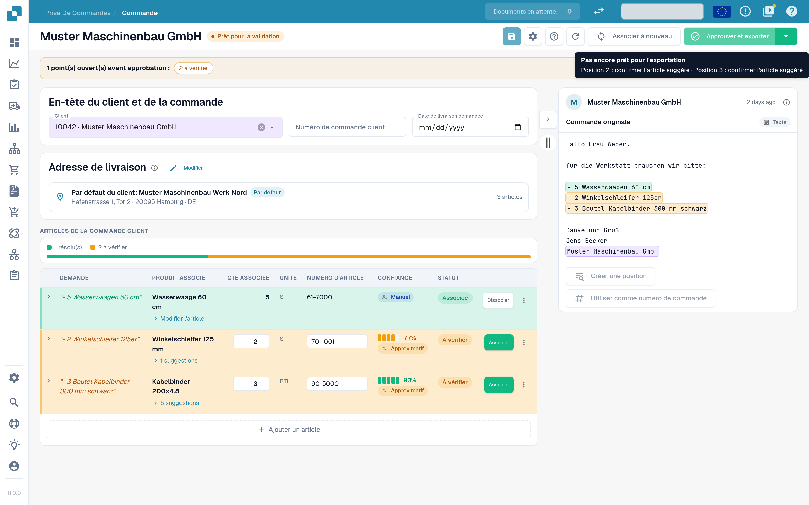<figcaption><p>Approuver et exporter reste désactivé tant que tous les points ouverts ne sont pas résolus ; au survol, une infobulle indique ce qui manque.</p></figcaption></figure>

1. Cliquez sur **Approuver et exporter**.
2. La fenêtre récapitule le client, le nombre de positions, les adresses de livraison (y compris l'adresse par défaut du client) et le numéro de commande client (ainsi que la valeur de la commande, avec les prix ERP). Elle indique aussi ce qu'il advient d'une question ouverte : un brouillon non envoyé est abandonné, une question envoyée est clôturée — *Rien n'est envoyé au client.*
3. Cliquez sur **Approuver et exporter**. La commande client est alors créée dans l'ERP.

<figure>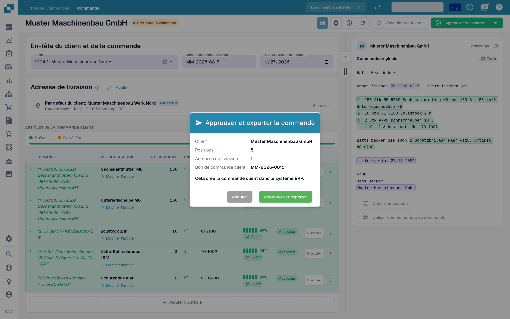<figcaption><p>Dernière vérification avant que la commande ne parte vers l'ERP.</p></figcaption></figure>

La commande est ensuite **Exporté** et affiche le numéro de commande ERP. Si la transmission échoue, le statut est **L'exportation a échoué.** et une bannière rouge en indique la raison dans votre langue — par exemple que l'ERP a refusé la commande, qu'il n'était pas joignable ou qu'aucun export ERP n'est encore configuré (dans ce cas, rien n'est parvenu à l'ERP ; un administrateur le configure dans **Paramètres › Exporter** avec le type de document **Commande client (Prise de commandes)**, voir *Configurer l'export ERP (administrateurs)*). Les administrateurs voient en plus dans la bannière le lien **Ouvrir les paramètres de l’export ERP** ; après une confirmation, il ouvre les paramètres de la Prise de commandes, dont la section **Export ERP** indique l'état actuel. Corrigez la cause et cliquez sur **Réessayer l'exportation**.

<figure>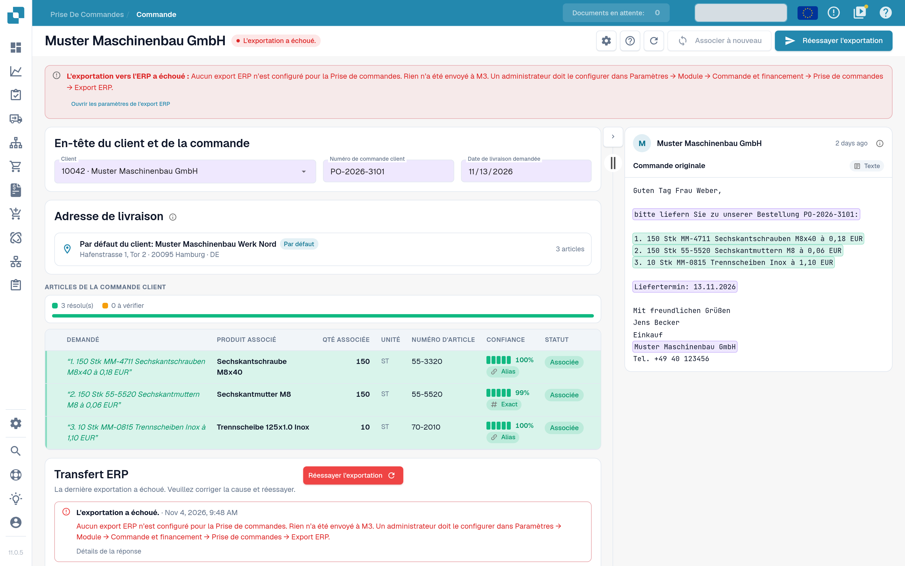<figcaption><p>Si la transmission à l'ERP échoue, la bannière en indique la raison ; ici aucun export ERP n'est configuré et les administrateurs voient le lien Ouvrir les paramètres de l’export ERP. Corrigez la cause et cliquez sur Réessayer l'exportation.</p></figcaption></figure>

### Rejeter une commande

Pour arrêter une commande (p. ex. un doublon ou un message qui n'est pas une vraie commande), ouvrez la flèche à côté de **Approuver et exporter** et cliquez sur **Rejeter**. Ajoutez une raison si vous le souhaitez. Rien n'est transmis à l'ERP.

Si DocBits détecte qu'une commande pourrait être un **doublon** d'une commande antérieure (même client et même numéro de commande, ou positions très similaires), une bannière propose **Rejeter comme doublon**, **Voir les doublons** et **Poursuivre quand même**.
