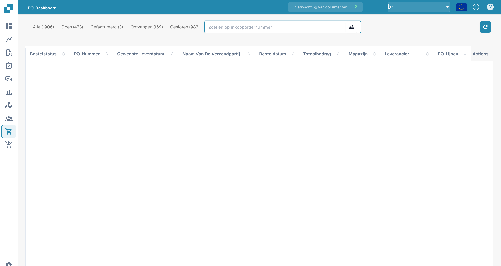

# Dashboard voor inkooporders

Deze sectie biedt een gedetailleerd overzicht van alle aankooporders. Het bevat een zoekbalk met verschillende filters die je kunt selecteren om snel je resultaten te verfijnen. Daarnaast kun je de indeling van de kolomkoppen aanpassen met de slepen-en-neerzetten functionaliteit voor een meer op maat gemaakte kijkervaring.

Kies in de regel van een inkooporder **Acties** (de drie puntjes) en daarna **Weergave** (het oogpictogram) om één inkooporder volledig te bekijken. Welke velden, regels en extra kosten je daar ziet, licht [Inkooporderdetails](purchase-order-detail.md) toe.

<figure><figcaption>
Inkooporderweergave met afgeschermde ordergegevens.
</figcaption></figure>
