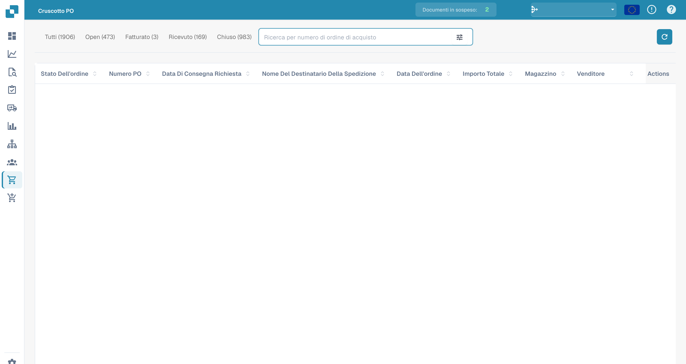

# Ordine di Acquisto

Questa sezione offre una panoramica dettagliata di tutti gli ordini di acquisto. Include una barra di ricerca con vari filtri che puoi selezionare per restringere rapidamente i tuoi risultati. Inoltre, puoi personalizzare l'ordinamento delle intestazioni delle colonne utilizzando la funzionalità di trascinamento per un'esperienza di visualizzazione più personalizzata. Per controllare un singolo ordine di acquisto in dettaglio, apri la pagina [Dettaglio dell'ordine di acquisto](purchase-order-detail.md) con **Azioni** e **Vista** nella riga dell'ordine di acquisto.

<figure><figcaption>
Vista degli ordini di acquisto con i dati degli ordini nascosti.
</figcaption></figure>
