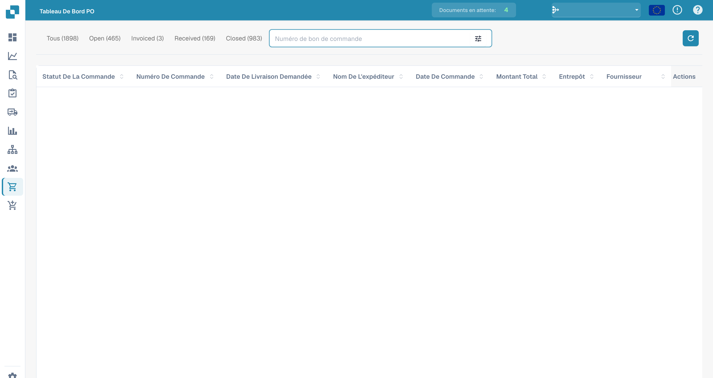

# Bon de commande

Cette section offre un aperçu détaillé de tous les bons de commande. Elle comprend une barre de recherche avec divers filtres que vous pouvez sélectionner pour affiner rapidement vos résultats. De plus, vous pouvez personnaliser l'agencement des en-têtes de colonne en utilisant la fonctionnalité de glisser-déposer pour une expérience de visualisation plus adaptée. Pour consulter un bon de commande en détail, ouvrez la page [Détail du bon de commande](purchase-order-detail.md) avec l'action **Vue** dans la ligne du bon de commande.

<figure><figcaption>
Vue des commandes avec les données de commande masquées.
</figcaption></figure>
