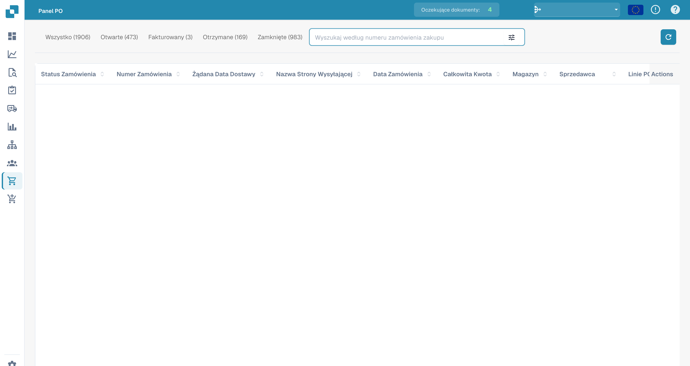

# Zamówienie Zakupu

Ta sekcja oferuje szczegółowy przegląd wszystkich zamówień zakupu. Zawiera pasek wyszukiwania z różnymi filtrami, które możesz wybrać, aby szybko zawęzić wyniki. Dodatkowo możesz dostosować układ nagłówków kolumn, korzystając z funkcji przeciągnij i upuść, aby uzyskać bardziej spersonalizowane doświadczenie przeglądania. Aby przejrzeć pojedyncze zamówienie zakupu, otwórz stronę [Szczegóły zamówienia zakupu](purchase-order-detail.md) za pomocą menu **Akcje → Podgląd** w wierszu zamówienia zakupu.

<figure><figcaption>
Widok zamówień zakupu z ukrytymi danymi zamówień.
</figcaption></figure>
