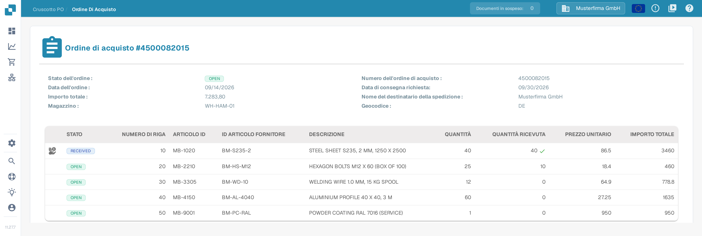
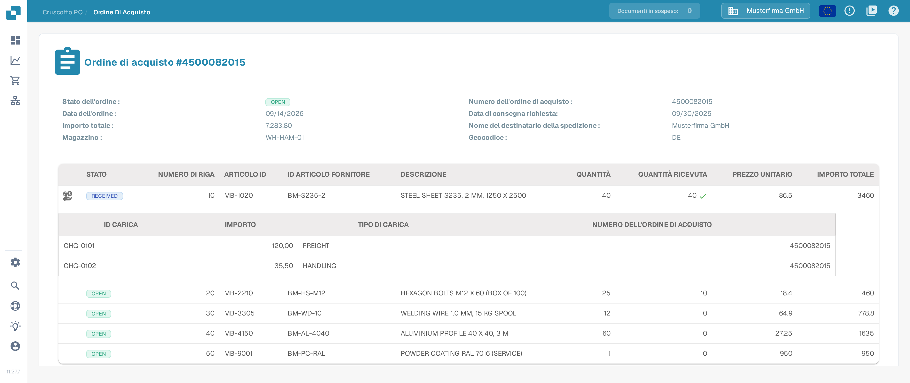

# Dettaglio dell'ordine di acquisto

La pagina Dettaglio dell'ordine di acquisto mostra un singolo ordine di acquisto in modo completo. Consente di controllare i dati dell'ordine, esaminare ogni riga ordinata e vedere il documento originale dell'ordine di acquisto senza aprire un altro sistema.

## Come aprire la pagina Dettaglio dell'ordine di acquisto

1. Apri dal menu principale la [Dashboard degli ordini di acquisto](purchase-order-dashboard.md).
2. Cerca l'ordine di acquisto che vuoi controllare, ad esempio con la barra di ricerca o con i filtri.
3. Nella riga dell'ordine di acquisto apri il menu della colonna **Azioni** (icona con i tre punti) e seleziona **Vista** (icona a forma di occhio).

La pagina Dettaglio dell'ordine di acquisto si apre e mostra il numero dell'ordine di acquisto nel titolo, ad esempio **Ordine di acquisto #4500082015**.

<figure><figcaption>
La pagina Dettaglio dell'ordine di acquisto con i dati dell'ordine in alto e la tabella delle righe in basso. L'icona a sinistra nella prima riga indica che questa riga ha costi aggiuntivi.
</figcaption></figure>

L'immagine sopra mostra l'interfaccia italiana con l'ordine di acquisto sintetico della Sandbox `4500082015`. I numeri di riga, gli ID articolo e gli importi provengono da dati di esempio.

## Dati dell'ordine

La parte superiore della pagina mostra i dati generali dell'ordine di acquisto:

| Campo | Descrizione |
| :-- | :-- |
| **Stato dell'ordine** | Stato attuale dell'ordine di acquisto, ad esempio `OPEN`. |
| **Numero dell'ordine di acquisto** | Il numero univoco dell'ordine di acquisto. |
| **Data dell'ordine** | La data in cui è stato effettuato l'ordine. |
| **Data di consegna richiesta** | La data di consegna richiesta nell'ordine di acquisto. |
| **Importo totale** | Il valore totale dell'ordine di acquisto. |
| **Nome del destinatario della spedizione** | Il destinatario a cui vengono consegnati i beni. |
| **Magazzino** | Il magazzino per cui è ordinata la merce. |
| **Geocodice** | Il codice di località del magazzino. |

## Righe dell'ordine

La tabella sotto i dati dell'ordine elenca una riga per ogni posizione ordinata:

| Colonna | Descrizione |
| :-- | :-- |
| **STATO** | Stato della riga, ad esempio `OPEN`. Un segno di spunta verde accanto alla quantità ricevuta indica che la quantità ordinata è stata ricevuta completamente. |
| **NUMERO DI RIGA** | Numero della riga nell'ordine di acquisto. |
| **ARTICOLO ID** | Numero articolo interno dell'articolo ordinato. |
| **ID ARTICOLO FORNITORE** | Numero articolo usato dal fornitore. |
| **DESCRIZIONE** | Descrizione dell'articolo o del servizio ordinato. |
| **QUANTITÀ** | Quantità ordinata. |
| **QUANTITÀ RICEVUTA** | Quantità ricevuta finora. |
| **PREZZO UNITARIO** | Prezzo per unità. |
| **IMPORTO TOTALE** | Valore totale della riga. |

### Costi aggiuntivi di una riga

Se a una riga sono assegnati costi aggiuntivi (ad esempio spese di trasporto o di movimentazione), nella prima colonna di quella riga compare l'icona dei costi aggiuntivi. Seleziona l'icona per aprire o chiudere una sottotabella con i costi aggiuntivi della riga. La sottotabella mostra **ID CARICA**, **IMPORTO**, **TIPO DI CARICA** e il **NUMERO DELL'ORDINE DI ACQUISTO** a cui appartiene il costo aggiuntivo. Nell'interfaccia italiana i costi aggiuntivi sono indicati con il termine «carica».

<figure><figcaption>
La sottotabella aperta mostra i costi aggiuntivi della prima riga. Nella colonna TIPO DI CARICA compaiono i valori dell'ordine, ad esempio FREIGHT e HANDLING.
</figcaption></figure>

I costi aggiuntivi vengono estratti dal documento dell'ordine di acquisto. Il confronto con i costi aggiuntivi di una fattura è descritto negli [Strumenti di Abbinamento Ordini di Acquisto](purchase-order-matching/purchase-order-matching-tools.md) e in [Confronta i costi totali](../../administration-and-setup/workflow/and/compare-with-purchase-order/compare-total-charges.md).

## Anteprima del documento

Sotto le righe la pagina mostra un'anteprima PDF del documento originale dell'ordine di acquisto, così puoi confrontare in qualsiasi momento i dati estratti con il documento di origine.

## Ordine di acquisto senza righe

Se l'ordine di acquisto non contiene righe, la tabella delle righe mostra **NO DATA FOUND** al posto dei dati. Torna alla [Dashboard degli ordini di acquisto](purchase-order-dashboard.md) e apri un altro ordine di acquisto dall'elenco.

## Pagine correlate

- [Dashboard degli ordini di acquisto](purchase-order-dashboard.md) — trovare e filtrare gli ordini di acquisto.
- [Schermata di Abbinamento Ordini di Acquisto](purchase-order-matching/README.md) — confrontare una fattura con un ordine di acquisto.
