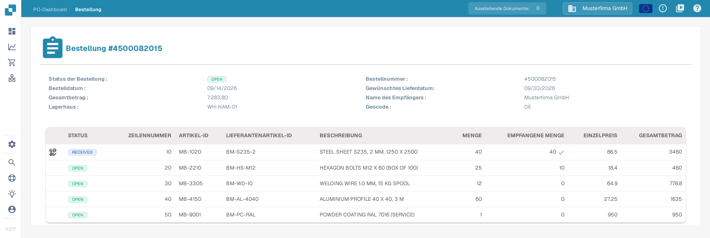
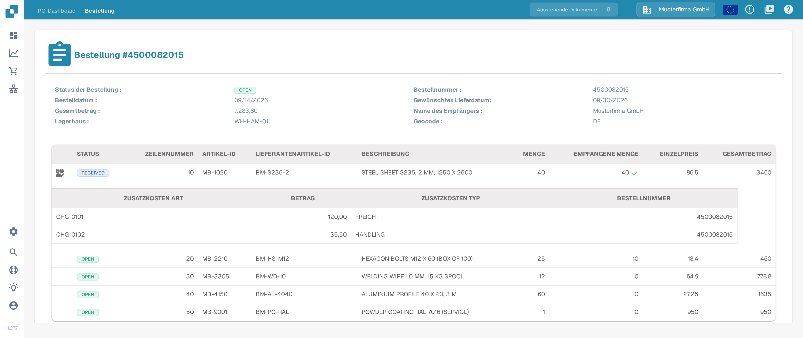

# Bestelldetails

Die Seite Bestelldetails zeigt eine einzelne Bestellung vollständig. Sie prüfen dort die Bestelldaten, jede bestellte Position und das ursprüngliche Bestelldokument, ohne ein anderes System zu öffnen.

## So öffnen Sie die Seite Bestelldetails

1. Öffnen Sie über das Hauptmenü das [Dashboard für Bestellungen](purchase-order-dashboard.md).
2. Suchen Sie die Bestellung, die Sie prüfen möchten, zum Beispiel über die Suchleiste oder die Filter.
3. Wählen Sie in der Zeile der Bestellung **Aktionen** (Dreipunkt-Symbol) und dort **Anzeigen** (Augensymbol).

Die Seite Bestelldetails öffnet sich und zeigt die Bestellnummer in der Überschrift, zum Beispiel **Bestellung #4500082015**.

<figure><figcaption>
Die Seite Bestelldetails mit den Bestelldaten oben und der Positionstabelle darunter. Das Symbol links in der ersten Position zeigt an, dass diese Position Zusatzkosten hat.
</figcaption></figure>

Das Bild oben zeigt die deutsche Oberfläche mit der synthetischen Sandbox-Bestellung `4500082015`. Zeilennummern, Artikel-IDs und Beträge stammen aus Beispieldaten.

## Bestelldaten

Der obere Bereich der Seite zeigt die allgemeinen Daten der Bestellung:

| Feld | Beschreibung |
| :-- | :-- |
| **Status der Bestellung** | Aktueller Status der Bestellung, zum Beispiel `OPEN`. |
| **Bestellnummer** | Die eindeutige Nummer der Bestellung. |
| **Bestelldatum** | Das Datum, an dem die Bestellung aufgegeben wurde. |
| **Gewünschtes Lieferdatum** | Das in der Bestellung gewünschte Lieferdatum. |
| **Gesamtbetrag** | Der Gesamtwert der Bestellung. |
| **Name des Empfängers** | Die Partei, an die die Ware geliefert wird. |
| **Lagerhaus** | Das Lager, für das die Ware bestellt ist. |
| **Geocode** | Der Ortscode des Lagers. |

## Positionen

Die Tabelle unter den Bestelldaten listet jede bestellte Position in einer eigenen Zeile:

| Spalte | Beschreibung |
| :-- | :-- |
| **STATUS** | Status der Position, zum Beispiel `OPEN`. Ein grünes Häkchen neben der empfangenen Menge zeigt, dass die bestellte Menge vollständig eingegangen ist. |
| **ZEILENNUMMER** | Nummer der Position in der Bestellung. |
| **ARTIKEL-ID** | Interne Artikelnummer des bestellten Artikels. |
| **LIEFERANTENARTIKEL-ID** | Artikelnummer, die der Lieferant verwendet. |
| **BESCHREIBUNG** | Beschreibung des bestellten Artikels oder der Leistung. |
| **MENGE** | Bestellte Menge. |
| **EMPFANGENE MENGE** | Bisher eingegangene Menge. |
| **EINZELPREIS** | Preis je Einheit. |
| **GESAMTBETRAG** | Gesamtwert der Position. |

### Zusatzkosten einer Position

Sind einer Position Zusatzkosten zugeordnet (zum Beispiel Fracht oder Bearbeitungsgebühren), erscheint in der ersten Spalte dieser Position ein Symbol für Zusatzkosten. Wählen Sie das Symbol, um eine Untertabelle mit den Zusatzkosten der Position ein- oder auszublenden. Die Untertabelle zeigt **ZUSATZKOSTEN ART**, **BETRAG**, **ZUSATZKOSTEN TYP** und die **BESTELLNUMMER**, zu der die Zusatzkosten gehören.

<figure><figcaption>
Die geöffnete Untertabelle zeigt die Zusatzkosten der ersten Position. In der Spalte Zusatzkosten Typ stehen die Werte der Bestellung, zum Beispiel FREIGHT und HANDLING.
</figcaption></figure>

Zusatzkosten werden aus dem Bestelldokument erfasst. Wie sie mit den Zusatzkosten einer Rechnung verglichen werden, beschreiben die [Bestellnummer-Abgleich-Tools](purchase-order-matching/purchase-order-matching-tools.md) und [Vergleichen Sie die Gesamtgebühren](../../administration-and-setup/workflow/and/compare-with-purchase-order/compare-total-charges.md).

## Dokumentvorschau

Unterhalb der Positionen zeigt die Seite eine PDF-Vorschau des ursprünglichen Bestelldokuments. So können Sie die erfassten Daten jederzeit mit der Vorlage vergleichen.

## Bestellung nicht gefunden

Existiert die Bestellnummer aus der Adresse der Seite nicht in Ihrer Organisation, zeigt die Seite **NO DATA FOUND** statt der Bestelldaten. Kehren Sie zum [Dashboard für Bestellungen](purchase-order-dashboard.md) zurück und öffnen Sie eine Bestellung aus der Liste.

## Verwandte Seiten

- [Dashboard für Bestellungen](purchase-order-dashboard.md) — Bestellungen suchen und filtern.
- [Bildschirm für den Bestellabgleich](purchase-order-matching/README.md) — eine Rechnung mit einer Bestellung abgleichen.
