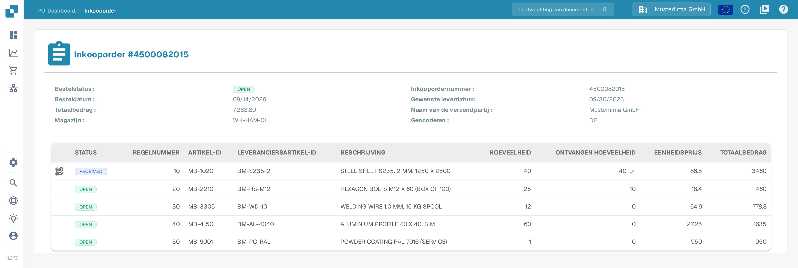
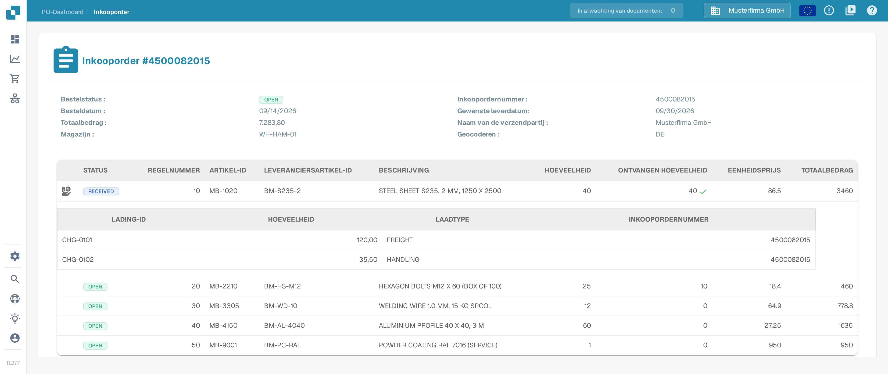

# Inkooporderdetails

De pagina Inkooporderdetails geeft je een volledig beeld van één inkooporder. Je controleert er de ordergegevens, je bekijkt elke bestelde regel en je ziet het oorspronkelijke inkooporderdocument, zonder een ander systeem te openen.

## De pagina Inkooporderdetails openen

1. Kies in het hoofdmenu **Inkooporder** om het [Dashboard voor inkooporders](purchase-order-dashboard.md) te openen.
2. Zoek de inkooporder die je wilt bekijken, bijvoorbeeld met de zoekbalk of de filters.
3. Kies in de regel van de inkooporder **Acties** (de drie puntjes) en daarna **Weergave** (het oogpictogram).

De pagina Inkooporderdetails opent en toont het inkoopordernummer in de kop, bijvoorbeeld **Inkooporder #4500082015**.

<figure><figcaption>
Pagina Inkooporderdetails in het Nederlands met de ordergegevens en de regeltabel van inkooporder 4500082015.
</figcaption></figure>

Het beeld hierboven toont de Nederlandse interface met de synthetische sandbox-inkooporder `4500082015`. Ordernummers, artikel-ID's en bedragen zijn voorbeeldgegevens. Het pictogram links in de eerste regel betekent dat er extra kosten aan die regel zijn toegewezen; bij een regel zonder dit pictogram zijn er geen extra kosten vastgelegd.

## Ordergegevens

Het bovenste deel van de pagina toont de algemene gegevens van de inkooporder:

| Veld | Beschrijving |
| :-- | :-- |
| **Bestelstatus** | Huidige status van de inkooporder, bijvoorbeeld `OPEN`. |
| **Inkoopordernummer** | Het unieke nummer van de inkooporder. |
| **Besteldatum** | De datum waarop de order is geplaatst. |
| **Gewenste leverdatum** | De leverdatum die in de inkooporder is gevraagd. |
| **Totaalbedrag** | De totale waarde van de inkooporder. |
| **Naam van de verzendpartij** | De partij waar de goederen naartoe gaan. |
| **Magazijn** | Het magazijn waarvoor de goederen besteld zijn. |
| **Geocoderen** | De locatiecode van het magazijn. |

## Regels

De tabel onder de ordergegevens bevat één rij per bestelde regel:

| Kolom | Beschrijving |
| :-- | :-- |
| **STATUS** | Status van de regel, bijvoorbeeld `OPEN`. Een groen vinkje naast de ontvangen hoeveelheid betekent dat de volledige bestelde hoeveelheid is ontvangen. |
| **REGELNUMMER** | Nummer van de regel binnen de inkooporder. |
| **ARTIKEL-ID** | Intern artikelnummer van het bestelde artikel. |
| **LEVERANCIERSARTIKEL-ID** | Artikelnummer dat de leverancier gebruikt. |
| **BESCHRIJVING** | Beschrijving van het bestelde artikel of de dienst. |
| **HOEVEELHEID** | Bestelde hoeveelheid. |
| **ONTVANGEN HOEVEELHEID** | Tot nu toe ontvangen hoeveelheid. |
| **EENHEIDSPRIJS** | Prijs per eenheid. |
| **TOTAALBEDRAG** | Totale waarde van de regel. |

### Extra kosten van een regel

Zijn er extra kosten (bijvoorbeeld vracht- of behandelingskosten) aan een regel toegewezen, dan staat in de eerste kolom van die regel een pictogram voor extra kosten. Kies het pictogram om de bijbehorende subtablet te openen of weer te verbergen. De subtablet toont het **Lading-ID**, de **Hoeveelheid** (in deze subtablet het bedrag van de kosten), het **Laadtype** en het **Inkoopordernummer** waar de kosten bij horen.

<figure><figcaption>
Uitgeklapte subtablet met de extra kosten van de eerste regel: lading-ID CHG-0101 met 120,00 en laadtype FREIGHT, lading-ID CHG-0102 met 35,50 en laadtype HANDLING.
</figcaption></figure>

Extra kosten worden uit het inkooporderdocument geëxtraheerd. Hoe je ze met de kosten van een factuur vergelijkt, lees je in de [Inkooporder Matching Tools](purchase-order-matching/purchase-order-matching-tools.md) en in [Vergelijk totale kosten](../../administration-and-setup/workflow/and/compare-with-purchase-order/compare-total-charges.md).

## Documentvoorbeeld

Onder de regels toont de pagina een PDF-voorbeeld van het oorspronkelijke inkooporderdocument. Zo vergelijk je de geëxtraheerde gegevens altijd met de bron.

## Inkooporder zonder regels

Heeft een inkooporder geen regels, dan staat in de regeltabel **GEEN GEGEVENS GEVONDEN** in plaats van regels. Ga terug naar het [Dashboard voor inkooporders](purchase-order-dashboard.md) en open een andere inkooporder uit de lijst.

## Gerelateerde pagina's

- [Dashboard voor inkooporders](purchase-order-dashboard.md) — inkooporders zoeken en filteren.
- [Inkooporder Matching Scherm](purchase-order-matching/README.md) — een factuur met een inkooporder vergelijken.
