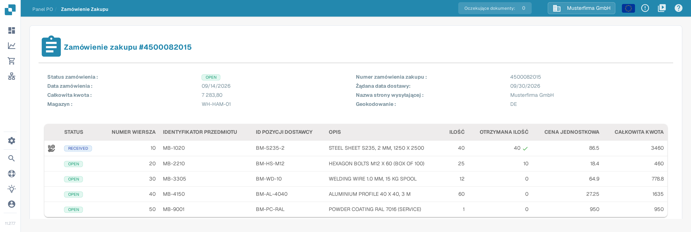
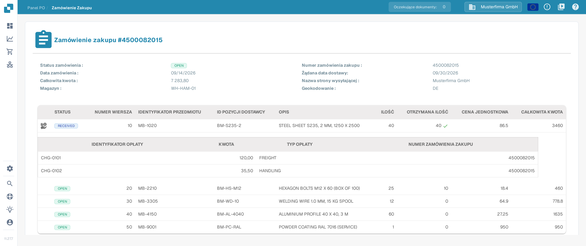

# Szczegóły zamówienia zakupu

Strona Szczegóły zamówienia zakupu pokazuje pełny widok pojedynczego zamówienia zakupu. Możesz na niej sprawdzić dane zamówienia, przejrzeć każdą zamówioną pozycję i zobaczyć oryginalny dokument zamówienia bez otwierania innego systemu.

## Jak otworzyć stronę Szczegóły zamówienia zakupu

1. W menu głównym wybierz **Zamówienie Zakupu**, aby otworzyć [Panel PO](purchase-order-dashboard.md).
2. Znajdź zamówienie zakupu, które chcesz sprawdzić, na przykład za pomocą paska wyszukiwania lub filtrów.
3. W wierszu zamówienia wybierz menu **Akcje** (ikona trzech kropek), a następnie **Podgląd** (ikona oka).

Strona Szczegóły zamówienia zakupu otwiera się i pokazuje numer zamówienia w nagłówku, na przykład **Zamówienie zakupu #4500082015**.

<figure><figcaption>
Strona Szczegóły zamówienia zakupu w polskim interfejsie z danymi zamówienia i tabelą pozycji zamówienia zakupu 4500082015.
</figcaption></figure>

Obraz powyżej pokazuje polski interfejs z przykładowym zamówieniem zakupu `4500082015`. Ikona opłat w wierszu pozycji jest widoczna tylko wtedy, gdy pozycja ma dodatkowe opłaty; w tym przykładzie pierwsza pozycja ma opłaty, dlatego jej ikona opłat jest widoczna.

## Dane zamówienia

Górna część strony pokazuje ogólne dane zamówienia zakupu:

| Pole | Opis |
| :-- | :-- |
| **Status zamówienia** | Bieżący status zamówienia zakupu, na przykład `OPEN`. |
| **Numer zamówienia zakupu** | Unikalny numer zamówienia zakupu. |
| **Data zamówienia** | Data złożenia zamówienia. |
| **Żądana data dostawy** | Data dostawy żądana w zamówieniu zakupu. |
| **Całkowita kwota** | Łączna wartość zamówienia zakupu. |
| **Nazwa strony wysyłającej** | Strona, do której wysyłane są towary. |
| **Magazyn** | Magazyn, dla którego zamówiono towary. |
| **Geokodowanie** | Kod lokalizacji magazynu. |

## Pozycje zamówienia

Tabela poniżej danych zamówienia zawiera jeden wiersz dla każdej zamówionej pozycji:

| Kolumna | Opis |
| :-- | :-- |
| **STATUS** | Status pozycji, na przykład `OPEN`. Zielony znacznik obok otrzymanej ilości pokazuje, że odebrano pełną zamówioną ilość. |
| **NUMER WIERSZA** | Numer pozycji w zamówieniu zakupu. |
| **IDENTYFIKATOR PRZEDMIOTU** | Wewnętrzny numer artykułu zamówionego towaru. |
| **ID POZYCJI DOSTAWCY** | Numer artykułu używany przez dostawcę. |
| **OPIS** | Opis zamówionego artykułu lub usługi. |
| **ILOŚĆ** | Zamówiona ilość. |
| **OTRZYMANA ILOŚĆ** | Ilość otrzymana do tej pory. |
| **CENA JEDNOSTKOWA** | Cena za jednostkę. |
| **CAŁKOWITA KWOTA** | Łączna wartość pozycji. |

### Opłaty pozycji

Jeśli do pozycji są rozdzielone dodatkowe opłaty (na przykład fracht lub opłaty manipulacyjne), w pierwszej kolumnie tej pozycji pojawia się ikona opłat. Wybierz ikonę, aby otworzyć lub ukryć podtabelę z opłatami pozycji. Podtabela pokazuje **IDENTYFIKATOR OPŁATY**, **KWOTA**, **TYP OPŁATY** oraz **NUMER ZAMÓWIENIA ZAKUPU**, do którego należy opłata.

<figure><figcaption>
Podtabela opłat otwarta w pierwszej pozycji zamówienia zakupu 4500082015.
</figcaption></figure>

Opłaty są odczytywane z dokumentu zamówienia zakupu. Sposób ich porównywania z opłatami na fakturze opisują strony [Narzędzia dopasowywania zamówień zakupu](purchase-order-matching/purchase-order-matching-tools.md) oraz [Porównaj całkowite opłaty](../../administration-and-setup/workflow/and/compare-with-purchase-order/compare-total-charges.md).

## Podgląd dokumentu

Poniżej pozycji zamówienia strona pokazuje podgląd PDF oryginalnego dokumentu zamówienia zakupu, dzięki czemu w każdej chwili możesz porównać odczytane dane ze źródłem.

## Gdy brakuje pozycji zamówienia

Jeśli dla zamówienia zakupu nie ma żadnych pozycji, tabela pod nagłówkami kolumn pokazuje tylko jeden komunikat zamiast wierszy pozycji. Sprawdź wtedy, czy zamówienie zostało zaimportowane w całości, i otwórz je ponownie z [Panelu PO](purchase-order-dashboard.md).

## Powiązane strony

- [Panel PO](purchase-order-dashboard.md) — wyszukiwanie i filtrowanie zamówień zakupu.
- [Ekran dopasowywania zamówień zakupu](purchase-order-matching/README.md) — porównanie faktury z zamówieniem zakupu.
