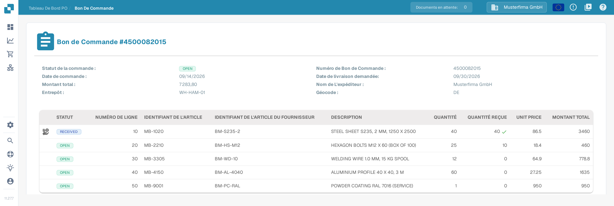
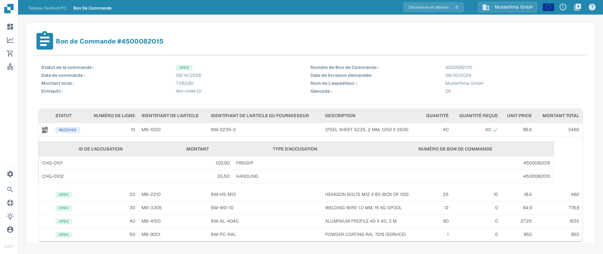

# Détail du bon de commande

La page Détail du bon de commande présente un bon de commande complet. Vous y vérifiez les données du bon de commande, chaque ligne commandée et le document d'origine, sans ouvrir un autre système.

## Comment ouvrir la page Détail du bon de commande

1. Dans le menu principal, sélectionnez **Bon De Commande** pour ouvrir le [tableau de bord des bons de commande](purchase-order-dashboard.md).
2. Recherchez le bon de commande à consulter, par exemple avec la barre de recherche ou les filtres.
3. Dans la ligne du bon de commande, ouvrez le menu d'actions (icône à trois points) et sélectionnez **Vue** (icône en forme d'œil).

La page Détail du bon de commande s'ouvre et affiche le numéro du bon de commande dans le titre, par exemple **Bon De Commande #4500082015**.

<figure><figcaption>
La page Détail du bon de commande avec les données de commande en haut et le tableau des lignes en dessous. L'icône à gauche de la première ligne signale que cette ligne comporte des frais supplémentaires.
</figcaption></figure>

L'image ci-dessus montre l'interface française avec le bon de commande synthétique `4500082015` de la Sandbox. Les numéros de ligne, les identifiants d'article et les montants proviennent de données d'exemple.

## Données du bon de commande

La partie supérieure de la page affiche les données générales du bon de commande :

| Champ | Description |
| :-- | :-- |
| **Statut de la commande** | Statut actuel du bon de commande, par exemple `OPEN`. |
| **Numéro de Bon de Commande** | Le numéro unique du bon de commande. |
| **Date de commande** | La date à laquelle le bon de commande a été émis. |
| **Date de livraison demandée** | La date de livraison souhaitée dans le bon de commande. |
| **Montant total** | La valeur totale du bon de commande. |
| **Nom de L'expéditeur** | La partie à laquelle la marchandise est livrée, c'est-à-dire le destinataire. |
| **Entrepôt** | L'entrepôt pour lequel la marchandise est commandée. |
| **Géocode** | Le code de localisation de l'entrepôt. |

## Lignes du bon de commande

Le tableau sous les données de commande présente une ligne par article commandé :

| Colonne | Description |
| :-- | :-- |
| **STATUT** | Statut de la ligne, par exemple `OPEN`. Une coche verte à côté de la quantité reçue indique que la quantité commandée a été entièrement reçue. |
| **NUMÉRO DE LIGNE** | Numéro de la ligne dans le bon de commande. |
| **IDENTIFIANT DE L'ARTICLE** | Numéro d'article interne de l'article commandé. |
| **IDENTIFIANT DE L'ARTICLE DU FOURNISSEUR** | Numéro d'article utilisé par le fournisseur. |
| **DESCRIPTION** | Description de l'article ou de la prestation commandée. |
| **QUANTITÉ** | Quantité commandée. |
| **QUANTITÉ REÇUE** | Quantité reçue jusqu'à présent. |
| **UNIT PRICE** | Prix par unité. L'interface française affiche cette colonne en anglais. |
| **MONTANT TOTAL** | Valeur totale de la ligne. |

### Frais supplémentaires d'une ligne

Lorsque des frais supplémentaires (par exemple des frais de transport ou de manutention) sont répartis sur une ligne, une icône de frais apparaît dans la première colonne de cette ligne. Sélectionnez l'icône pour afficher ou masquer une sous-table avec les frais de la ligne. La sous-table affiche **ID DE L'ACCUSATION**, **MONTANT**, **TYPE D'ACCUSATION** et le **NUMÉRO DE BON DE COMMANDE** auquel les frais appartiennent. L'interface française appelle ces frais « accusation » ; il s'agit des frais supplémentaires de la ligne.

<figure><figcaption>
La sous-table ouverte montre les frais de la première ligne. La colonne TYPE D'ACCUSATION contient les valeurs du bon de commande, par exemple FREIGHT et HANDLING.
</figcaption></figure>

Les frais supplémentaires sont extraits du document du bon de commande. La comparaison avec les frais d'une facture est décrite dans les [Outils de Correspondance de Bon de Commande](purchase-order-matching/purchase-order-matching-tools.md) et dans [Comparer les frais totaux](../../administration-and-setup/workflow/and/compare-with-purchase-order/compare-total-charges.md).

## Aperçu du document

Sous les lignes, la page affiche un aperçu PDF du document d'origine du bon de commande. Vous pouvez ainsi comparer à tout moment les données extraites avec le document source.

## Bon de commande introuvable

Si le numéro du bon de commande présent dans l'adresse de la page n'existe pas dans votre organisation, la page n'affiche aucune donnée de commande. Revenez au [tableau de bord des bons de commande](purchase-order-dashboard.md) et ouvrez un bon de commande de la liste.

## Pages liées

- [Tableau de bord des bons de commande](purchase-order-dashboard.md) — rechercher et filtrer les bons de commande.
- [Écran de Correspondance des Bons de Commande](purchase-order-matching/README.md) — comparer une facture avec un bon de commande.
